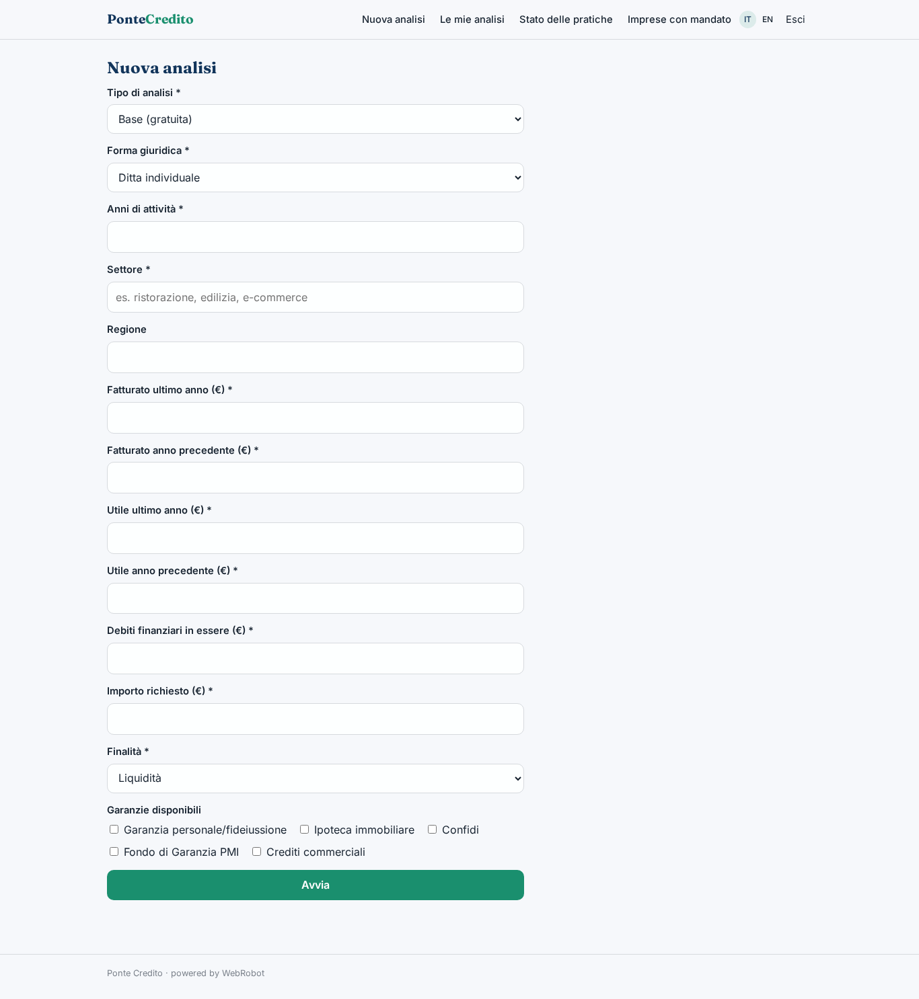
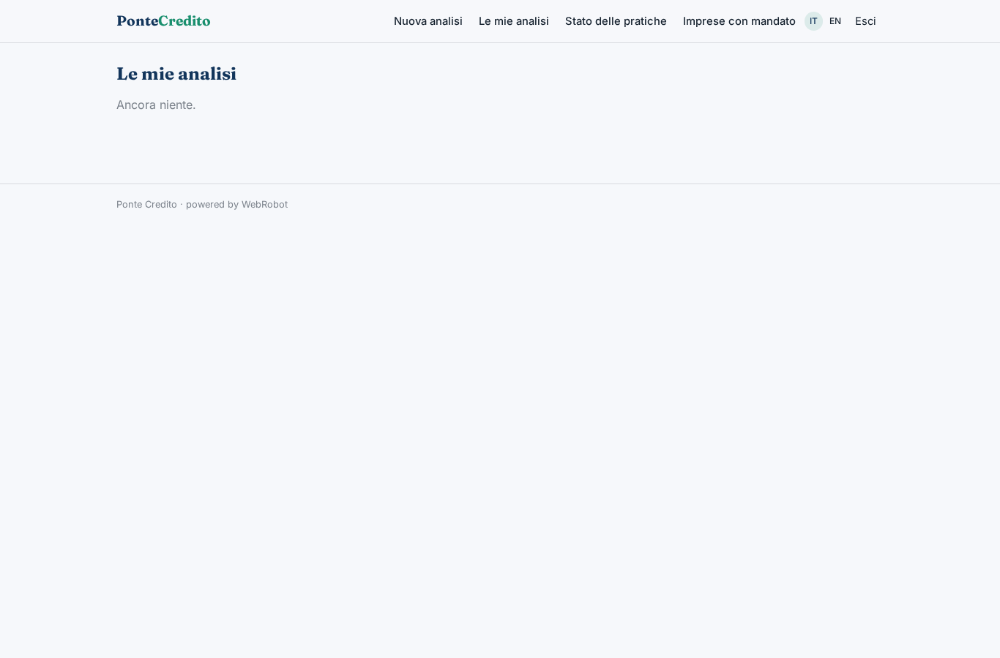
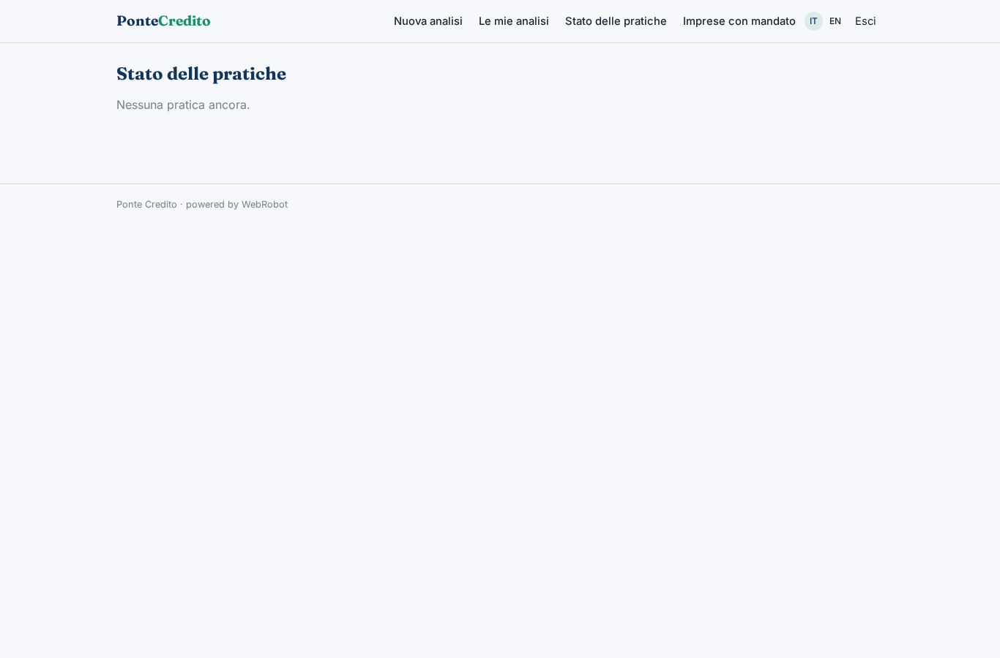
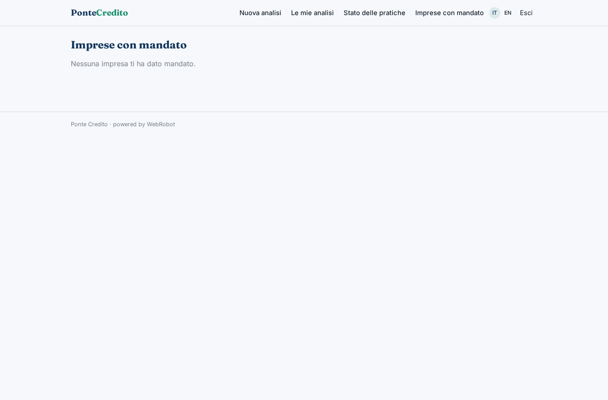
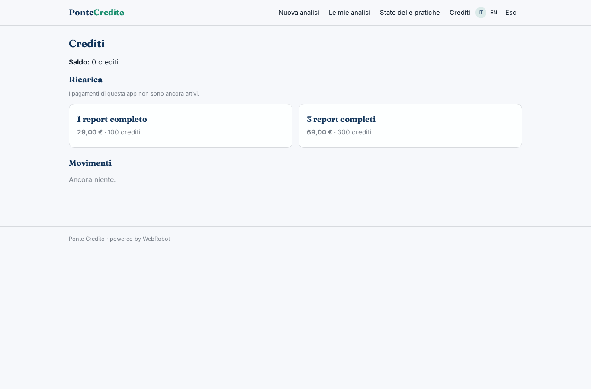

# Ponte Credito

_Scopri a quale credito puoi accedere e preparati._

**Manifest status:** valid (schema validator + runtime contract)

## Description given to the app builder (Italian)

Voglio Ponte Credito, un'app che aiuta le piccole imprese a capire a quale credito possono accedere e a prepararsi. L'imprenditore si registra e compila un modulo: forma giuridica, anni di attività, settore, fatturato e utile degli ultimi due anni, debiti in essere, importo richiesto, finalità (liquidità, investimento, anticipo fatture) e garanzie disponibili. Un agente calcola indicatori di sostenibilità del debito e un punteggio di bancabilità, cerca sul web le offerte pubbliche dei finanziatori (banche, piattaforme di lending, fondo di garanzia, misure regionali) e confronta condizioni, tassi indicativi e requisiti, producendo un report con le opzioni più adatte e la documentazione da preparare. Vorremmo leggere direttamente i movimenti bancari collegando i conti con l'open banking, e inoltrare la pratica ai finanziatori tramite un mediatore creditizio iscritto all'OAM che rivede tutto. L'imprenditore vede il proprio report e lo stato delle pratiche; il mediatore vede le imprese che gli hanno dato mandato. Analisi base gratuita, report completo a pagamento una tantum, commissione del mediatore solo a finanziamento ottenuto.

## Features not expressible today (spec.extensions)

- **open_banking**: Reading bank movements by linking accounts through open banking (PSD2 AISP) is not available yet: it needs each customer's bank consent and a licensed provider. For now the form takes declared figures.
- **broker_forwarding**: Mandate signing, forwarding the practice to lenders through the OAM-registered broker, and the broker's review workflow are not available yet. Today the broker sees the practices shared with them (viewer sharing) and status is updated manually; the broker role is assigned by invitation.
- **success_fee**: The broker's fee only on funded loans is agreed and invoiced outside the app: the platform cannot yet collect a commission upon a funding event.
- **notifications**: Emails to the entrepreneur or the broker when a report is ready or a practice changes status are not available yet.
- **file_upload**: Uploading balance sheets or documents is not available yet: figures are typed in the form.

## Screenshots (interpretive runtime)

### home-anon

### home-mobile

### home

### new

### analyses

### my_practices

### broker_desk

### account

