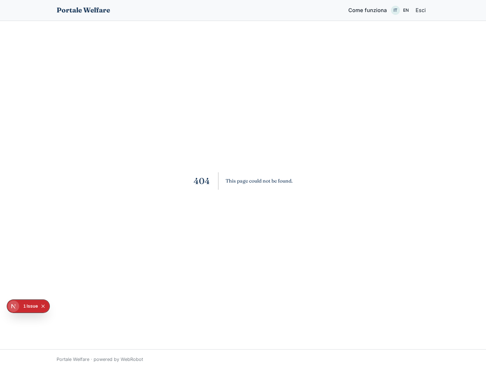
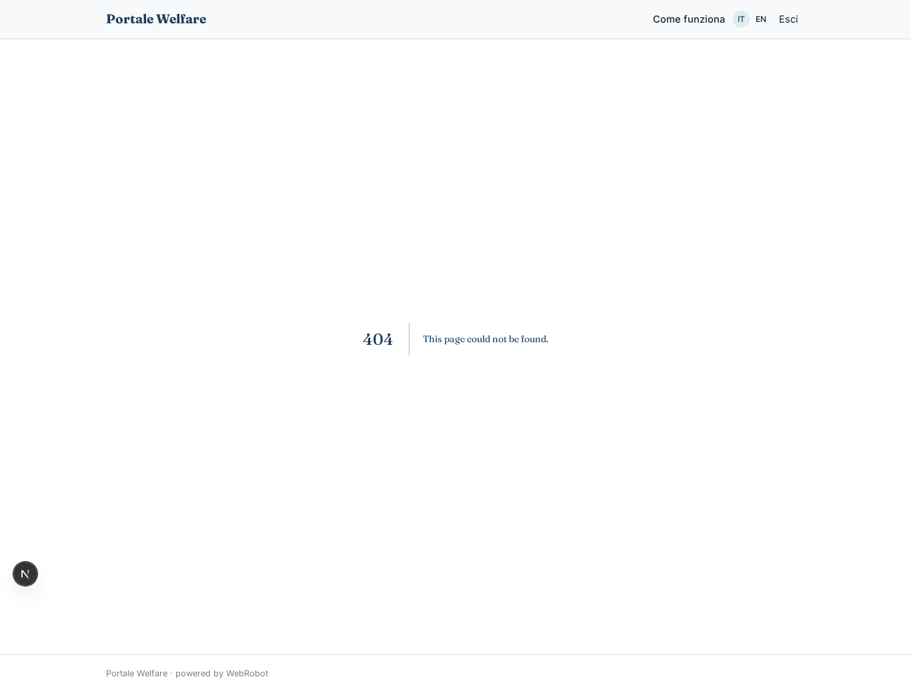
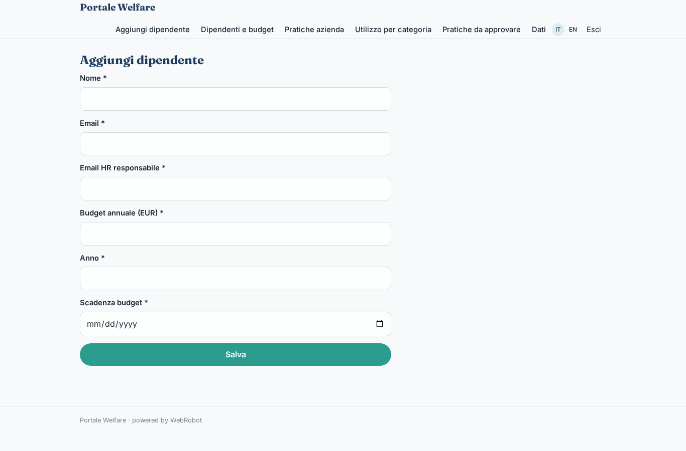
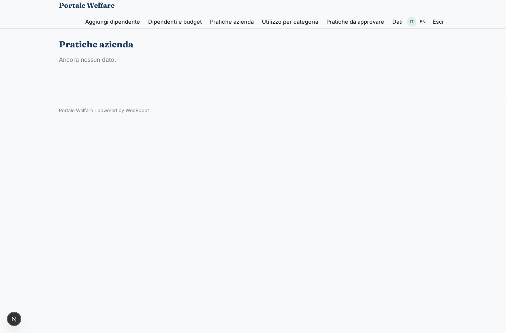
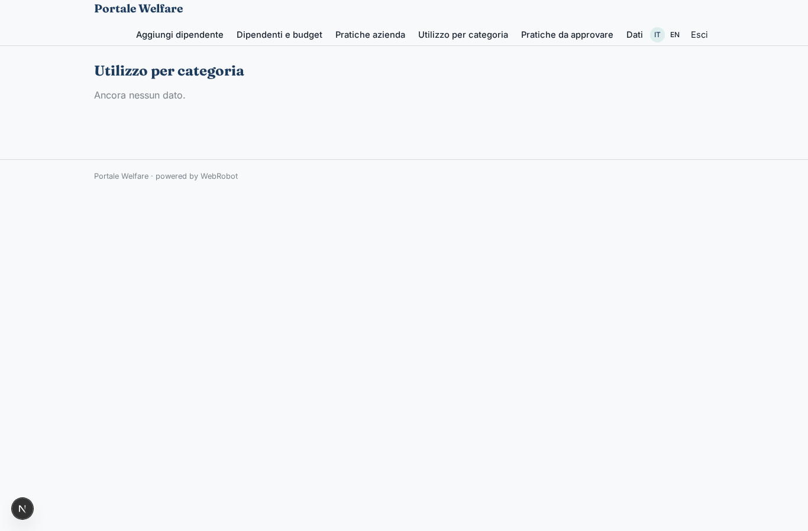
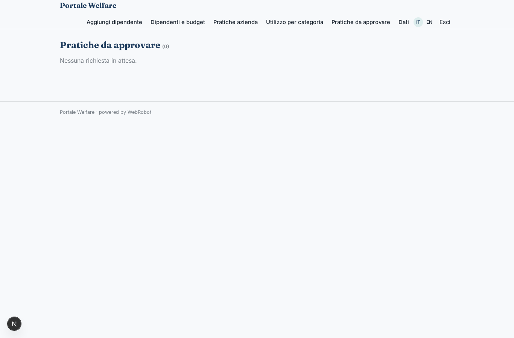

# Portale Welfare

_Il welfare aziendale in un unico portale: budget, rimborsi e voucher._

**Manifest:** valid (schema + runtime contract) · **Functional test:** passed (28 checks passed)

## Description given to the app builder (Italian)

Ci serve Portale Welfare, la parte software di un servizio di welfare aziendale. Descrivo solo lo strato digitale: la rete di fornitori convenzionati, l'emissione dei voucher e gli aspetti fiscali sono gestiti dal provider. L'HR dell'azienda cliente carica l'elenco dei dipendenti e assegna a ciascuno un budget welfare annuale secondo il regolamento aziendale. Il dipendente accede, vede il saldo e sceglie come usarlo: rimborso di spese scolastiche o mediche caricando la ricevuta, abbonamento ai trasporti, buoni spesa, palestra, versamento alla previdenza. Un agente controlla che la richiesta di rimborso sia ammissibile secondo le regole fiscali e il regolamento, legge la ricevuta e prepara la pratica; l'HR o l'operatore del provider la approva. Un assistente in chat risponde alle domande dei dipendenti sul piano. Ogni mese l'HR riceve un report con utilizzo per categoria, budget residuo e scadenze. Il dipendente vede solo il proprio conto, l'HR i dati dell'azienda, i fornitori solo i voucher emessi presso di loro. L'azienda paga una commissione sul budget gestito.

## Functional test: what did not pass

- **form saves a record** (form voucher_request): only role employee may fill it, and the test cannot hold that role _(warning)_
- **template instance created and run** (template monthly_report): reserved to hr _(warning)_
- **page opened by a role allowed to** (view reports): only role hr may open it, the test cannot hold it _(warning)_

## Features not expressible today (spec.extensions)

- **commission_on_budget**: La commissione dell'azienda sul budget gestito (percentuale) è fatturata dal provider fuori dal portale: il manifest non la calcola.
- **budget_enforcement**: Il saldo residuo è mostrato e verificato dall'agente; non esiste un blocco automatico oltre il budget.
- **csv_upload_employees**: Il caricamento in blocco dei dipendenti da CSV non è disponibile per le raccolte di utente: l'HR li inserisce dal form.
- **provider_integration**: Rete fornitori, emissione voucher ed effettivo rimborso sono nei sistemi del provider.

## Screenshots (interpretive runtime, no data)

### home-anon

### home-mobile

### home

### balance

### new_claim

### my_claims

### voucher_request

### assistant_chat

### employees_form

### employees_table

### company_claims

### company_usage

### reviews

### supplier_vouchers

### reports

