# Portale Welfare

_Il welfare aziendale in un unico portale: saldo, rimborsi e assistente._

**Stato manifest:** valido (validatore Python + contratto runtime)

## Descrizione data all'app builder

Ci serve Portale Welfare, la parte software di un servizio di welfare aziendale. Descrivo solo lo strato digitale: la rete di fornitori convenzionati, l'emissione dei voucher e gli aspetti fiscali sono gestiti dal provider. L'HR dell'azienda cliente carica l'elenco dei dipendenti e assegna a ciascuno un budget welfare annuale secondo il regolamento aziendale. Il dipendente accede, vede il saldo e sceglie come usarlo: rimborso di spese scolastiche o mediche caricando la ricevuta, abbonamento ai trasporti, buoni spesa, palestra, versamento alla previdenza. Un agente controlla che la richiesta di rimborso sia ammissibile secondo le regole fiscali e il regolamento, legge la ricevuta e prepara la pratica; l'HR o l'operatore del provider la approva. Un assistente in chat risponde alle domande dei dipendenti sul piano. Ogni mese l'HR riceve un report con utilizzo per categoria, budget residuo e scadenze. Il dipendente vede solo il proprio conto, l'HR i dati dell'azienda, i fornitori solo i voucher emessi presso di loro. L'azienda paga una commissione sul budget gestito.

## Funzioni non esprimibili oggi (spec.extensions)

- **file_upload**: Receipt and employee-list upload are not available yet: employees paste the receipt text or a link, HR pastes the list as CSV text.
- **monthly_email**: Notifications are not available yet: the monthly report is stored in the Monthly reports view; no email is sent to HR.
- **cross_user_visibility**: Employee/HR/supplier isolation relies on per-record sharing (viewer) and derived roles from employees.email and vouchers.supplier_email. HR seeing employees' claims and aggregating them in the report needs those records shared to HR; to be verified in the studio.
- **commission_on_budget**: The company pays a commission as a percentage of the managed budget: not expressible in the billing model yet. Bill it outside the portal or as a subscription plan.
- **provider_scope**: Supplier network, voucher issuance and tax handling stay with the provider; vouchers are loaded into the vouchers collection by the provider.

## Screenshot (runtime interpretativo)

### home-anon
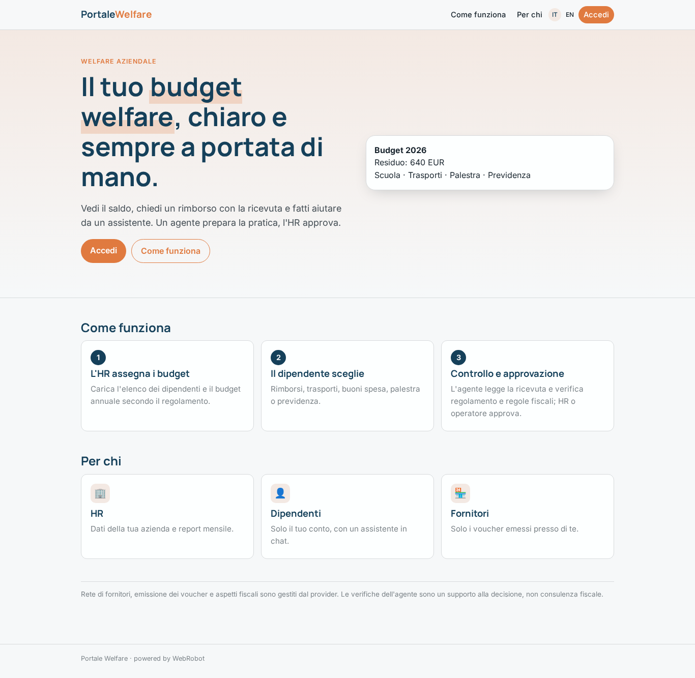

### home-mobile
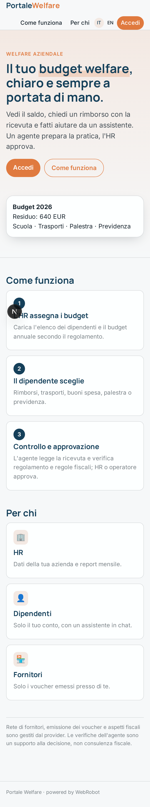

### home
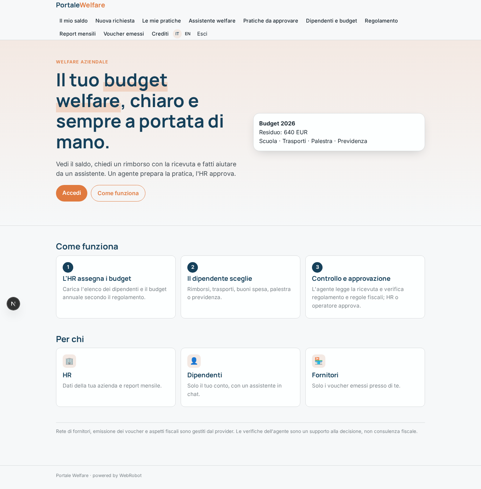

### balance
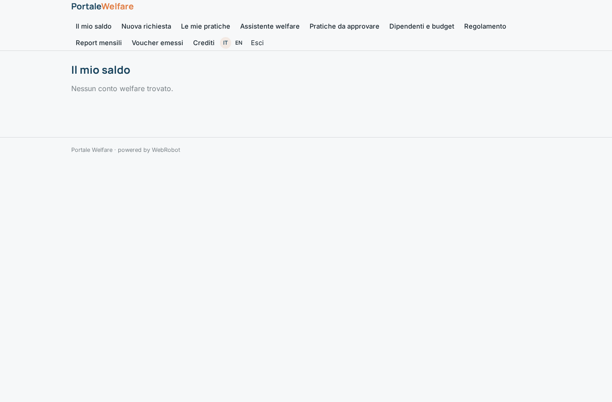

### new
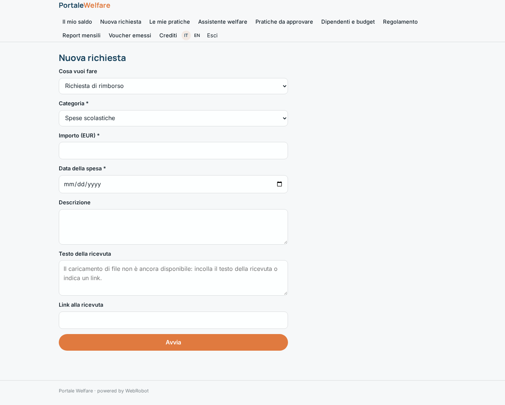

### requests
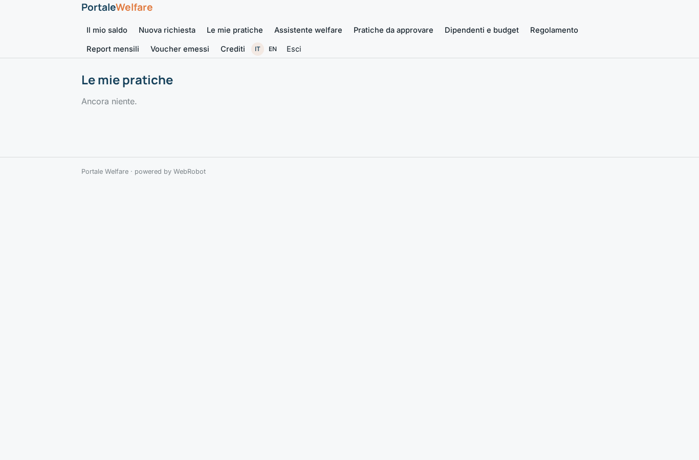

### assistant_chat
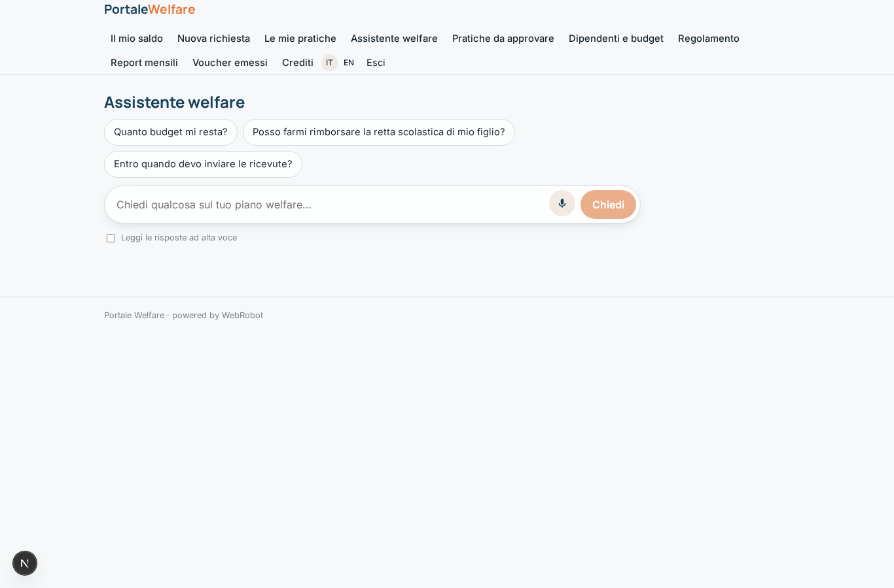

### to_approve

### hr_accounts
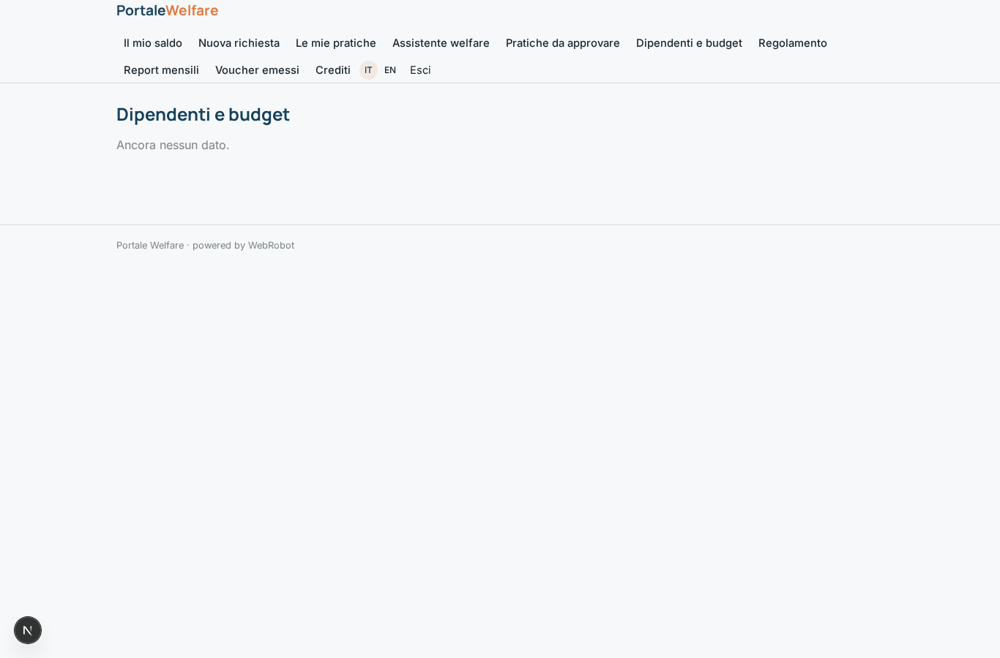

### hr_regulation
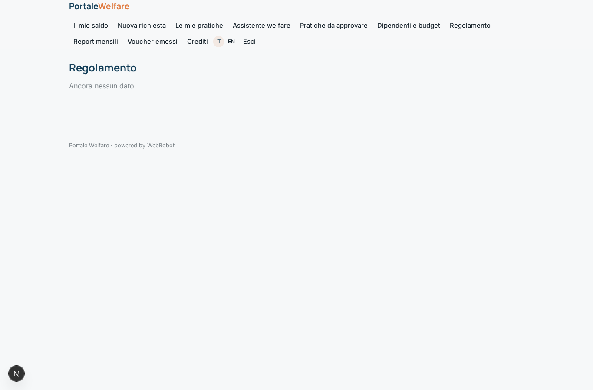

### watches
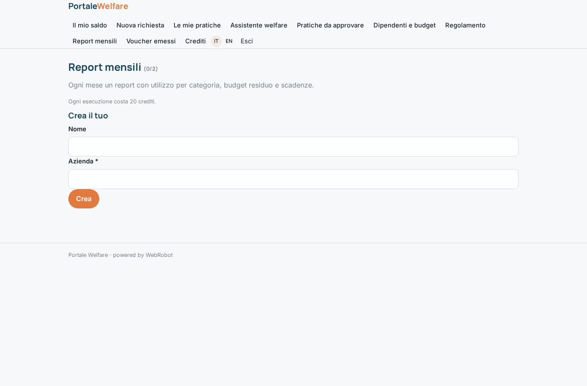

### vouchers_view
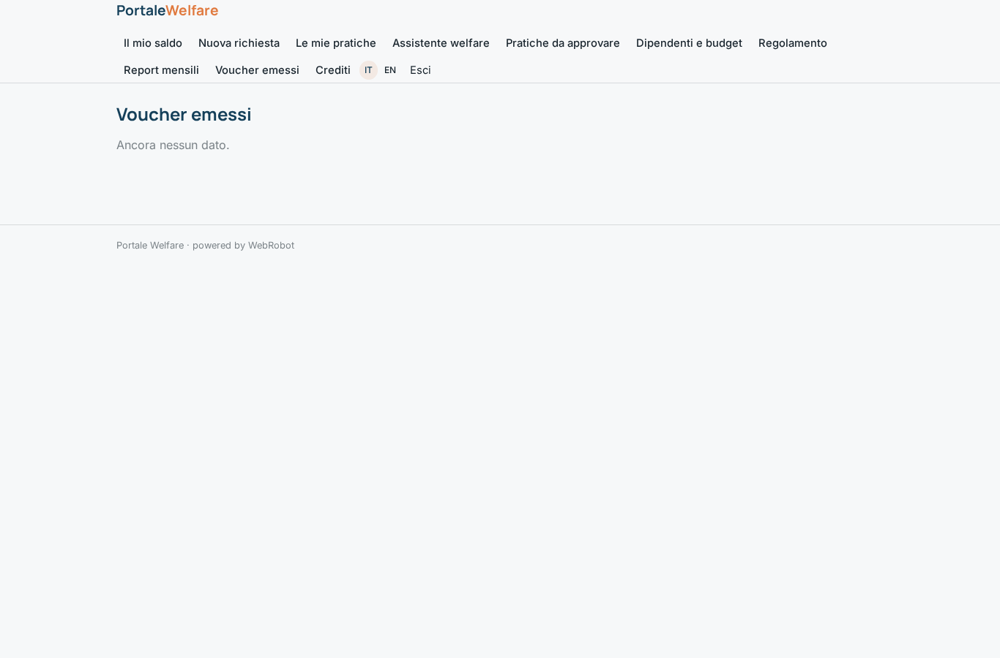

### account
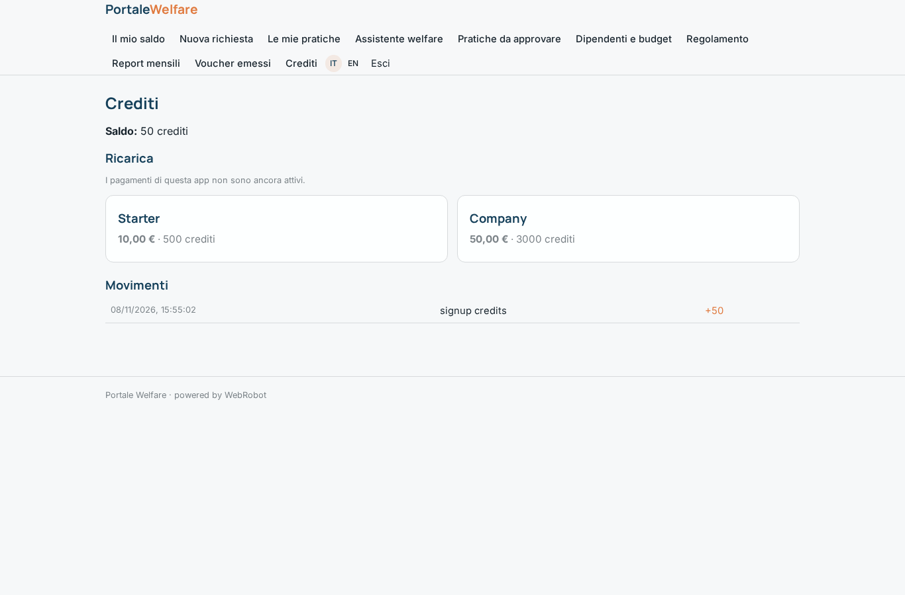

