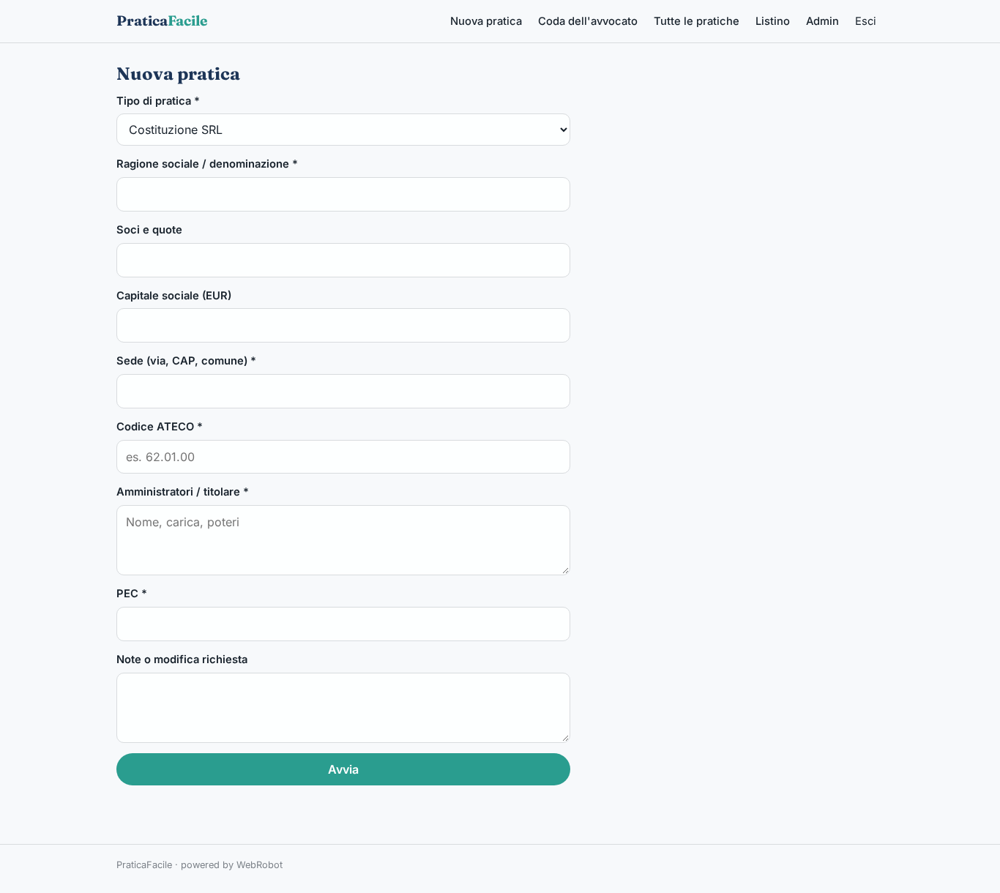
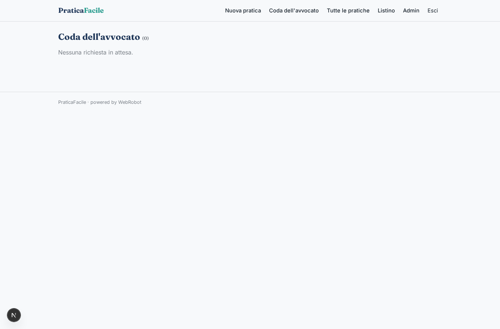
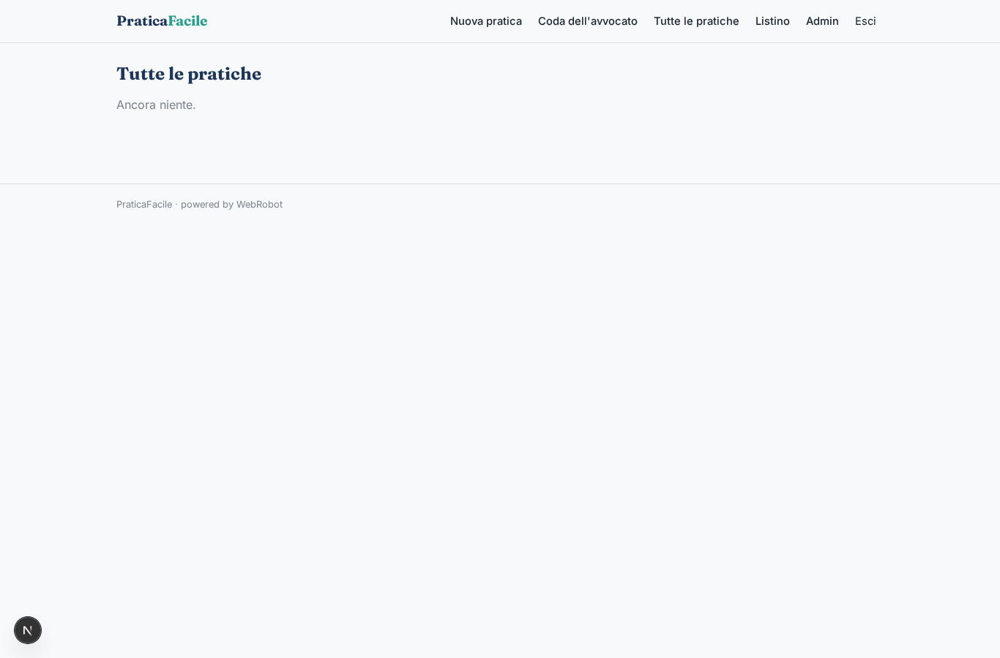
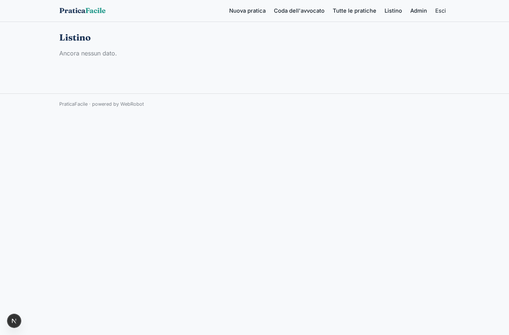
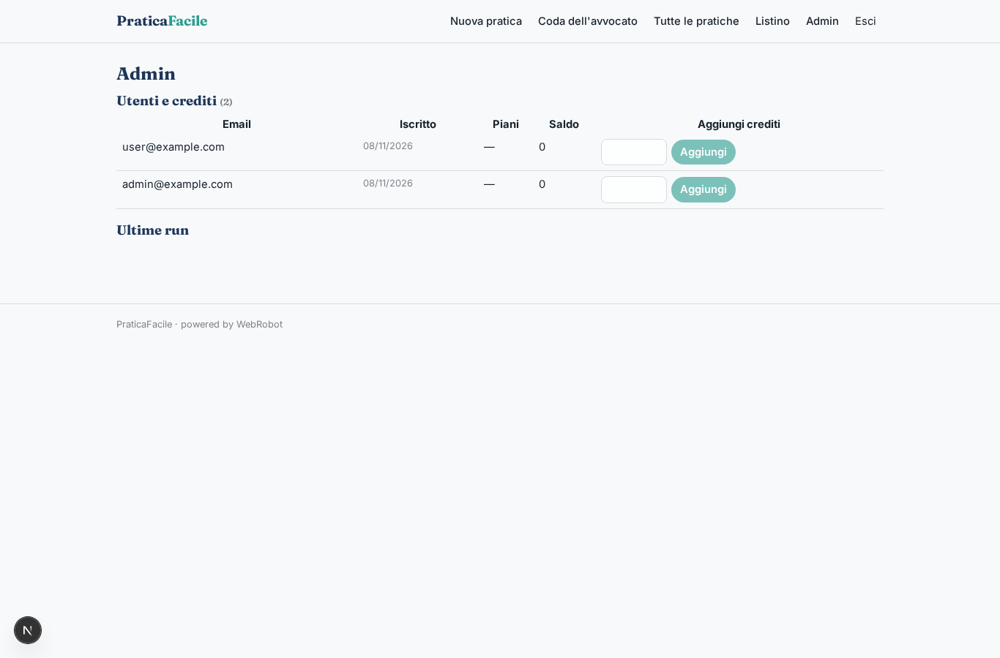
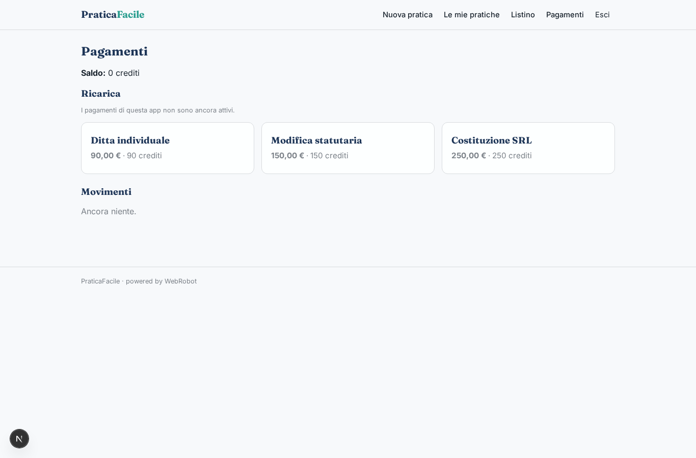

# PraticaFacile

_Apri la tua impresa senza andare in studio._

**Stato manifest:** valido (validatore Python + contratto runtime)

## Descrizione data all'app builder

Voglio un'app chiamata PraticaFacile per chi deve aprire o gestire una piccola impresa (SRL, ditta individuale, modifiche statutarie) senza andare in studio. Il cliente si registra e sceglie la pratica da un catalogo; compila un modulo guidato con ragione sociale, soci e quote, capitale, sede, codice ATECO, amministratori e PEC. Un agente verifica la coerenza dei dati con la normativa e con i moduli camerali pubblici, segnala cosa manca e prepara la bozza dell'atto costitutivo, dello statuto e della modulistica per la Camera di Commercio. La bozza non parte mai da sola: un avvocato dello studio la apre nella sua coda, la corregge e la approva; solo allora il cliente riceve un'email con i documenti e i passi successivi (notaio, firma digitale, versamento del capitale). Il cliente vede solo le sue pratiche con lo stato aggiornato, l'avvocato vede quelle assegnate, l'admin tutte e il listino. Si paga a pratica con carta al momento dell'invio, prezzo diverso per tipo di pratica. Lingua italiana, promemoria email se il cliente lascia la pratica a metà per più di tre giorni.

## Funzioni non esprimibili oggi (spec.extensions)

- **email_documenti**: Email al cliente con documenti e prossimi passi (notaio, firma digitale, versamento del capitale) dopo l'approvazione dell'avvocato: le notifiche email non sono ancora disponibili; il cliente trova lo stato e i documenti nella pratica.
- **promemoria_pratica_incompleta**: Promemoria email se la pratica resta a metà per più di tre giorni: non disponibile, richiede notifiche email.
- **assegnazione_avvocato**: Assegnazione di ogni pratica a un avvocato specifico: oggi la coda è condivisa tra gli avvocati; l'assegnazione richiede logica personalizzata.
- **pagamento_all_invio**: Il prezzo per tipo di pratica è un costo fisso in crediti (1 credito = 1 EUR) acquistati con carta prima dell'invio.

## Screenshot (runtime interpretativo)

### home-anon

### home-mobile

### home

### new

### pratiche

### coda

### tutte

### listino

### admin

### account

