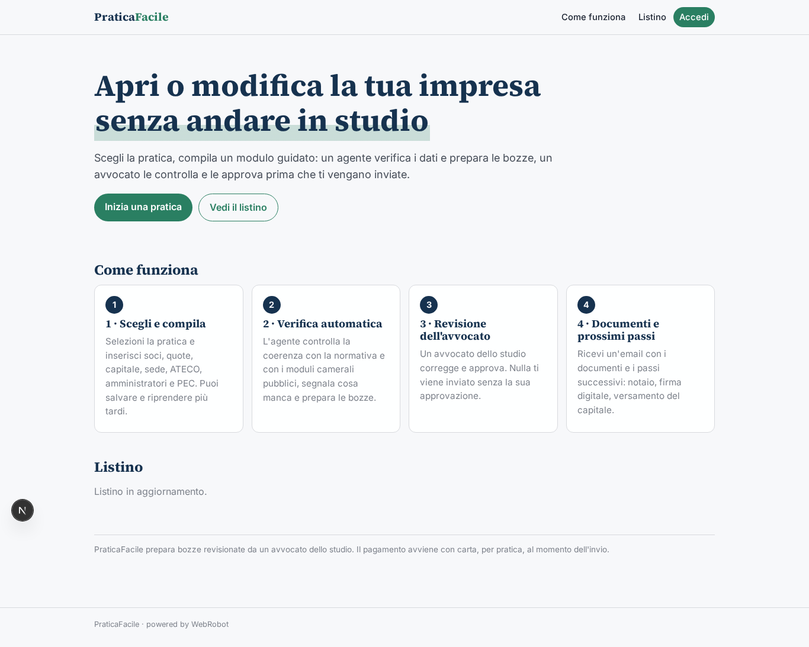
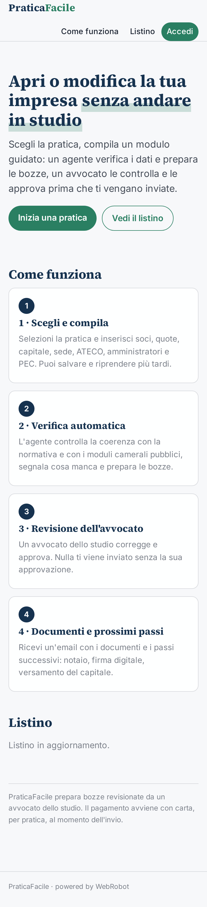
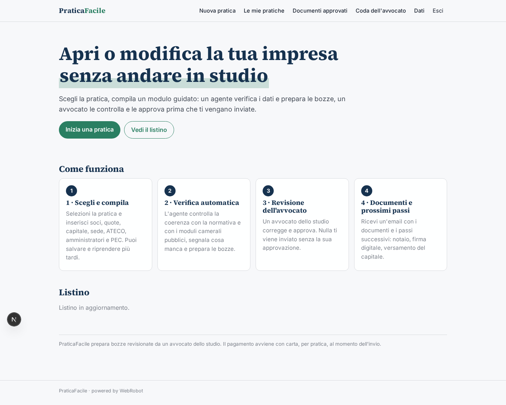
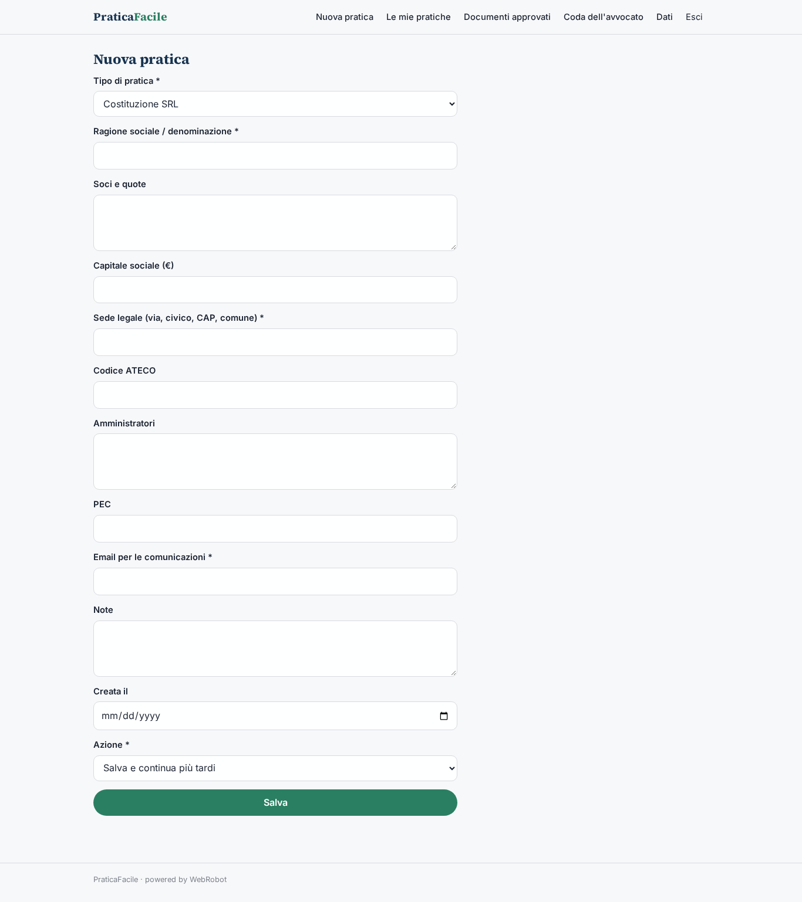
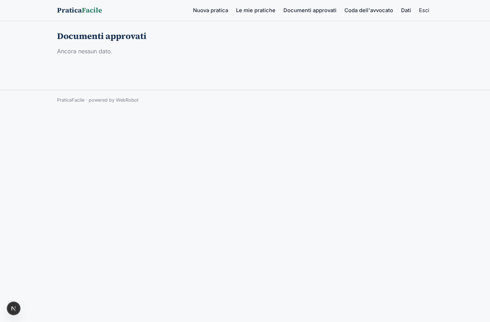
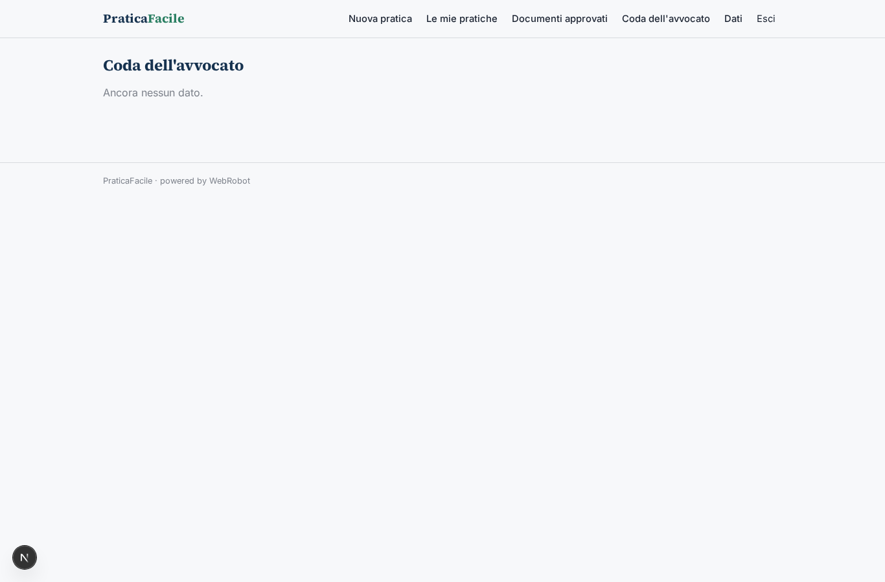
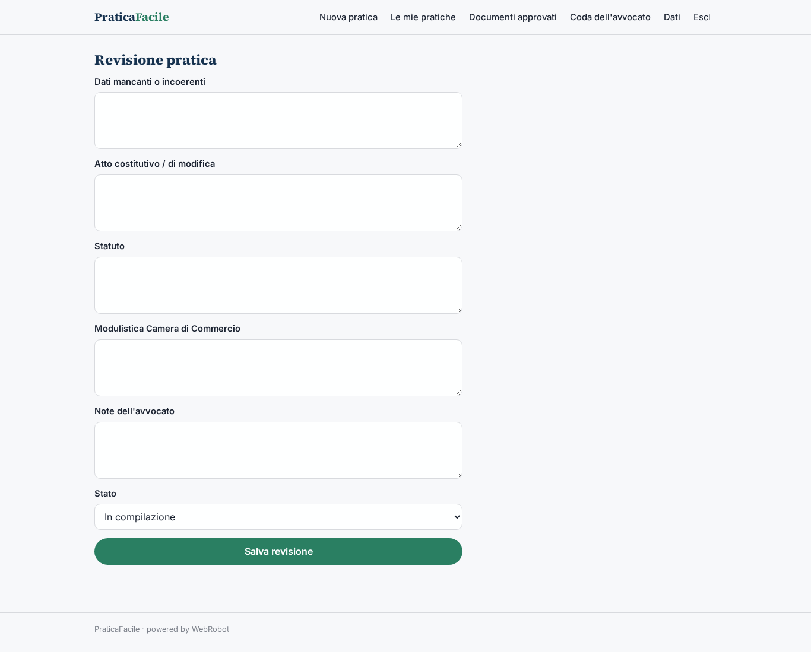
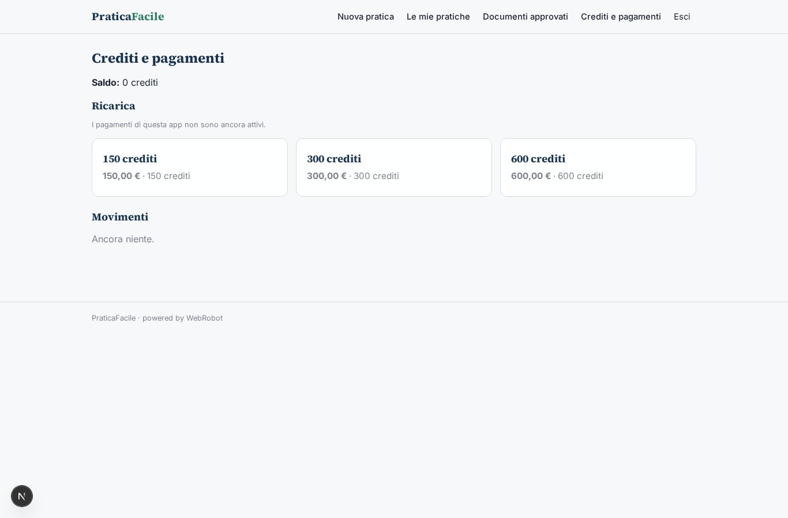

# PraticaFacile

_Apri o modifica la tua impresa senza andare in studio._

**Manifest:** valid (schema + runtime contract) · **Functional test:** passed (11 checks passed)

## Description given to the app builder (Italian)

Voglio un'app chiamata PraticaFacile per chi deve aprire o gestire una piccola impresa (SRL, ditta individuale, modifiche statutarie) senza andare in studio. Il cliente si registra e sceglie la pratica da un catalogo; compila un modulo guidato con ragione sociale, soci e quote, capitale, sede, codice ATECO, amministratori e PEC. Un agente verifica la coerenza dei dati con la normativa e con i moduli camerali pubblici, segnala cosa manca e prepara la bozza dell'atto costitutivo, dello statuto e della modulistica per la Camera di Commercio. La bozza non parte mai da sola: un avvocato dello studio la apre nella sua coda, la corregge e la approva; solo allora il cliente riceve un'email con i documenti e i passi successivi (notaio, firma digitale, versamento del capitale). Il cliente vede solo le sue pratiche con lo stato aggiornato, l'avvocato vede quelle assegnate, l'admin tutte e il listino. Si paga a pratica con carta al momento dell'invio, prezzo diverso per tipo di pratica. Lingua italiana, promemoria email se il cliente lascia la pratica a metà per più di tre giorni.

## Features not expressible today (spec.extensions)

- **prezzi_per_tipo**: 1 credito = 1 €. I prezzi (SRL 290, ditta 120, modifica statutaria 190) sono fissati nei trigger carica_*; se l'admin cambia il listino va aggiornato anche il trigger. Il pagamento con carta avviene acquistando i crediti nella pagina Crediti prima dell'invio.
- **assegnazione_avvocato**: L'assegnazione dell'avvocato (campo lawyer_email) la fa l'admin dalla pagina dati /admin/data; non c'è assegnazione automatica.
- **data_creazione_automatica**: Il campo creata_il usa come default la data odierna ({date}); se il runtime non lo compila da solo va impostato al salvataggio, perché il promemoria dopo 3 giorni parte da questa data.

## Screenshots (interpretive runtime, no data)

### home-anon

### home-mobile

### home

### nuova

### pratiche

### documenti

### coda

### revisione

### account

