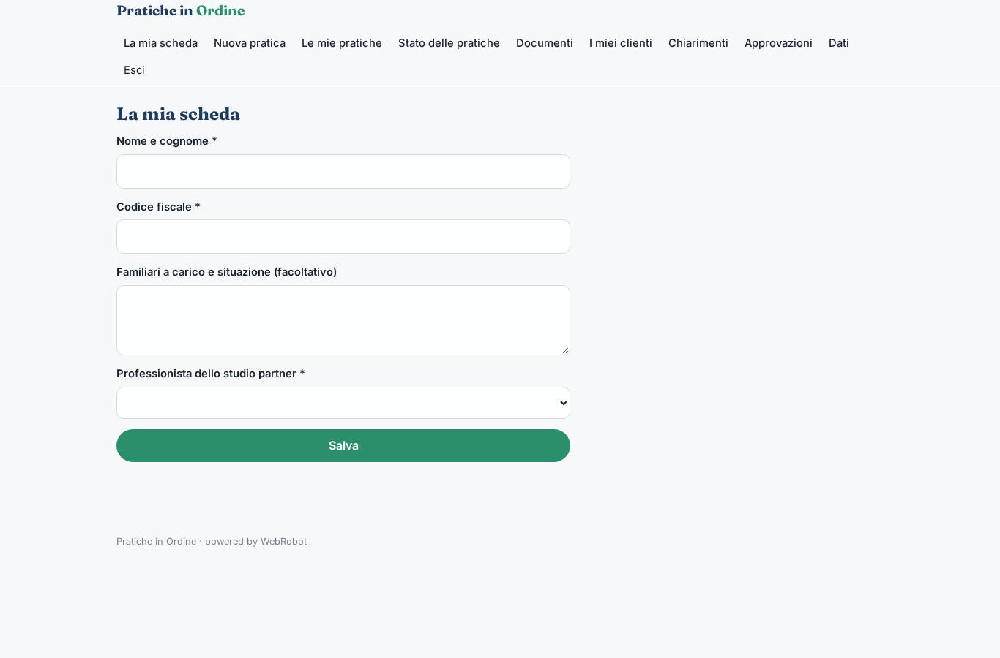
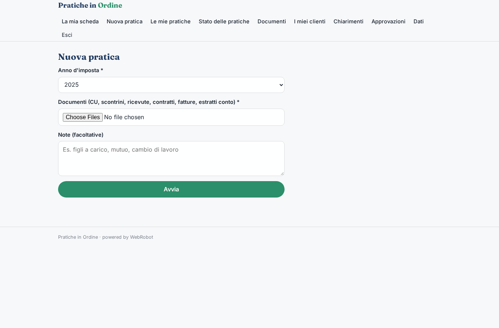
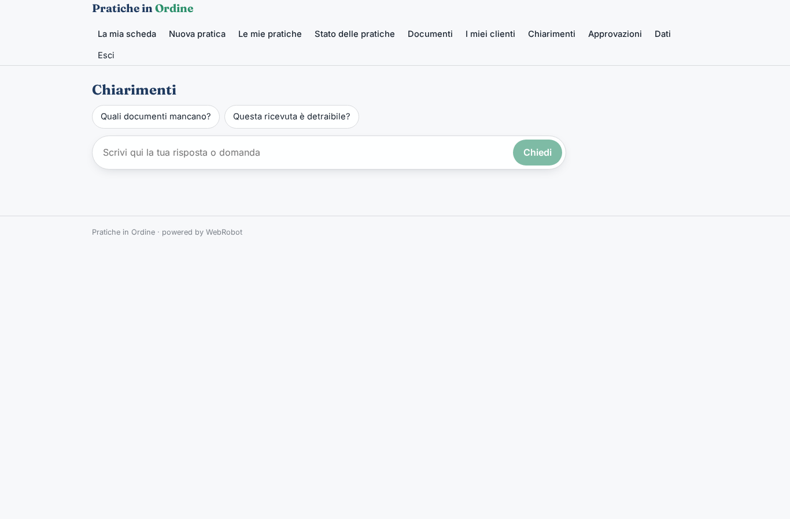
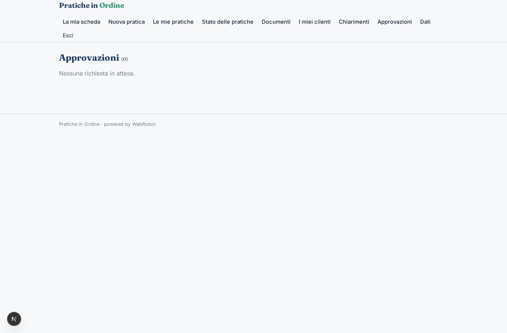
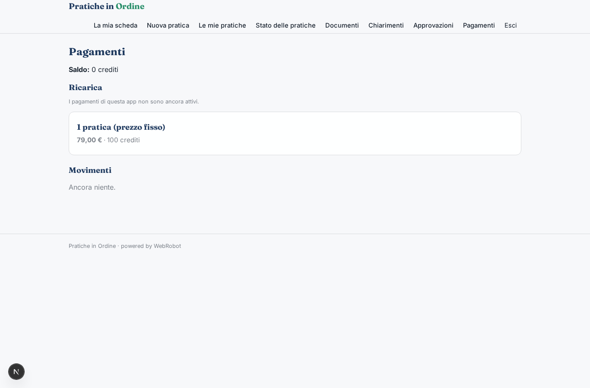

# Pratiche in Ordine

_I tuoi documenti fiscali diventano una pratica pronta da approvare._

**Manifest:** valid (schema + runtime contract) · **Functional test:** passed (13 checks passed)

## Description given to the app builder (Italian)

Voglio costruire Pratiche in Ordine, un'app che trasforma i documenti fiscali di privati e professionisti in pratiche pronte da approvare, come la dichiarazione dei redditi. Il contribuente si registra e carica i suoi documenti: CU, scontrini delle spese mediche, ricevute, contratti d'affitto, fatture, estratti conto, anche come foto dal telefono. Vorremmo anche recuperare in automatico i dati dal cassetto fiscale con la sua delega. Un agente legge e classifica ogni documento, estrae importi e date, li abbina alle voci di detrazione giuste consultando le istruzioni ufficiali indicizzate, segnala documenti mancanti e chiede chiarimenti all'utente in chat. Poi compila una bozza della pratica con un riepilogo di quanto si risparmia. Un professionista abilitato dello studio partner riceve la bozza, la controlla, può chiedere modifiche e la approva; solo dopo il cliente la conferma e lo studio la trasmette. Il cliente vede i suoi documenti e lo stato della pratica, il professionista solo i clienti assegnati. I documenti contengono dati personali e vanno conservati in modo riservato. Pagamento a pratica, con prezzo fisso mostrato prima di iniziare.

## Features not expressible today (spec.extensions)

- **cassetto_fiscale**: Recupero automatico dei dati dal cassetto fiscale con delega: richiede accesso con SPID/CIE/Entratel e deleghe, non disponibile (nessun OAuth o accesso senza chiave API). Per ora l'utente carica i documenti.
- **trasmissione**: La trasmissione all'Agenzia delle Entrate resta a carico dello studio partner, fuori dall'app.
- **istruzioni_ufficiali**: La collezione 'instructions' va popolata dagli admin con le istruzioni ufficiali (es. Agenzia delle Entrate) per anno; l'elenco 'professionals' con i professionisti dello studio.

## Screenshots (interpretive runtime, no data)

### home-anon

### home-mobile

### home

### profile

### new_practice

### practices_history

### my_practices

### my_documents

### clients

### assistant

### decisions

### account

