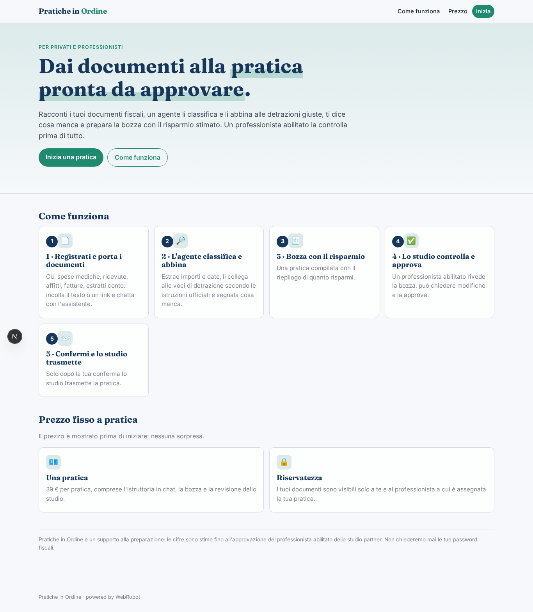
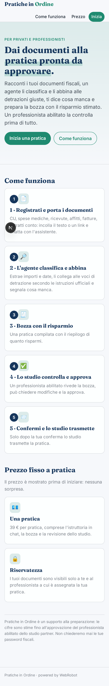
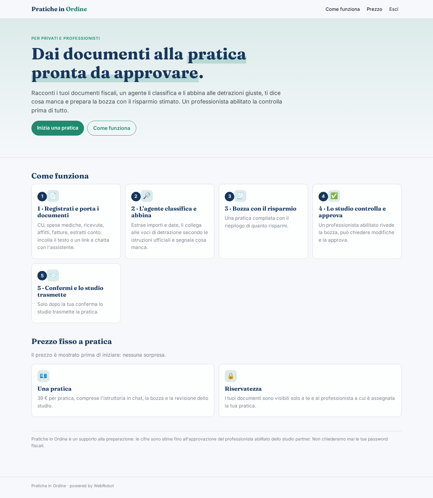
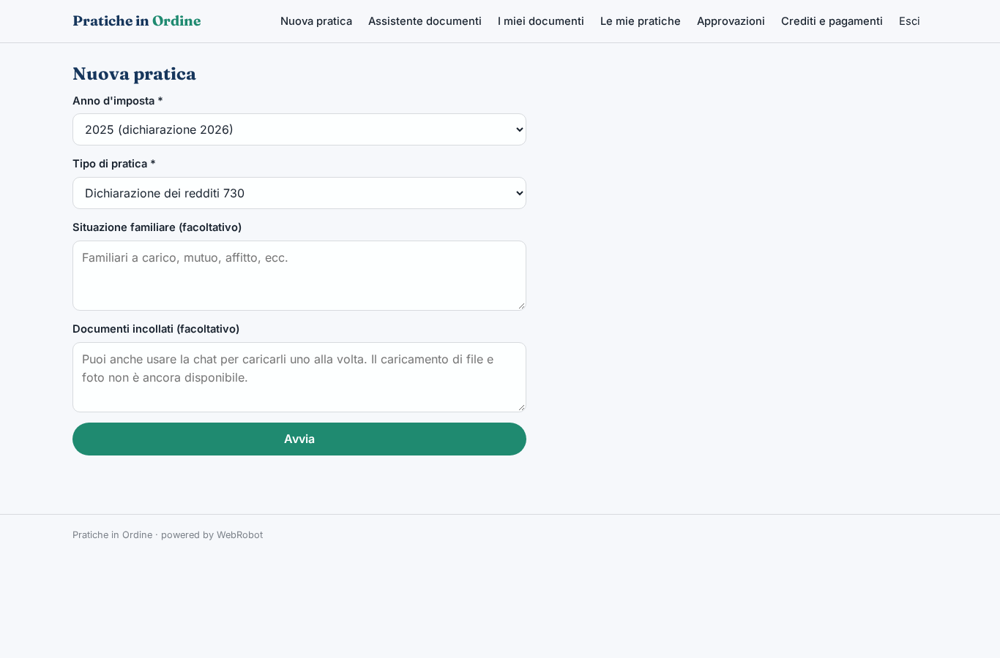
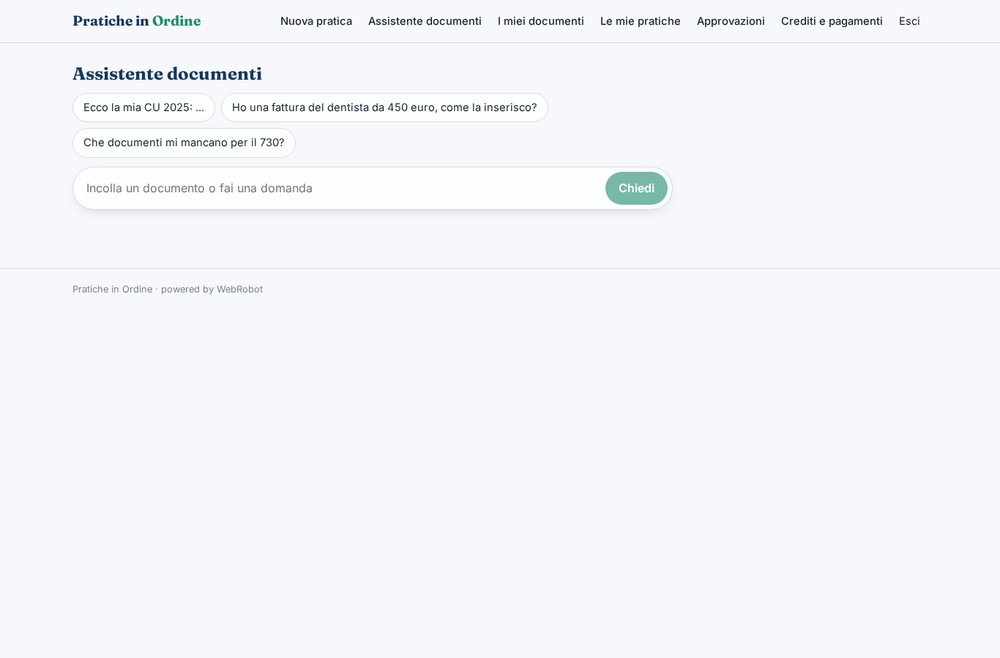
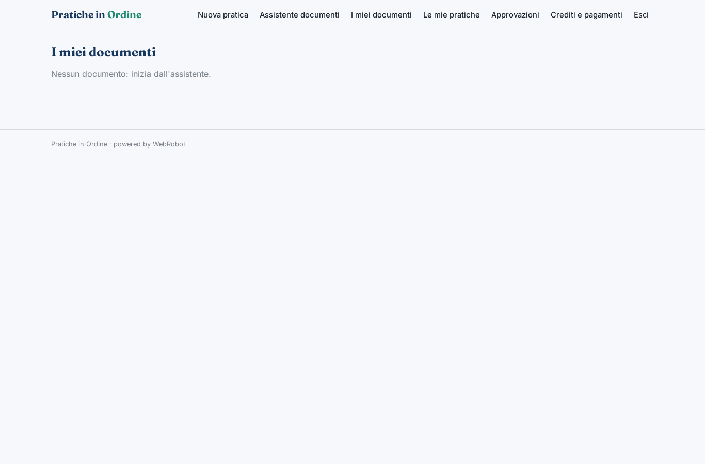
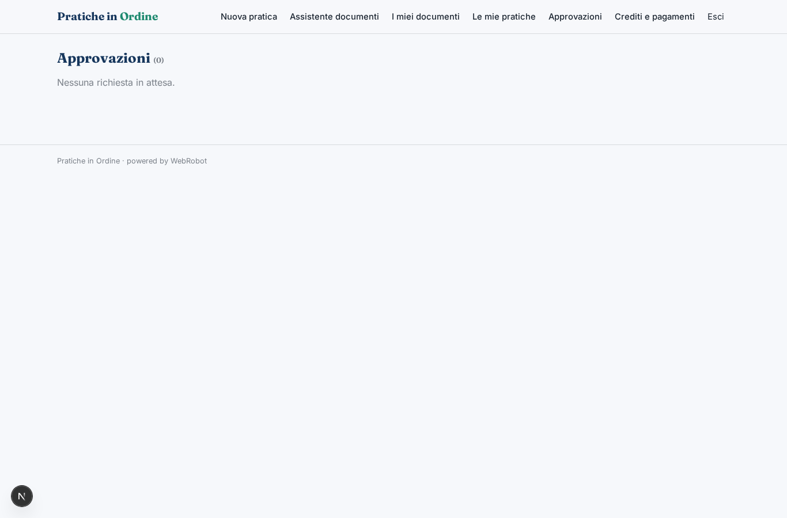
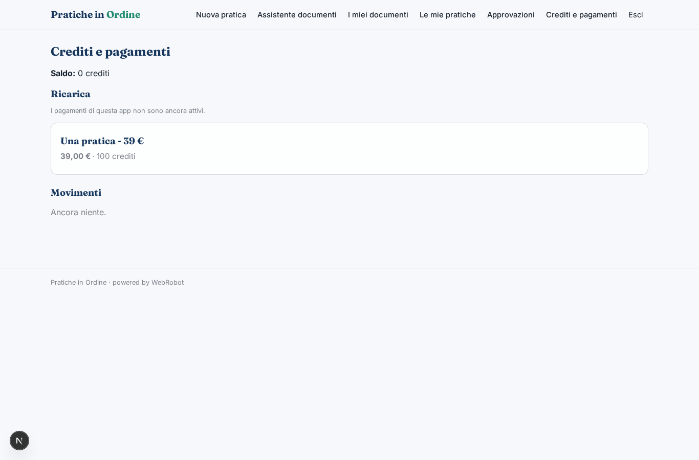

# Pratiche in Ordine

_Dai tuoi documenti fiscali a una pratica pronta da approvare._

**Stato manifest:** valido (validatore Python + contratto runtime)

## Descrizione data all'app builder

Voglio costruire Pratiche in Ordine, un'app che trasforma i documenti fiscali di privati e professionisti in pratiche pronte da approvare, come la dichiarazione dei redditi. Il contribuente si registra e carica i suoi documenti: CU, scontrini delle spese mediche, ricevute, contratti d'affitto, fatture, estratti conto, anche come foto dal telefono. Vorremmo anche recuperare in automatico i dati dal cassetto fiscale con la sua delega. Un agente legge e classifica ogni documento, estrae importi e date, li abbina alle voci di detrazione giuste consultando le istruzioni ufficiali indicizzate, segnala documenti mancanti e chiede chiarimenti all'utente in chat. Poi compila una bozza della pratica con un riepilogo di quanto si risparmia. Un professionista abilitato dello studio partner riceve la bozza, la controlla, può chiedere modifiche e la approva; solo dopo il cliente la conferma e lo studio la trasmette. Il cliente vede i suoi documenti e lo stato della pratica, il professionista solo i clienti assegnati. I documenti contengono dati personali e vanno conservati in modo riservato. Pagamento a pratica, con prezzo fisso mostrato prima di iniziare.

## Funzioni non esprimibili oggi (spec.extensions)

- **cassetto_fiscale**: Recupero automatico dei dati dal cassetto fiscale con delega del contribuente: richiede credenziali/delega di ogni cliente, non ancora disponibile. Per ora i dati si incollano in chat.
- **file_upload**: Caricamento di file e foto dal telefono non ancora disponibile: il contribuente incolla il testo del documento o un link.
- **client_assignment**: Assegnazione dei clienti ai professionisti (il professionista vede solo i clienti assegnati) e visibilità dei documenti del cliente al professionista assegnato: oggi il professionista vede le richieste di revisione a lui destinate, non l'archivio; serve un meccanismo di assegnazione.
- **transmission**: Trasmissione della pratica da parte dello studio dopo la conferma del cliente: avviene fuori dall'app; lo stato 'trasmessa' è aggiornato dallo studio.
- **notifications**: Email di avviso a cliente e studio (bozza pronta, modifiche richieste, conferma) non ancora disponibili.
- **confidential_storage**: Cifratura e conservazione riservata dei documenti, retention e consensi privacy (GDPR) da configurare a livello di piattaforma.

## Screenshot (runtime interpretativo)

### home-anon

### home-mobile

### home

### new

### assistant

### documents

### practices

### approvals

### account

