# Prestazione in Campo

_Carico, rischio e performance degli atleti, dopo ogni sessione._

**Stato manifest:** valido (validatore Python + contratto runtime)

## Descrizione data all'app builder

Mi serve Prestazione in Campo, la piattaforma di analisi per un servizio che misura la performance degli atleti con dispositivi indossabili e telecamere. Descrivo solo lo strato software di analisi e reportistica: i sensori, le telecamere e l'elaborazione video sono forniti a parte. Il preparatore atletico della squadra è admin e crea la rosa con ruolo, età, peso e storico infortuni. Dopo ogni allenamento o partita i dati dei dispositivi (distanza, velocità, accelerazioni, frequenza cardiaca, carico) dovrebbero arrivare in automatico; per ora si caricano come file esportati. Un agente calcola indicatori di carico acuto e cronico, confronta ogni atleta con la sua media, segnala chi è a rischio sovraccarico e propone come modulare il carico della settimana successiva. Lo staff tecnico riceve un report dopo ogni sessione e un riepilogo settimanale; in chat può chiedere confronti tra giocatori o tra partite. Il medico della squadra vede i dati sanitari, l'allenatore solo gli indicatori di prestazione, l'atleta solo i propri. Abbonamento stagionale per squadra, in italiano e inglese.

## Funzioni non esprimibili oggi (spec.extensions)

- **file_upload**: I dati dei dispositivi si incollano o si linkano: il caricamento di file non è ancora disponibile.
- **auto_ingest**: L'arrivo automatico dei dati da dispositivi/telecamere richiede connettori non ancora disponibili; per ora inserimento manuale.
- **athlete_own_data**: La vista 'metrics' per il ruolo atleta deve essere filtrata ai soli record dell'atleta (match email/nome) e il ruolo medico non deve vedere la modifica della rosa: richiede filtro per utente a livello di runtime.
- **record_editing**: Creazione e modifica di rosa e dati sanitari da parte del preparatore e del medico (form sulle collezioni): da completare nello studio.
- **per_team_tenancy**: Una installazione per squadra; più squadre nello stesso deployment richiedono un campo team su tutte le collezioni.
- **notifications**: Invio automatico via email del report dopo ogni sessione e del riepilogo settimanale: notifiche non ancora disponibili, i report sono consultabili nell'app.

## Screenshot (runtime interpretativo)

### home-anon
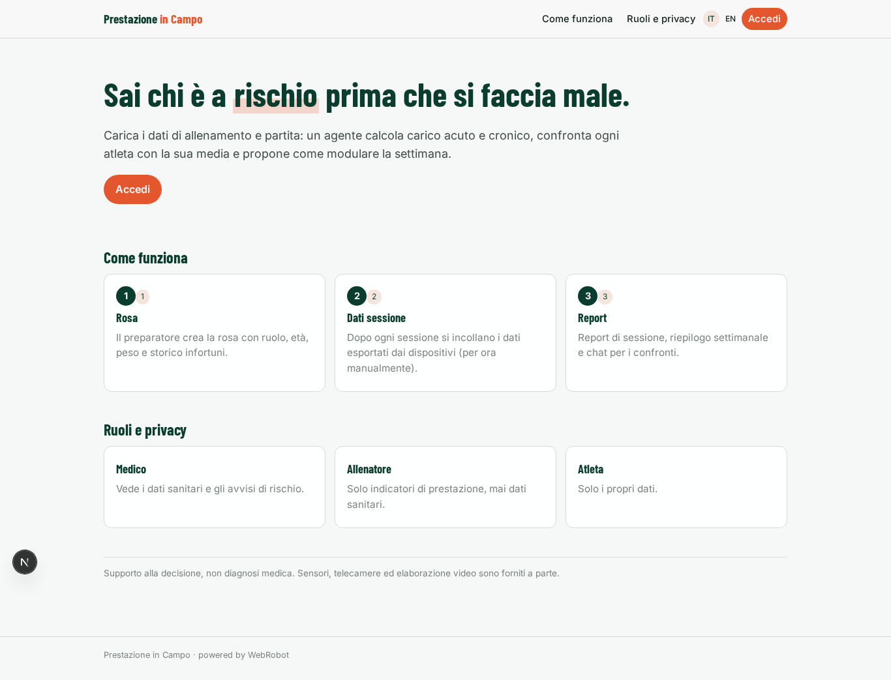

### home-mobile
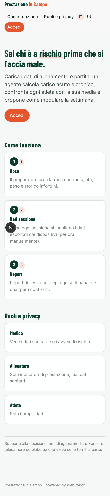

### home
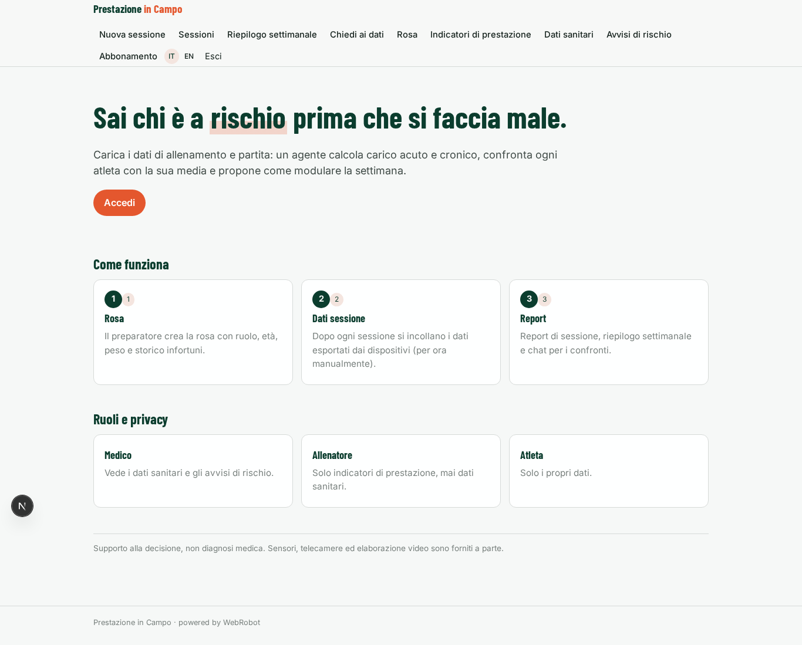

### new_session
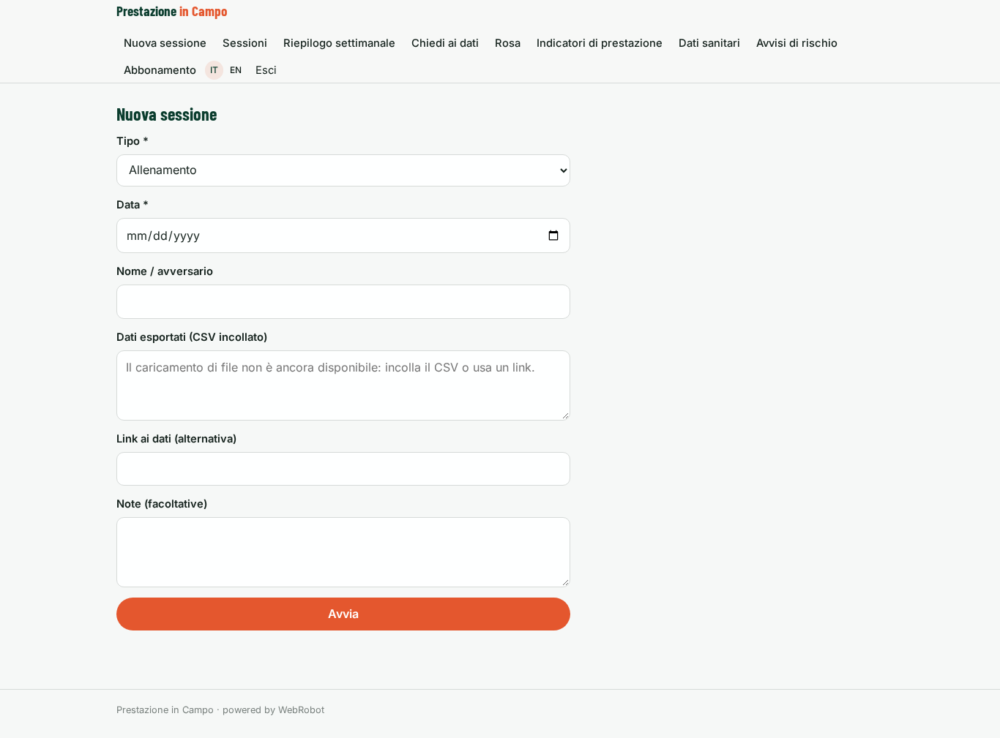

### sessions

### weekly_view
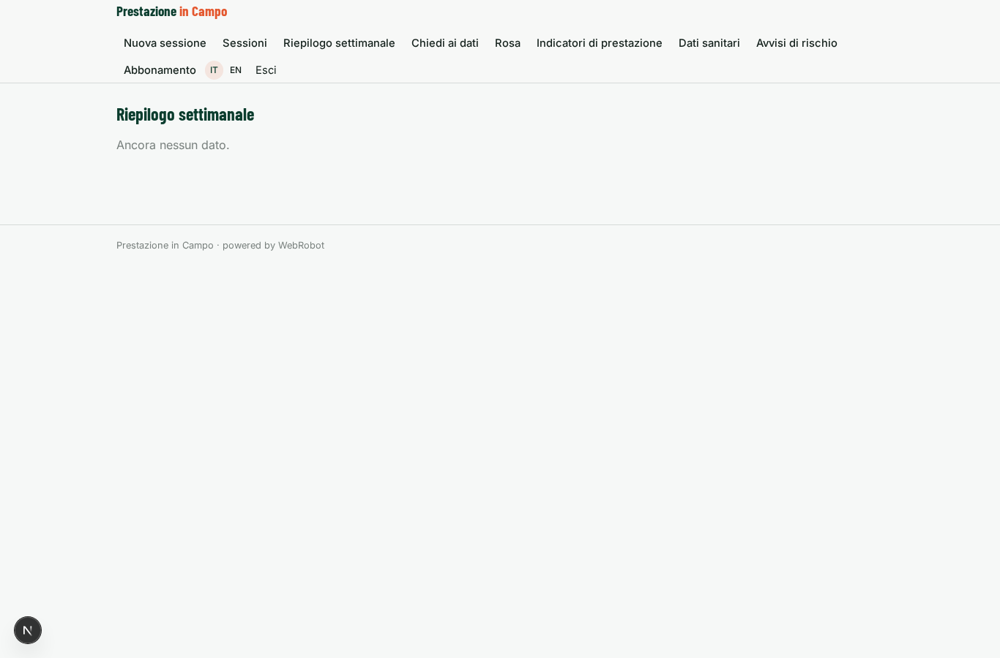

### assistant_chat
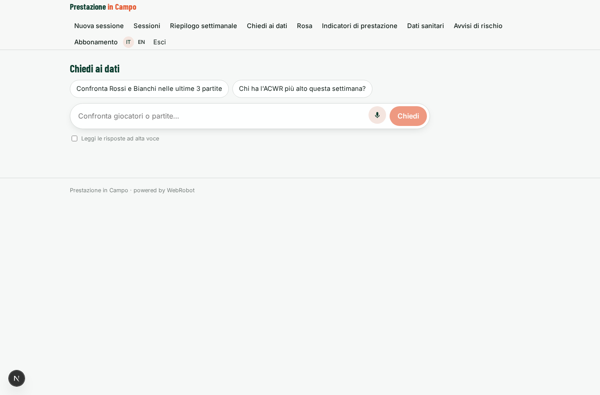

### roster
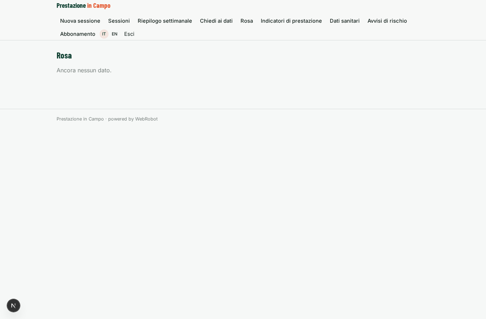

### metrics
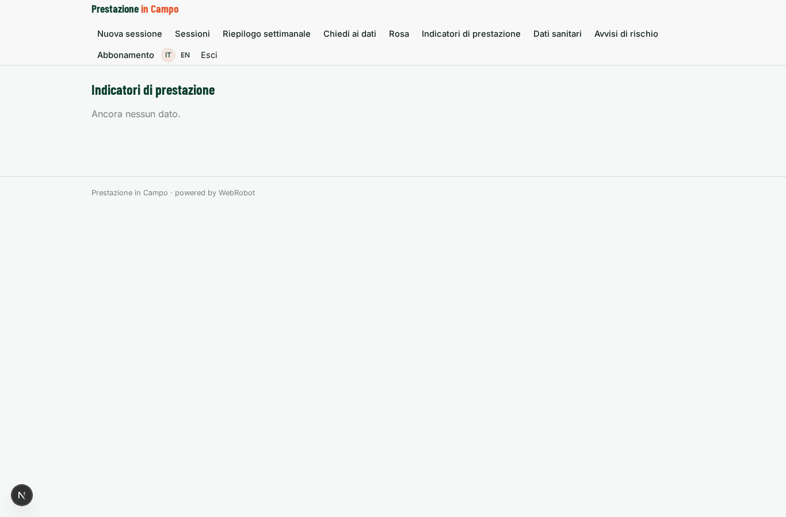

### health
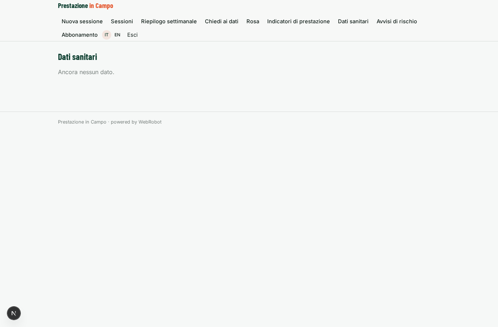

### risks
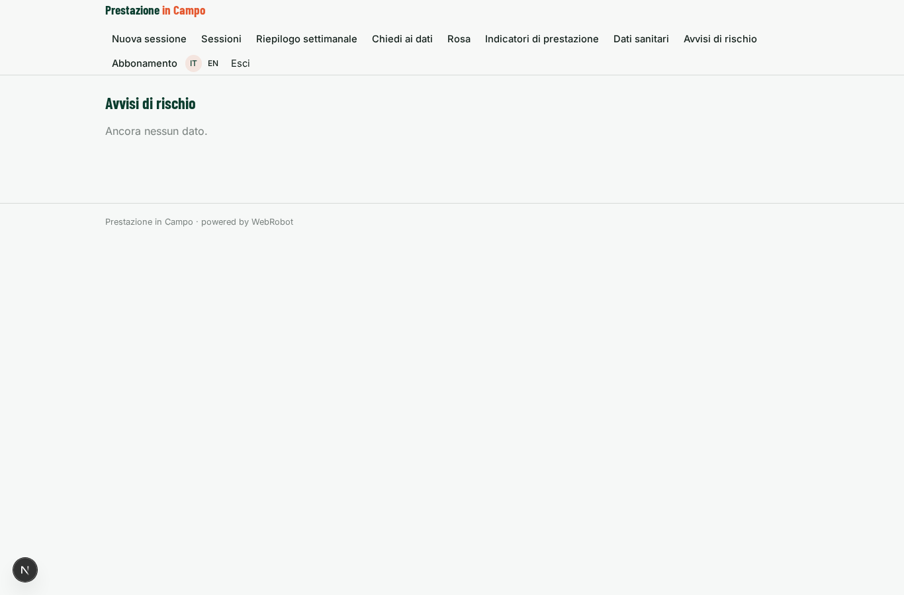

### account
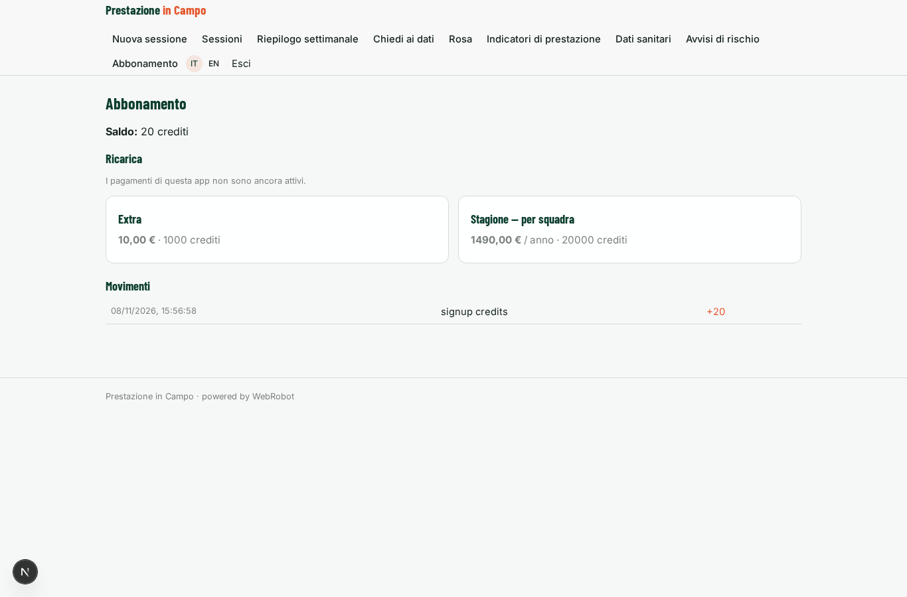

