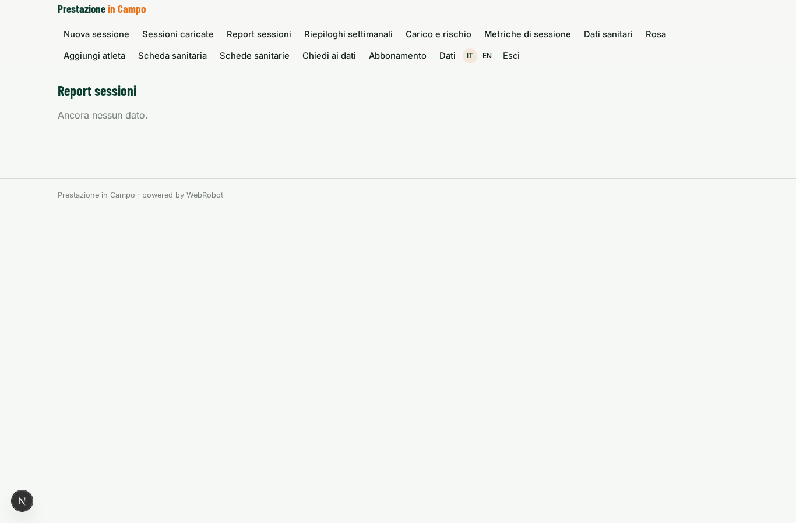
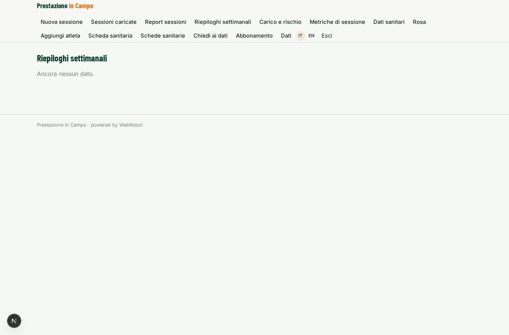
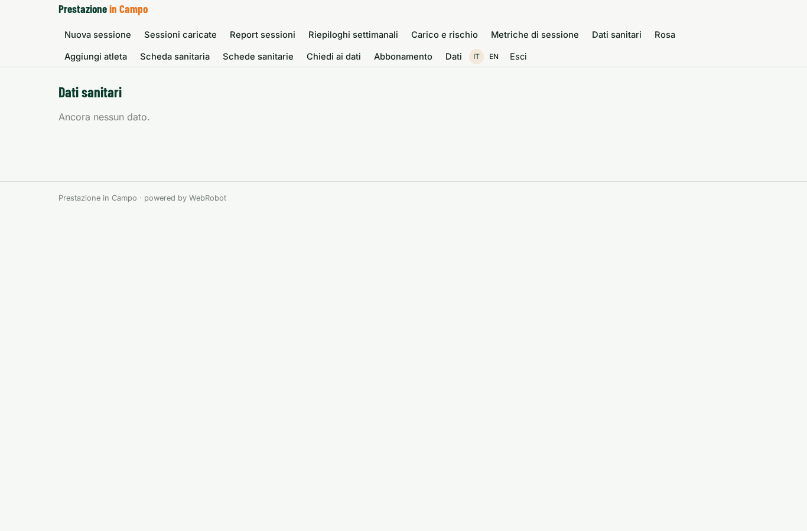
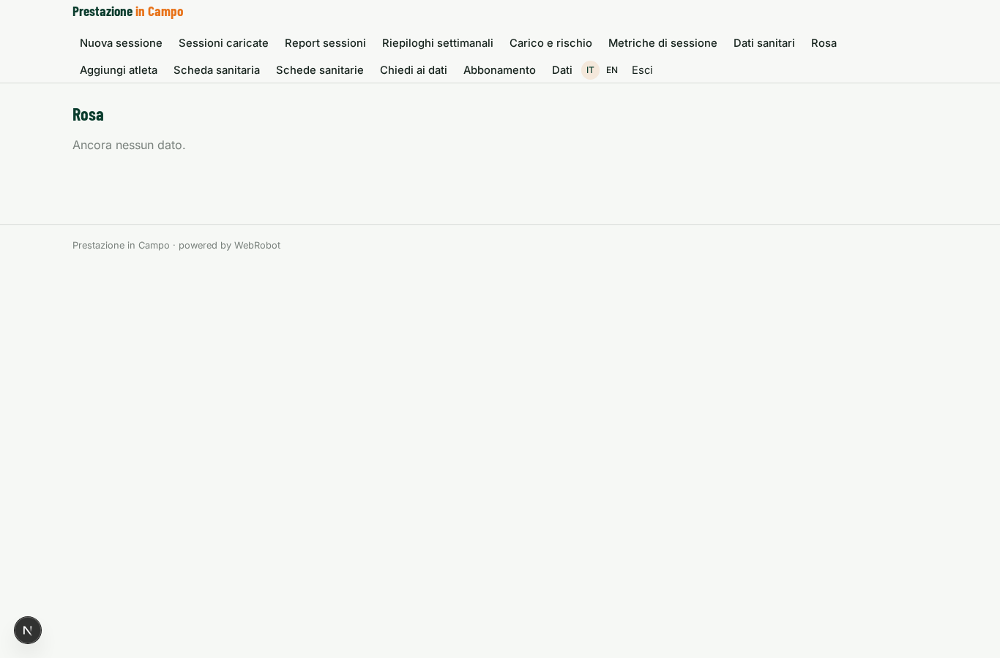
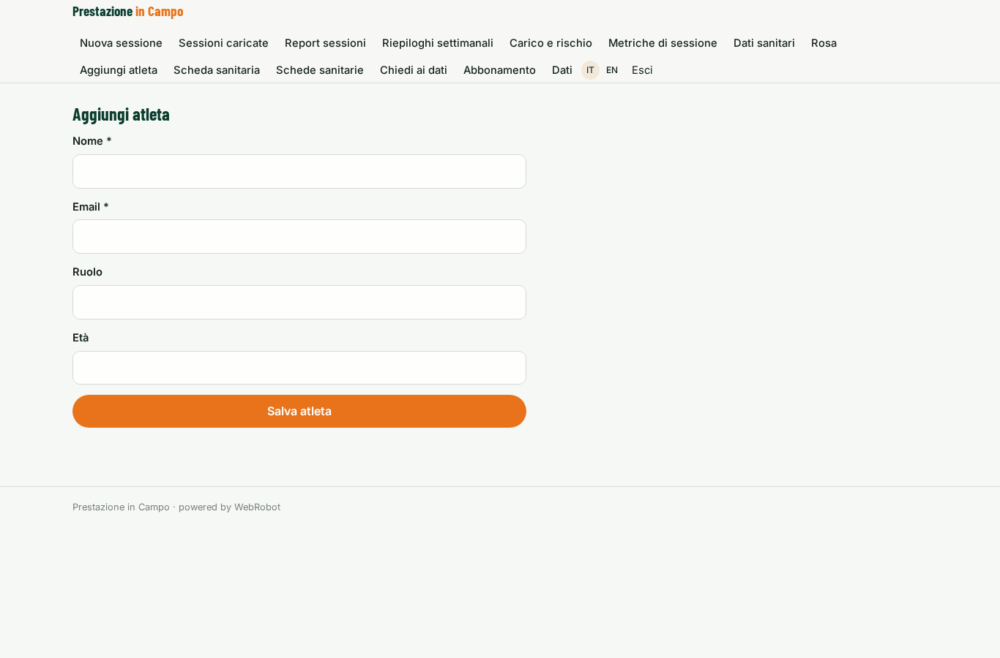
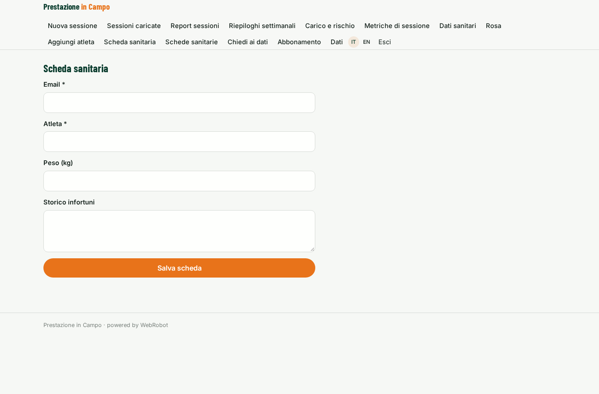
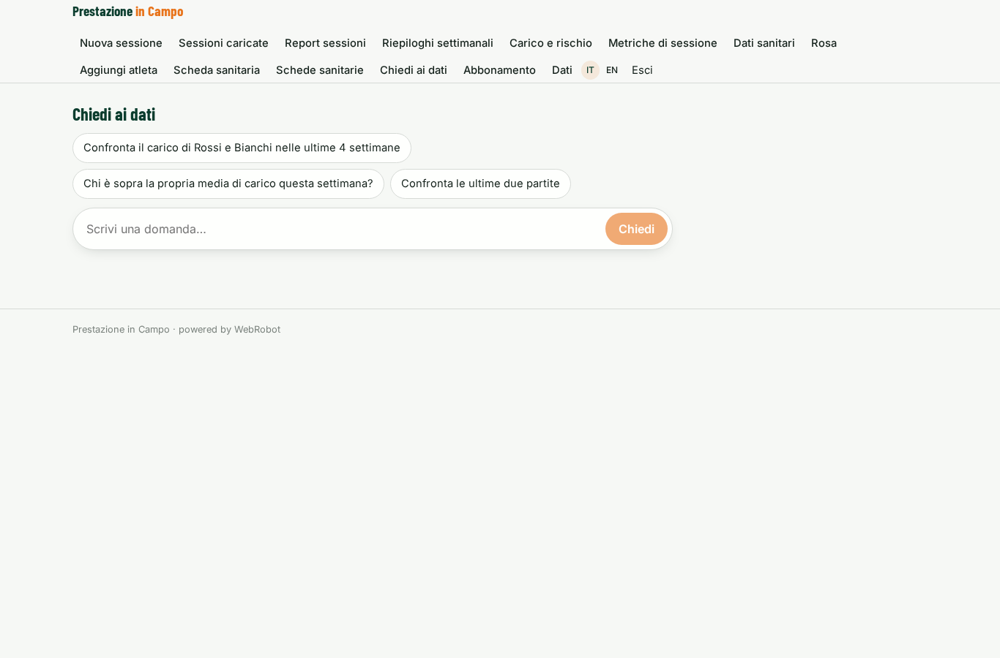
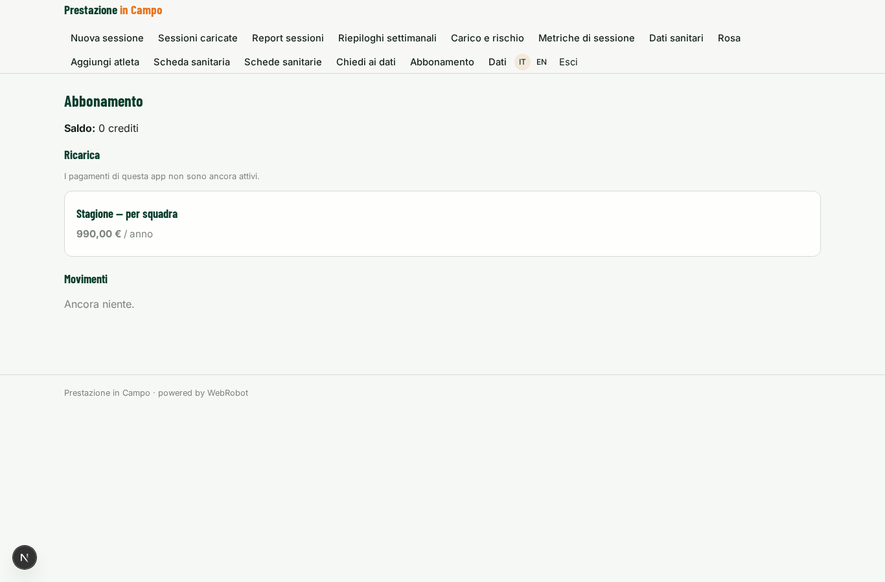

# Prestazione in Campo

_Carico, rischio sovraccarico e piano settimanale per ogni atleta._

**Manifest:** valid (schema + runtime contract) · **Functional test:** passed (35 checks passed)

## Description given to the app builder (Italian)

Mi serve Prestazione in Campo, la piattaforma di analisi per un servizio che misura la performance degli atleti con dispositivi indossabili e telecamere. Descrivo solo lo strato software di analisi e reportistica: i sensori, le telecamere e l'elaborazione video sono forniti a parte. Il preparatore atletico della squadra è admin e crea la rosa con ruolo, età, peso e storico infortuni. Dopo ogni allenamento o partita i dati dei dispositivi (distanza, velocità, accelerazioni, frequenza cardiaca, carico) dovrebbero arrivare in automatico; per ora si caricano come file esportati. Un agente calcola indicatori di carico acuto e cronico, confronta ogni atleta con la sua media, segnala chi è a rischio sovraccarico e propone come modulare il carico della settimana successiva. Lo staff tecnico riceve un report dopo ogni sessione e un riepilogo settimanale; in chat può chiedere confronti tra giocatori o tra partite. Il medico della squadra vede i dati sanitari, l'allenatore solo gli indicatori di prestazione, l'atleta solo i propri. Abbonamento stagionale per squadra, in italiano e inglese.

## Features not expressible today (spec.extensions)

- **device_auto_ingest**: Automatic arrival of device data (webhook/API from the sensor vendor) and automatic analysis on arrival: for now sessions are uploaded as exported files.
- **video_metrics**: Camera and video-processing indicators are provided separately and not part of this software layer.

## Screenshots (interpretive runtime, no data)

### home-anon

### home-mobile

### home

### new_session

### sessions

### session_reports_list

### weekly_list

### loads

### metrics

### health_data

### roster

### athlete_form

### health_form

### health_profiles_list

### assistant_chat

### account

