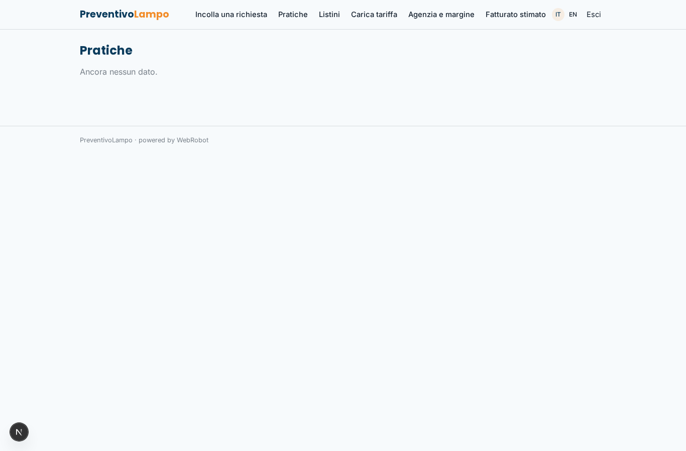
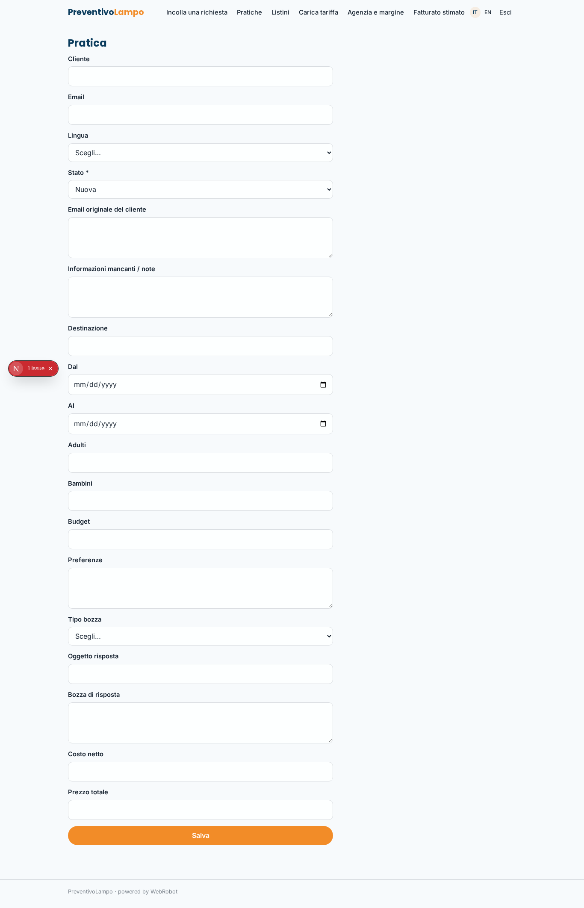
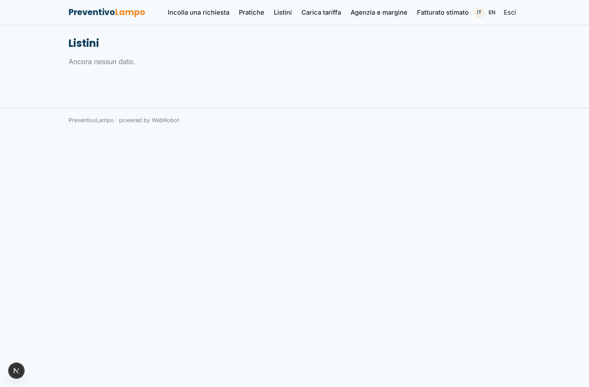
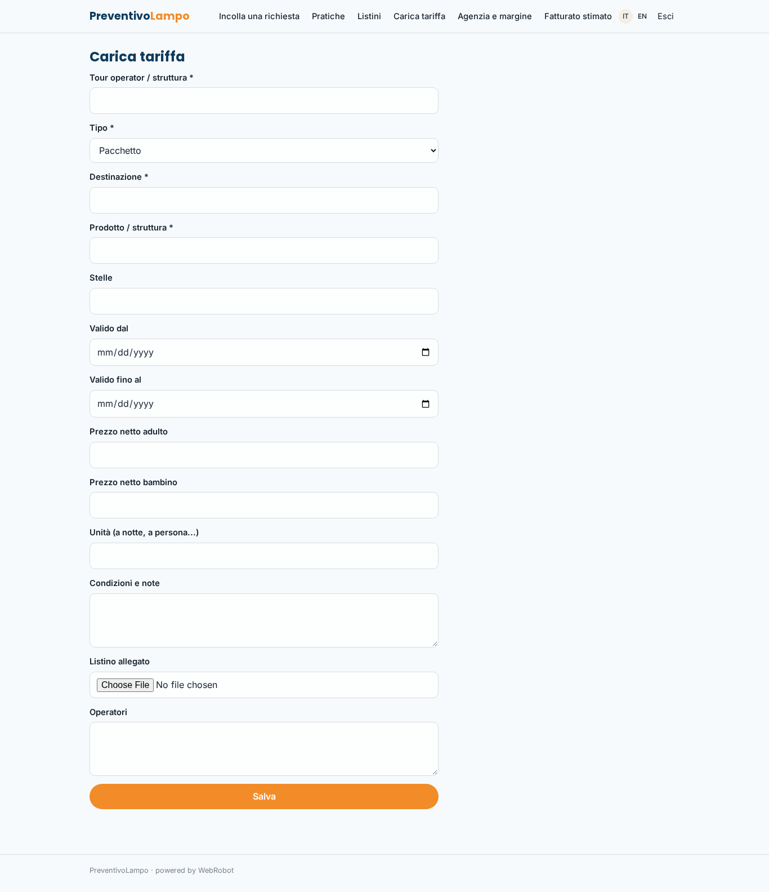
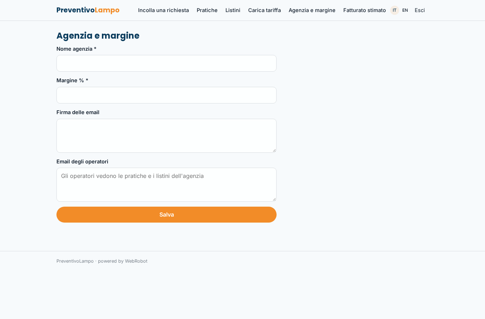
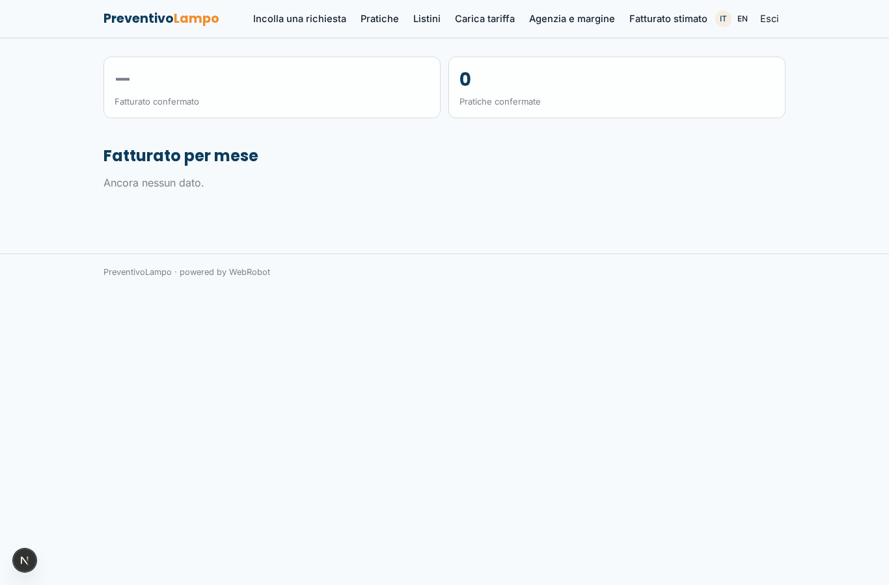
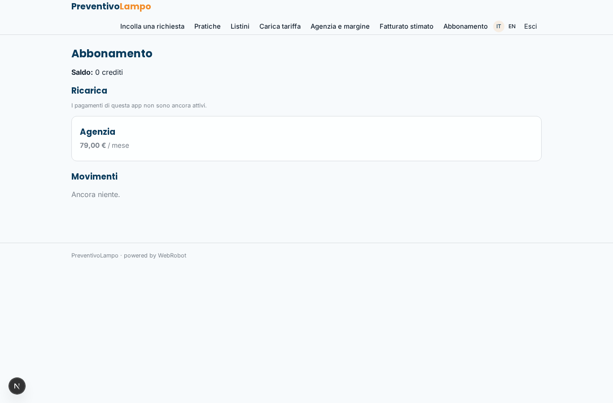

# PreventivoLampo

_Dalla richiesta del cliente al preventivo pronto da approvare, in pochi minuti._

**Manifest:** valid (schema + runtime contract) · **Functional test:** passed (16 checks passed)

## Description given to the app builder (Italian)

Gestisco un'agenzia viaggi e voglio PreventivoLampo. Collego la casella email dove arrivano le richieste dei clienti; un agente legge ogni nuova email, estrae destinazione, date, numero di adulti e bambini, budget, preferenze (mare, cultura, hotel 4 stelle, volo incluso) e se mancano informazioni prepara una risposta per chiederle. Poi compone due o tre proposte di pacchetto usando esclusivamente i listini e le tariffe dei nostri tour operator e strutture convenzionate, che carico e aggiorno io nell'app (niente prezzi presi da portali di prenotazione esterni). Calcola il prezzo totale con il nostro margine e scrive l'email di preventivo con descrizione, itinerario e condizioni. L'operatore dell'agenzia vede la richiesta originale accanto alla bozza, può correggerla e la approva; solo dopo l'approvazione la risposta parte dalla nostra casella. Ogni pratica resta in un elenco con stato (nuova, in attesa, inviata, confermata). Gli operatori vedono le pratiche dell'agenzia, il titolare anche il fatturato stimato. Abbonamento mensile per agenzia. Italiano e inglese per i clienti stranieri.

## Features not expressible today (spec.extensions)

- **own_mailbox**: Connecting the agency's own mailbox (IMAP/Google/Microsoft OAuth) to read incoming mail and sending the approved reply from that mailbox is not available yet. Today: forward requests to the app's email channel address (or paste the text), and the approved reply is sent by the platform email.
- **operator_roles**: Operators are added by the owner as emails in the settings and see the agency's practices and rate lists; a separate owner-only revenue view per role is not enforceable yet, so the revenue page is open to all signed-in agency users.

## Screenshots (interpretive runtime, no data)

### home-anon

### home-mobile

### home

### new_request

### practices

### practice

### rates

### rate_new

### settings

### revenue

### account

