# PreventivoLampo

_Dalla richiesta del cliente al preventivo pronto in pochi minuti, solo sui vostri listini._

**Stato manifest:** valido (validatore Python + contratto runtime)

## Descrizione data all'app builder

Gestisco un'agenzia viaggi e voglio PreventivoLampo. Collego la casella email dove arrivano le richieste dei clienti; un agente legge ogni nuova email, estrae destinazione, date, numero di adulti e bambini, budget, preferenze (mare, cultura, hotel 4 stelle, volo incluso) e se mancano informazioni prepara una risposta per chiederle. Poi compone due o tre proposte di pacchetto usando esclusivamente i listini e le tariffe dei nostri tour operator e strutture convenzionate, che carico e aggiorno io nell'app (niente prezzi presi da portali di prenotazione esterni). Calcola il prezzo totale con il nostro margine e scrive l'email di preventivo con descrizione, itinerario e condizioni. L'operatore dell'agenzia vede la richiesta originale accanto alla bozza, può correggerla e la approva; solo dopo l'approvazione la risposta parte dalla nostra casella. Ogni pratica resta in un elenco con stato (nuova, in attesa, inviata, confermata). Gli operatori vedono le pratiche dell'agenzia, il titolare anche il fatturato stimato. Abbonamento mensile per agenzia. Italiano e inglese per i clienti stranieri.

## Funzioni non esprimibili oggi (spec.extensions)

- **mailbox_connector**: Reading new emails from the agency mailbox and sending approved replies from it are not available yet (they need the agency's own mailbox credentials and notifications). For now the operator pastes the customer's email and copies the approved draft into their mail client.
- **file_upload_rate_cards**: Uploading rate card files (PDF/Excel) is not available yet: rate cards are entered as records or pasted as text in the Rate cards view.
- **multi_agency**: Data is held in the app owner's back office: one deployment per agency. A shared multi-agency version with per-agency staff would need an agency-scoped ownership model.

## Screenshot (runtime interpretativo)

### home-anon
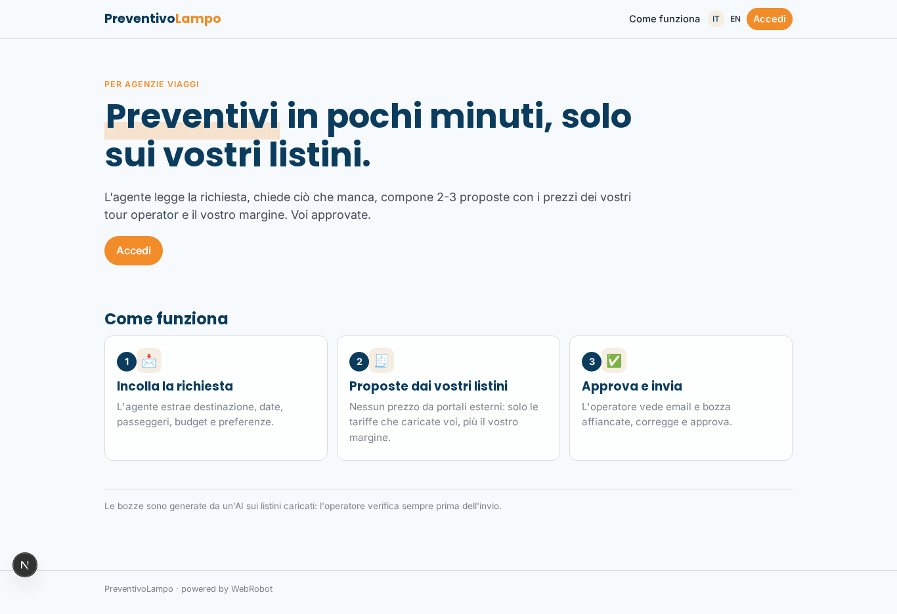

### home-mobile

### home
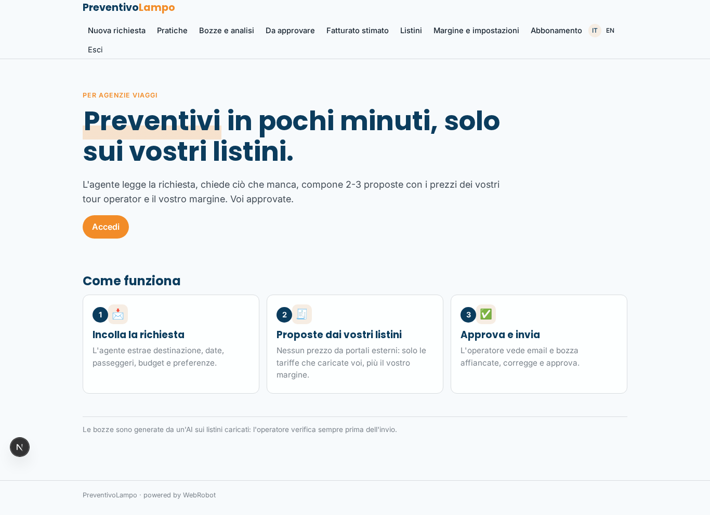

### new_request
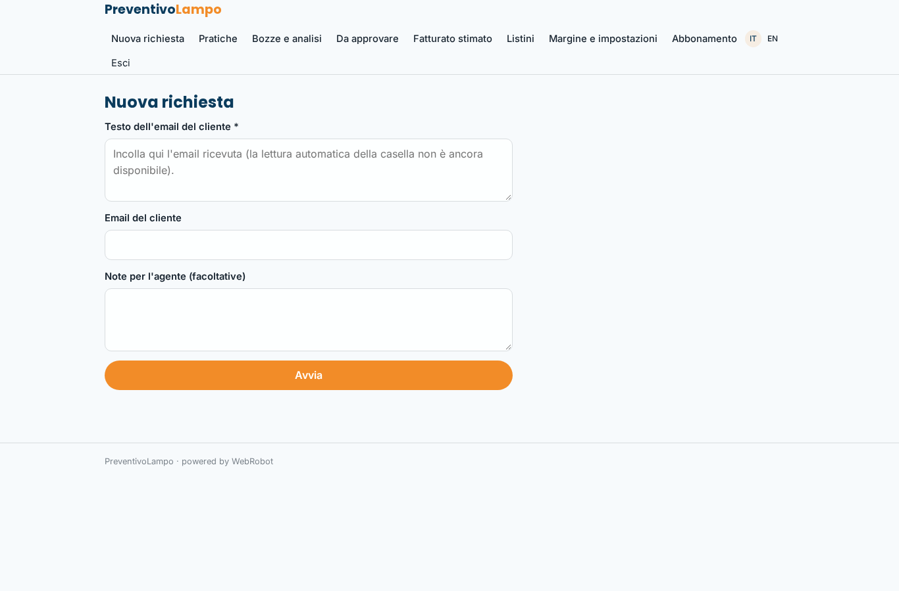

### cases_list
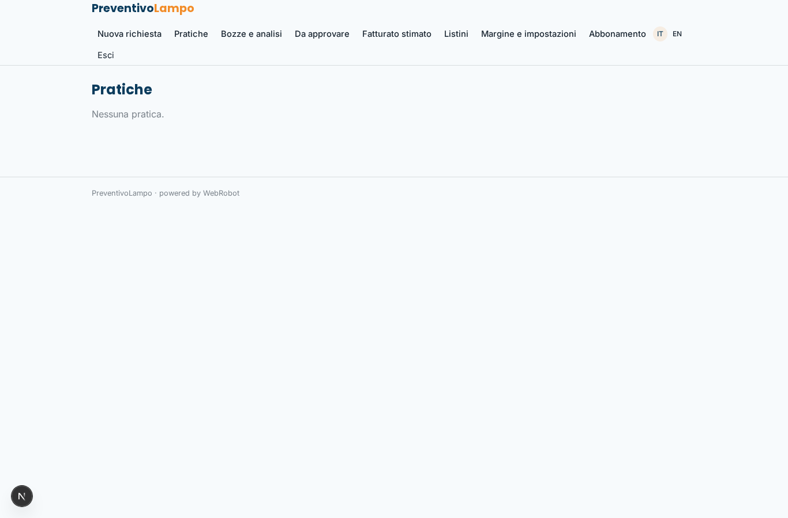

### runs
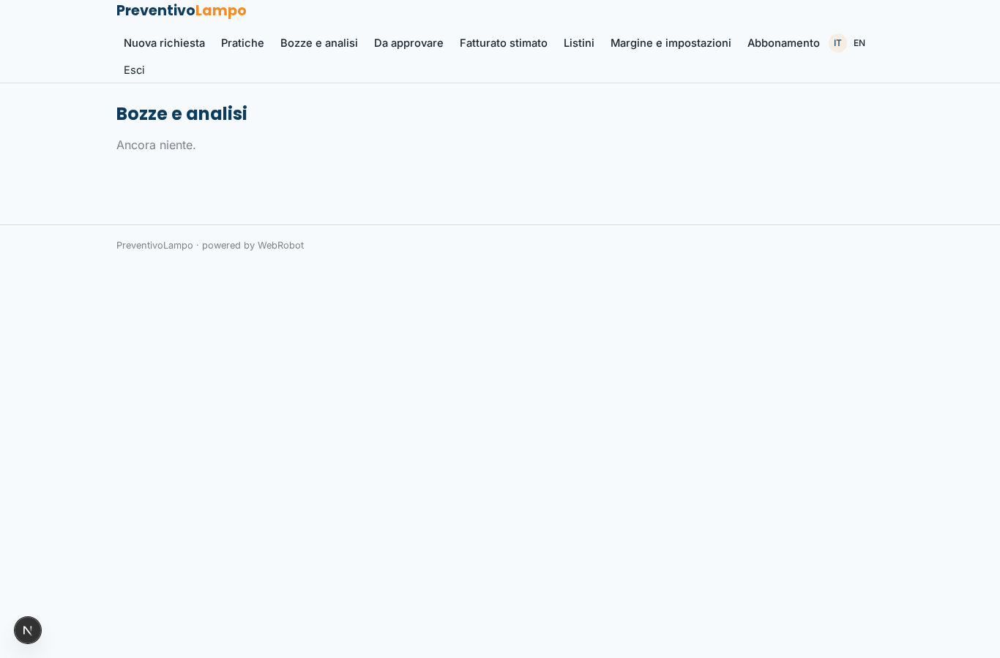

### to_approve
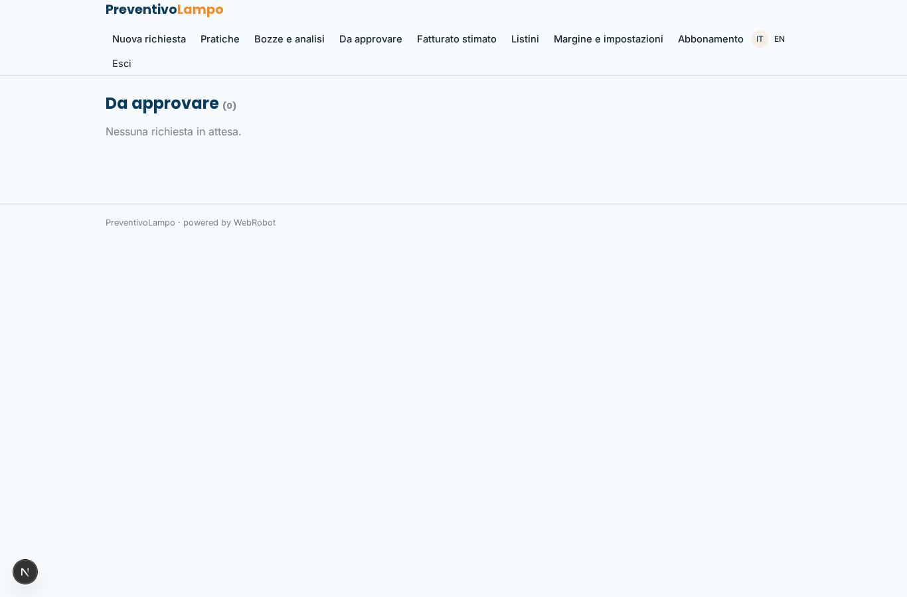

### revenue
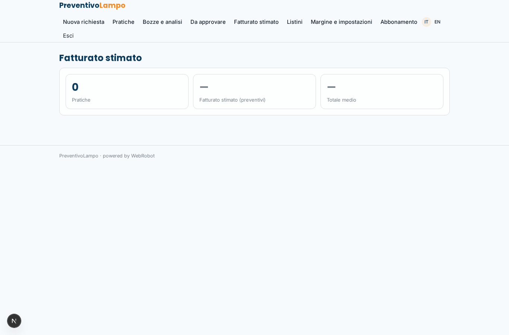

### revenue_data
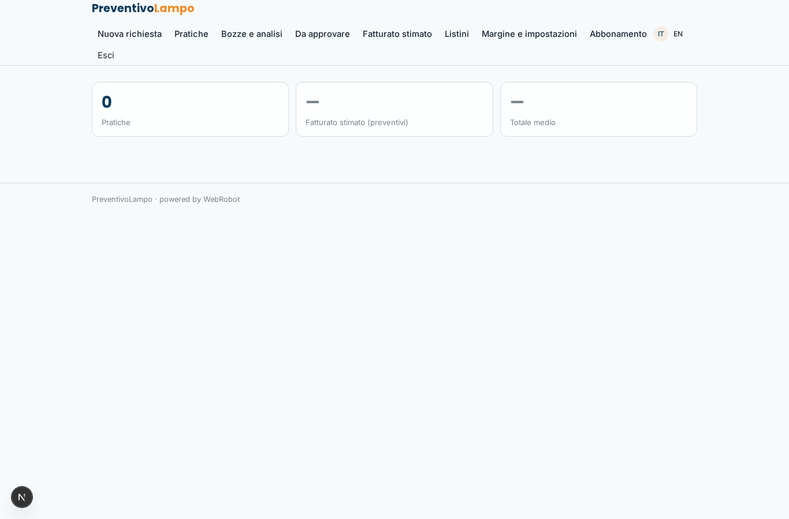

### admin_rate_cards
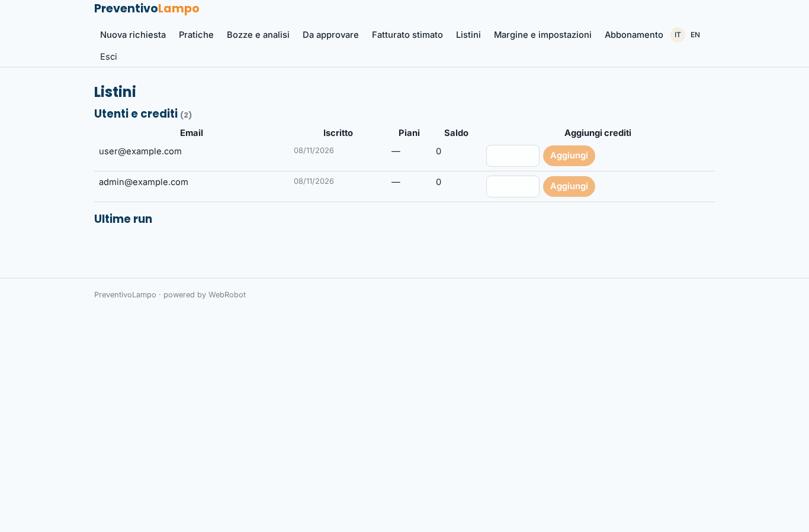

### admin_settings
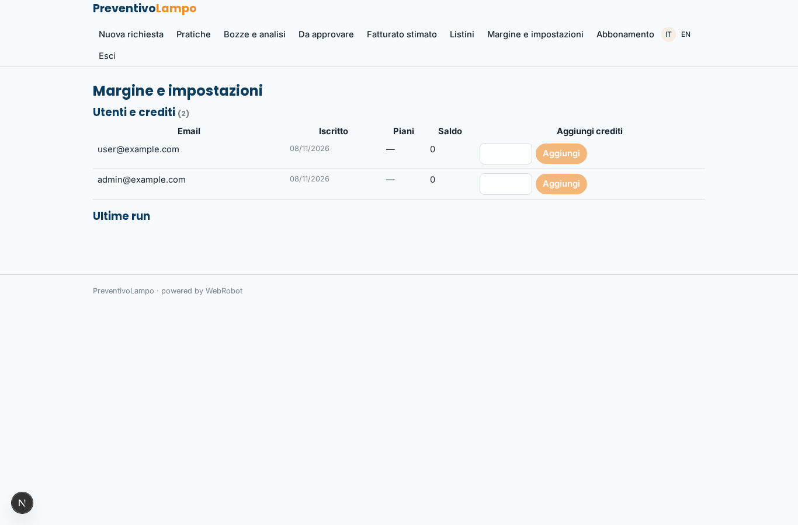

### account
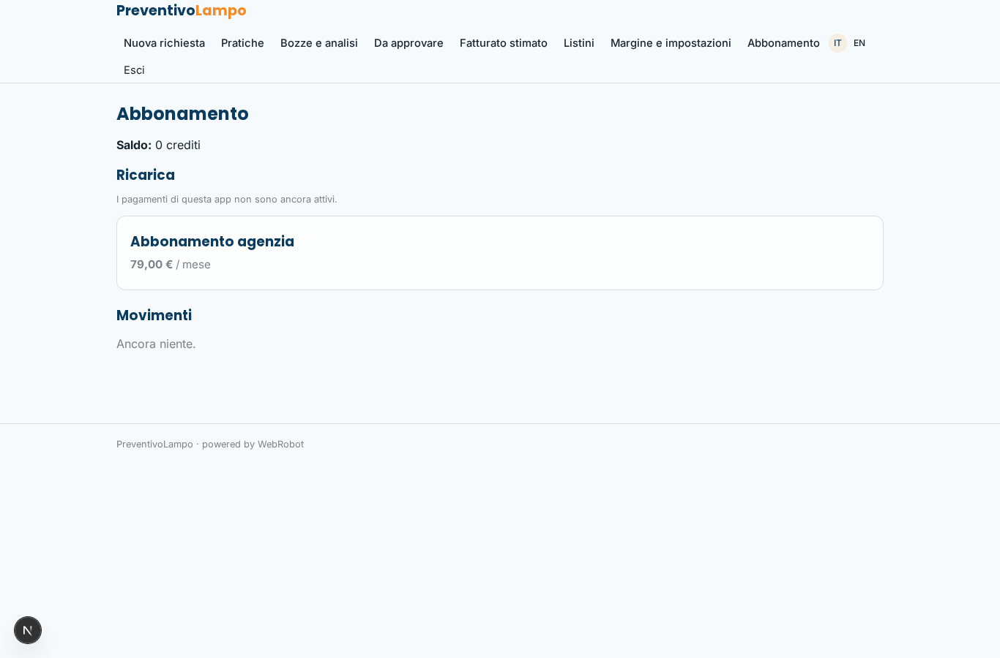

