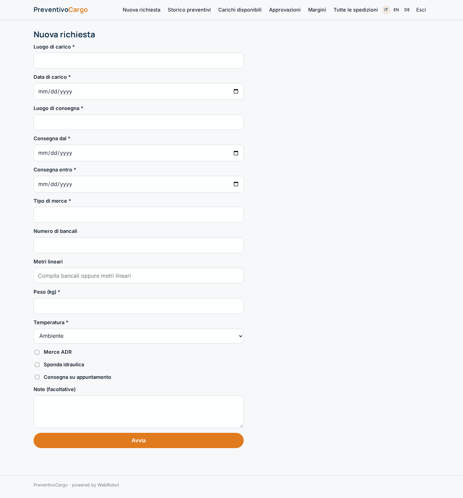
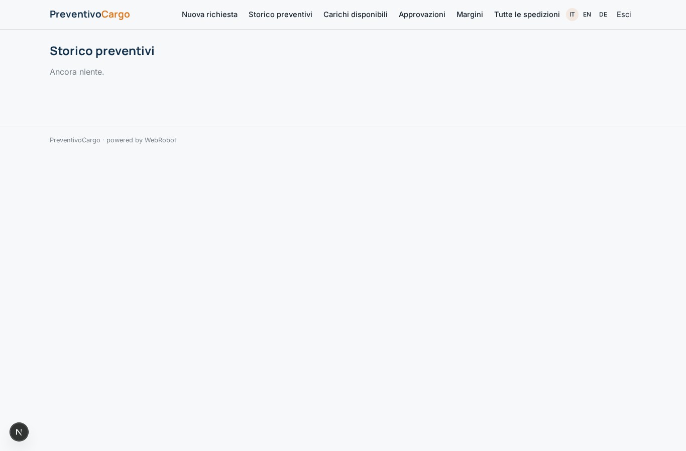
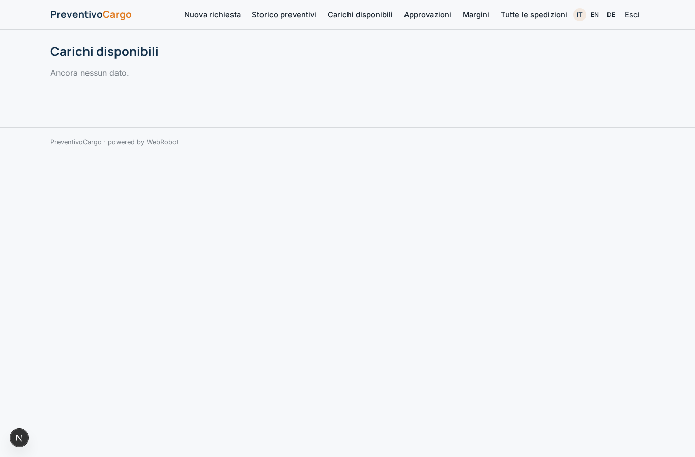
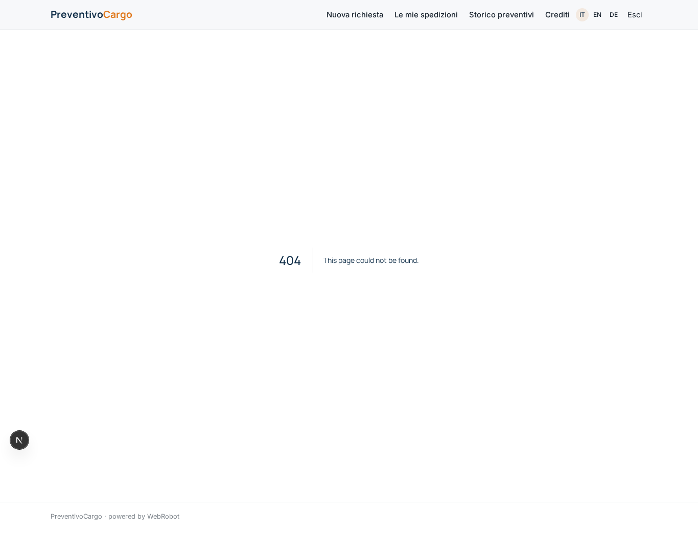
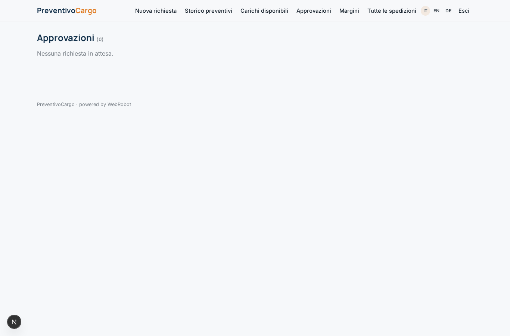
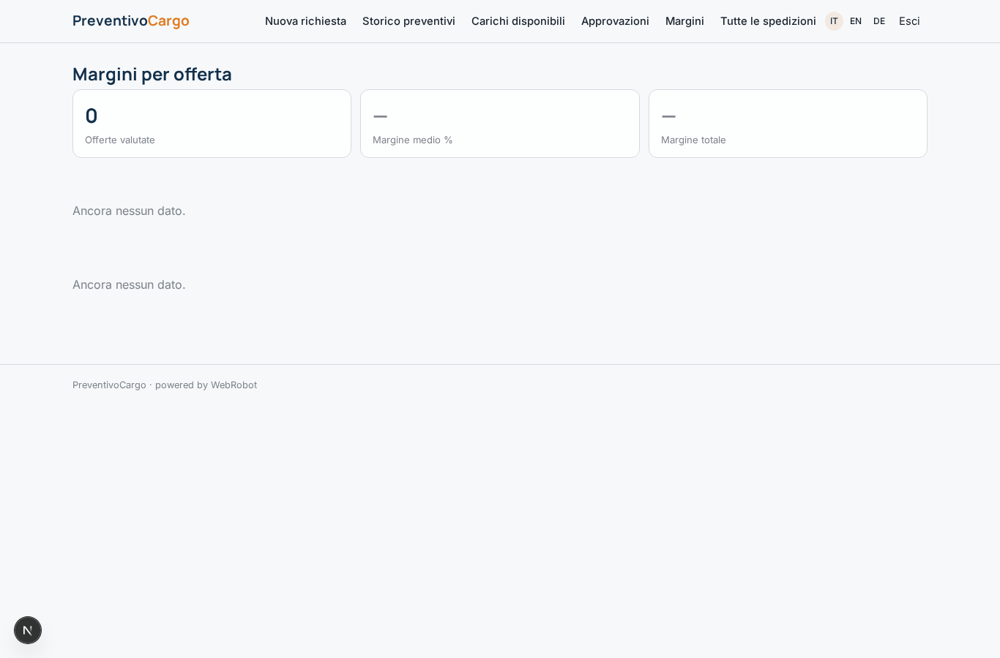
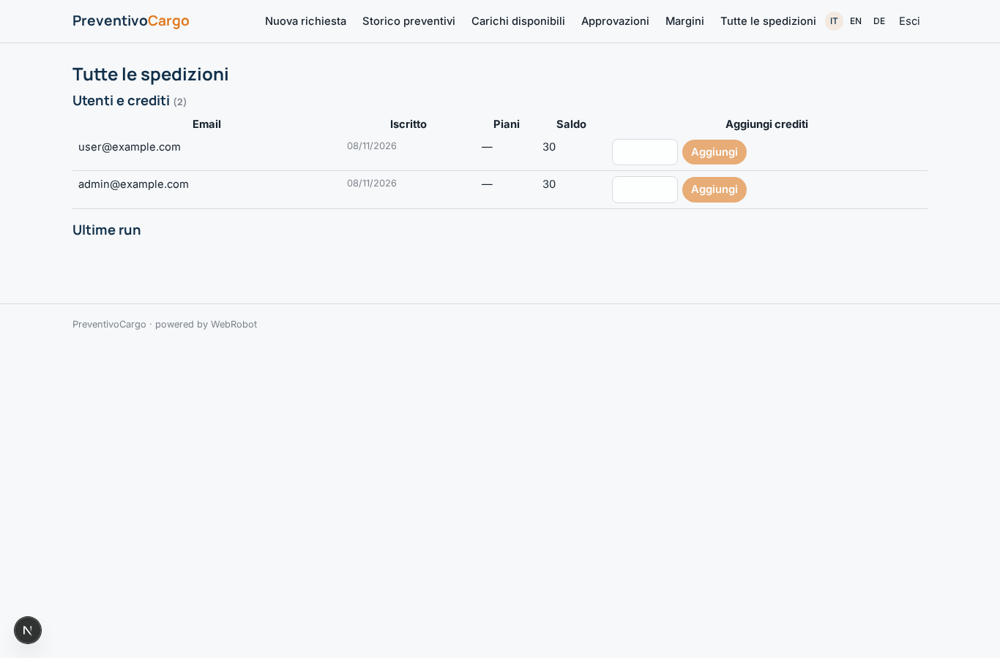
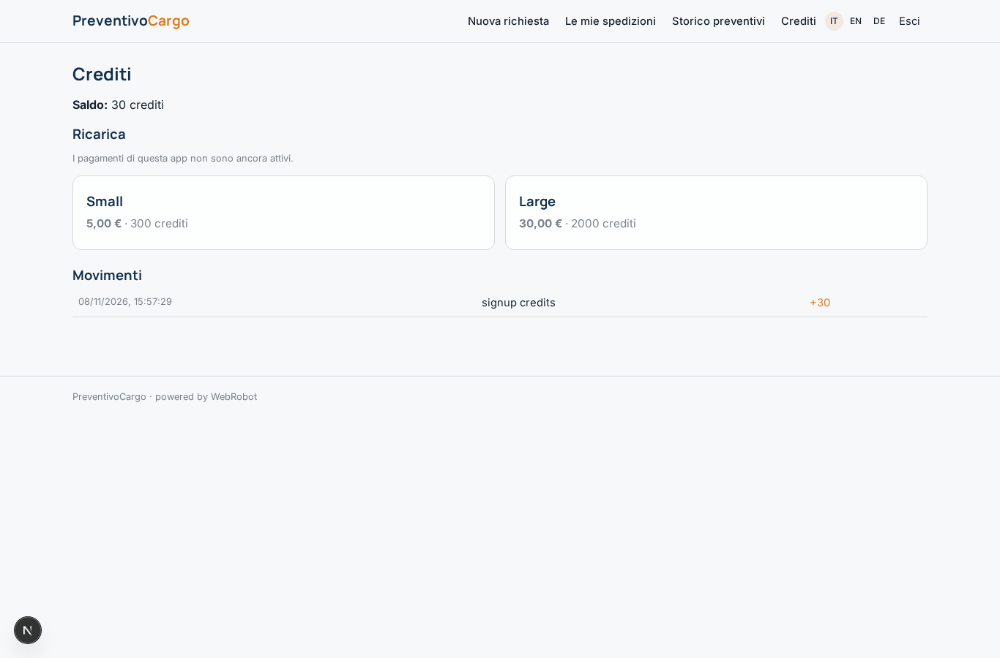

# PreventivoCargo

_Preventivo trasporto in pochi secondi, vettori in gara, tracking fino alla consegna._

**Manifest status:** valid (schema validator + runtime contract)

## Description given to the app builder (Italian)

Mi serve PreventivoCargo, uno strumento per spedizionieri e aziende che spediscono merci su strada in Italia ed Europa. Il cliente compila il modulo di richiesta: luogo e data di carico, luogo e finestra di consegna, tipo di merce, numero di bancali o metri lineari, peso, temperatura controllata, ADR sì/no, servizi accessori (sponda, appuntamento). Un agente normalizza gli indirizzi, calcola distanze e pedaggi da dati open, poi stima il prezzo con un modello addestrato sullo storico delle tratte dello spedizioniere, tenendo conto di stagionalità, prezzo del gasolio pubblicato e rischio di viaggio a vuoto al ritorno. Il cliente riceve in pochi secondi un prezzo indicativo con forchetta e tempi; se accetta, la richiesta passa a un marketplace di vettori registrati, che vedono i carichi disponibili nella loro zona e fanno offerta. L'operatore dello spedizioniere sceglie il vettore e conferma; serve la sua approvazione per margini sotto soglia. Poi tracking della consegna con aggiornamenti via email e caricamento del documento di trasporto firmato. Il cliente vede solo le sue spedizioni, il vettore solo i carichi assegnati, l'operatore tutto più una dashboard margini. Commissione per spedizione. Italiano, inglese, tedesco.

## Features not expressible today (spec.extensions)

- **email_tracking**: Email updates on delivery tracking are not available yet: customers see the status in My shipments.
- **pod_upload**: Uploading the signed transport document is not available yet: the carrier gives a link, saved in pod_url.
- **trained_price_model**: No trained ML model can run on the platform: the agent estimates from the lanes in route_history (to be loaded by the operator), season, diesel and empty-return risk.
- **carrier_assignment**: Carrier selection by the operator and carrier-only visibility of assigned loads need custom logic: today carriers see anonymised open loads and their own bids; assignment is done by the operator in the back office.

## Screenshots (interpretive runtime)

### home-anon

### home-mobile

### home

### new_quote

### my_shipments

### history

### loadboard

### my_bids

### carrier_profile

### approvals

### margins

### admin_runs

### account

