# PreventivoCargo

_Preventivo trasporto in pochi secondi, vettori in gara, consegna tracciata._

**Manifest:** valid (schema + runtime contract) · **Functional test:** passed (36 checks passed)

## Description given to the app builder (Italian)

Mi serve PreventivoCargo, uno strumento per spedizionieri e aziende che spediscono merci su strada in Italia ed Europa. Il cliente compila il modulo di richiesta: luogo e data di carico, luogo e finestra di consegna, tipo di merce, numero di bancali o metri lineari, peso, temperatura controllata, ADR sì/no, servizi accessori (sponda, appuntamento). Un agente normalizza gli indirizzi, calcola distanze e pedaggi da dati open, poi stima il prezzo con un modello addestrato sullo storico delle tratte dello spedizioniere, tenendo conto di stagionalità, prezzo del gasolio pubblicato e rischio di viaggio a vuoto al ritorno. Il cliente riceve in pochi secondi un prezzo indicativo con forchetta e tempi; se accetta, la richiesta passa a un marketplace di vettori registrati, che vedono i carichi disponibili nella loro zona e fanno offerta. L'operatore dello spedizioniere sceglie il vettore e conferma; serve la sua approvazione per margini sotto soglia. Poi tracking della consegna con aggiornamenti via email e caricamento del documento di trasporto firmato. Il cliente vede solo le sue spedizioni, il vettore solo i carichi assegnati, l'operatore tutto più una dashboard margini. Commissione per spedizione. Italiano, inglese, tedesco.

## Functional test: what did not pass

- **form saves a record** (form bid): only role carrier may fill it, and the test cannot hold that role _(warning)_
- **form saves a record** (form update_delivery): only role carrier may fill it, and the test cannot hold that role _(warning)_
- **saved record shown where its collection is read** (view my_shipments): a record was saved in shipments (by user) but the page does not show it (as user) _(warning)_
- **saved record shown where its collection is read** (view my_jobs): a record was saved in shipments (by user) but the page does not show it (as carrier) _(warning)_
- **saved record shown where its collection is read** (view ops_shipments): a record was saved in shipments (by user) but the page does not show it (as admin) _(warning)_

## Features not expressible today (spec.extensions)

- **trained_price_model**: A price model trained on the forwarder's lane history is not available yet: the quoter estimates from similar lanes (median EUR/km) adjusted for fuel, seasonality and return risk. Bulk CSV import of the history and model training are missing.
- **toll_api**: No open toll API: tolls are estimated with per-country per-km rates.
- **carrier_zone_filter**: Carriers see all open loads; automatic filtering by the zones of their profile is not available yet.
- **sms_whatsapp_tracking**: Tracking updates are by email only; SMS/WhatsApp/push and live GPS positions are not available yet.

## Screenshots (interpretive runtime, no data)

### home-anon

### home-mobile

### home

### new_quote

### quotes_history
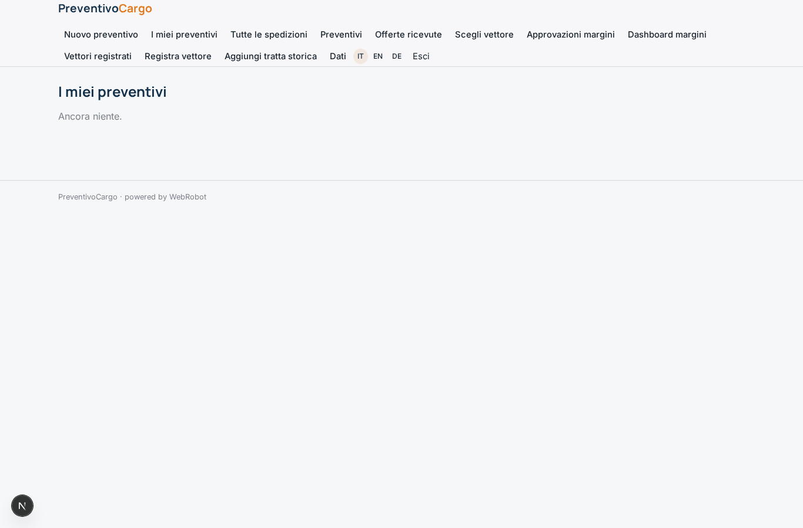

### my_shipments
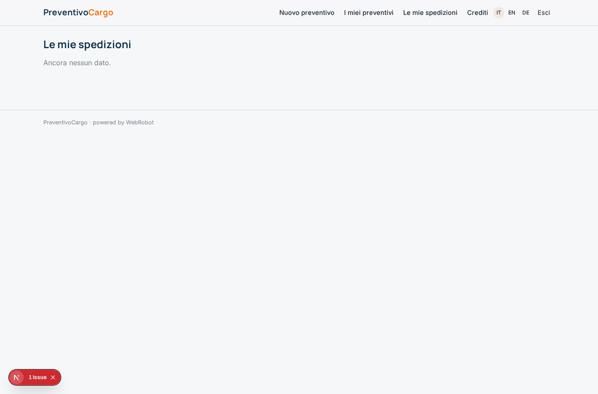

### accept
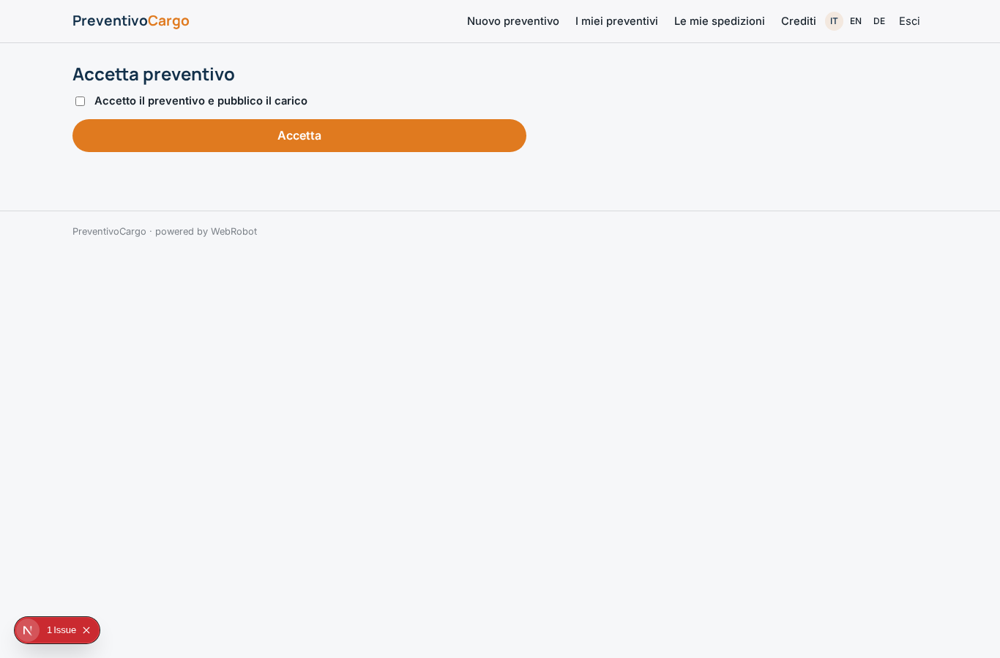

### loads_open

### bid

### my_bids

### my_jobs

### update_delivery

### ops_shipments
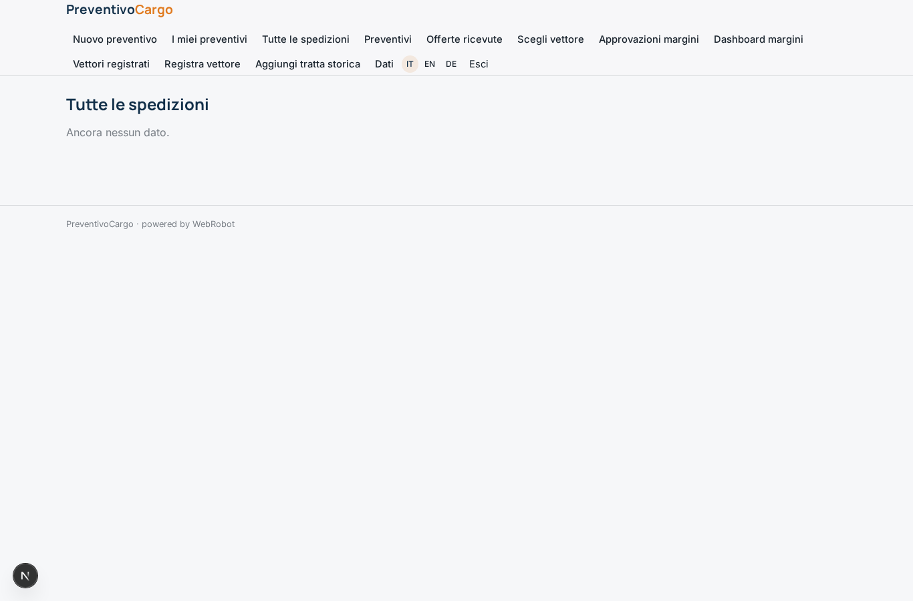

### ops_quotes

### ops_bids
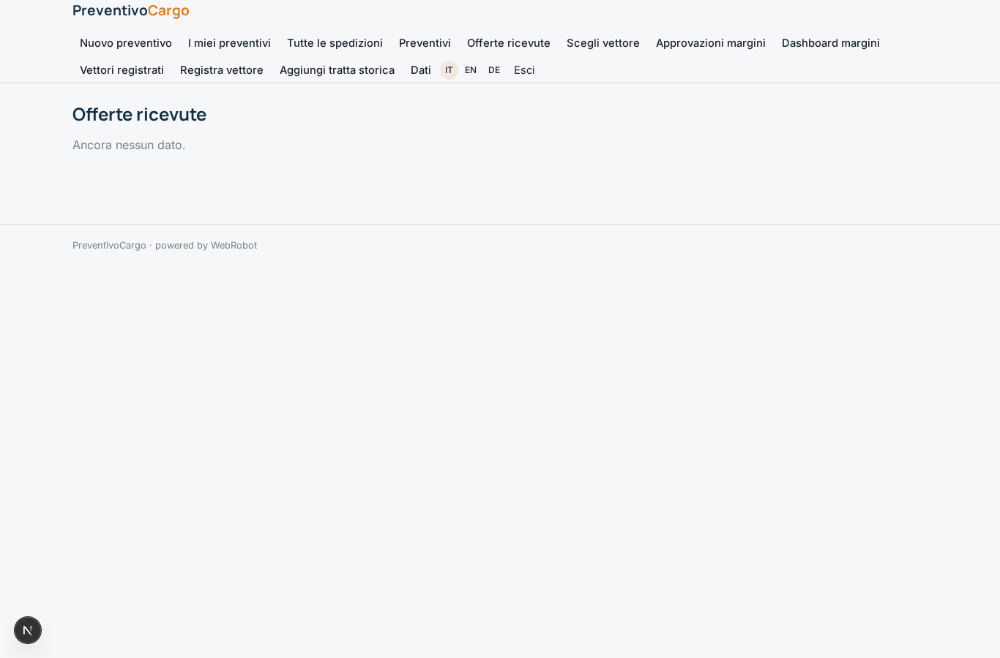

### assign
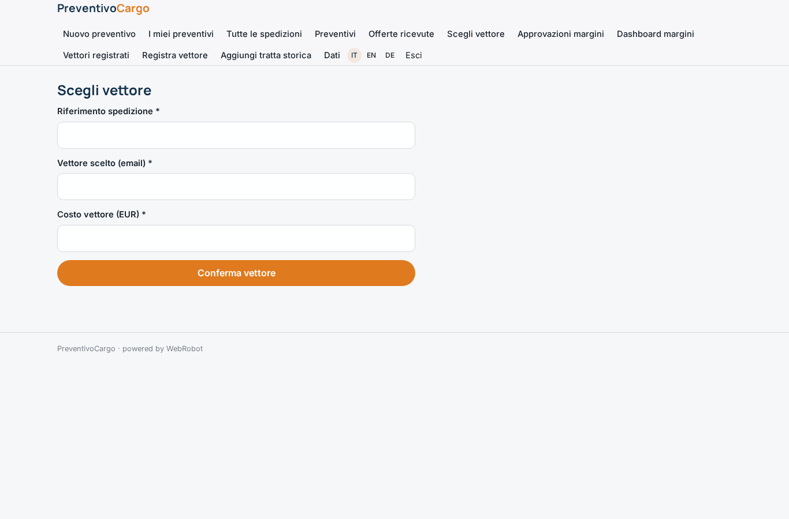

### approvals
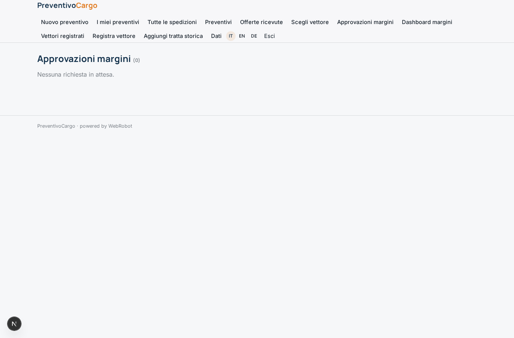

### margins
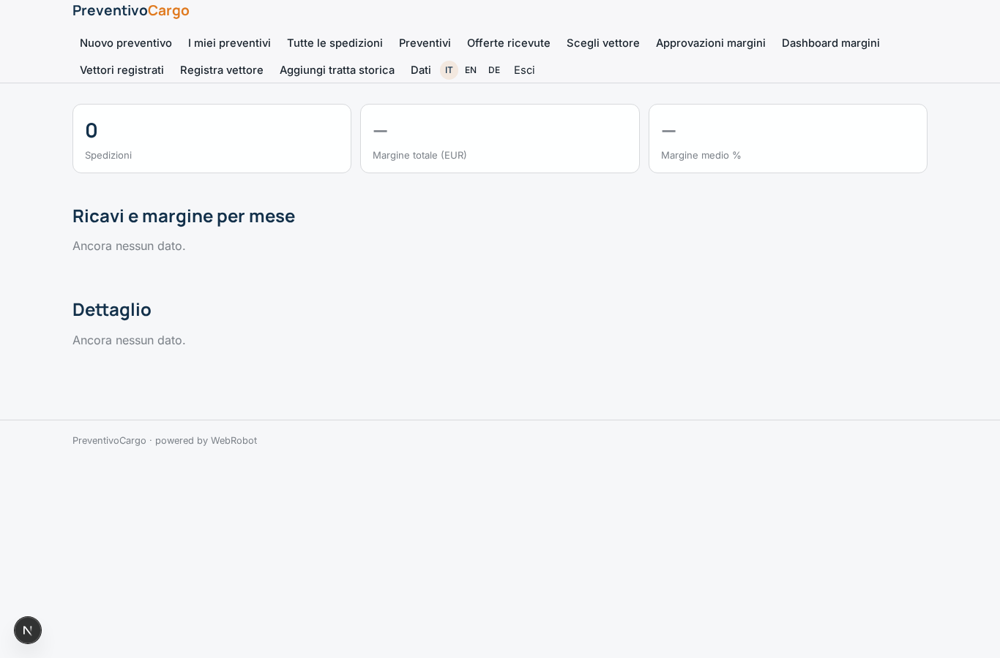

### carriers_list
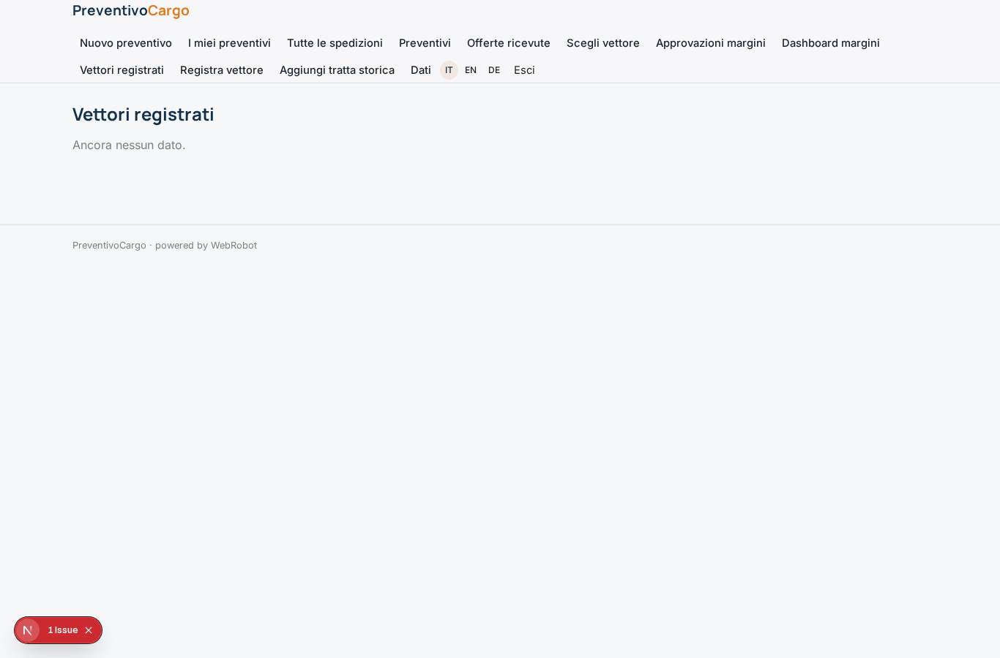

### carrier_new
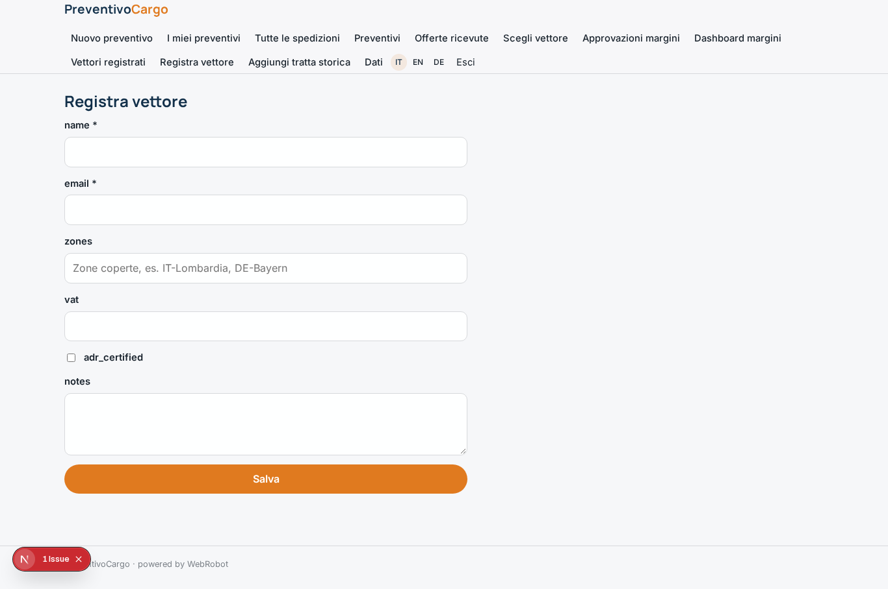

### lane_new
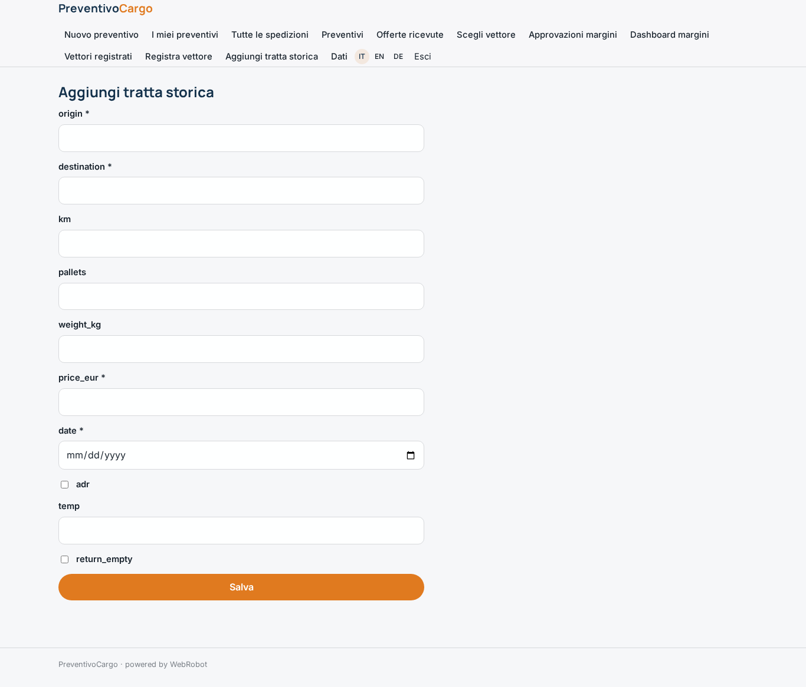

### account
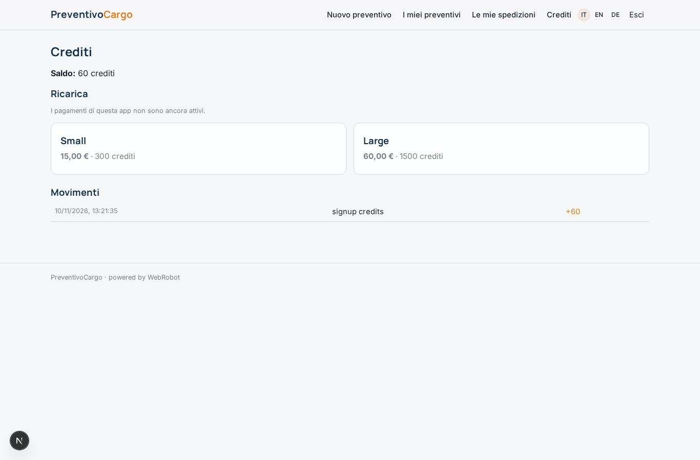
