# PrezzoSentinella

_Sai sempre come prezzano i tuoi concorrenti, nel rispetto dei loro termini._

**Manifest:** valid (schema + runtime contract) · **Functional test:** passed (16 checks passed)

## Description given to the app builder (Italian)

PrezzoSentinella è per brand e retailer che vogliono sapere come prezzano i concorrenti. L'utente carica o inserisce il proprio elenco di prodotti (SKU, EAN, nome, prezzo proprio) e indica gli shop concorrenti da seguire. Per ogni coppia prodotto-shop l'app verifica prima robots.txt e termini d'uso: se lo shop lo vieta, viene segnalato e escluso; non uso mai i siti comparatori, solo gli shop diretti. Ogni giorno alle 6 un agente legge le pagine prodotto consentite, estrae prezzo, disponibilità e promozioni, e salva tutto nello storico. Un secondo agente abbina i prodotti tra shop diversi usando EAN e somiglianza del nome, chiedendo conferma all'utente quando il match è incerto. L'utente vede una tabella con il proprio prezzo, il minimo, la media di mercato e la posizione, più il grafico storico per ciascun SKU. Riceve un alert email quando un concorrente scende sotto una soglia o va fuori stock. Ogni cliente vede solo i propri cataloghi. Abbonamento mensile a scaglioni di SKU monitorati, interfaccia in italiano e inglese.

## Features not expressible today (spec.extensions)

- **plan_sku_cap**: The SKU cap per plan is enforced for products created through the importer; manual form entries are not counted by spec.limits yet.
- **cron_utc**: The daily run is scheduled at 05:00 UTC (06:00 CET in winter, 07:00 CEST in summer).

## Screenshots (interpretive runtime, no data)

### home-anon
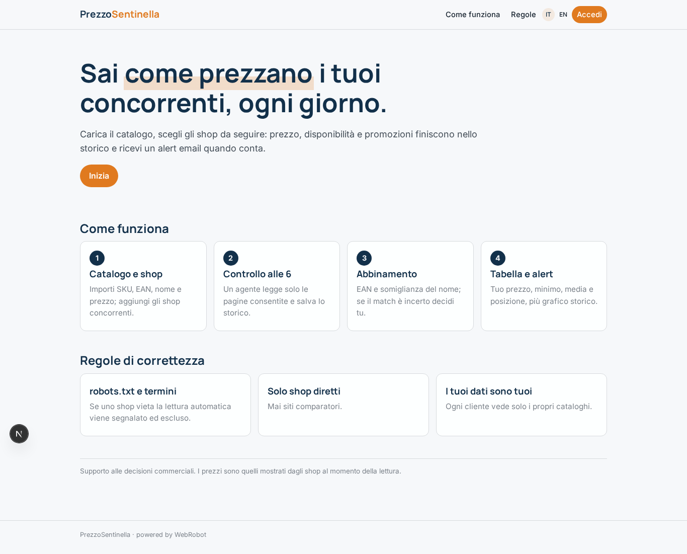

### home-mobile
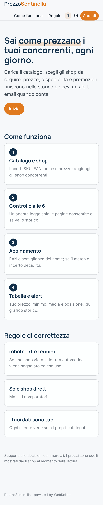

### home
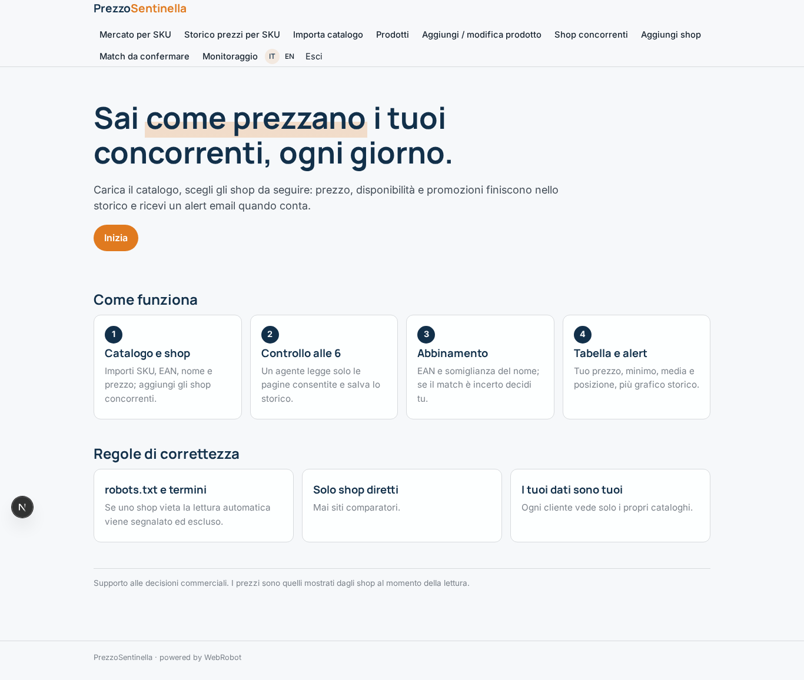

### market
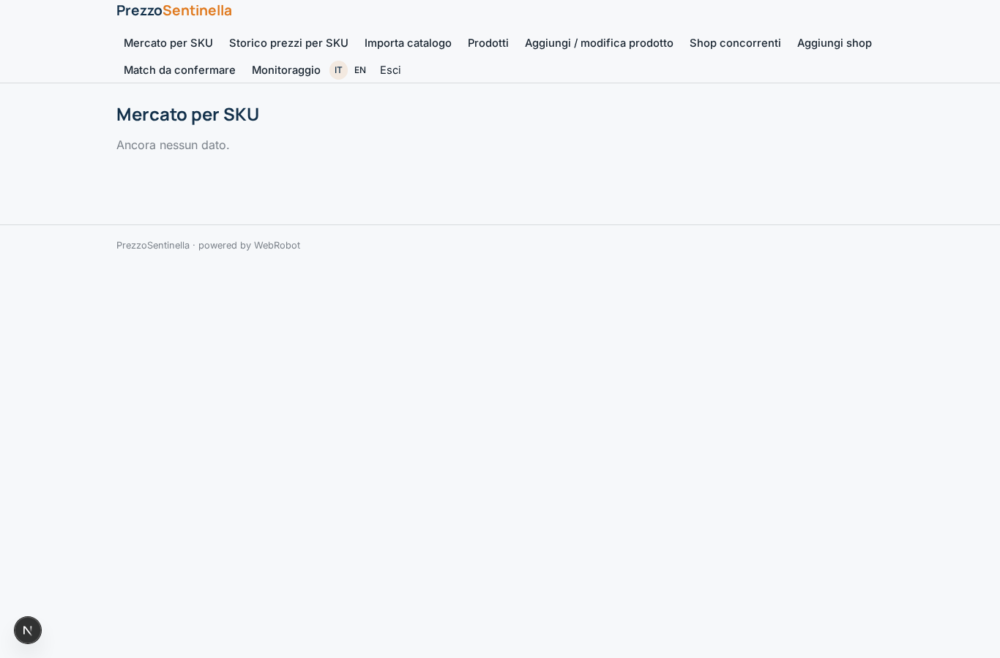

### history
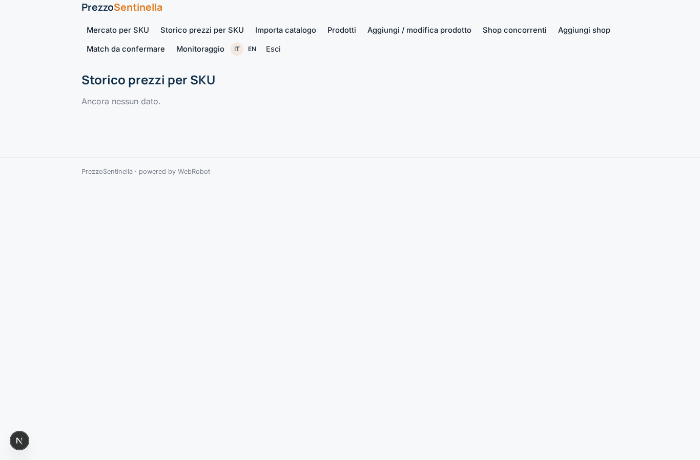

### import
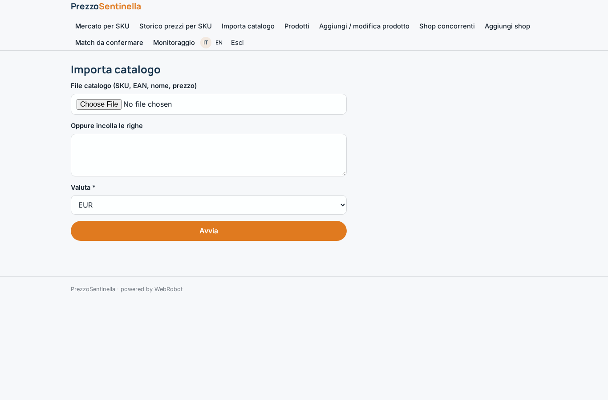

### products
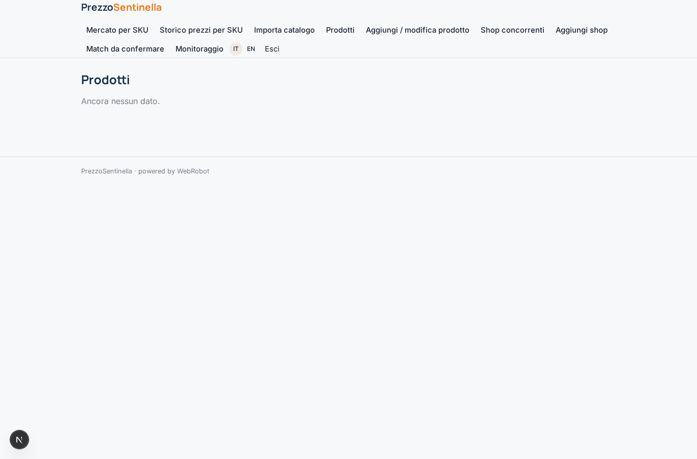

### add_product
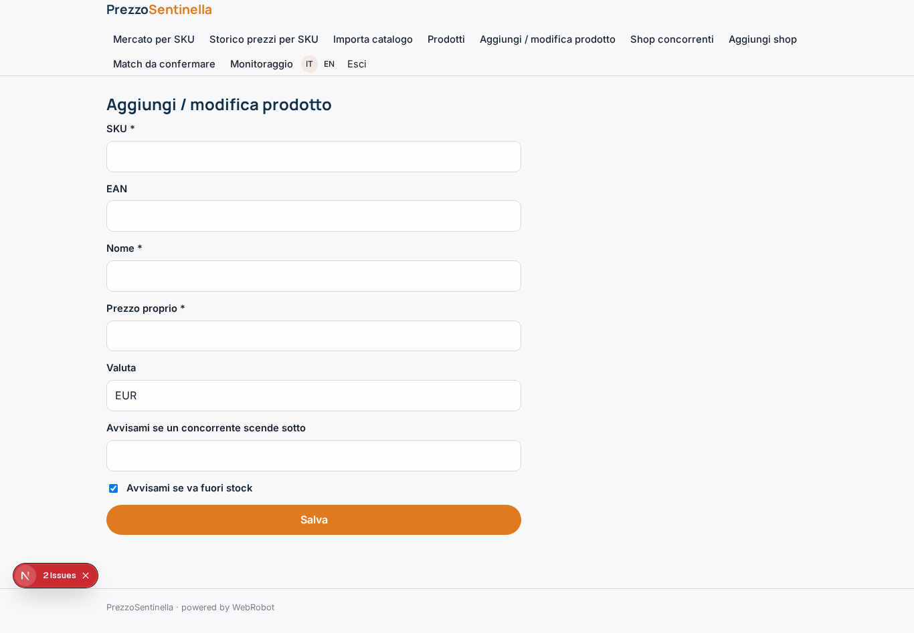

### shops
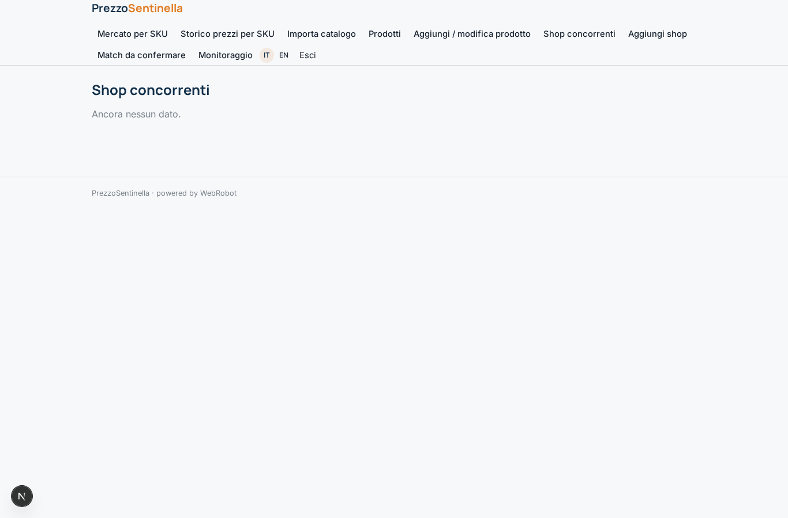

### add_shop
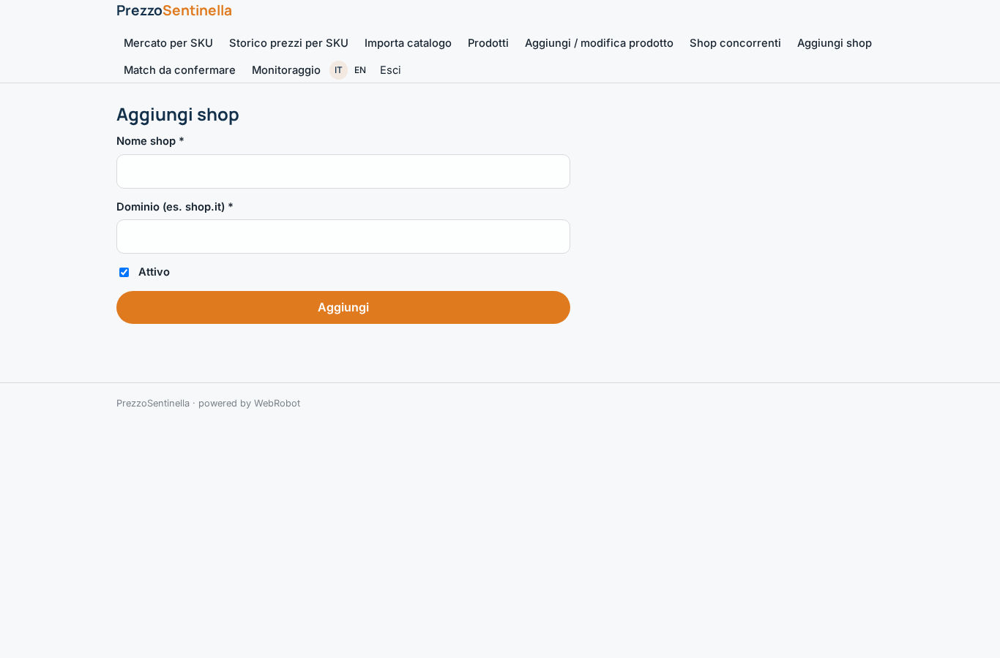

### matches
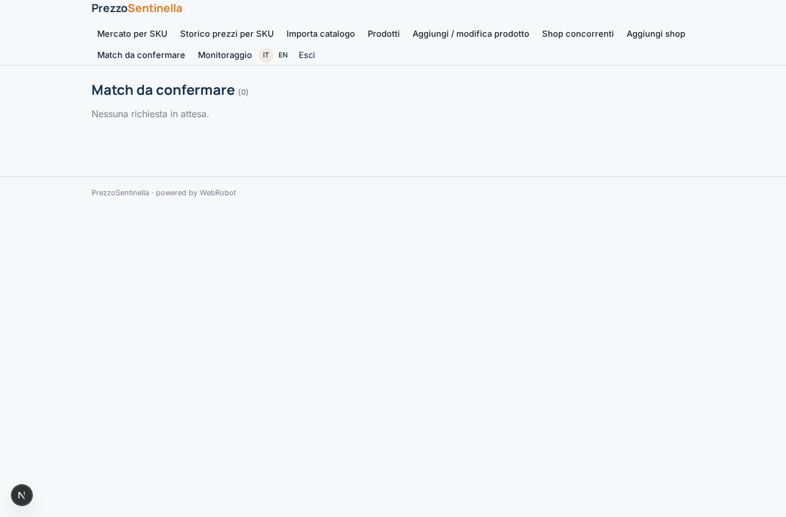

### watches
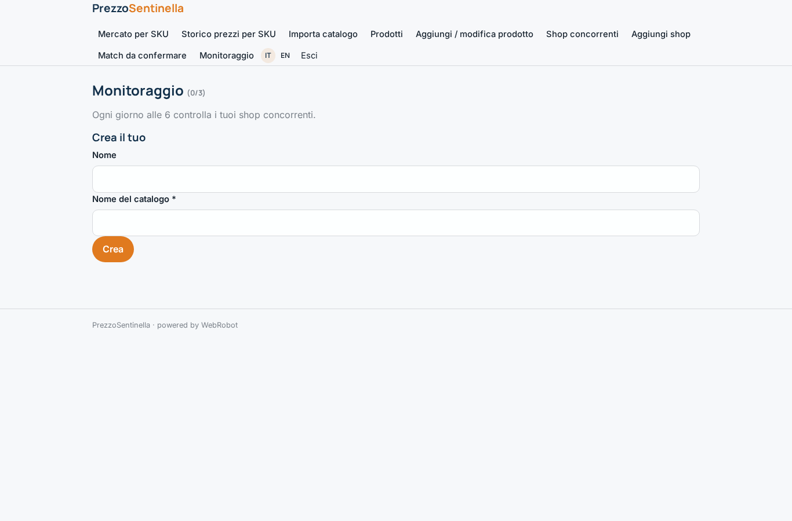

### account
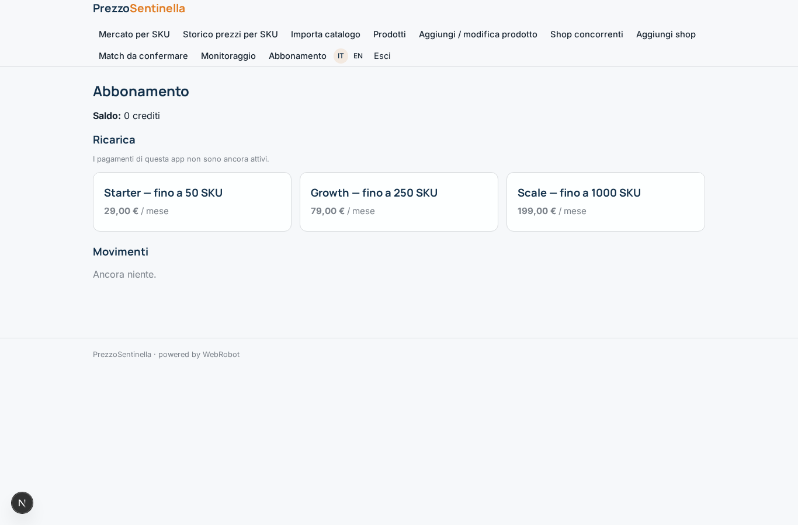
