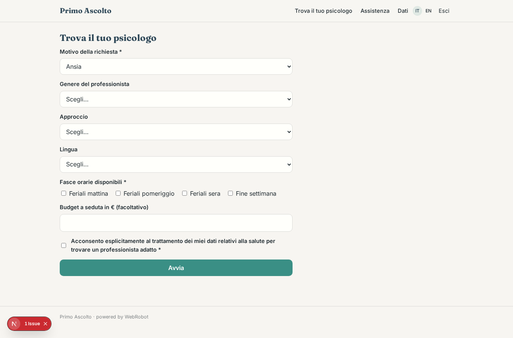
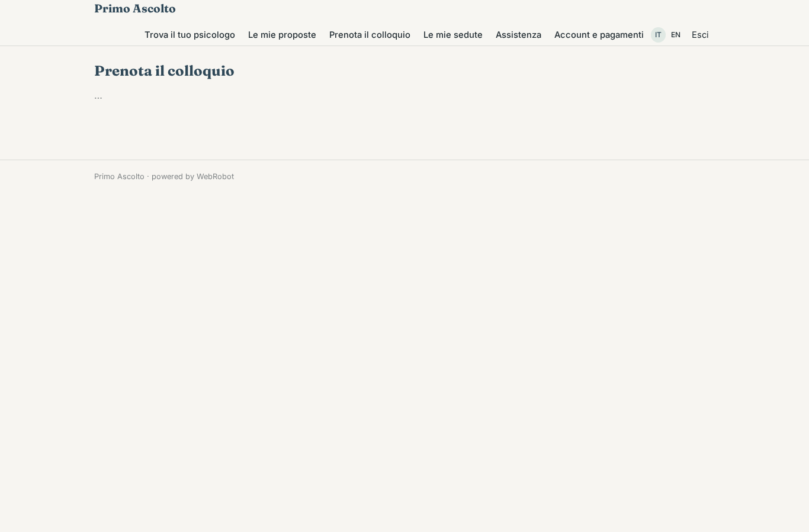
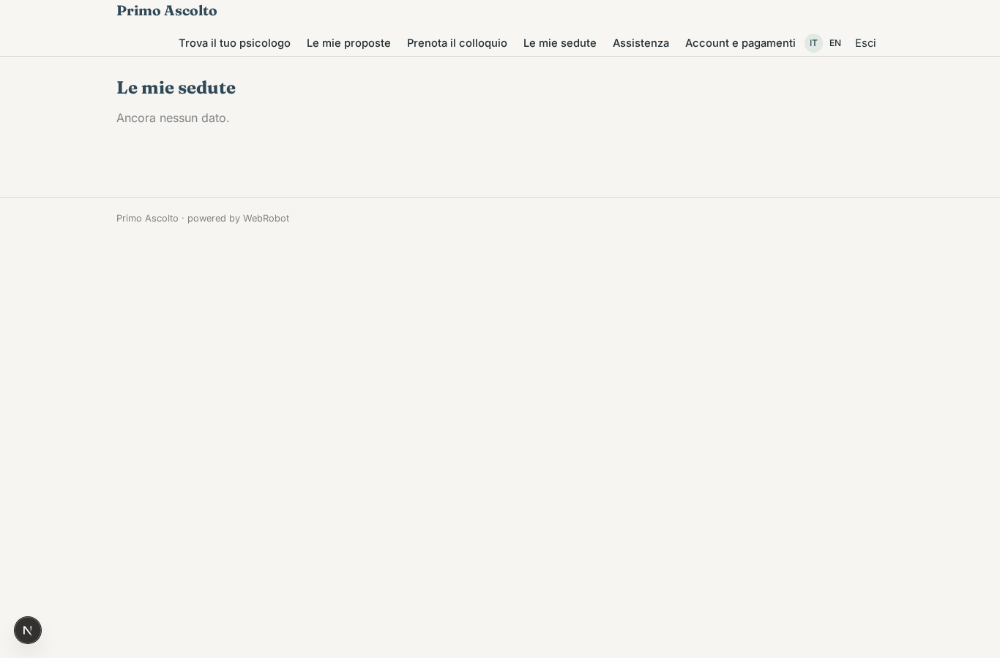
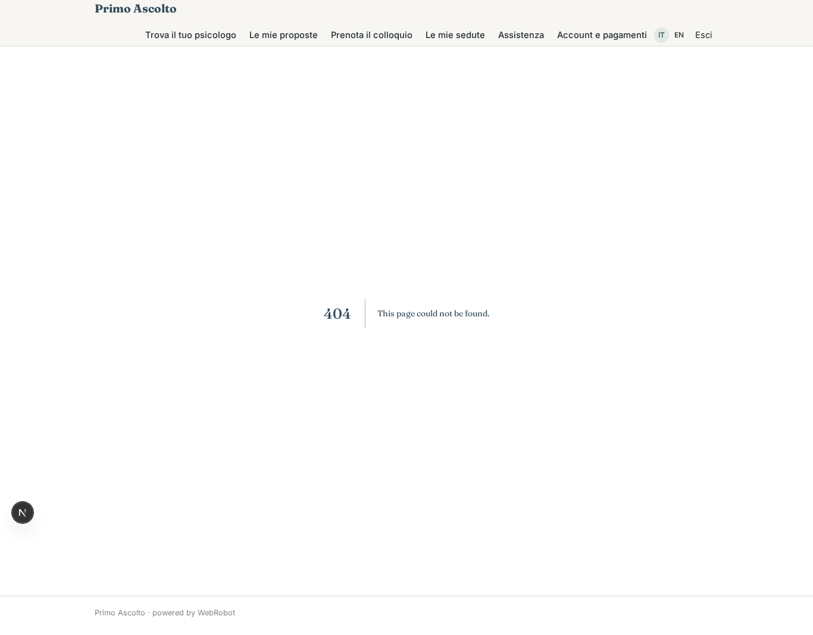
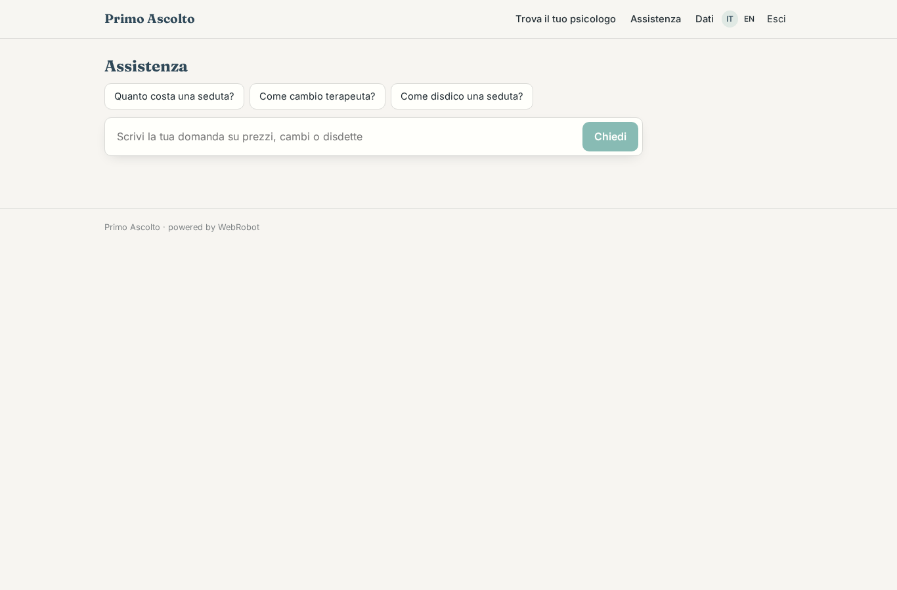
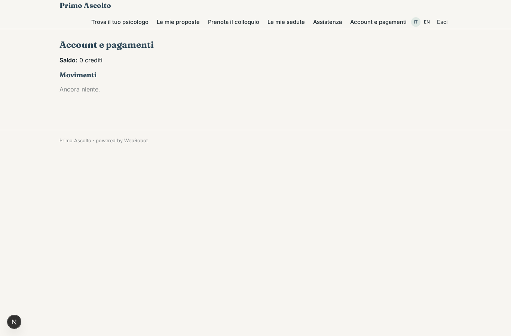

# Primo Ascolto

_Trova lo psicologo giusto e prenota il primo colloquio._

**Manifest:** valid (schema + runtime contract) · **Functional test:** passed (10 checks passed)

## Description given to the app builder (Italian)

Voglio Primo Ascolto, la piattaforma di prenotazione per un servizio di psicologia online. Descrivo solo lo strato software di abbinamento, prenotazione e pagamento: la terapia la fanno psicologi iscritti all'albo, e i dati sanitari vanno trattati con il massimo riserbo e il consenso esplicito. La persona compila un questionario iniziale: motivo della richiesta in categorie (ansia, relazioni, lavoro, lutto), preferenze sul professionista (genere, approccio, lingua), fasce orarie disponibili, eventuale budget. Un agente propone due o tre psicologi compatibili spiegando perché, usando solo i profili e le specializzazioni che i professionisti hanno inserito. La persona sceglie, prenota il primo colloquio da un calendario e paga con carta; le sedute si svolgono in videochiamata dentro la piattaforma. Promemoria via email e notifica prima di ogni seduta. Lo psicologo gestisce agenda e pazienti; nessun altro, admin compreso, vede le note cliniche. Un servizio clienti in chat risponde su prezzi, cambi di terapeuta e disdette, senza mai dare consigli clinici. La piattaforma trattiene una commissione su ogni seduta e versa il resto al professionista.

## Features not expressible today (spec.extensions)

- **video_sessions**: Video calls inside the platform are not available yet: the session link must be added by other means.
- **push_notifications**: Push notifications before a session are not available yet; only email reminders are sent.
- **clinical_notes**: The platform deliberately stores no clinical notes: a notes feature visible only to the author psychologist (not even admins) is not expressible; use the professional's own tool.
- **checkout_at_booking**: Card payment at booking time with the commission split to the psychologist's Stripe Connect account (per_transaction, seller = psychologists) needs the checkout wiring in the studio; the psychologists' appointments rule assumes the booking resource holds the psychologist's email.
- **patient_management**: The psychologist sees only the agenda of their bookings; a richer patient list is not covered.

## Screenshots (interpretive runtime, no data)

### home-anon

### home-mobile

### home

### match

### matches

### book

### my_sessions

### agenda

### support

### account

