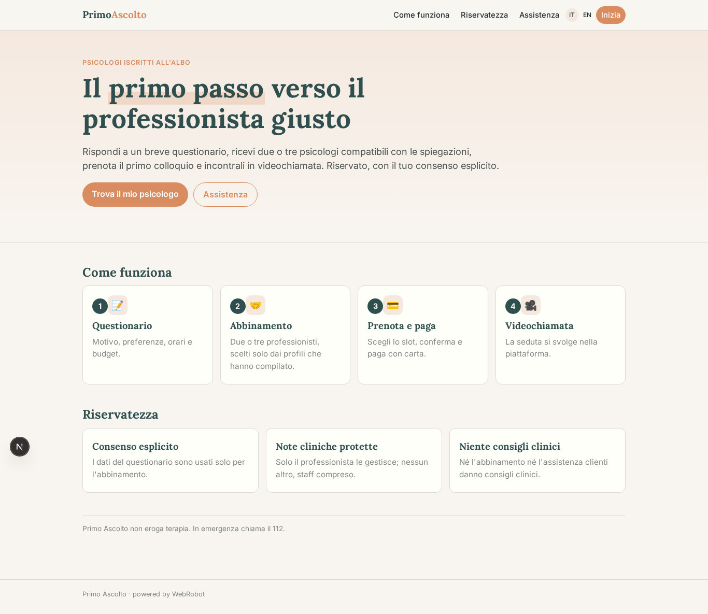
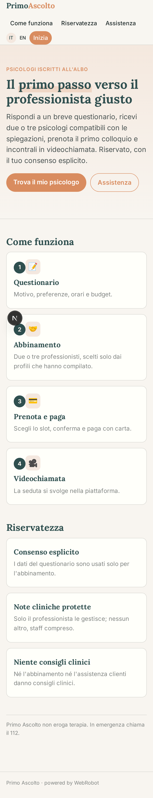
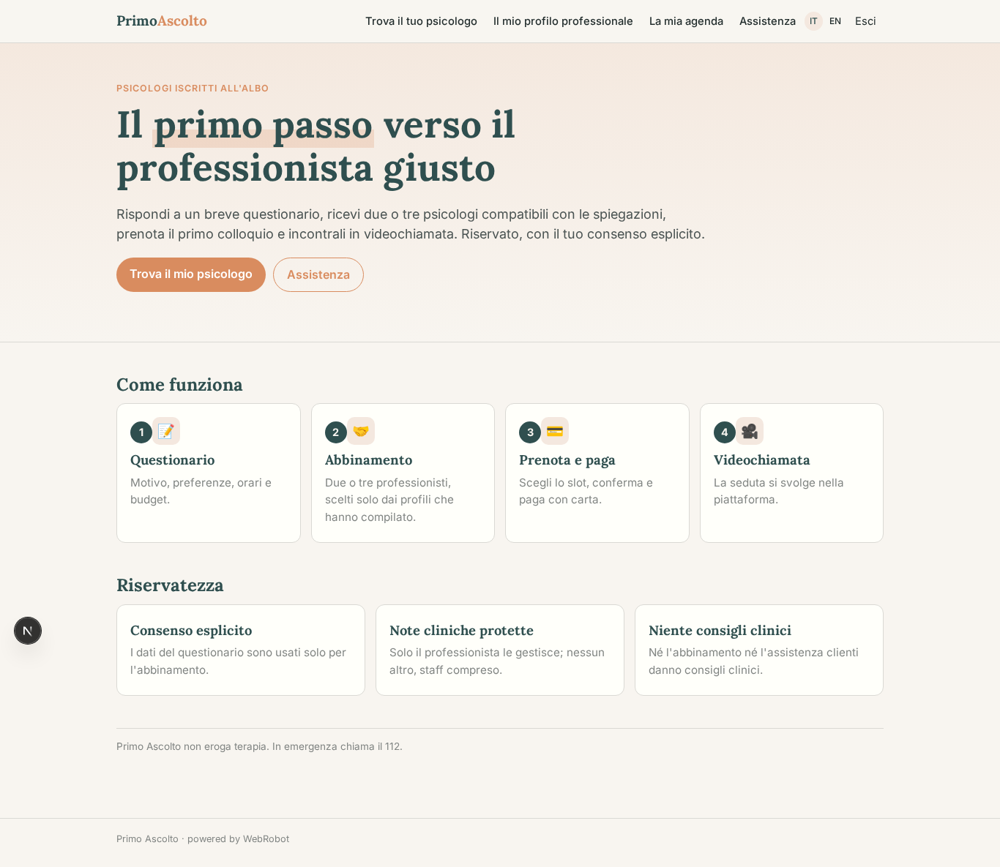
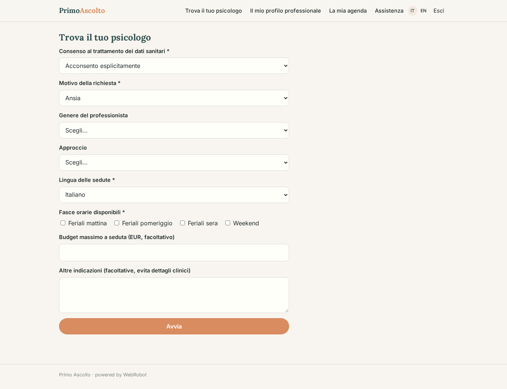
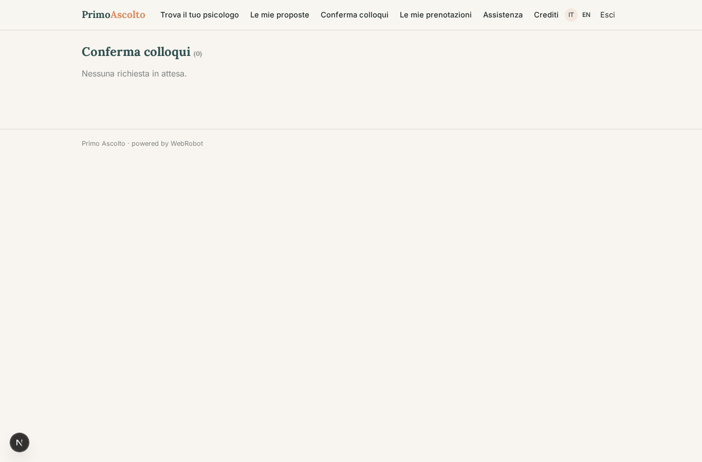
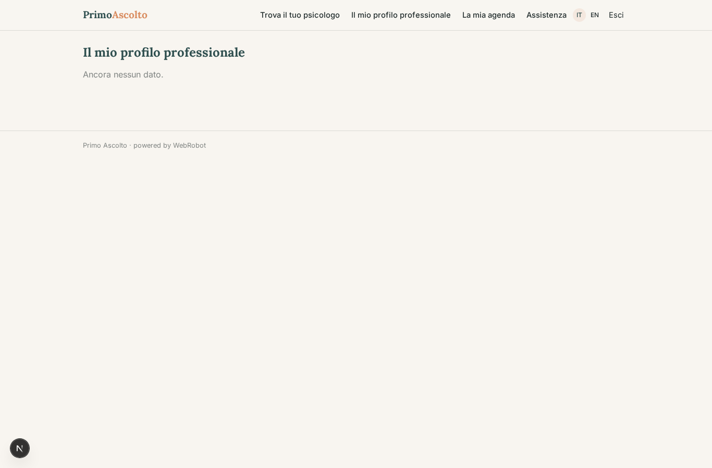
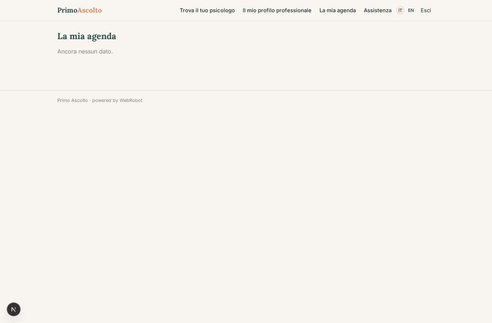
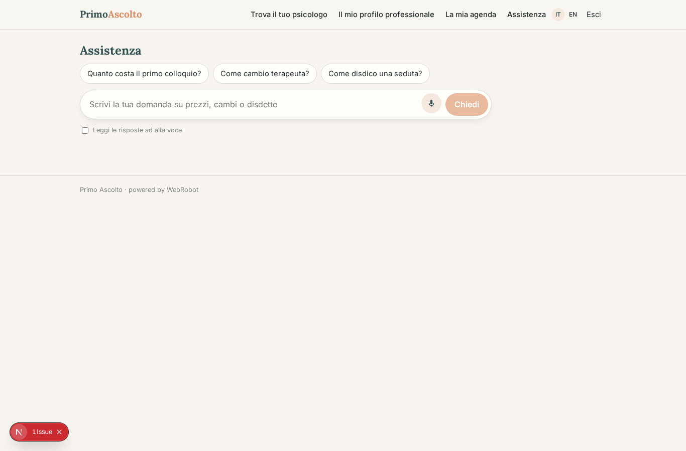
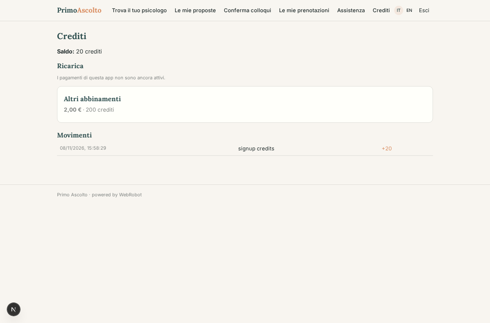

# Primo Ascolto

_Trova lo psicologo giusto per un primo colloquio, in modo riservato._

**Stato manifest:** valido (validatore Python + contratto runtime)

## Descrizione data all'app builder

Voglio Primo Ascolto, la piattaforma di prenotazione per un servizio di psicologia online. Descrivo solo lo strato software di abbinamento, prenotazione e pagamento: la terapia la fanno psicologi iscritti all'albo, e i dati sanitari vanno trattati con il massimo riserbo e il consenso esplicito. La persona compila un questionario iniziale: motivo della richiesta in categorie (ansia, relazioni, lavoro, lutto), preferenze sul professionista (genere, approccio, lingua), fasce orarie disponibili, eventuale budget. Un agente propone due o tre psicologi compatibili spiegando perché, usando solo i profili e le specializzazioni che i professionisti hanno inserito. La persona sceglie, prenota il primo colloquio da un calendario e paga con carta; le sedute si svolgono in videochiamata dentro la piattaforma. Promemoria via email e notifica prima di ogni seduta. Lo psicologo gestisce agenda e pazienti; nessun altro, admin compreso, vede le note cliniche. Un servizio clienti in chat risponde su prezzi, cambi di terapeuta e disdette, senza mai dare consigli clinici. La piattaforma trattiene una commissione su ogni seduta e versa il resto al professionista.

## Funzioni non esprimibili oggi (spec.extensions)

- **booking_calendar**: Calendario per scegliere e prenotare uno slot e pagare la seduta con carta (Stripe Connect verso lo psicologo, commissione trattenuta): il manifest dichiara collezioni, approvazione e commissione, ma serve un modulo di prenotazione e checkout per singola seduta.
- **video_sessions**: Videochiamata dentro la piattaforma: non disponibile.
- **reminders**: Promemoria via email e notifica prima di ogni seduta: notifiche non ancora disponibili.
- **clinical_notes_isolation**: Note cliniche visibili solo allo psicologo autore, nemmeno all'admin, con cifratura dedicata e gestione dei pazienti per professionista: non esprimibile con i ruoli attuali, quindi nessuna collezione di note è stata creata.
- **professional_vetting**: Verifica dell'iscrizione all'albo e onboarding Stripe dei professionisti da parte dello staff; i dati sanitari richiedono DPA, informativa GDPR e registro dei trattamenti.

## Screenshot (runtime interpretativo)

### home-anon

### home-mobile

### home

### new_match

### matches

### confirmations

### my_bookings

### my_profile

### my_slots

### support

### account

