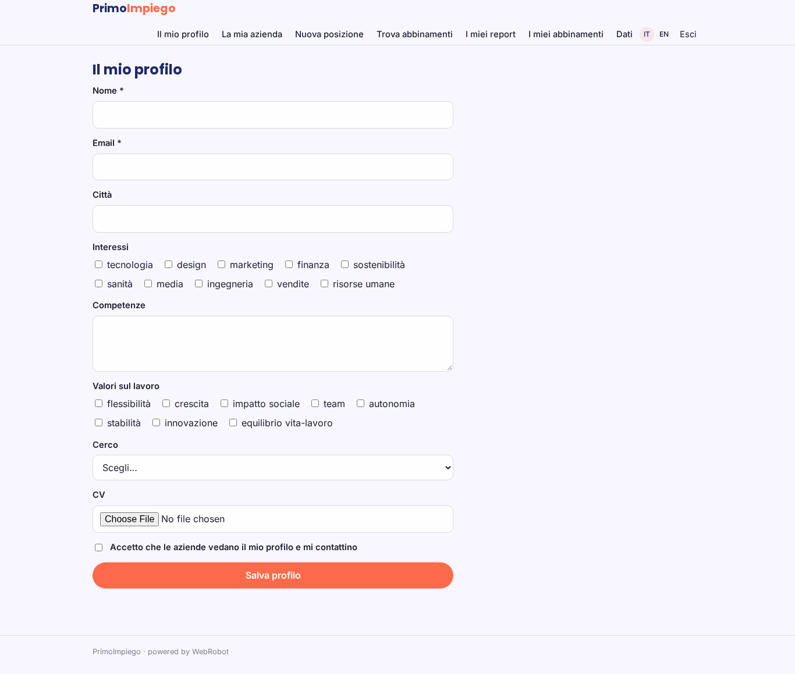
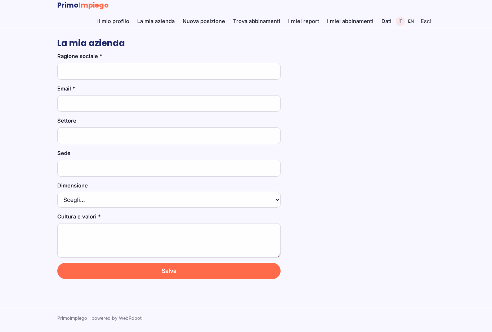
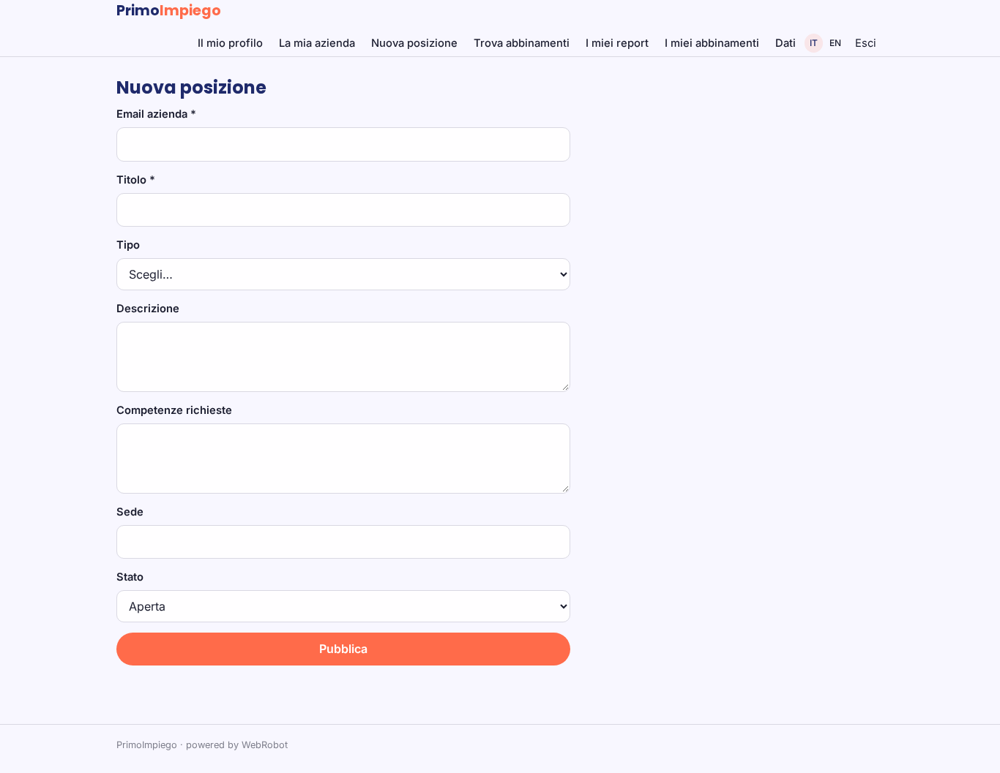
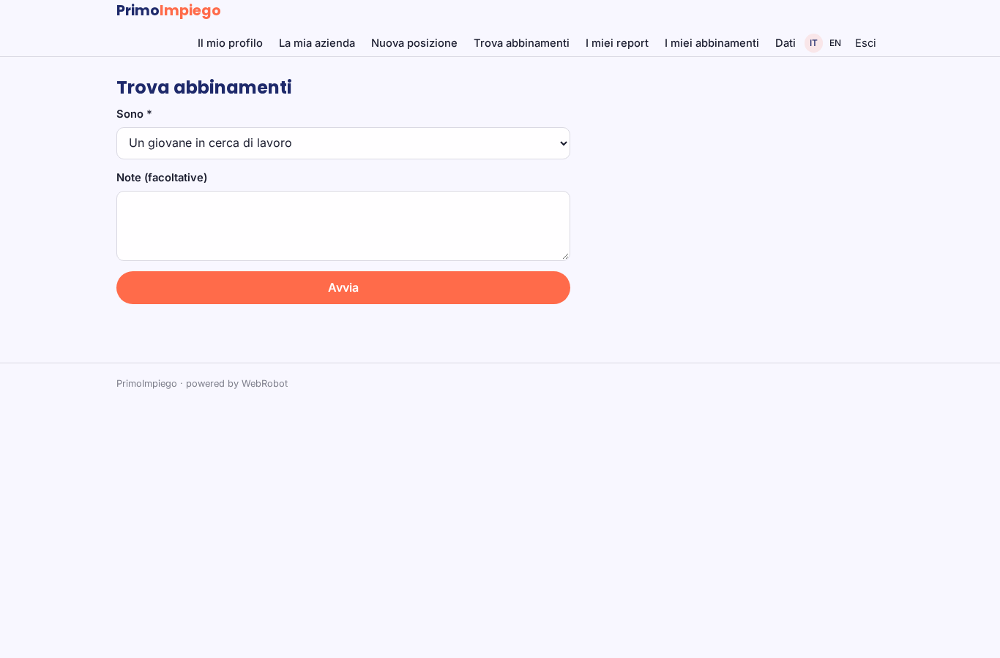
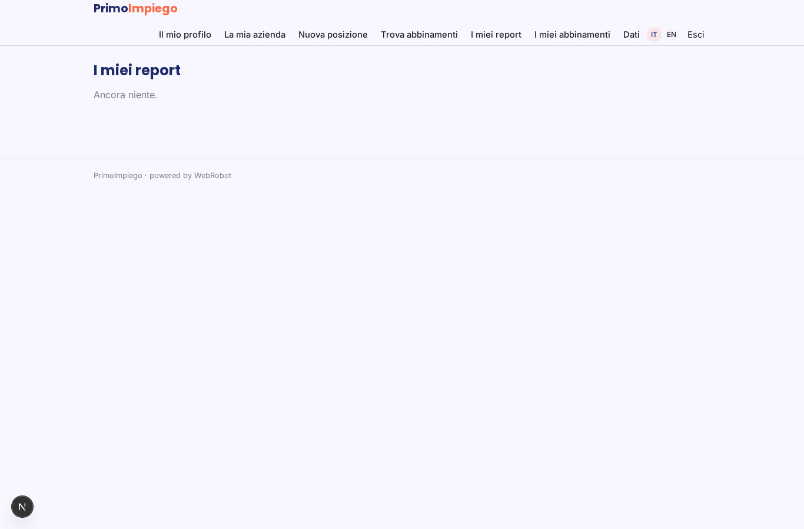
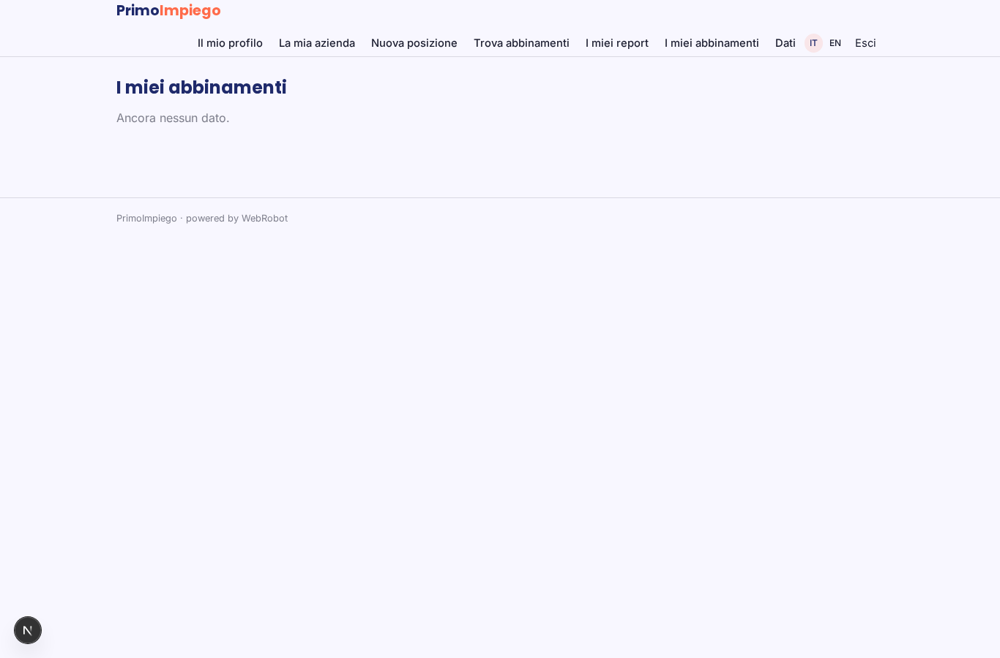
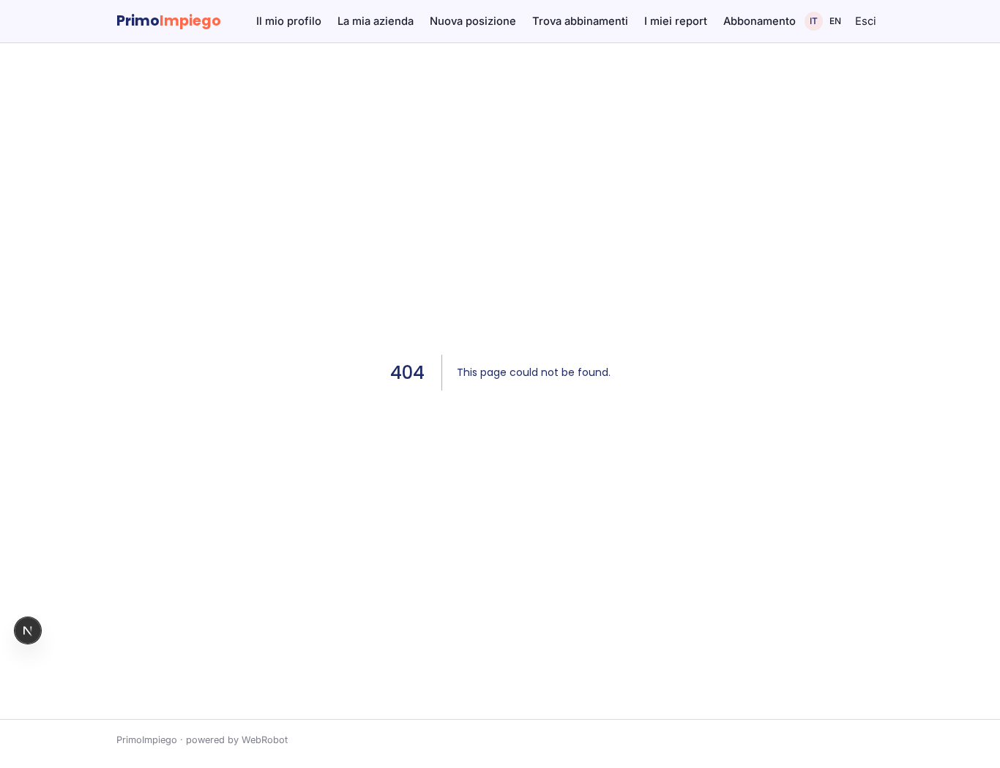
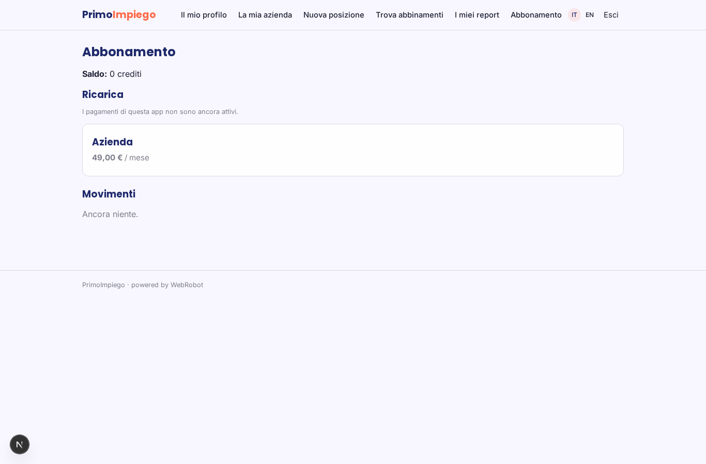

# PrimoImpiego

_Il primo lavoro giusto, per te e per l'azienda._

**Manifest:** valid (schema + runtime contract) · **Functional test:** passed (22 checks passed)

## Description given to the app builder (Italian)

Serve PrimoImpiego, una piattaforma che mette in contatto giovani della Generazione Z con aziende che cercano stage e primi lavori. Il giovane si registra, risponde a un breve questionario su interessi, competenze e valori e carica il CV. L'azienda si registra, pubblica le posizioni e descrive la propria cultura. Un agente calcola la compatibilità tra candidati e posizioni e propone a ciascuna azienda una rosa di profili, e a ciascun giovane le posizioni più adatte. Quando entrambi esprimono interesse si apre una chat. L'azienda vede solo i candidati che hanno accettato il contatto. Gratuito per i giovani, abbonamento per le aziende.

## Functional test: what did not pass

- **form saves a record** (form interest_candidate): only role candidate may fill it, and the test cannot hold that role _(warning)_
- **form saves a record** (form interest_company): only role company may fill it, and the test cannot hold that role _(warning)_
- **form saves a record** (form send_message): only role candidate may fill it, and the test cannot hold that role _(warning)_
- **saved record shown where its collection is read** (view my_matches): a record was saved in matches (by admin-data, admin-data) but the page does not show it (as candidate) _(warning)_
- **saved record shown where its collection is read** (view chat): a record was saved in messages (by admin-data, admin-data) but the page does not show it (as candidate) _(warning)_

## Features not expressible today (spec.extensions)

- **human_chat**: Chat in tempo reale tra due persone non disponibile: i messaggi sono salvati in una collezione e letti nella vista chat; la chat è aperta dalle regole di accesso, non bloccata finché non c'è interesse reciproco.
- **company_verification**: Il ruolo azienda deriva dal profilo azienda creato; la verifica dell'identità dell'azienda va fatta dall'admin.
- **subscription_gate**: L'abbonamento limita l'agente aziendale; la pubblicazione delle posizioni non è bloccata dal piano.

## Screenshots (interpretive runtime, no data)

### home-anon

### home-mobile

### home

### profile

### company

### position

### new_run

### history

### my_matches

### interest_candidate

### interest_company

### send_message

### chat

### account

