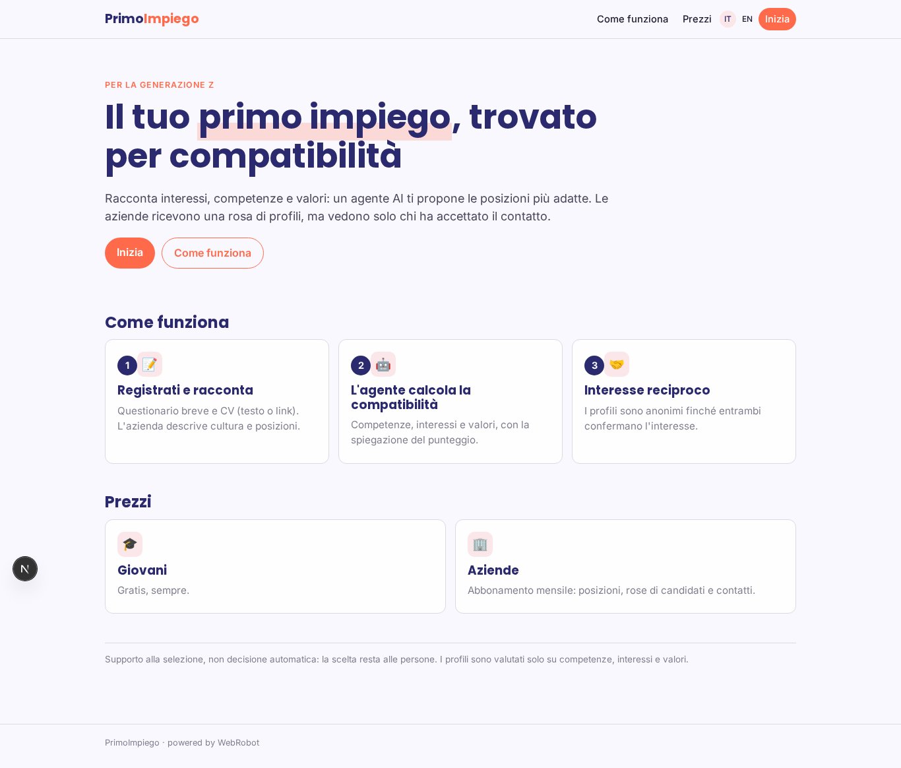
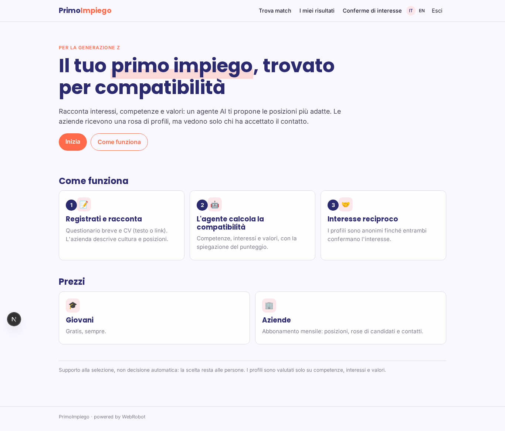
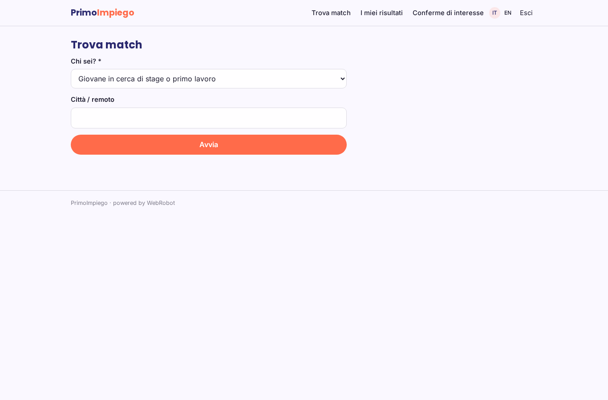
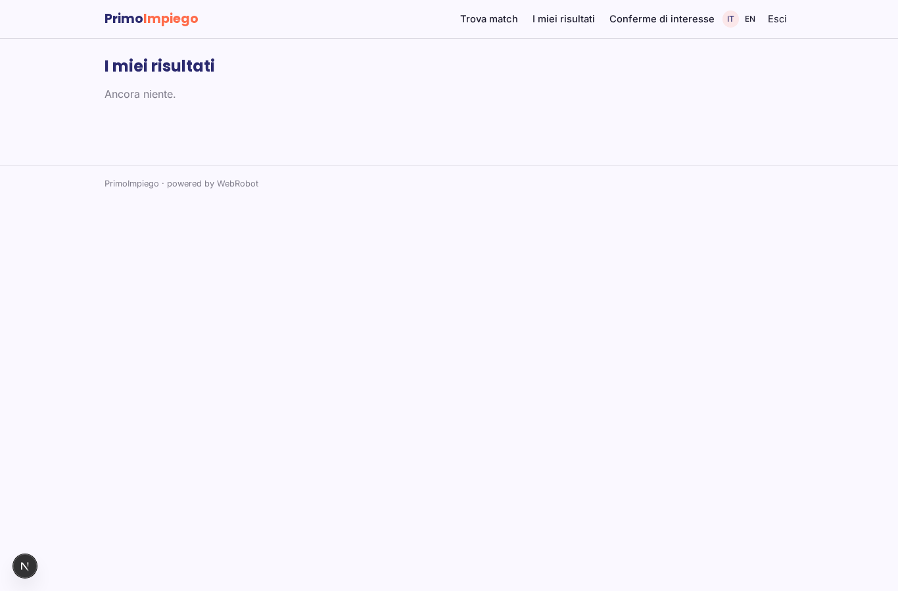
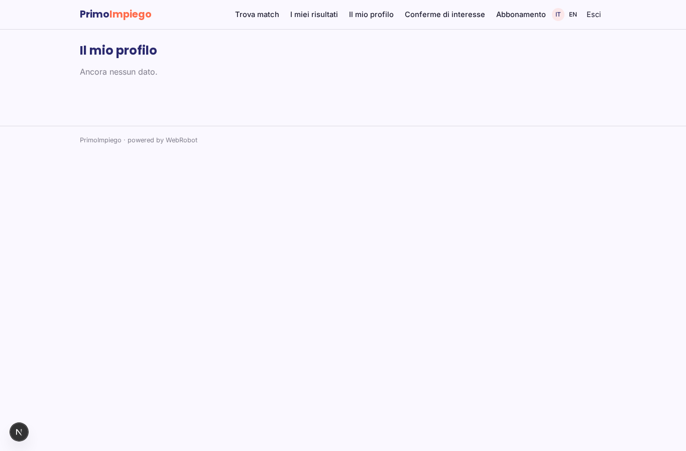
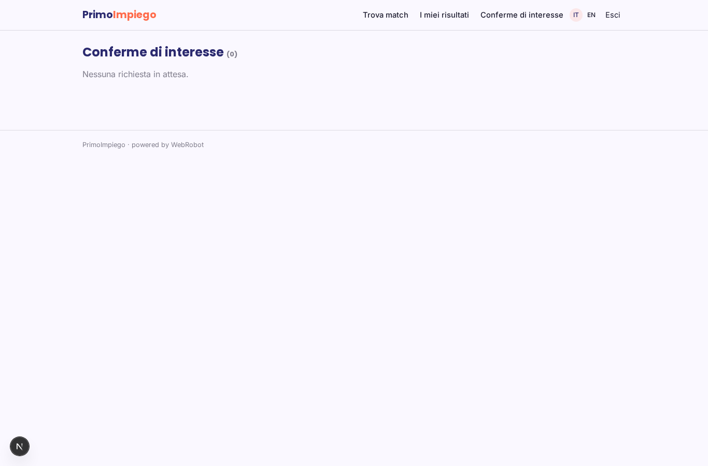
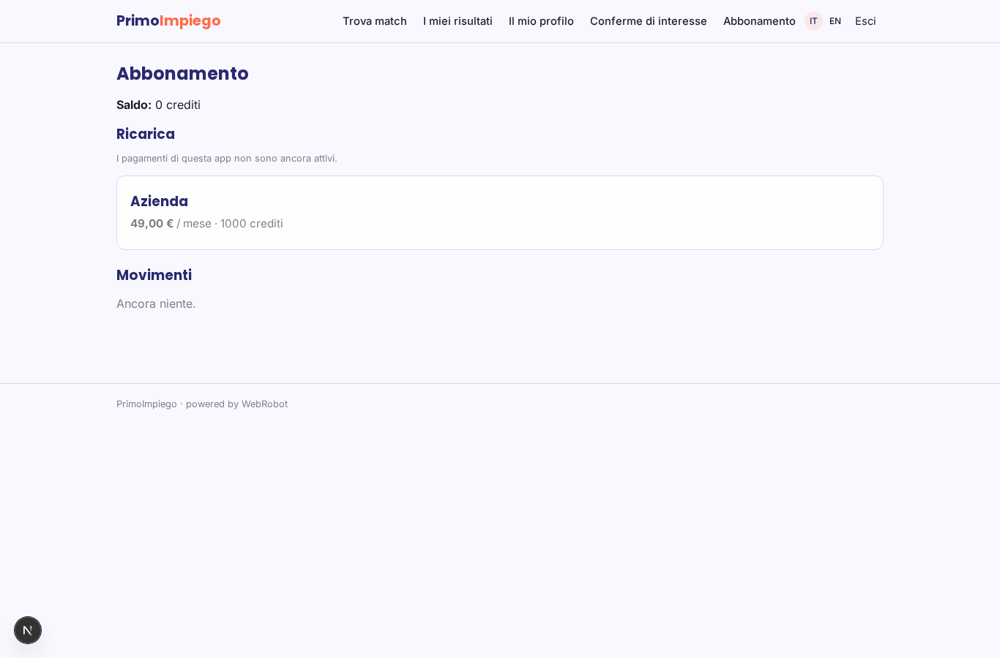

# PrimoImpiego

_Il primo impiego giusto, per la Generazione Z e per chi la assume._

**Manifest status:** valid (schema validator + runtime contract)

## Description given to the app builder (Italian)

Serve PrimoImpiego, una piattaforma che mette in contatto giovani della Generazione Z con aziende che cercano stage e primi lavori. Il giovane si registra, risponde a un breve questionario su interessi, competenze e valori e carica il CV. L'azienda si registra, pubblica le posizioni e descrive la propria cultura. Un agente calcola la compatibilità tra candidati e posizioni e propone a ciascuna azienda una rosa di profili, e a ciascun giovane le posizioni più adatte. Quando entrambi esprimono interesse si apre una chat. L'azienda vede solo i candidati che hanno accettato il contatto. Gratuito per i giovani, abbonamento per le aziende.

## Features not expressible today (spec.extensions)

- **mutual_chat**: Direct chat between a candidate and a company once both confirmed interest is not available yet (the runtime has no user-to-user messaging). For now mutual interest is recorded in interest_signals and the agent reports it; contact exchange needs a custom extension.
- **cv_upload**: CV file upload is not available: candidates paste the text or a link.
- **notifications**: Email notifications for new matches or mutual interest are not available yet.
- **company_role**: A separate 'company' role and onboarding are approximated by the mode field and the subscription plan; a derived role would need a back-office collection.

## Screenshots (interpretive runtime)

### home-anon

### home-mobile

### home

### new

### history

### my_profile

### approvals

### account

