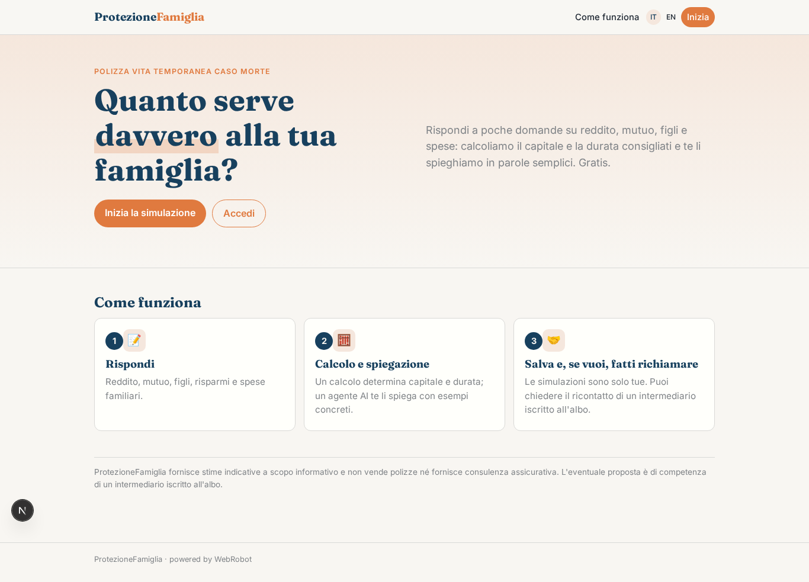
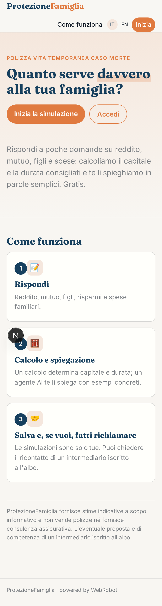
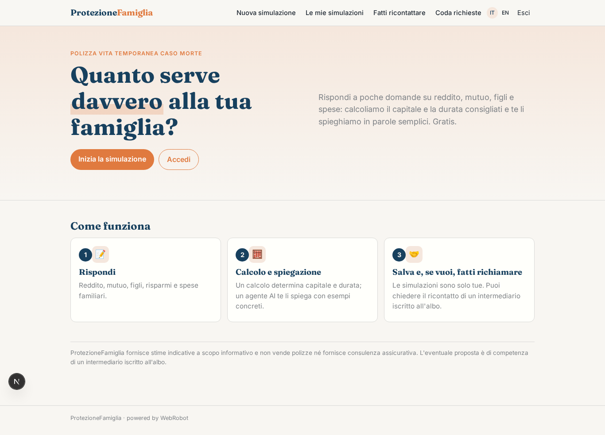
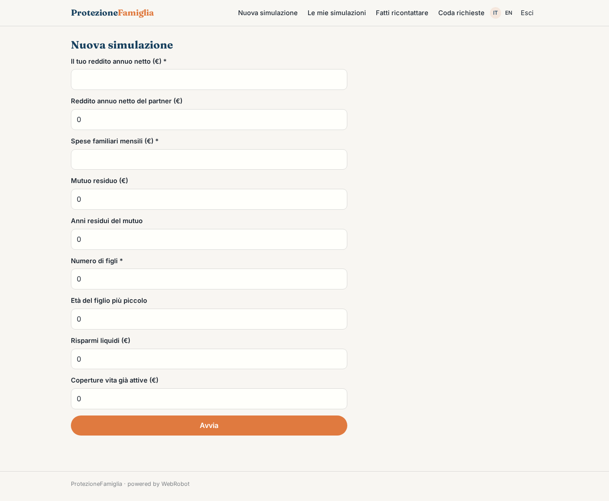
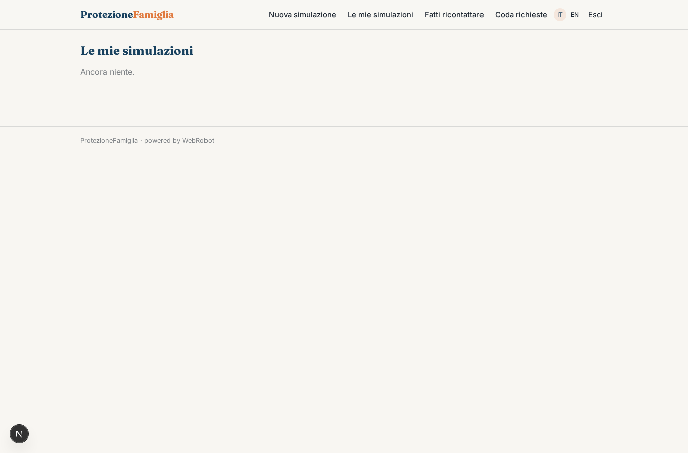
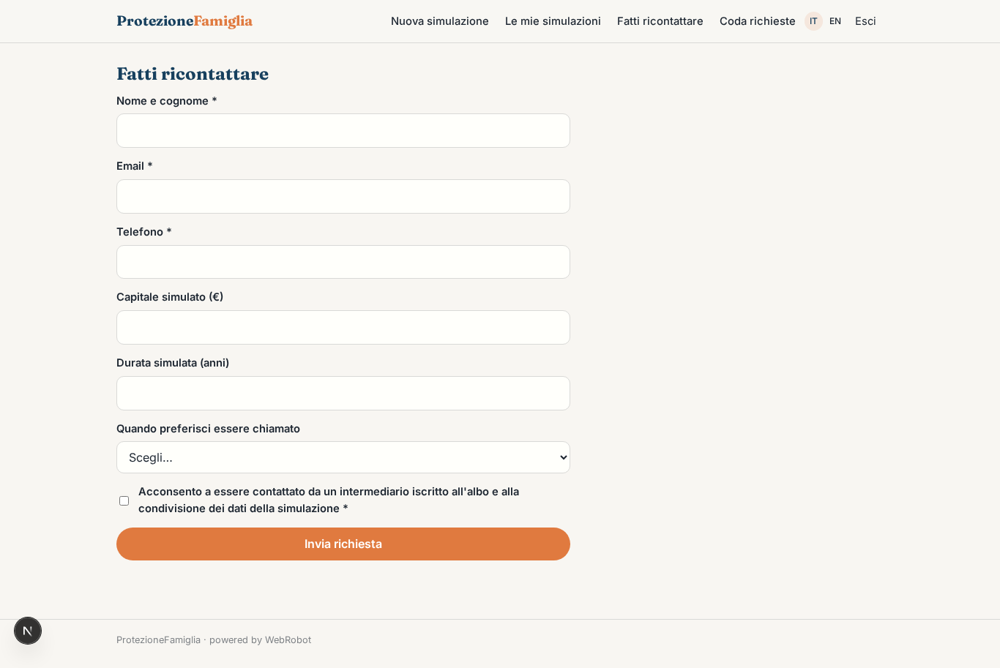
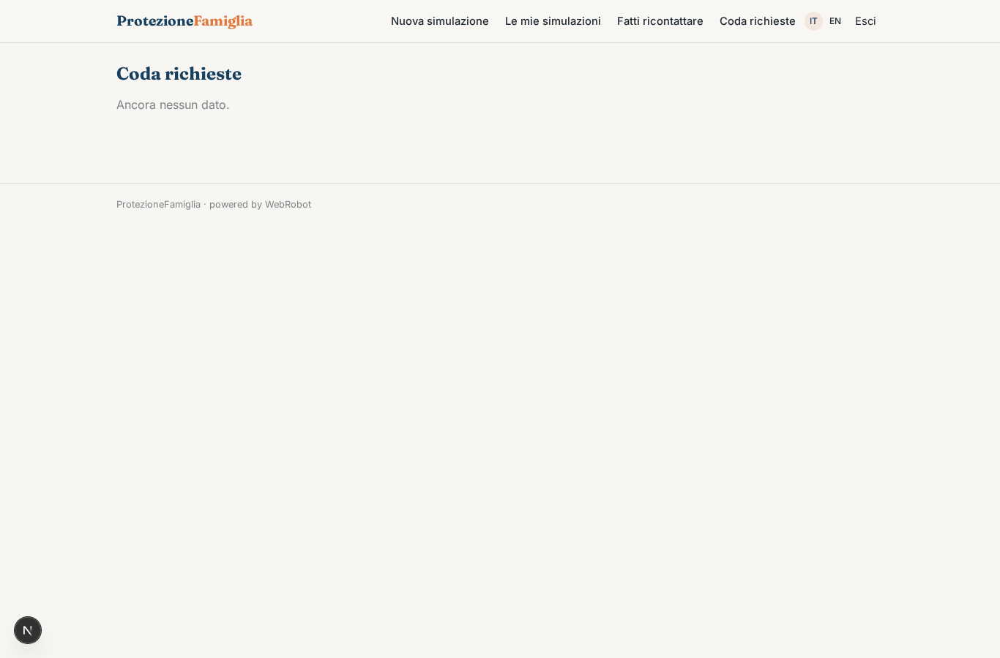
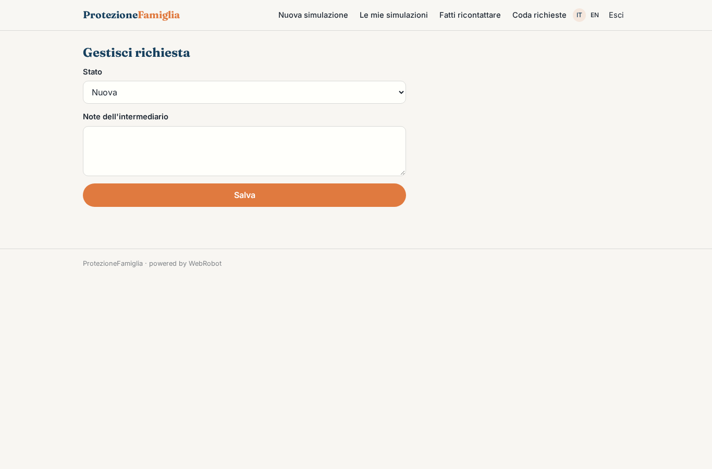

# ProtezioneFamiglia

_Quanto serve davvero alla tua famiglia se un giorno non ci fossi?_

**Manifest:** valid (schema + runtime contract) · **Functional test:** passed (12 checks passed)

## Description given to the app builder (Italian)

Voglio ProtezioneFamiglia, un consulente online per chi valuta una polizza vita temporanea caso morte. L'utente risponde a domande su reddito, mutuo, figli, risparmi e spese familiari. Un calcolo determina il capitale che servirebbe alla famiglia e la durata consigliata, e un agente spiega il risultato in linguaggio semplice con esempi. L'utente può salvare la simulazione e chiedere di essere ricontattato da un intermediario iscritto all'albo, che riceve la richiesta in una coda e la gestisce; l'app non vende polizze direttamente. Ogni utente vede solo le proprie simulazioni. Gratuito per l'utente, compenso per contatto qualificato dall'intermediario.

## Functional test: what did not pass

- **trigger has its effect** (trigger new_callback): email to role:intermediary: no such recipient in the test (role nobody holds or empty field) _(warning)_

## Features not expressible today (spec.extensions)

- **qualified_contact_fee**: Fee paid by the intermediary for each qualified contact (status qualified) is invoiced to the intermediary outside the app: automatic charging of a non-customer user is not available yet.

## Screenshots (interpretive runtime, no data)

### home-anon

### home-mobile

### home

### new_sim

### history

### callback

### queue

### handle

