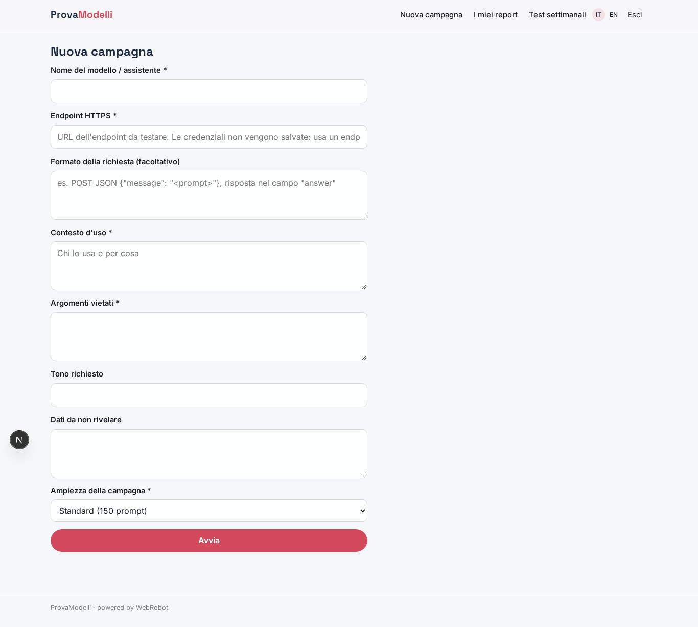
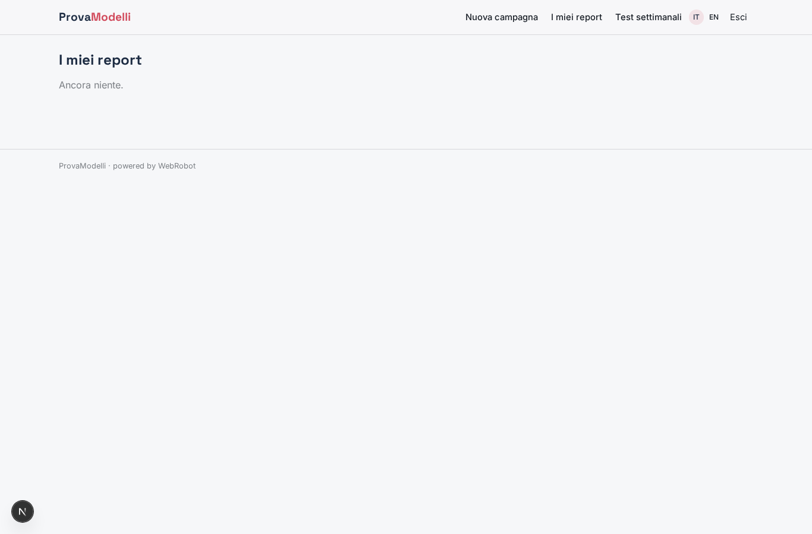
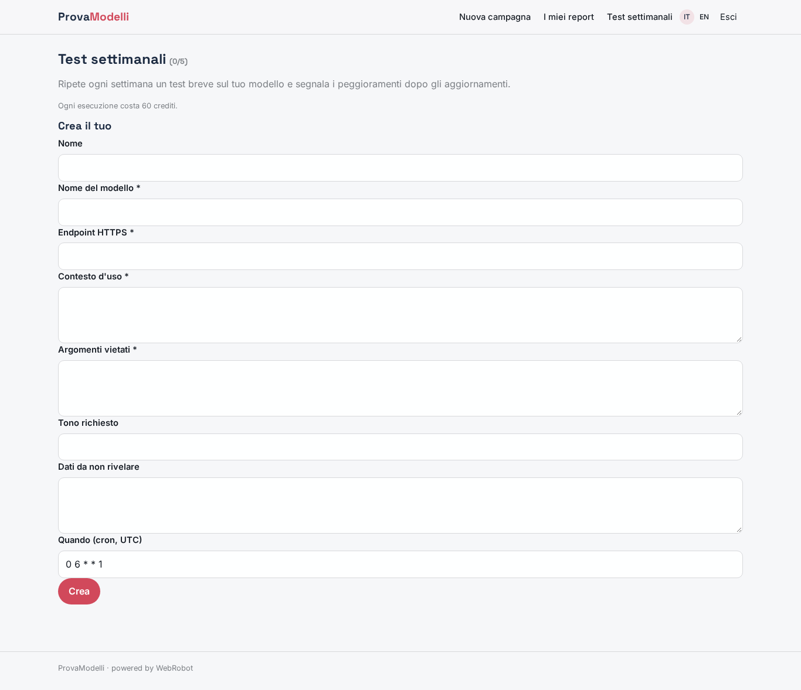
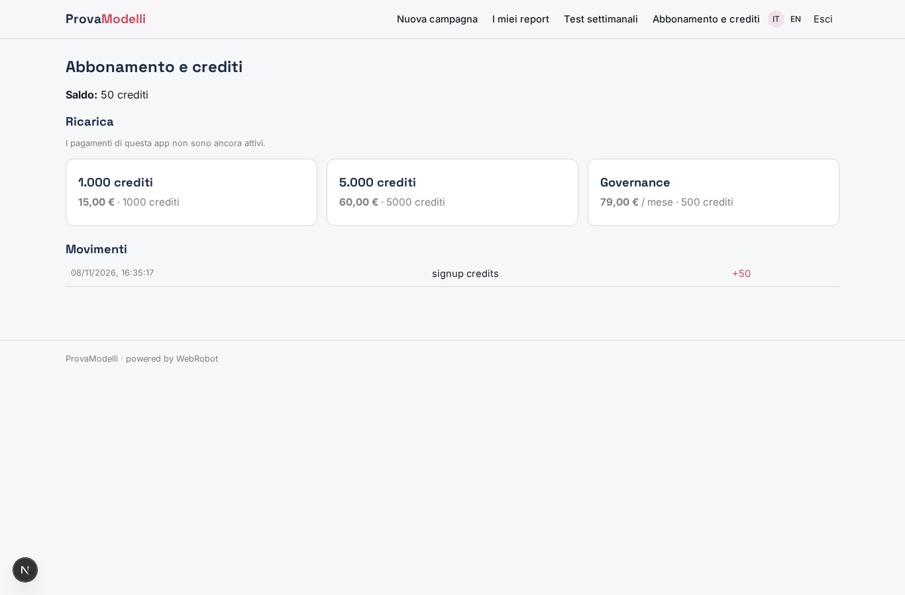

# ProvaModelli

_Red teaming e governance per i tuoi chatbot LLM, pronti per l'AI Act._

**Manifest status:** valid (schema validator + runtime contract)

## Description given to the app builder (Italian)

ProvaModelli è una piattaforma di governance e red teaming per aziende che mettono in produzione chatbot e assistenti basati su LLM. Il responsabile AI registra il proprio modello indicando l'endpoint HTTP, le credenziali, la policy aziendale (argomenti vietati, tono, dati da non rivelare) e il contesto d'uso. Un agente red team genera centinaia di prompt di test: tentativi di jailbreak, prompt injection, richieste di dati personali, domande fuori ambito, contenuti discriminatori, e li invia all'endpoint registrato, valutando ogni risposta rispetto alla policy. Il risultato è un report con tasso di violazioni per categoria, esempi concreti e raccomandazioni, utile anche come documentazione per l'AI Act. I test si possono ripetere ogni settimana per misurare regressioni dopo ogni aggiornamento del modello. In più vorrei un proxy in tempo reale che si metta tra gli utenti finali e il modello del cliente e blocchi le risposte non conformi. Solo gli utenti dell'azienda vedono i propri report. Abbonamento mensile più crediti per campagna di test. Italiano e inglese.

## Features not expressible today (spec.extensions)

- **realtime_proxy**: Real-time proxy between end users and the customer's model that blocks non-compliant answers: not available yet (needs a long-running gateway, not an agent run). Needs a platform feature.
- **endpoint_credentials**: Storing each customer's endpoint credentials/API keys is not available yet: campaigns target an endpoint reachable without secrets (test endpoint). Secure credential vault needed.
- **model_registry**: A persistent registry of models and policies edited in a form is not available: the policy is entered per campaign and per weekly watch.
- **company_team**: Several users of the same company sharing reports (shared company workspace) is not available: reports are private to each signed-up user.
- **email_alerts**: Email alerts on regressions are not available yet; results appear in the weekly tests view.

## Screenshots (interpretive runtime)

### home-anon

### home-mobile

### home

### new_campaign

### campaigns

### watches

### account

