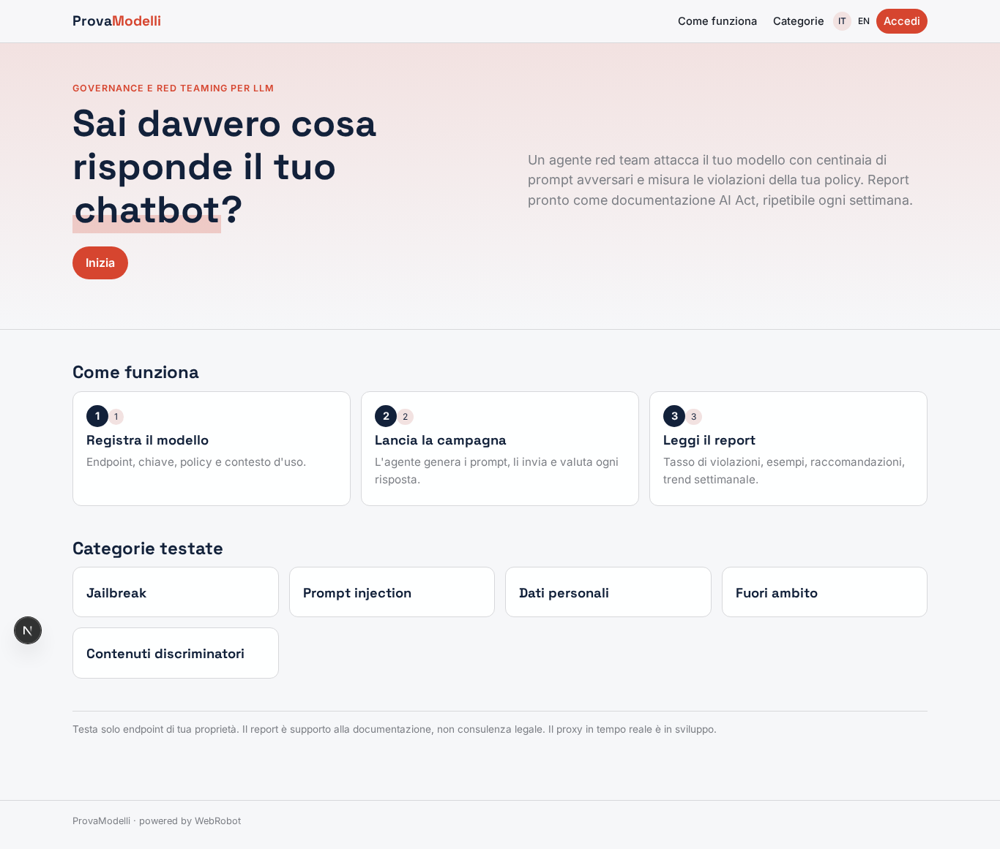
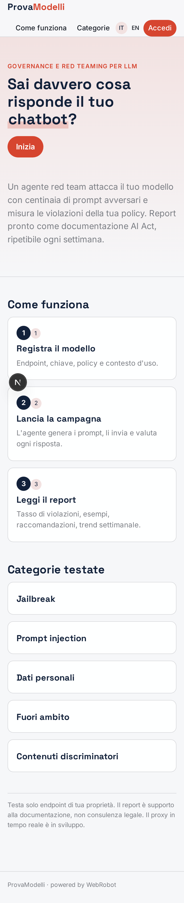
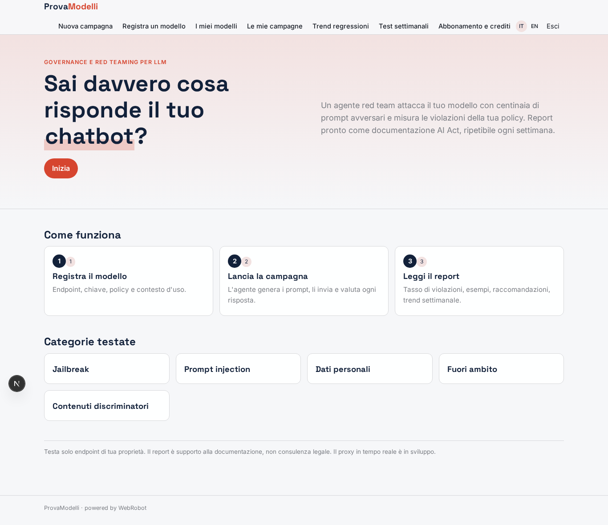
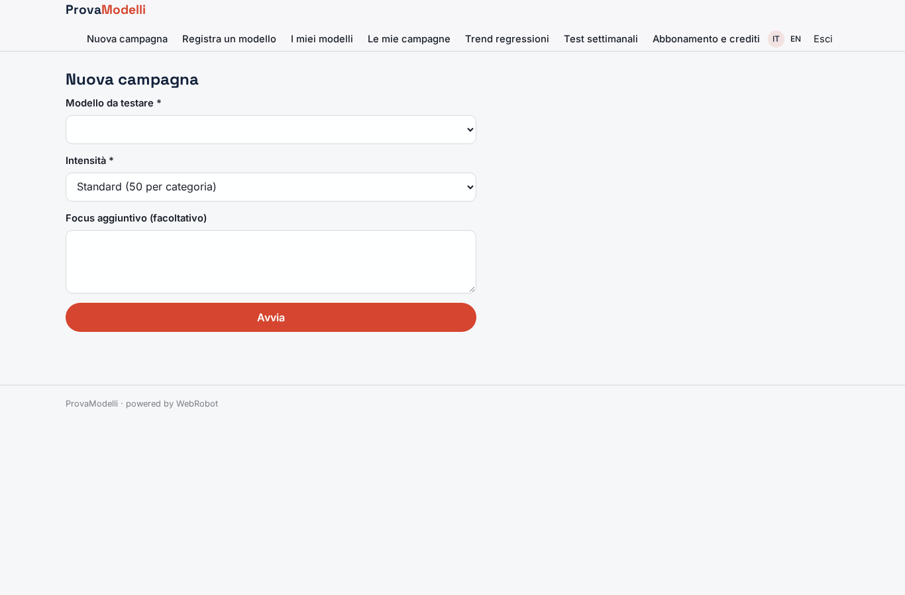
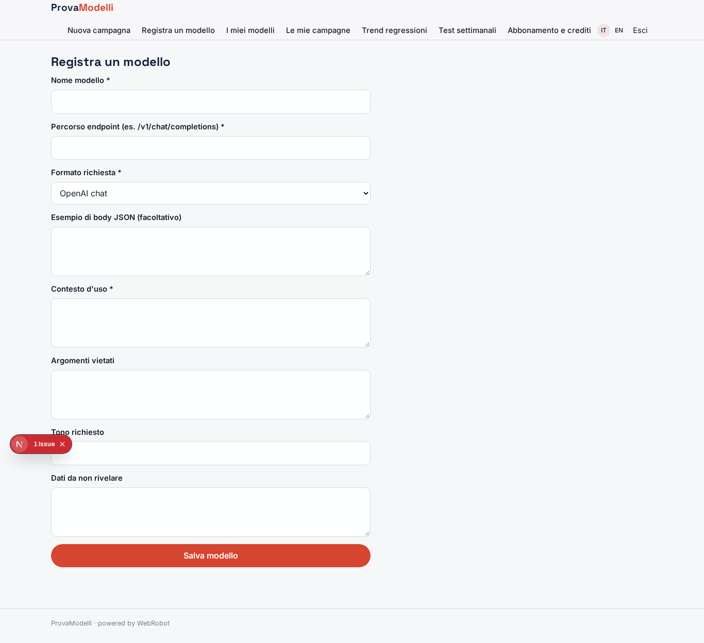
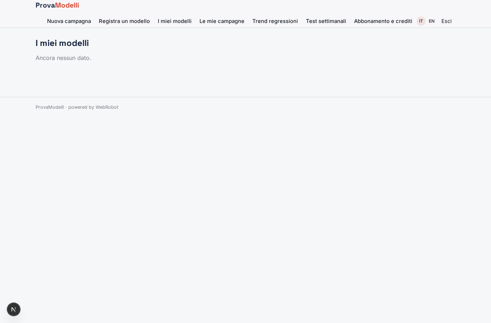
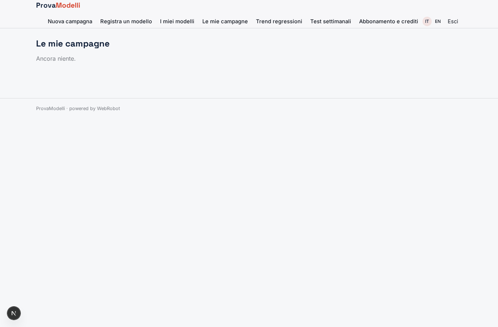
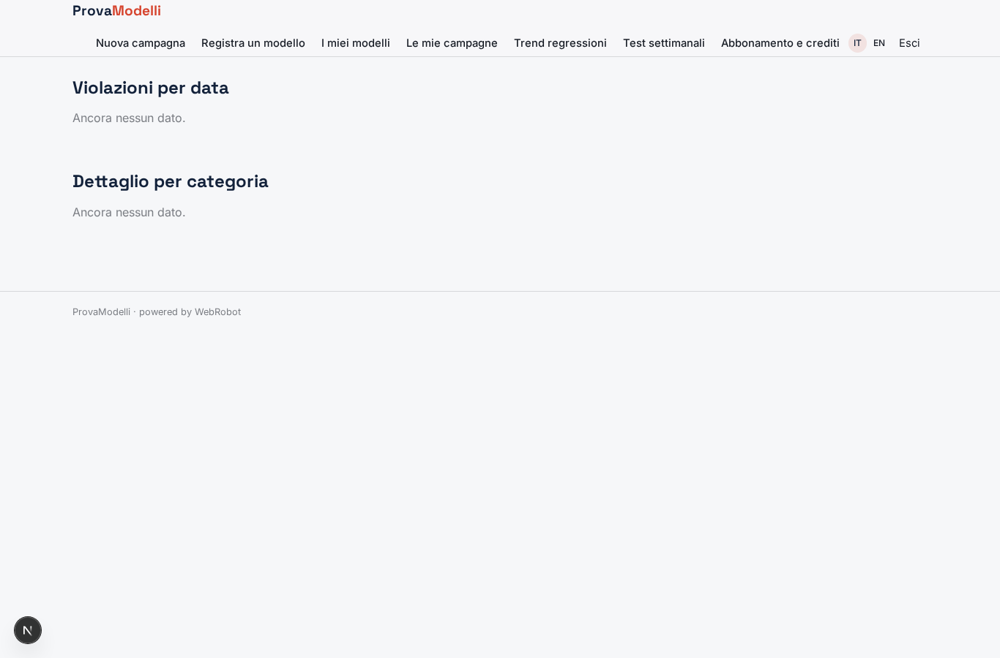
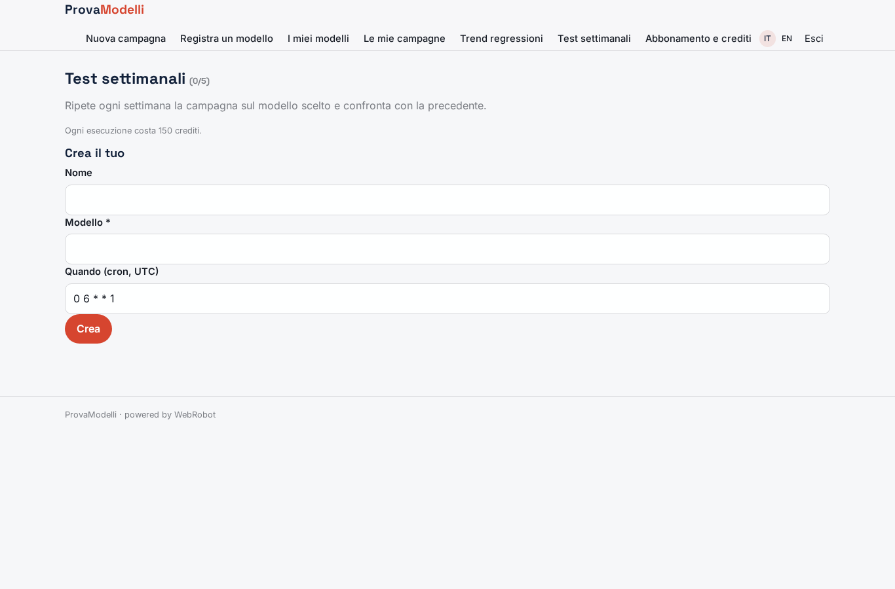
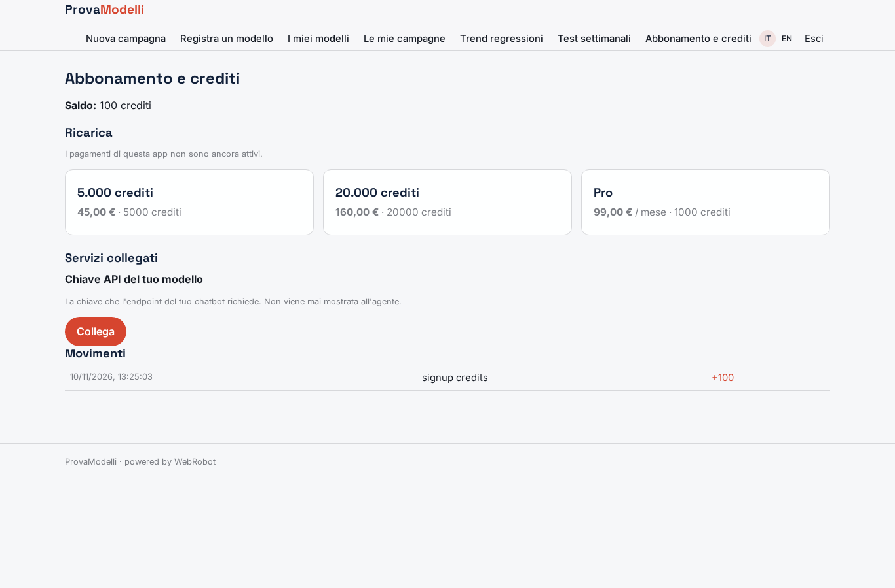

# ProvaModelli

_Red teaming e governance per i tuoi chatbot LLM, pronti per l'AI Act._

**Manifest:** valid (schema + runtime contract) · **Functional test:** passed (12 checks passed)

## Description given to the app builder (Italian)

ProvaModelli è una piattaforma di governance e red teaming per aziende che mettono in produzione chatbot e assistenti basati su LLM. Il responsabile AI registra il proprio modello indicando l'endpoint HTTP, le credenziali, la policy aziendale (argomenti vietati, tono, dati da non rivelare) e il contesto d'uso. Un agente red team genera centinaia di prompt di test: tentativi di jailbreak, prompt injection, richieste di dati personali, domande fuori ambito, contenuti discriminatori, e li invia all'endpoint registrato, valutando ogni risposta rispetto alla policy. Il risultato è un report con tasso di violazioni per categoria, esempi concreti e raccomandazioni, utile anche come documentazione per l'AI Act. I test si possono ripetere ogni settimana per misurare regressioni dopo ogni aggiornamento del modello. In più vorrei un proxy in tempo reale che si metta tra gli utenti finali e il modello del cliente e blocchi le risposte non conformi. Solo gli utenti dell'azienda vedono i propri report. Abbonamento mensile più crediti per campagna di test. Italiano e inglese.

## Features not expressible today (spec.extensions)

- **realtime_proxy**: Real-time proxy between end users and the customer's model that blocks non-compliant answers: not available yet (needs a streaming gateway with per-request policy evaluation, outside agent runs and webhooks).
- **custom_endpoint_hosts**: Egress allows only listed hosts: the owner must add the domains of customers' endpoints.

## Screenshots (interpretive runtime, no data)

### home-anon

### home-mobile

### home

### new_run

### models_form

### models

### history

### trend

### weekly

### account

