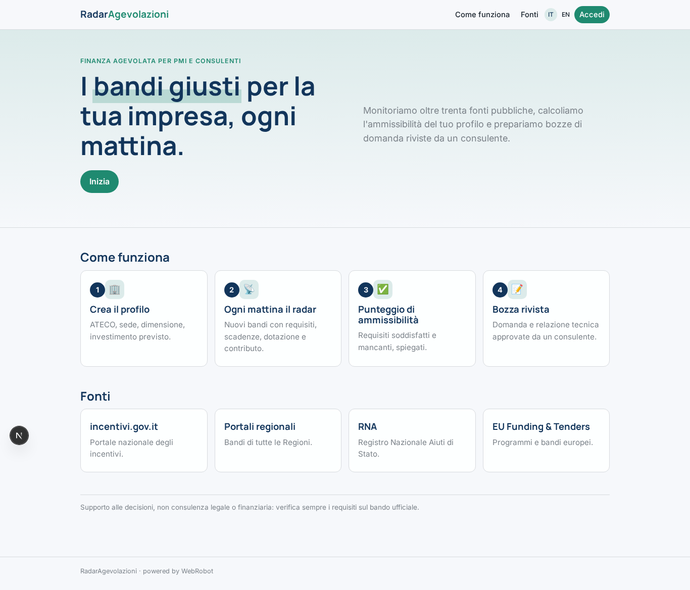
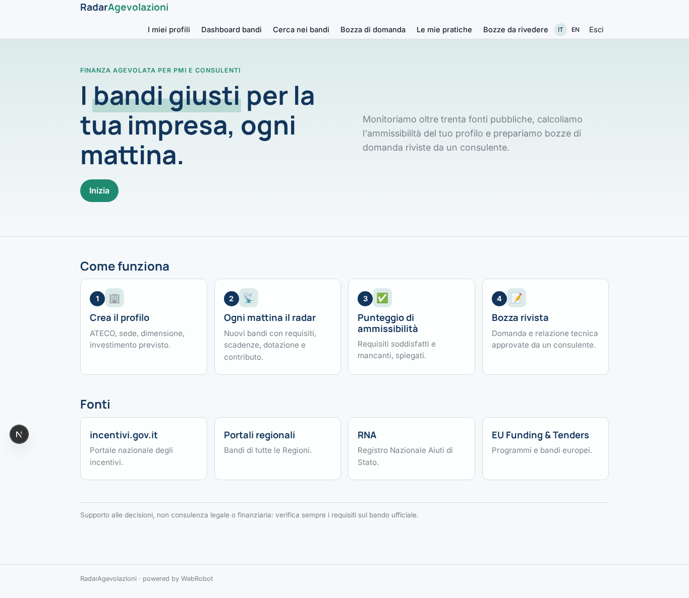
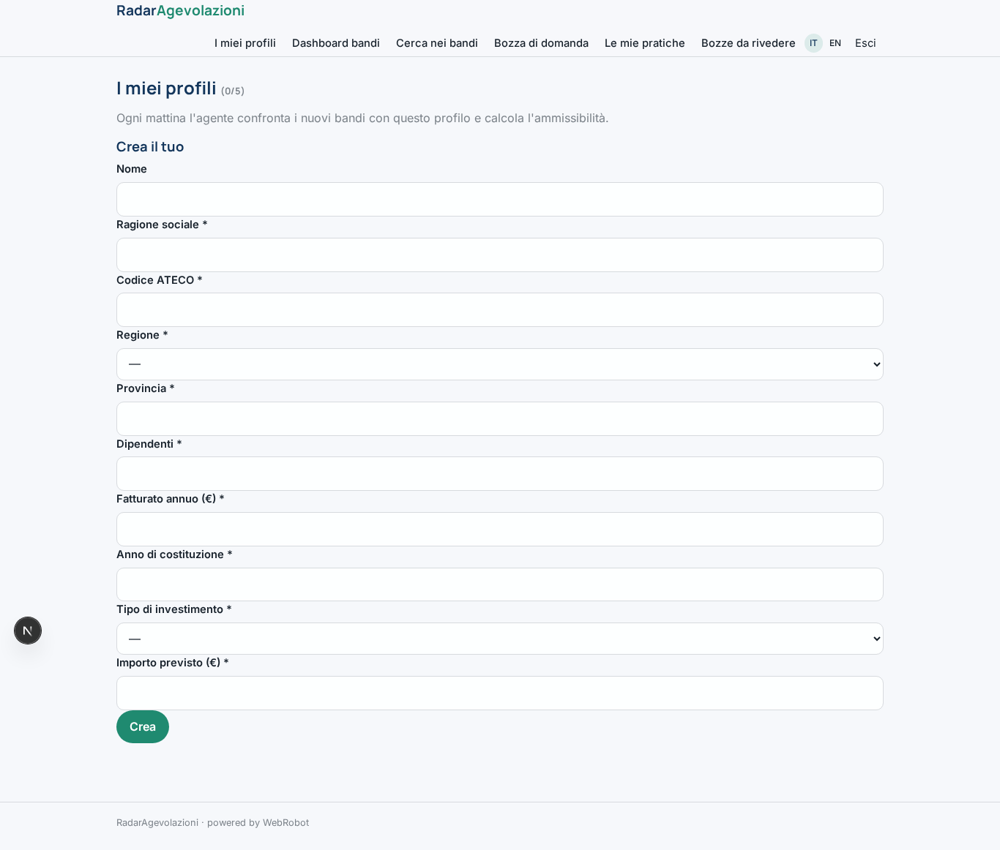
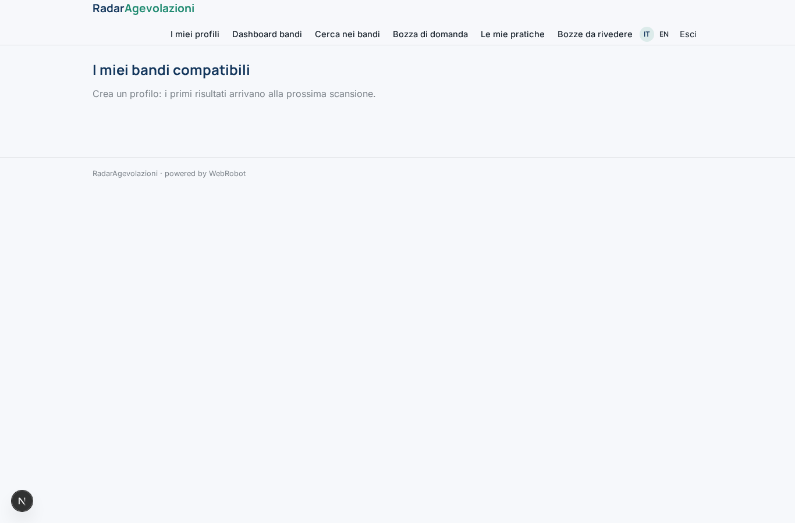
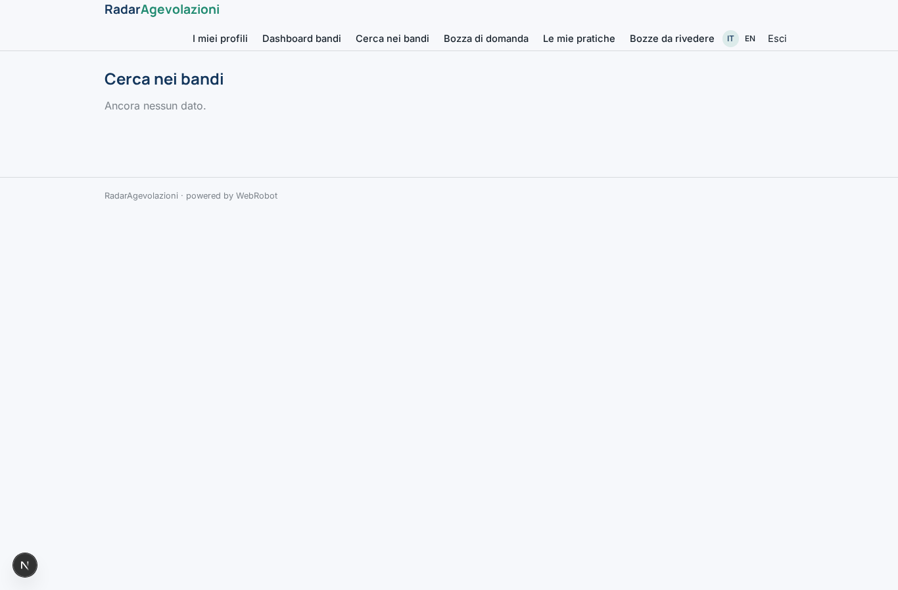
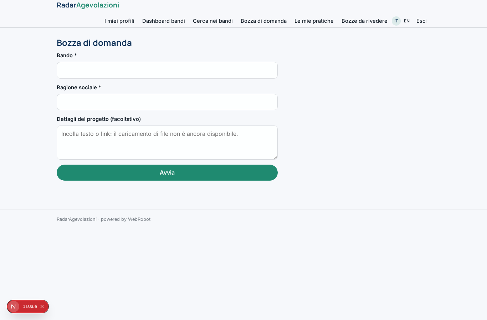
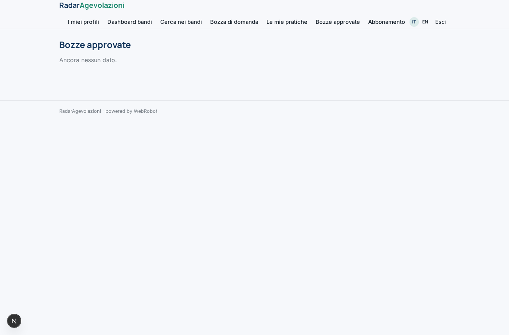
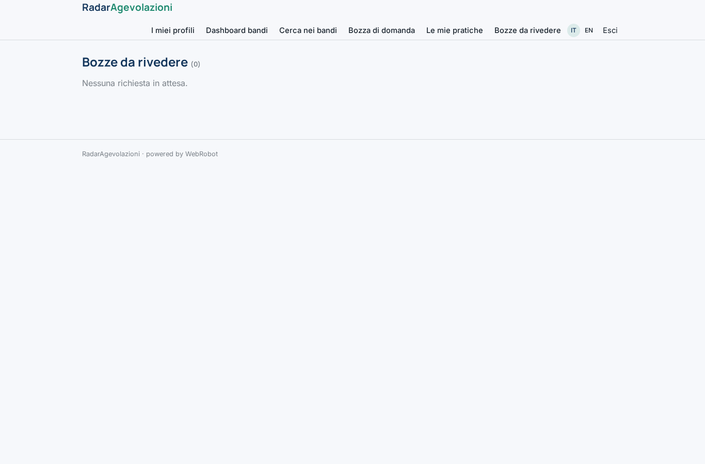
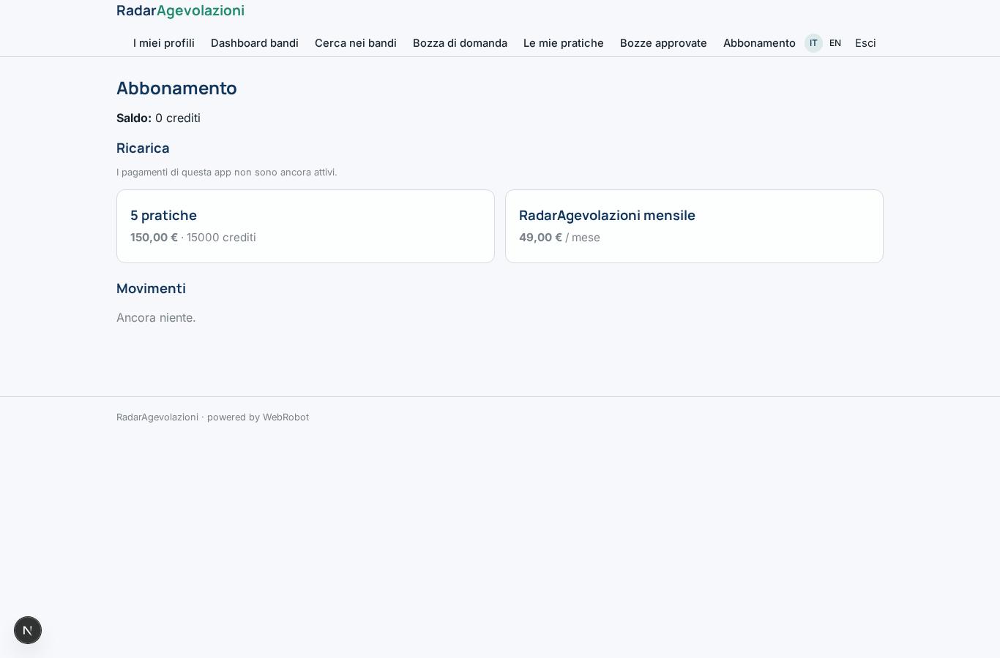

# RadarAgevolazioni

_I bandi giusti per la tua impresa, ogni mattina._

**Stato manifest:** valido (validatore Python + contratto runtime)

## Descrizione data all'app builder

Ci serve RadarAgevolazioni, una piattaforma per PMI e consulenti di finanza agevolata. Il cliente si registra e compila il profilo aziendale: codice ATECO, regione e provincia della sede, numero di dipendenti, fatturato, anno di costituzione, tipo di investimento previsto (macchinari, digitale, assunzioni, energia) e importo. Ogni mattina un agente monitora più di trenta fonti pubbliche, tra cui incentivi.gov.it, i portali delle Regioni, il Registro Nazionale Aiuti e il portale EU Funding & Tenders, indicizza i nuovi bandi e ne estrae requisiti, scadenze, dotazione e percentuale di contributo. Un secondo agente confronta ogni bando con il profilo e calcola un punteggio di ammissibilità, spiegando quali requisiti sono soddisfatti e quali mancano. Il cliente riceve un'email con i bandi compatibili e vede una dashboard con tabella filtrabile e motore di ricerca full-text. Per i bandi scelti l'agente prepara una bozza di domanda e di relazione tecnica, che un consulente dello studio deve rivedere e approvare prima che il cliente la scarichi. Il consulente vede tutti i clienti assegnati, il cliente solo i propri dati. Abbonamento mensile tramite Stripe, più una tariffa a pratica per la bozza di domanda.

## Funzioni non esprimibili oggi (spec.extensions)

- **consultant_assignment**: Il consulente dovrebbe vedere tutti i clienti a lui assegnati (profili, match, pratiche). I dati dei clienti sono per utente e il modello non prevede ancora una vista consulente→clienti assegnati: per ora il consulente vede solo le richieste di revisione nella vista 'Bozze da rivedere'.
- **email_digest**: Email giornaliera al cliente con i bandi compatibili: le notifiche email non sono ancora disponibili; il cliente consulta la dashboard.
- **file_upload**: Caricamento di documenti (visure, bilanci) e download file della bozza non disponibili: testo da incollare, stampa/PDF dal report.

## Screenshot (runtime interpretativo)

### home-anon

### home-mobile

### home

### watches

### dashboard

### search

### new_draft

### drafts

### approved

### reviews

### account

