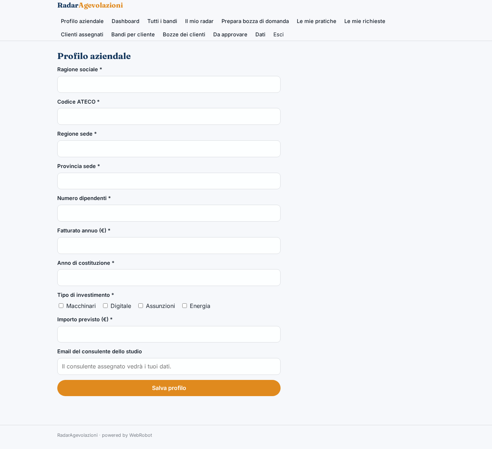
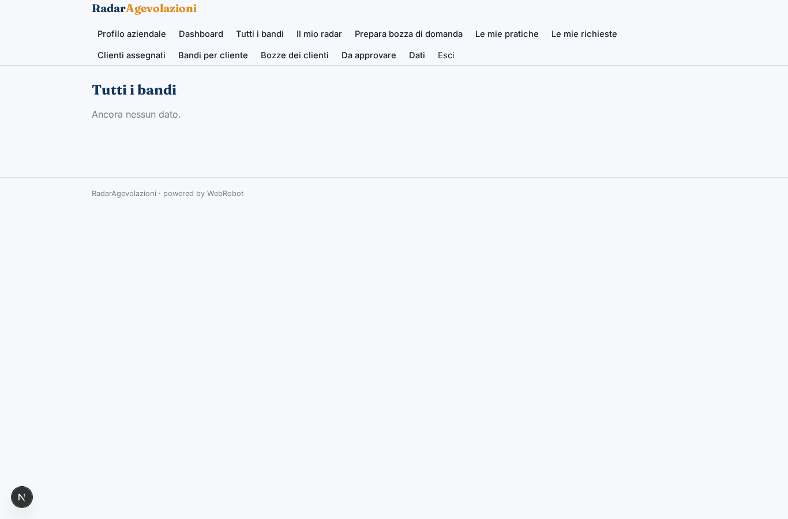
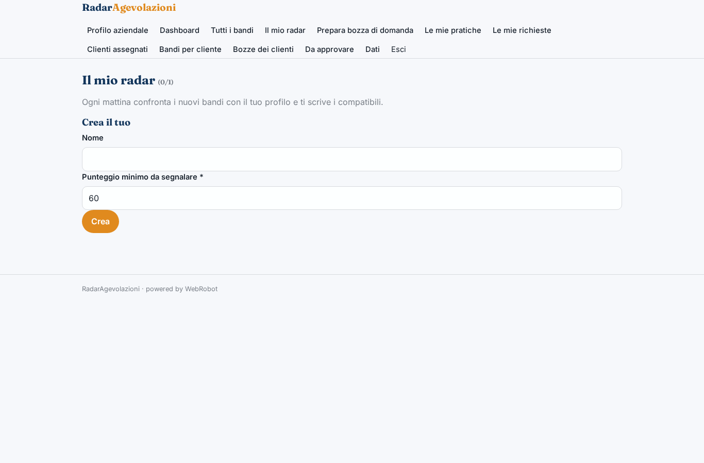
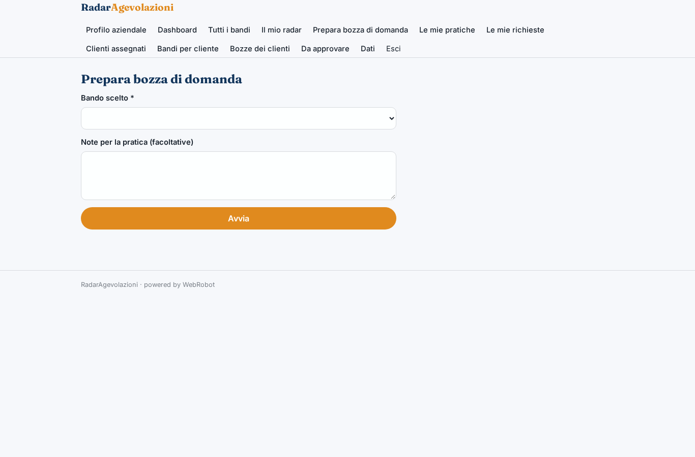
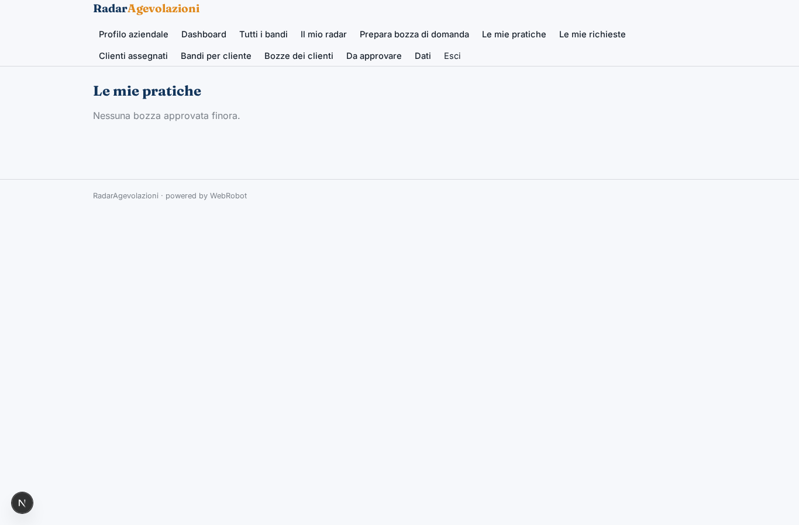
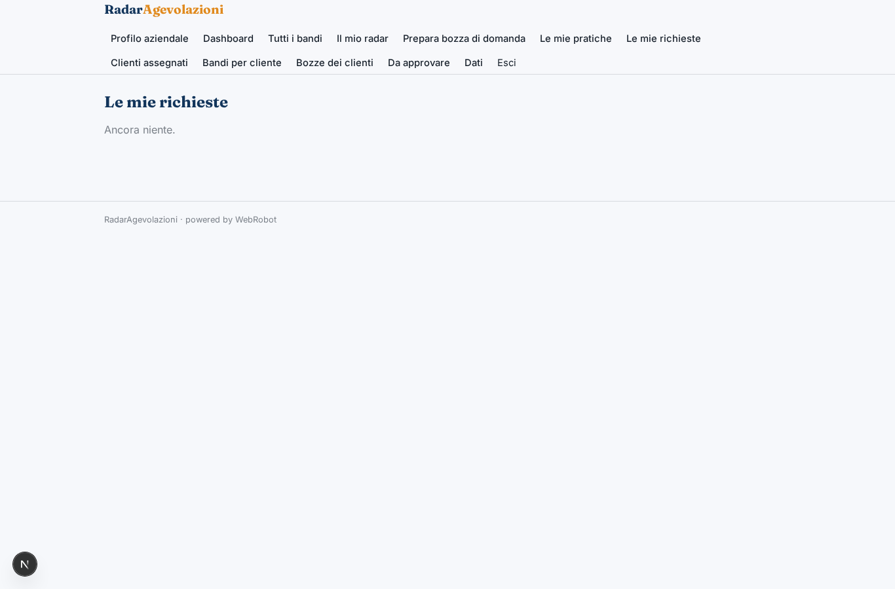
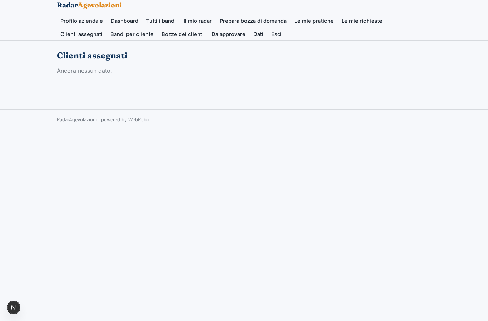
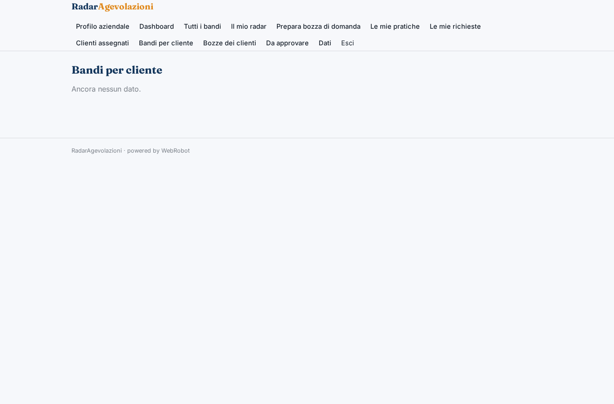
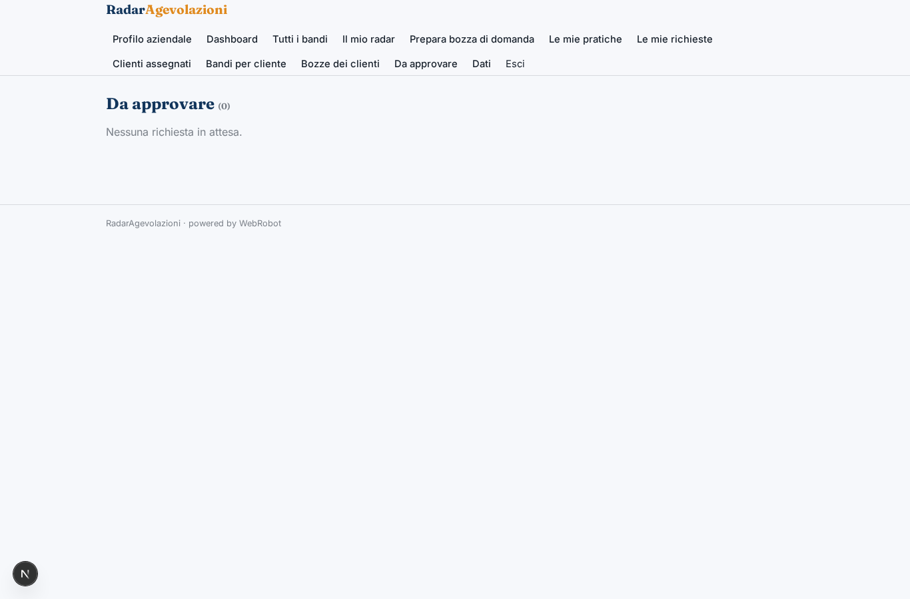
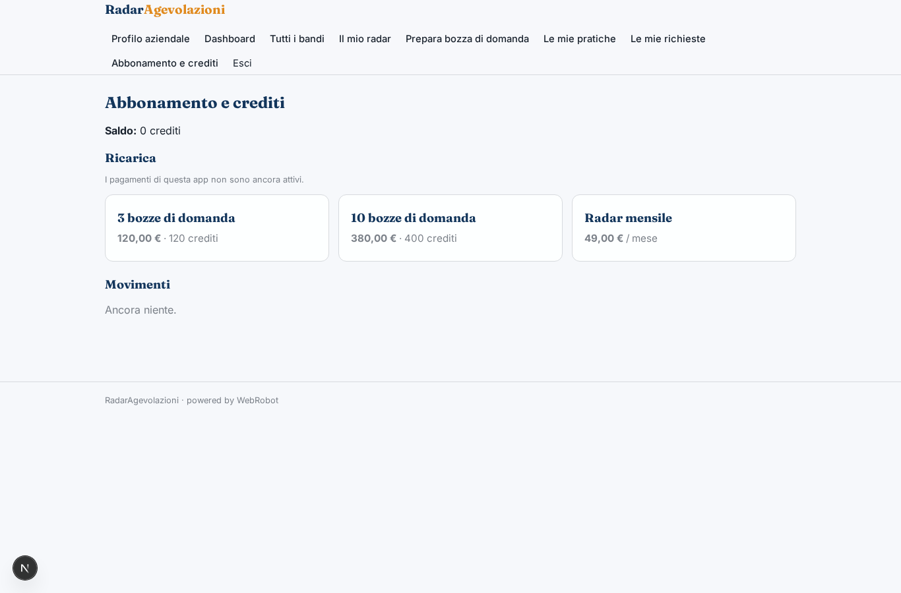

# RadarAgevolazioni

_I bandi giusti per la tua impresa, ogni mattina, con il punteggio di ammissibilità._

**Manifest:** valid (schema + runtime contract) · **Functional test:** 1 failure(s) (20 checks passed)

## Description given to the app builder (Italian)

Ci serve RadarAgevolazioni, una piattaforma per PMI e consulenti di finanza agevolata. Il cliente si registra e compila il profilo aziendale: codice ATECO, regione e provincia della sede, numero di dipendenti, fatturato, anno di costituzione, tipo di investimento previsto (macchinari, digitale, assunzioni, energia) e importo. Ogni mattina un agente monitora più di trenta fonti pubbliche, tra cui incentivi.gov.it, i portali delle Regioni, il Registro Nazionale Aiuti e il portale EU Funding & Tenders, indicizza i nuovi bandi e ne estrae requisiti, scadenze, dotazione e percentuale di contributo. Un secondo agente confronta ogni bando con il profilo e calcola un punteggio di ammissibilità, spiegando quali requisiti sono soddisfatti e quali mancano. Il cliente riceve un'email con i bandi compatibili e vede una dashboard con tabella filtrabile e motore di ricerca full-text. Per i bandi scelti l'agente prepara una bozza di domanda e di relazione tecnica, che un consulente dello studio deve rivedere e approvare prima che il cliente la scarichi. Il consulente vede tutti i clienti assegnati, il cliente solo i propri dati. Abbonamento mensile tramite Stripe, più una tariffa a pratica per la bozza di domanda.

## Functional test: what did not pass

- **run started and report ready** (view new_draft): required match (options from collection:matches) has no option

## Screenshots (interpretive runtime, no data)

### home-anon

### home-mobile

### home

### profile

### dashboard

### grants

### radar

### new_draft

### my_drafts

### history

### clients

### client_matches

### drafts_review

### approvals

### account

