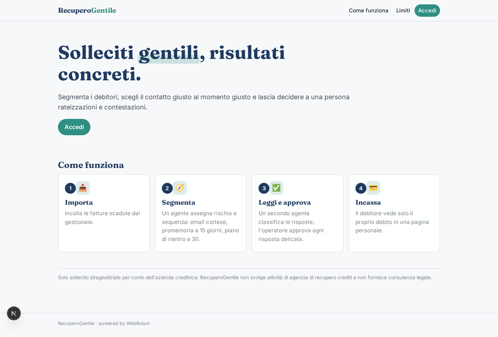
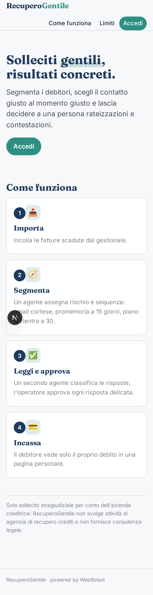
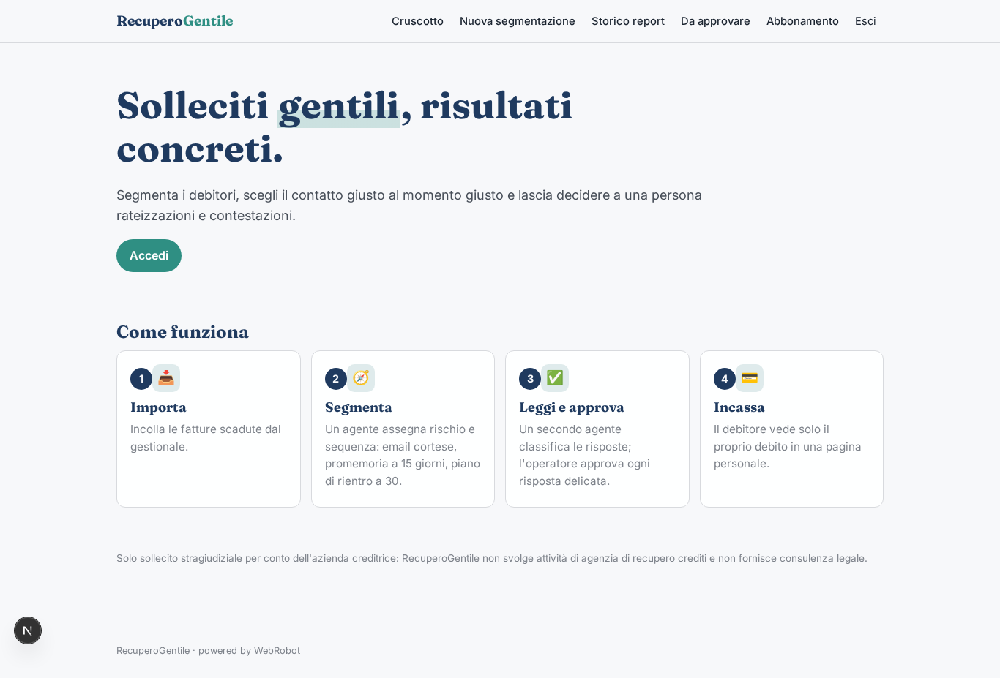
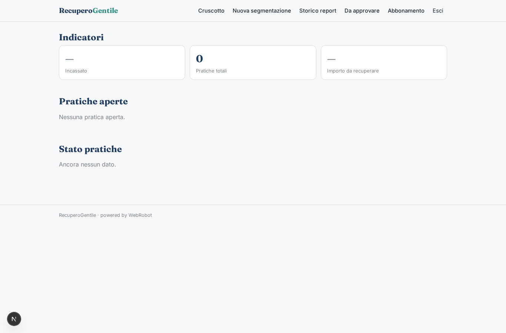
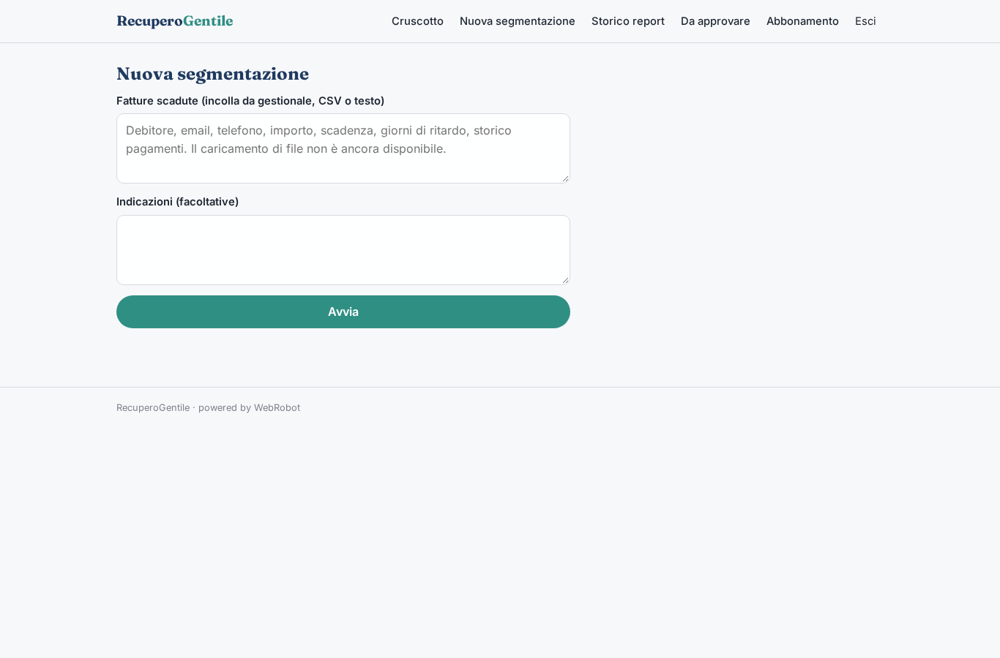
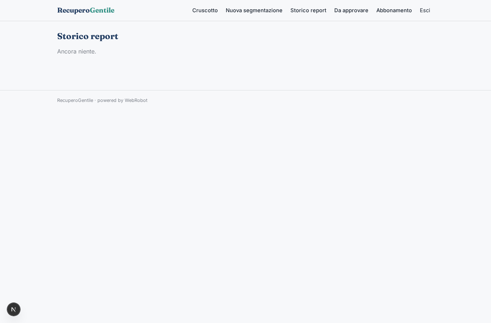
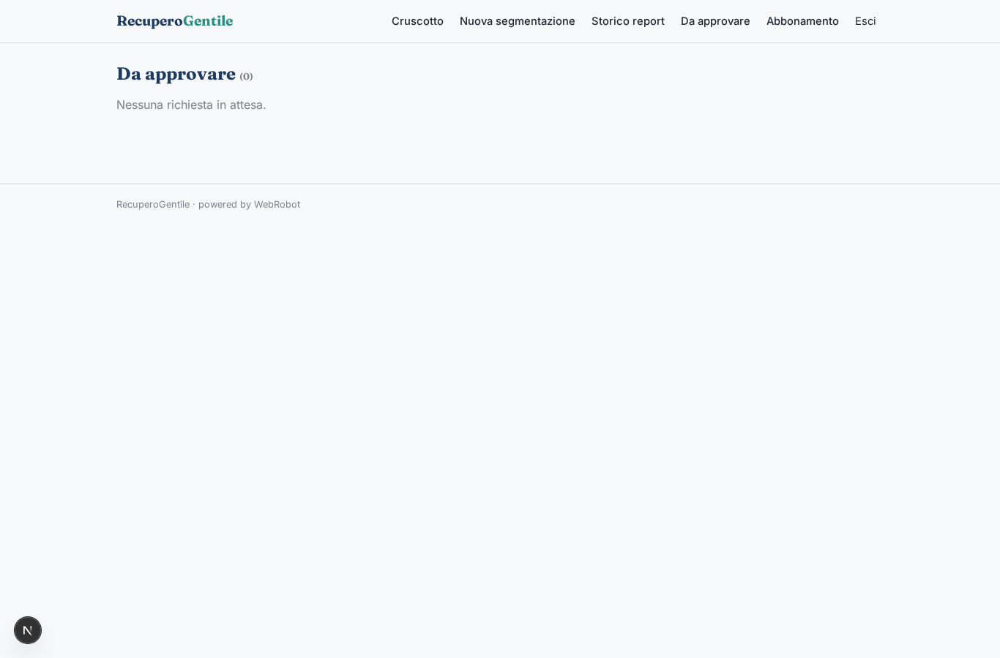
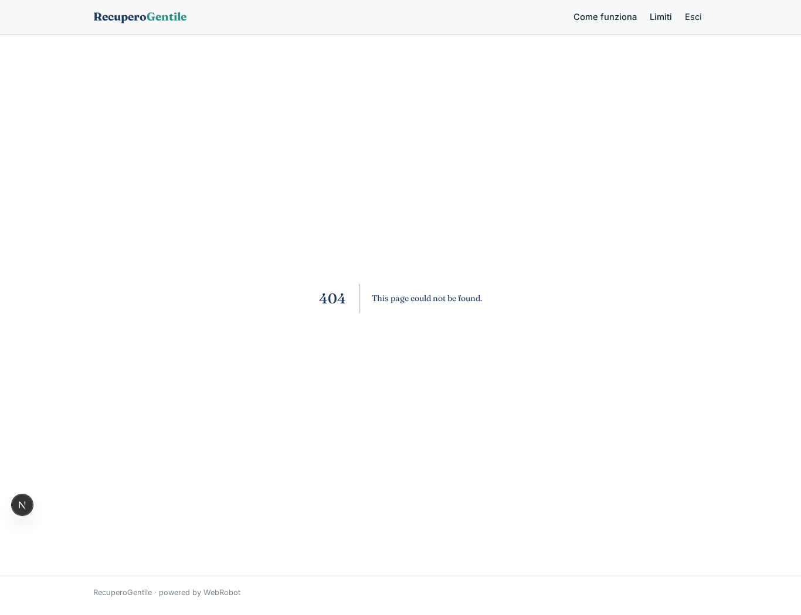
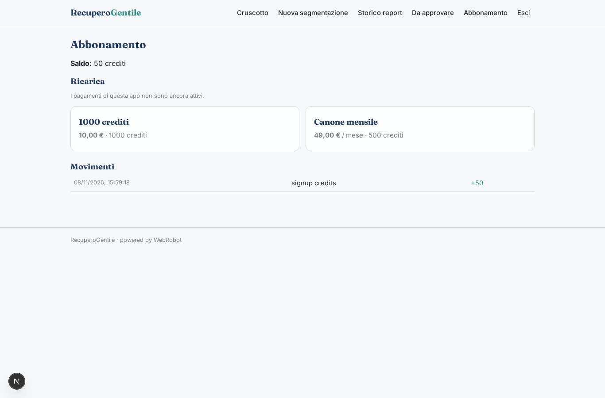

# RecuperoGentile

_Solleciti di pagamento automatici, ma sempre rispettosi._

**Stato manifest:** valido (validatore Python + contratto runtime)

## Descrizione data all'app builder

Serve RecuperoGentile, una piattaforma per PMI, studi professionali e utility che vogliono gestire i solleciti di pagamento in modo automatico ma rispettoso. Ruoli: admin dell'azienda creditrice, operatore crediti e debitore. L'azienda importa le fatture scadute dal gestionale contabile tramite connettore o file: debitore, email, telefono, importo, scadenza, giorni di ritardo, storico pagamenti. Un agente segmenta i debitori per rischio e importo e sceglie la sequenza di contatto: email cortese al primo ritardo, promemoria a 15 giorni, proposta di piano di rientro a 30. Un secondo agente legge le risposte dalla casella IMAP dedicata, capisce se il debitore contesta, chiede una rateizzazione o promette un pagamento, e aggiorna la pratica. Le proposte di rateizzazione e ogni caso di contestazione passano dall'operatore umano, che approva prima che parta la risposta. Il debitore riceve un link a una pagina personale dove vede solo il proprio debito, può pagare con carta o scegliere un piano. Prevista anche una fase di chiamate vocali e messaggi WhatsApp, che però per noi resta solo sollecito stragiudiziale dell'azienda creditrice, senza attività di agenzia di recupero. Dashboard con incassato, tasso di risposta e pratiche aperte. Canone mensile più percentuale sul recuperato. Italiano.

## Funzioni non esprimibili oggi (spec.extensions)

- **connettore_gestionale**: Importazione automatica dal gestionale contabile e caricamento file non disponibili: per ora le fatture si incollano come testo.
- **imap_inbox**: La lettura della casella IMAP dedicata non è disponibile: le risposte vengono registrate nella collezione replies (incolla/inoltro manuale) e l'agente le classifica.
- **invio_email_whatsapp_voce**: Invio email, WhatsApp e chiamate vocali (e relative notifiche) non disponibili: la bozza approvata va inviata fuori dall'app. Resta solo sollecito stragiudiziale, senza attività di agenzia di recupero.
- **pagina_debitore_e_pagamenti**: Pagina personale con link, pagamento con carta verso il creditore e scelta del piano richiedono credenziali Stripe del creditore e visibilità per-pratica del debitore: da sviluppare. Le pratiche sono ora per utente, la condivisione tra admin e operatori è da definire.
- **percentuale_sul_recuperato**: La percentuale sul recuperato non è esprimibile nel manifest: oggi solo canone mensile e crediti; la commissione va fatturata a parte.

## Screenshot (runtime interpretativo)

### home-anon

### home-mobile

### home

### dashboard

### new_run

### history

### approvals

### my_debt

### account

