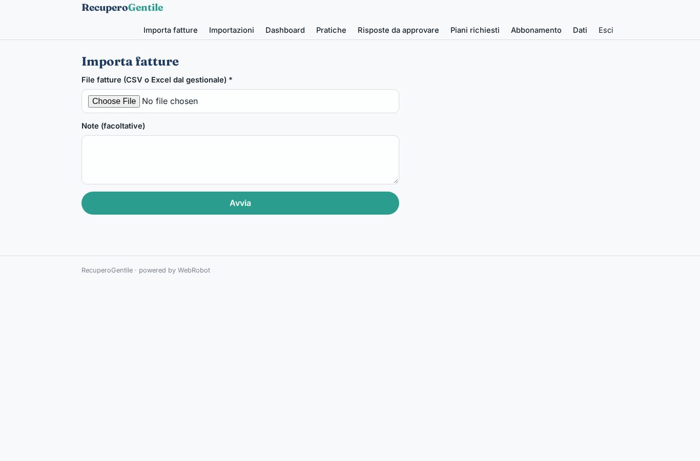
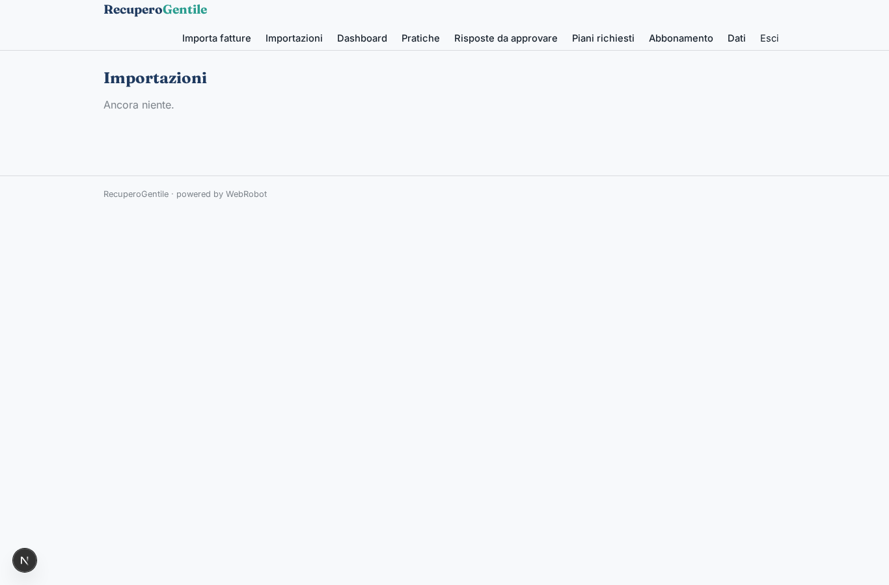
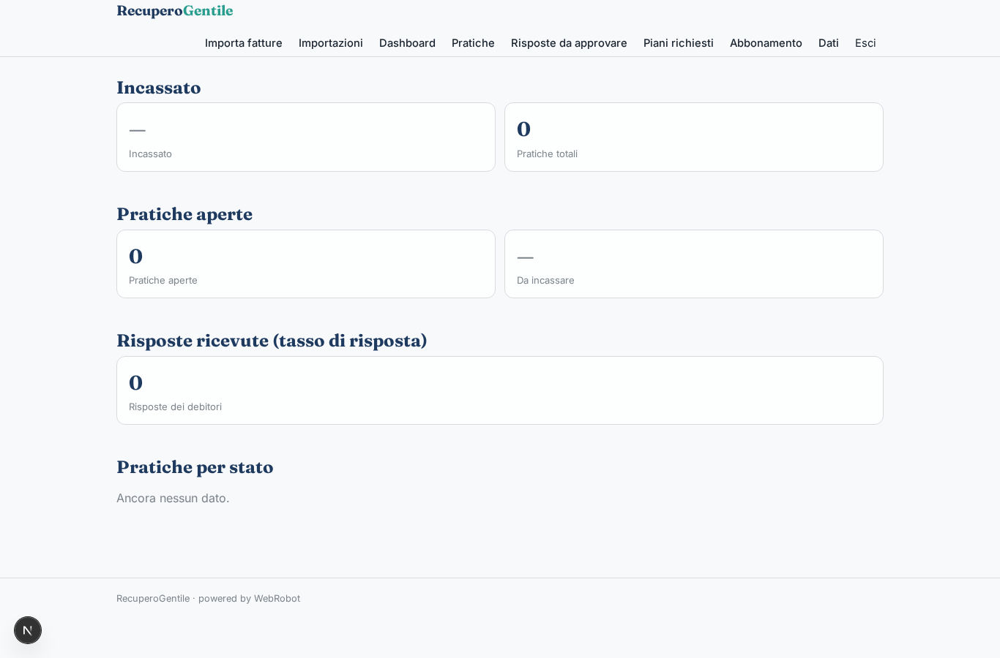
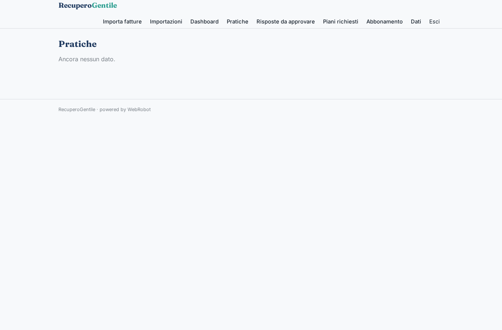
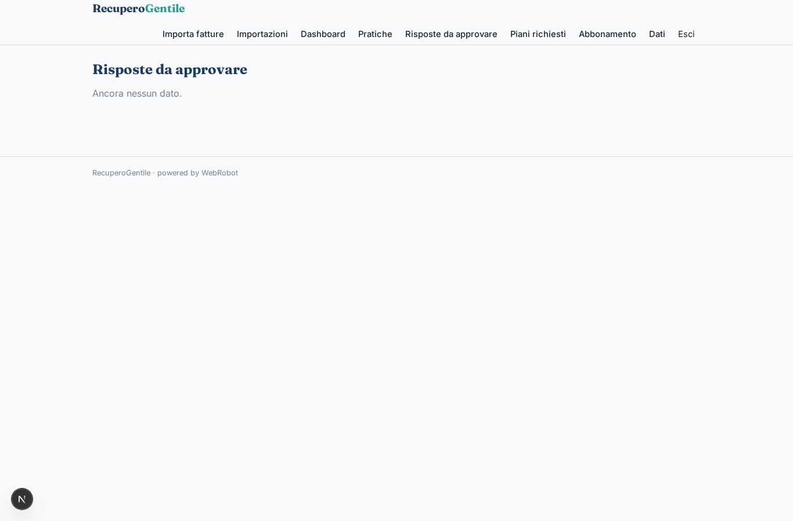
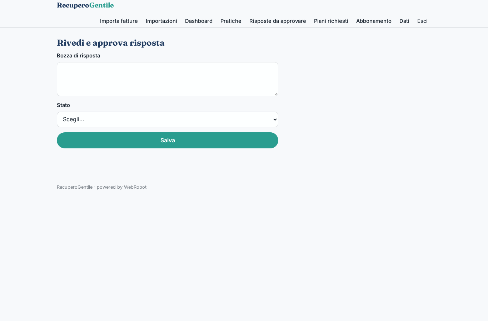
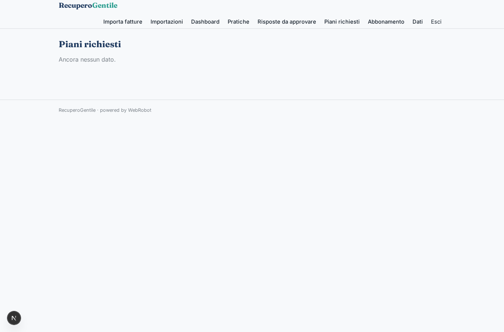
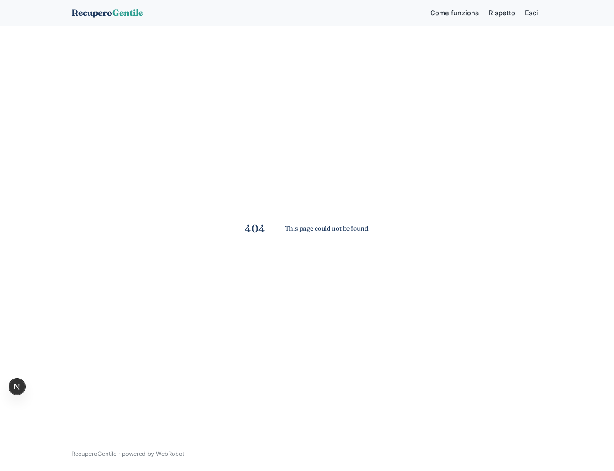
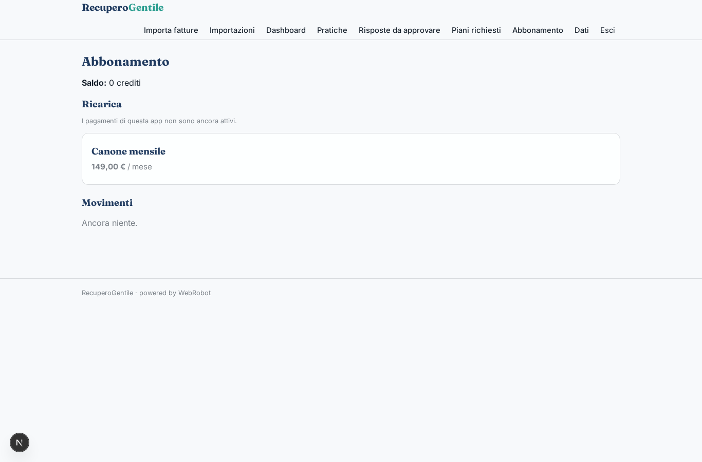

# RecuperoGentile

_Solleciti di pagamento automatici, ma sempre rispettosi._

**Manifest:** valid (schema + runtime contract) · **Functional test:** passed (26 checks passed)

## Description given to the app builder (Italian)

Serve RecuperoGentile, una piattaforma per PMI, studi professionali e utility che vogliono gestire i solleciti di pagamento in modo automatico ma rispettoso. Ruoli: admin dell'azienda creditrice, operatore crediti e debitore. L'azienda importa le fatture scadute dal gestionale contabile tramite connettore o file: debitore, email, telefono, importo, scadenza, giorni di ritardo, storico pagamenti. Un agente segmenta i debitori per rischio e importo e sceglie la sequenza di contatto: email cortese al primo ritardo, promemoria a 15 giorni, proposta di piano di rientro a 30. Un secondo agente legge le risposte dalla casella IMAP dedicata, capisce se il debitore contesta, chiede una rateizzazione o promette un pagamento, e aggiorna la pratica. Le proposte di rateizzazione e ogni caso di contestazione passano dall'operatore umano, che approva prima che parta la risposta. Il debitore riceve un link a una pagina personale dove vede solo il proprio debito, può pagare con carta o scegliere un piano. Prevista anche una fase di chiamate vocali e messaggi WhatsApp, che però per noi resta solo sollecito stragiudiziale dell'azienda creditrice, senza attività di agenzia di recupero. Dashboard con incassato, tasso di risposta e pratiche aperte. Canone mensile più percentuale sul recuperato. Italiano.

## Functional test: what did not pass

- **form saves a record** (form plan_form): only role debtor may fill it, and the test cannot hold that role _(warning)_

## Features not expressible today (spec.extensions)

- **imap_inbox**: La lettura diretta di una casella IMAP non è disponibile: le risposte entrano inoltrando le email al webhook /api/hooks/inbound_mail (campi from, subject, text, case_ref) tramite una regola di inoltro del provider email.
- **voice_whatsapp**: Chiamate vocali e messaggi WhatsApp non sono ancora disponibili. Quando lo saranno resteranno solo sollecito stragiudiziale del creditore, senza attività di agenzia di recupero.
- **card_payment**: Il pagamento con carta del debito da parte del debitore verso il creditore non è coperto dai pagamenti dell'app (che servono per i pacchetti del proprietario). Serve un link di pagamento del creditore da inserire nelle email.
- **success_fee**: La percentuale sul recuperato non è ancora addebitabile automaticamente: si fattura a parte partendo dal totale incassato in dashboard (campo paid_amount).
- **accounting_connector**: Il connettore diretto al gestionale contabile non è incluso: l'import avviene da file CSV/Excel. Un connettore via chiave API può essere aggiunto per il gestionale scelto.

## Screenshots (interpretive runtime, no data)

### home-anon

### home-mobile

### home

### import

### imports

### dashboard

### cases_table

### reviews

### reply_edit

### plans

### my_debt

### plan_form

### account

