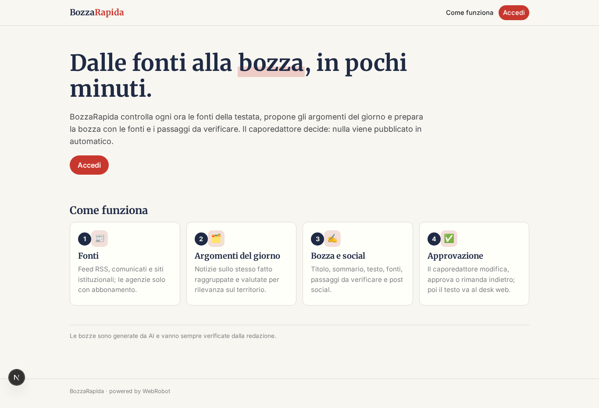
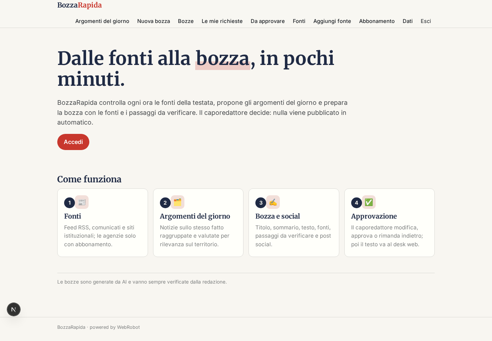
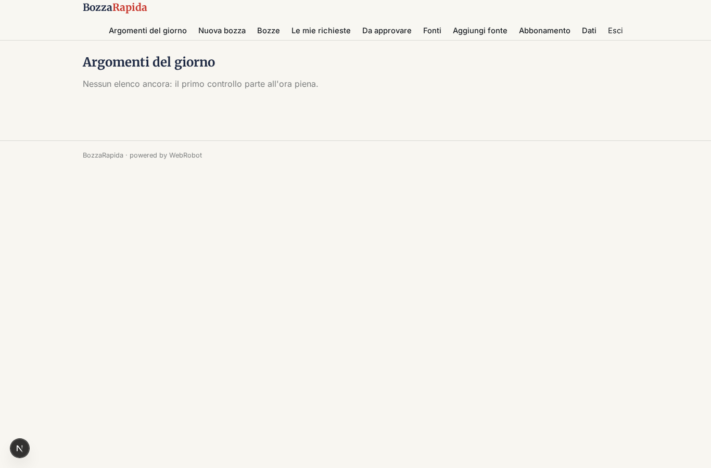
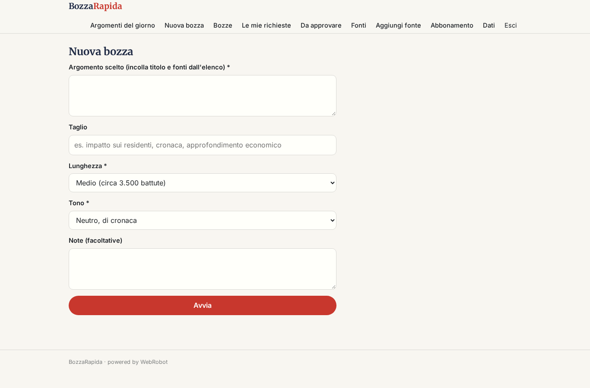
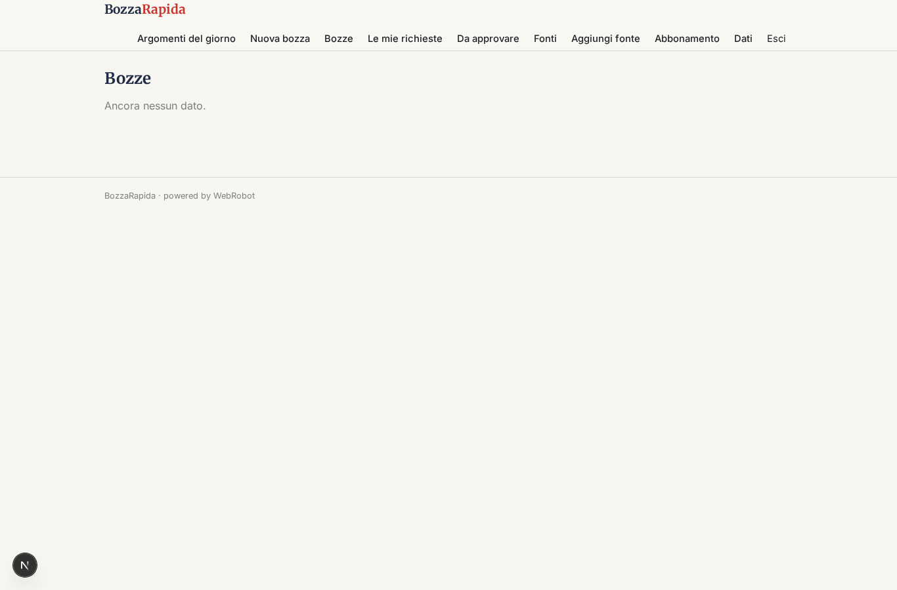
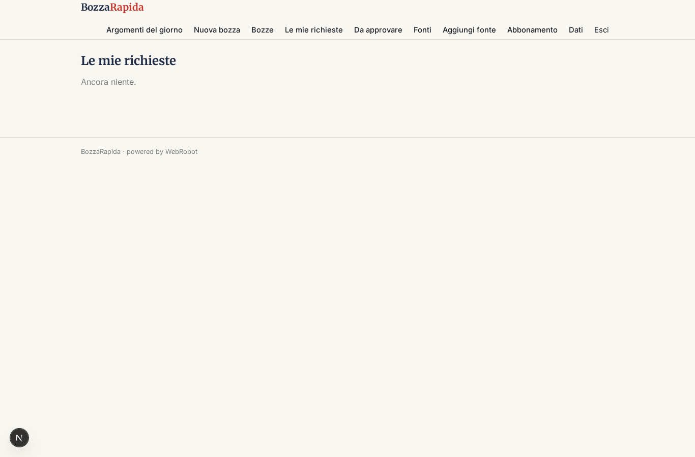
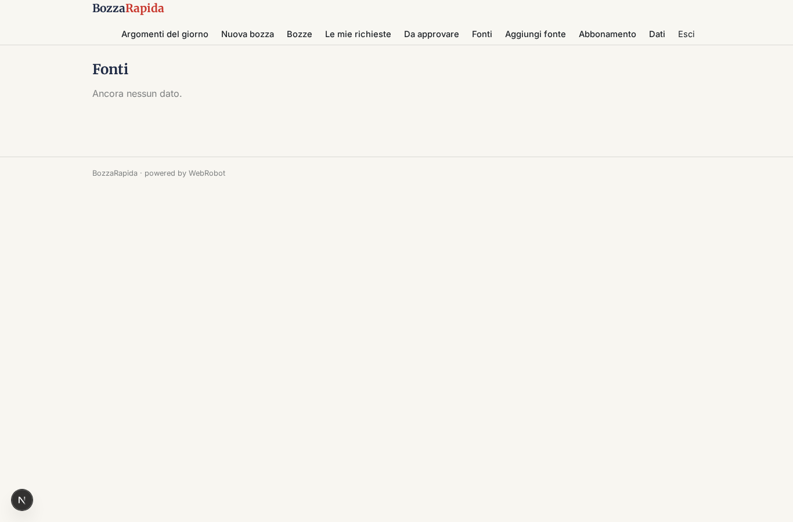
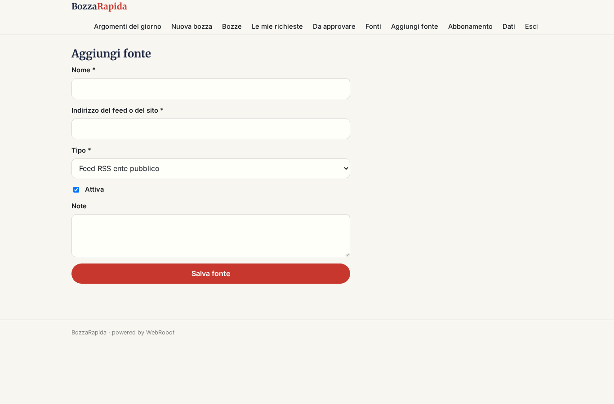
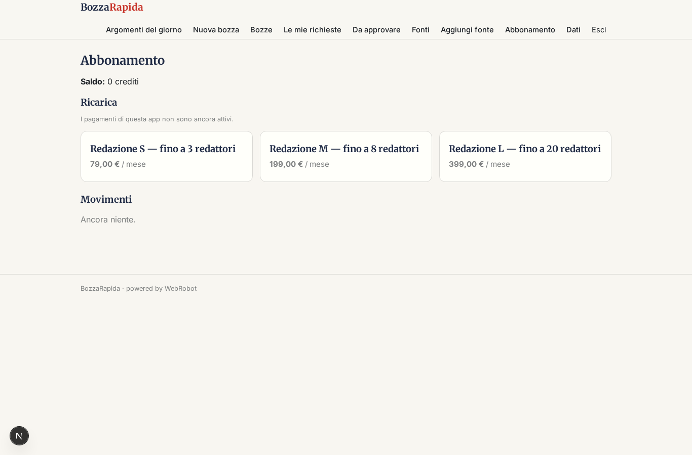

# BozzaRapida

_Dalle fonti all'articolo da approvare, in redazione._

**Manifest:** valid (schema + runtime contract) · **Functional test:** passed (17 checks passed)

## Description given to the app builder (Italian)

Sono caporedattore di una testata locale e vorrei un'app, BozzaRapida, che aiuti la redazione. Il redattore configura le fonti da seguire: feed RSS di enti pubblici, comunicati stampa di comuni, questure e aziende, siti istituzionali; i lanci d'agenzia solo se abbiamo l'abbonamento. Un agente controlla le fonti ogni ora, raggruppa le notizie sullo stesso fatto, ne valuta la rilevanza per il nostro territorio e propone un elenco di argomenti del giorno. Il redattore sceglie un argomento, indica taglio, lunghezza e tono, e un secondo agente scrive titolo, sommario e testo con l'elenco delle fonti usate e i passaggi da verificare evidenziati; un terzo agente propone anche post brevi per i social. Nulla viene pubblicato in automatico: il pezzo passa al caporedattore che modifica, approva o rimanda indietro con un commento. Quando è approvato, il testo arriva via email al desk web. Ogni redattore vede le sue bozze, il caporedattore tutte. Abbonamento mensile per testata con numero di redattori. Tutto in italiano.

## Features not expressible today (spec.extensions)

- **seat_limit**: Il numero massimo di redattori per piano (3, 8, 20) non è applicabile automaticamente dal manifest: va verificato dal caporedattore tra gli utenti.
- **source_edit_by_editors**: Le fonti sono configurate dal caporedattore (dati riservati alla redazione); la configurazione da parte di ogni redattore richiederebbe un modello dati condiviso non ancora disponibile per l'agente orario.

## Screenshots (interpretive runtime, no data)

### home-anon

### home-mobile

### home

### topics_list

### new_draft

### drafts

### my_runs

### review

### sources_list

### source_add

### account

