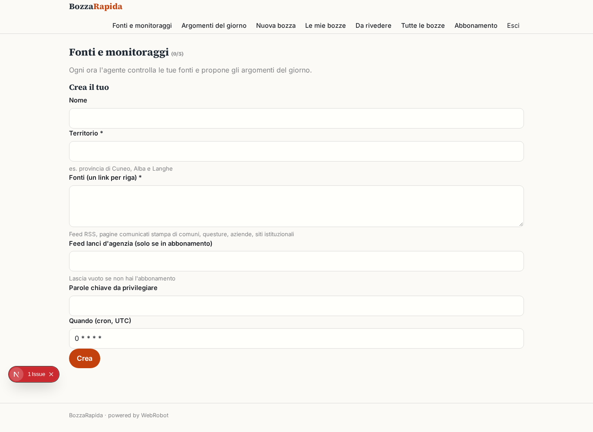
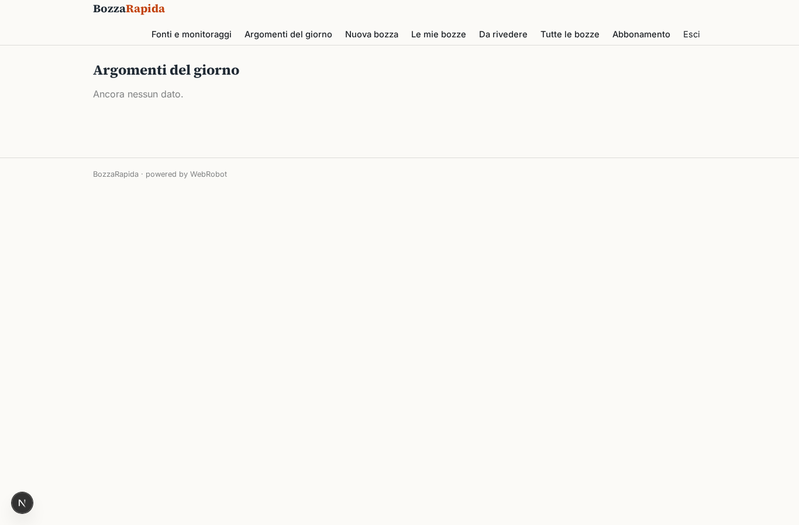
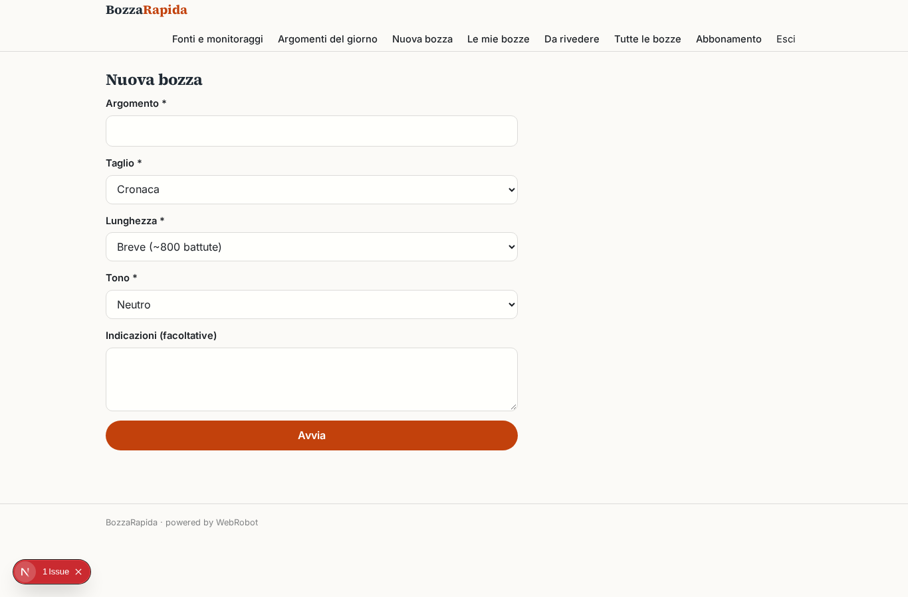
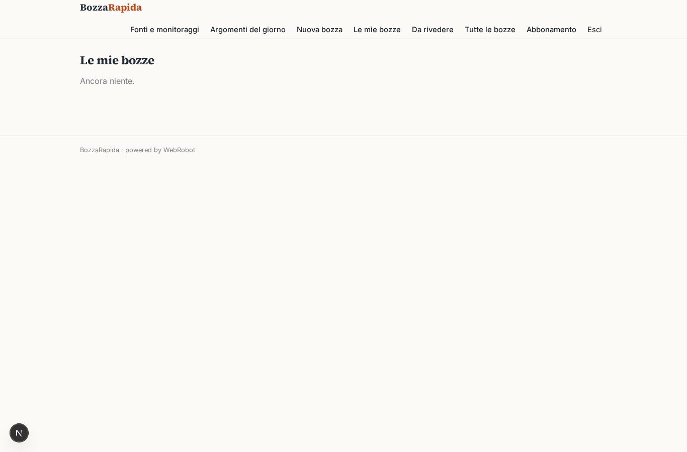
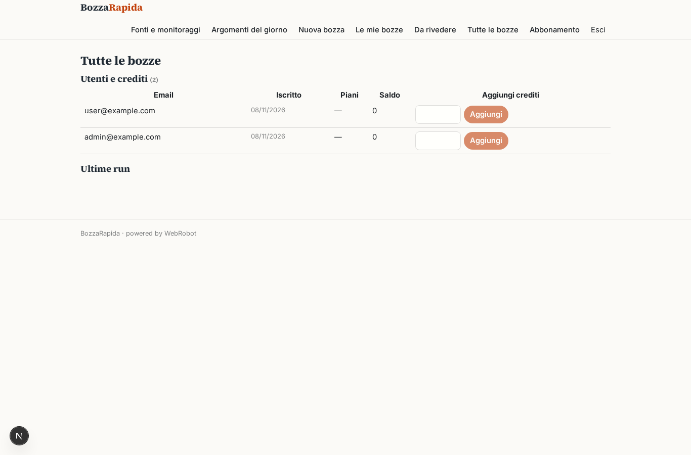
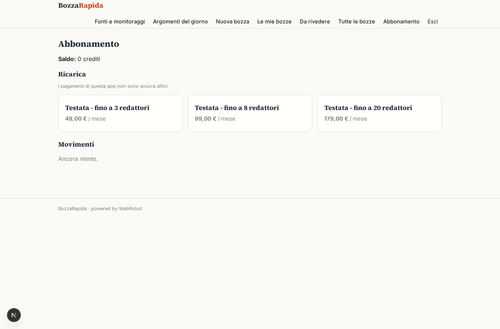

# BozzaRapida

_Dalle fonti alla bozza, con il caporedattore sempre al comando._

**Manifest status:** valid (schema validator + runtime contract)

## Description given to the app builder (Italian)

Sono caporedattore di una testata locale e vorrei un'app, BozzaRapida, che aiuti la redazione. Il redattore configura le fonti da seguire: feed RSS di enti pubblici, comunicati stampa di comuni, questure e aziende, siti istituzionali; i lanci d'agenzia solo se abbiamo l'abbonamento. Un agente controlla le fonti ogni ora, raggruppa le notizie sullo stesso fatto, ne valuta la rilevanza per il nostro territorio e propone un elenco di argomenti del giorno. Il redattore sceglie un argomento, indica taglio, lunghezza e tono, e un secondo agente scrive titolo, sommario e testo con l'elenco delle fonti usate e i passaggi da verificare evidenziati; un terzo agente propone anche post brevi per i social. Nulla viene pubblicato in automatico: il pezzo passa al caporedattore che modifica, approva o rimanda indietro con un commento. Quando è approvato, il testo arriva via email al desk web. Ogni redattore vede le sue bozze, il caporedattore tutte. Abbonamento mensile per testata con numero di redattori. Tutto in italiano.

## Features not expressible today (spec.extensions)

- **email_desk_web**: Invio via email del testo approvato al desk web: le notifiche email non sono ancora disponibili. Per ora il pezzo approvato resta nella bozza stampabile/copiabile.
- **modifica_caporedattore**: Modifica diretta del testo da parte del caporedattore nell'app: per ora può approvare o rimandare indietro con un commento, e correggere fuori dall'app.
- **posti_redattori**: Il limite di redattori per piano (3, 8, 20) non è applicato dal runtime: va controllato dal titolare.
- **agenzia_credenziali**: I lanci d'agenzia sono letti solo se la redazione fornisce un link di feed accessibile; connettori con credenziali non sono ancora disponibili.
- **fonti_condivise**: Le fonti e gli argomenti sono per utente: una redazione con più redattori condivide il monitoraggio solo se lo crea il caporedattore e gli argomenti vengono riportati manualmente.

## Screenshots (interpretive runtime)

### home-anon

### home-mobile

### home

### watches

### topics_list

### new_draft

### my_drafts

### review

### all_drafts

### account

