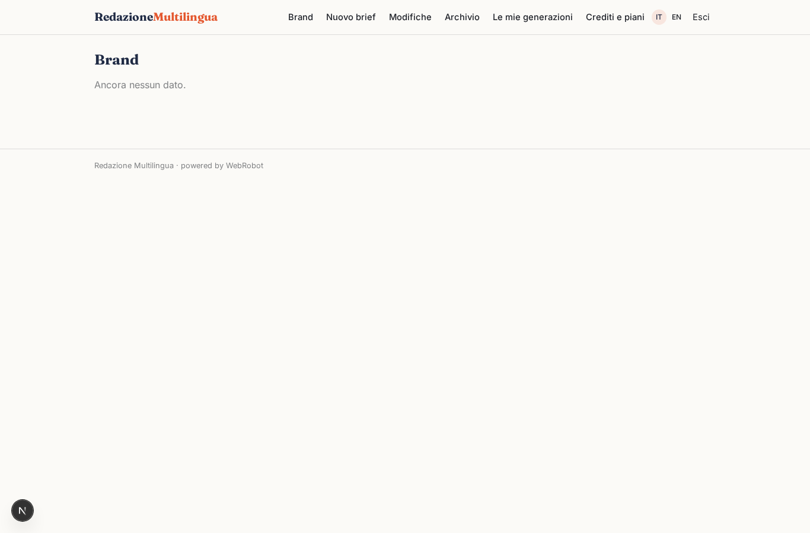
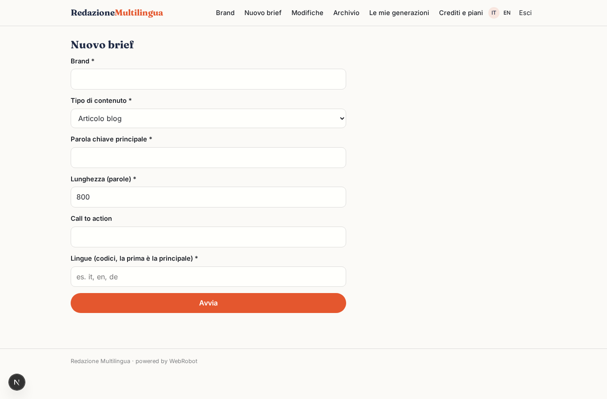
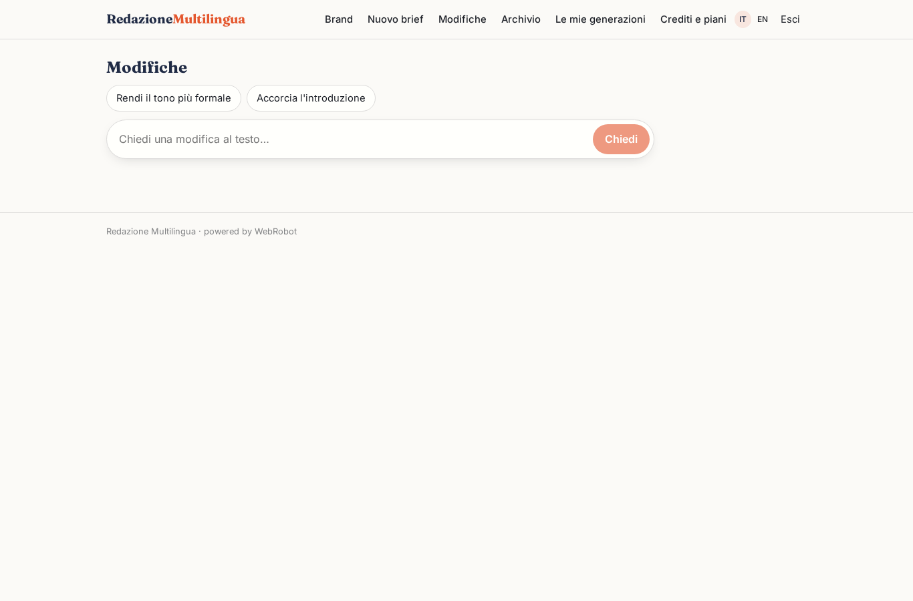
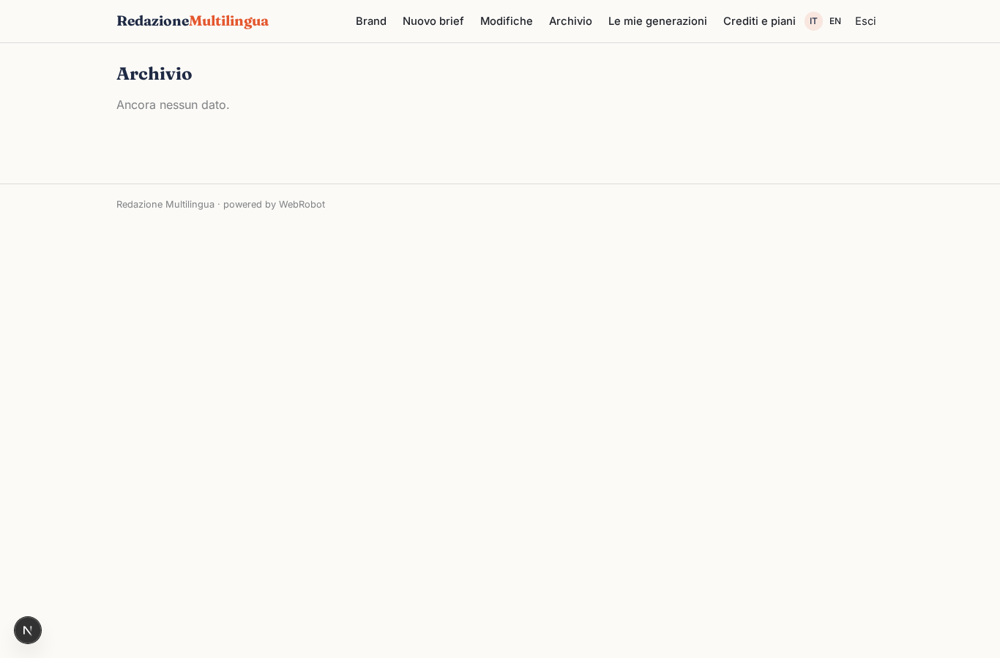
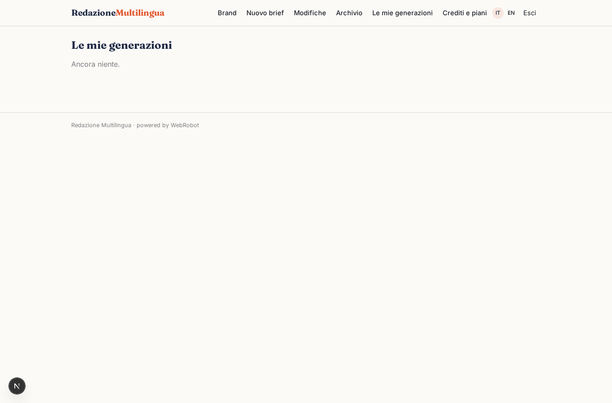
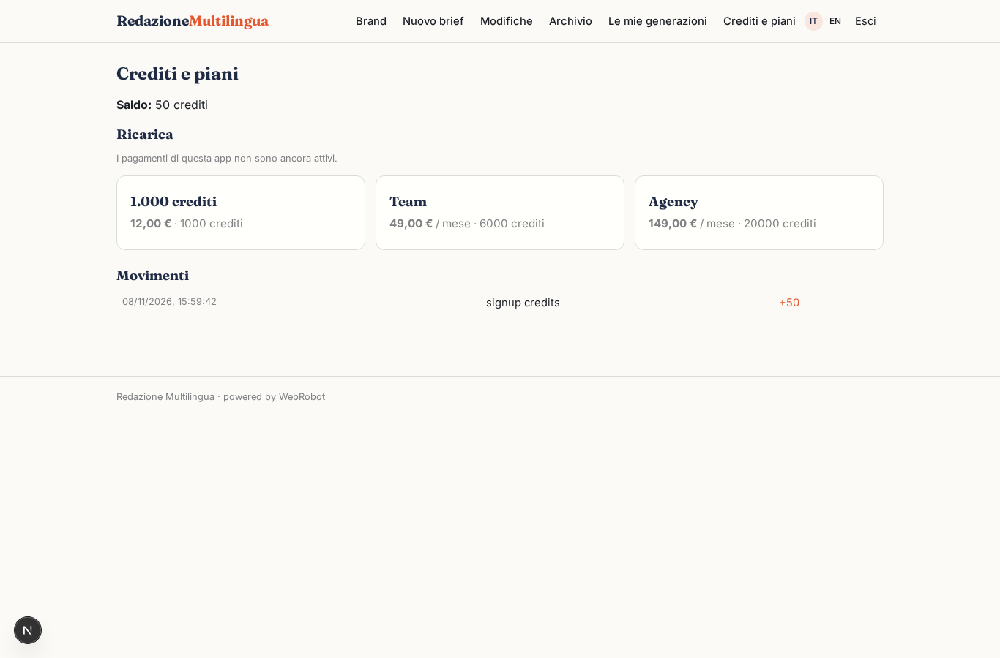

# Redazione Multilingua

_Contenuti SEO nel tono del tuo brand, in più lingue._

**Stato manifest:** valido (validatore Python + contratto runtime)

## Descrizione data all'app builder

Vorrei un'app che chiamo Redazione Multilingua, per agenzie e uffici marketing che producono contenuti in più lingue. L'admin dell'account crea uno o più brand, e per ciascuno inserisce tono di voce, pubblico, parole da evitare, esempi di testi approvati e lingue di destinazione. Il redattore compila un brief: brand, tipo di contenuto (articolo blog, scheda prodotto, newsletter, post social), parola chiave principale, lunghezza, call to action e lingue. Un agente fa una ricerca web sulle prime pagine dei risultati usando un'API SERP a pagamento, non lo scraping di Google, ricava domande frequenti e sottotemi, propone una scaletta, poi scrive il testo, il titolo SEO e la meta description e infine lo traduce adattandolo alle altre lingue. Il redattore vede l'anteprima, può chiedere modifiche in chat e approva. Dopo l'approvazione il contenuto viene pubblicato automaticamente come bozza sul CMS del cliente (WordPress o un altro tramite chiamata HTTP alla sua API) con le credenziali salvate dall'admin. Ogni brand ha il suo archivio storico visibile solo ai membri del team abilitati. Pagamento a crediti in base alle parole generate, con piani mensili.

## Funzioni non esprimibili oggi (spec.extensions)

- **serp_api_key**: The paid SERP API key cannot be placed in the manifest: the owner must configure it as a platform credential for the serp_search tool.
- **cms_publish**: Automatic draft publishing to the client's CMS (WordPress REST or other) after approval, with credentials saved by the admin, is not available yet: per-customer credentials are not supported. For now the approved text is copied from the archive; brands only store the CMS API URL.
- **approval_flow**: Explicit approve action and status change draft->approved on contents is not yet expressible; approval is currently implicit by saving in the archive.

## Screenshot (runtime interpretativo)

### home-anon

### home-mobile

### home

### brands

### new

### revise

### archive

### history

### account

