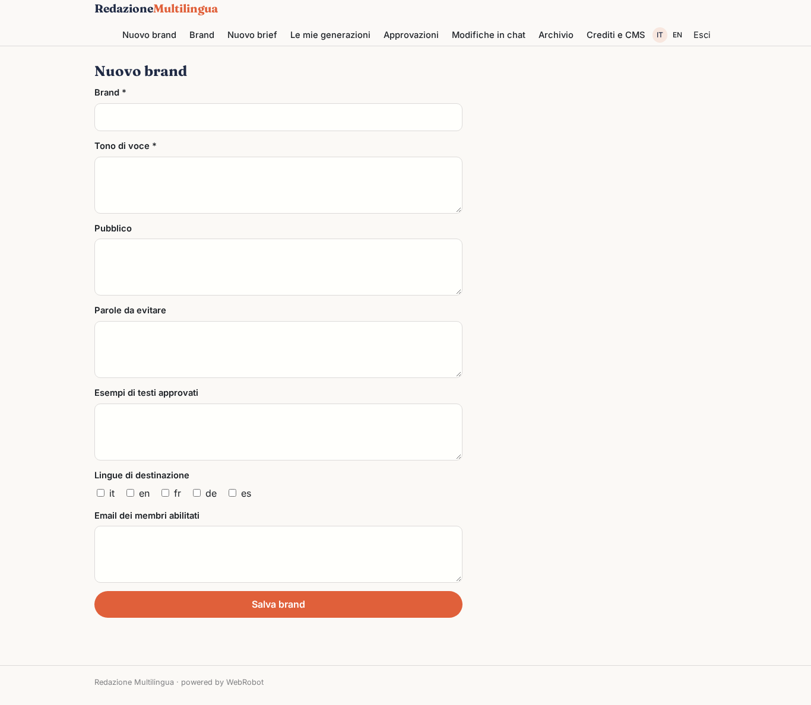
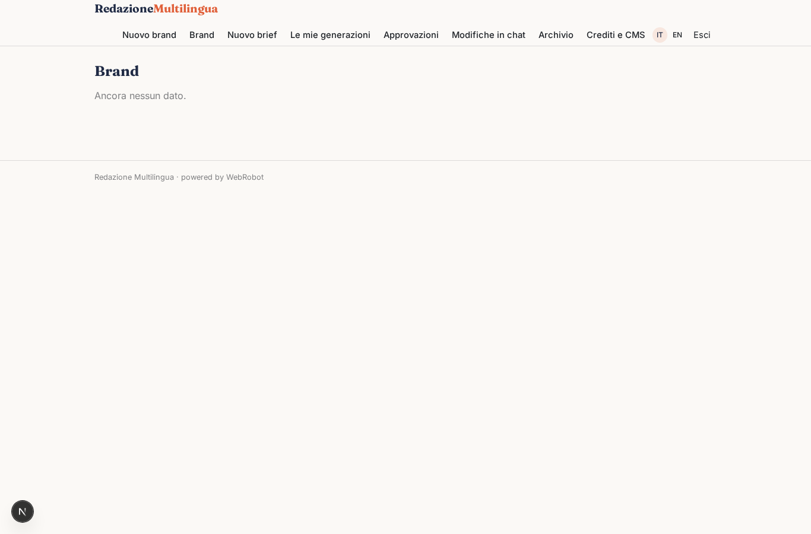
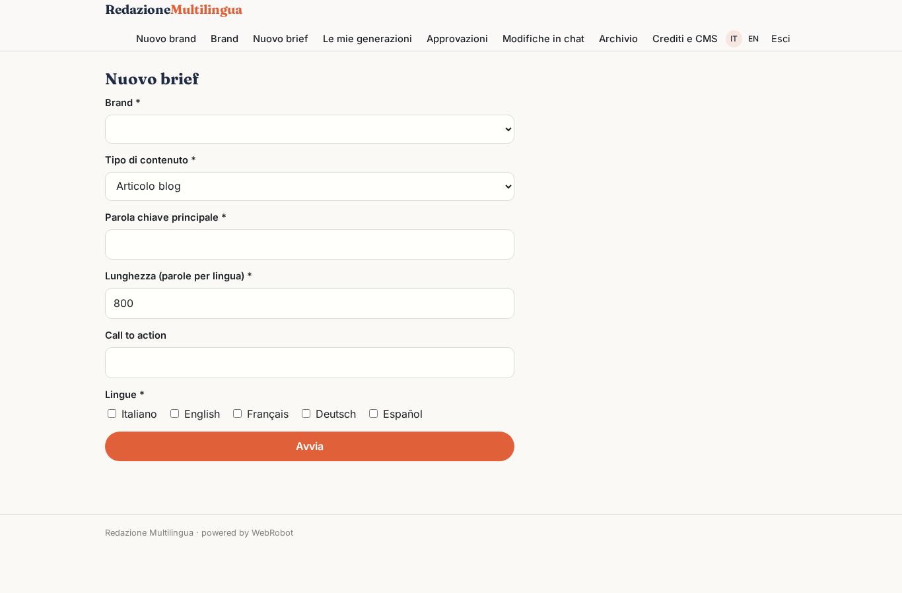
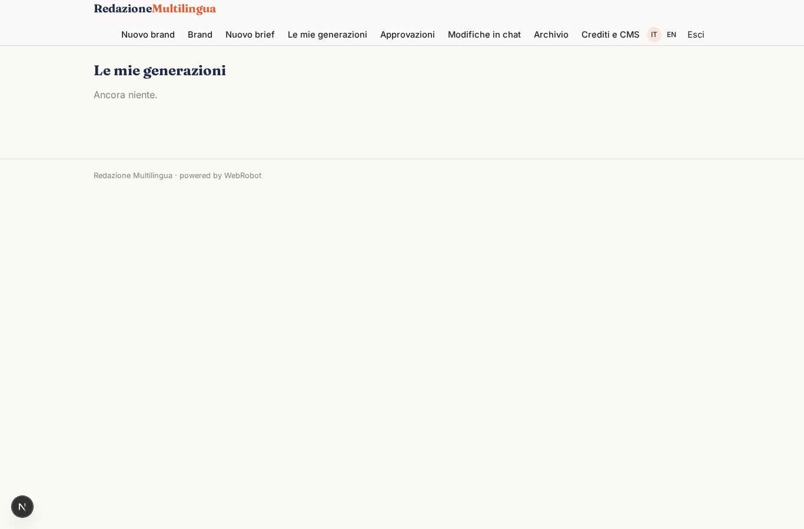
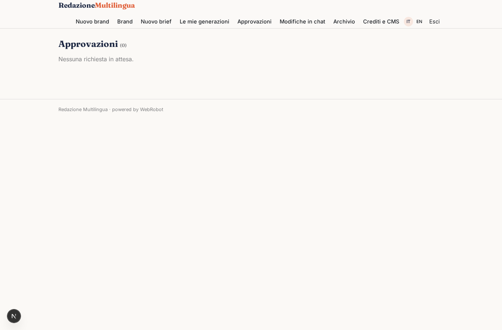
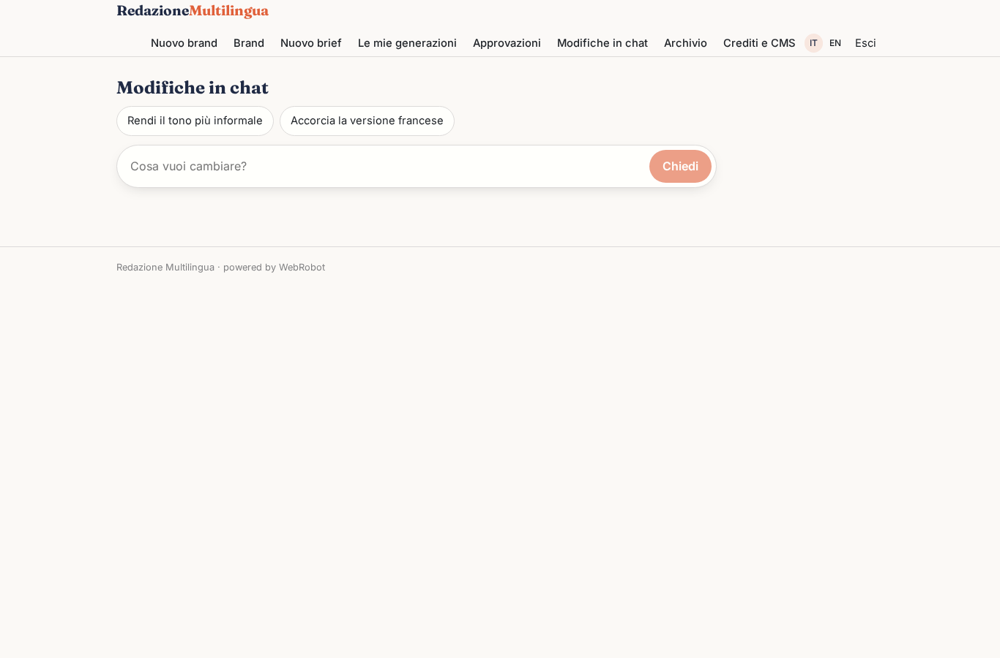
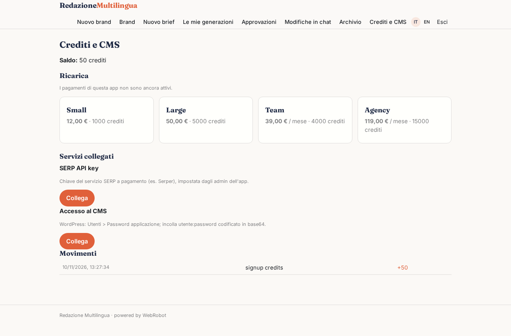

# Redazione Multilingua

_Contenuti SEO in più lingue, nel tono di ogni brand, fino alla bozza sul tuo CMS._

**Manifest:** valid (schema + runtime contract) · **Functional test:** passed (11 checks passed)

## Description given to the app builder (Italian)

Vorrei un'app che chiamo Redazione Multilingua, per agenzie e uffici marketing che producono contenuti in più lingue. L'admin dell'account crea uno o più brand, e per ciascuno inserisce tono di voce, pubblico, parole da evitare, esempi di testi approvati e lingue di destinazione. Il redattore compila un brief: brand, tipo di contenuto (articolo blog, scheda prodotto, newsletter, post social), parola chiave principale, lunghezza, call to action e lingue. Un agente fa una ricerca web sulle prime pagine dei risultati usando un'API SERP a pagamento, non lo scraping di Google, ricava domande frequenti e sottotemi, propone una scaletta, poi scrive il testo, il titolo SEO e la meta description e infine lo traduce adattandolo alle altre lingue. Il redattore vede l'anteprima, può chiedere modifiche in chat e approva. Dopo l'approvazione il contenuto viene pubblicato automaticamente come bozza sul CMS del cliente (WordPress o un altro tramite chiamata HTTP alla sua API) con le credenziali salvate dall'admin. Ogni brand ha il suo archivio storico visibile solo ai membri del team abilitati. Pagamento a crediti in base alle parole generate, con piani mensili.

## Features not expressible today (spec.extensions)

- **cms_shared_credentials**: The CMS key is saved per user; a single key saved by the account admin and shared with the whole team is not available yet, nor are custom CMS domains outside the listed egress hosts.
- **per_word_exact**: Credits follow the words per language field of the brief; the exact count of generated words is not metered.

## Screenshots (interpretive runtime, no data)

### home-anon

### home-mobile

### home

### brand_new

### brands

### new

### runs

### approvals

### edit_chat

### archive

### account

