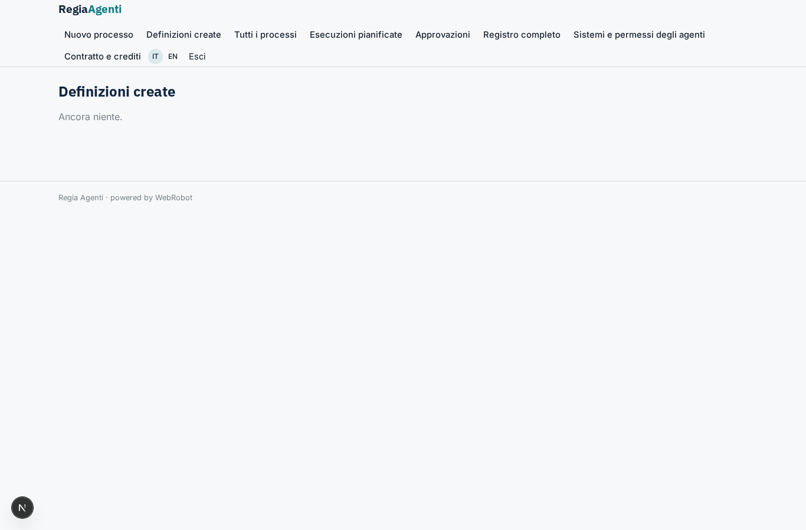
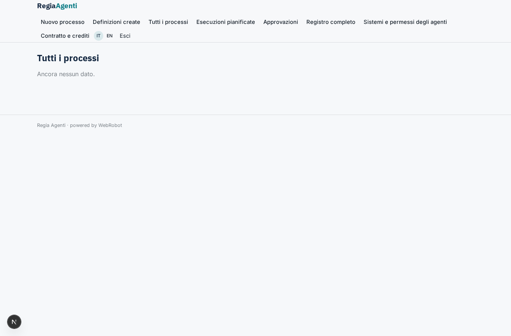
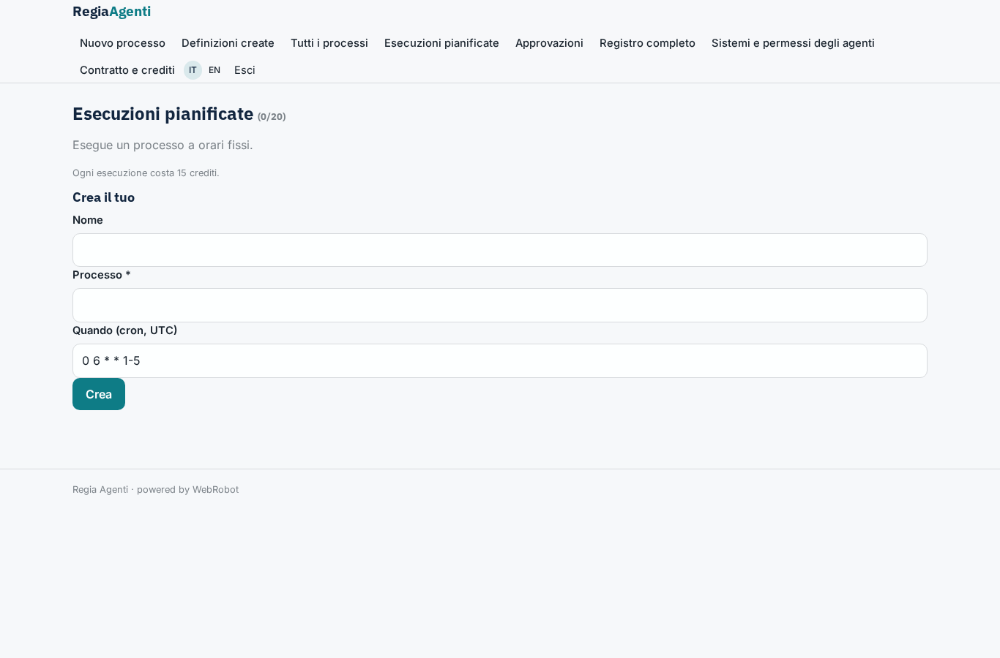
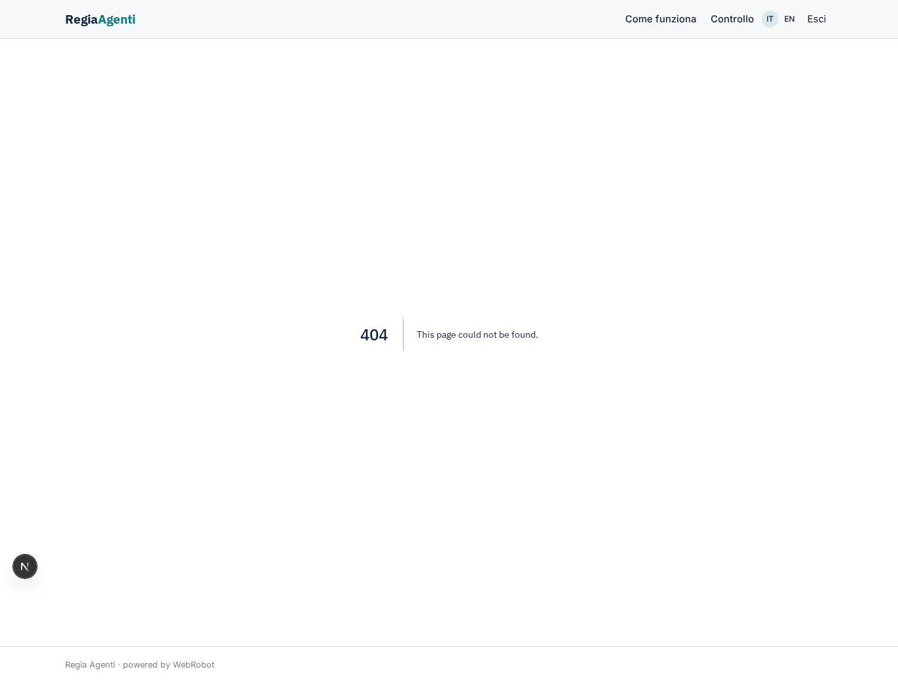
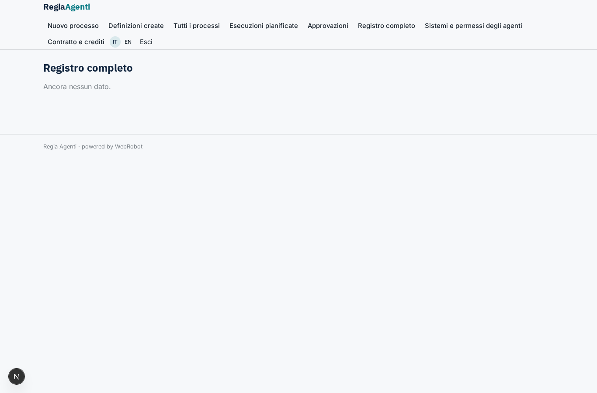
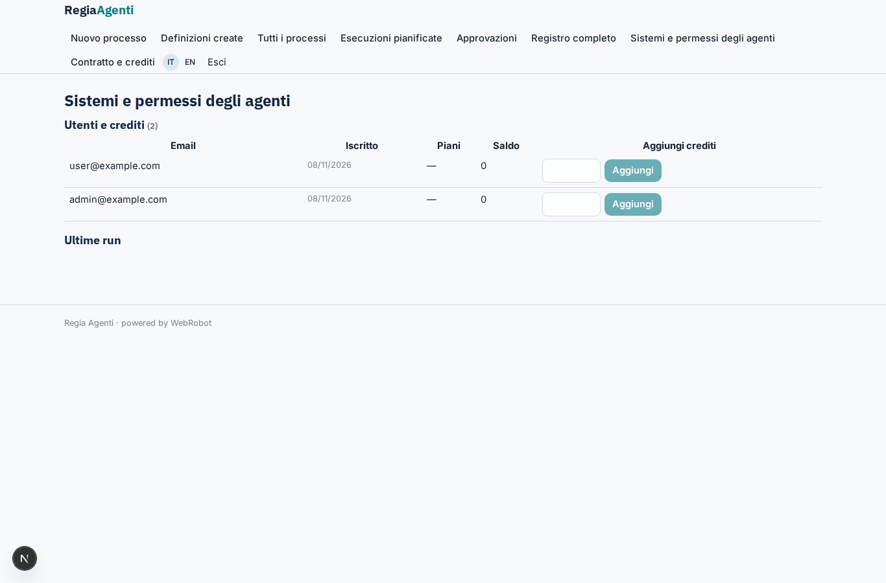
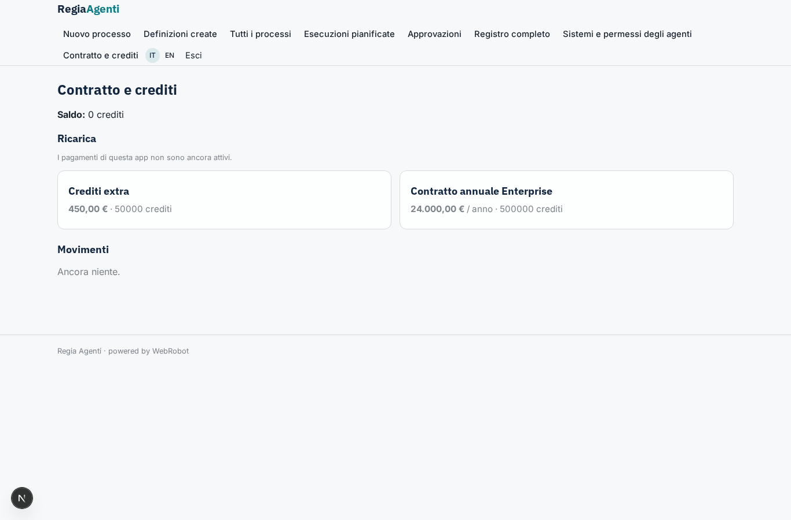

# Regia Agenti

_Agenti AI che portano i processi da un reparto all'altro, con approvazione umana e registro completo._

**Manifest status:** valid (schema validator + runtime contract)

## Description given to the app builder (Italian)

Voglio Regia Agenti, uno strato di agenti per grandi aziende che automatizza processi tra reparti. L'admin IT collega i sistemi aziendali: ERP e CRM via OAuth, API interne via HTTP e server MCP già esistenti, e definisce per ogni agente cosa può leggere e cosa può scrivere. Un responsabile di processo descrive in linguaggio naturale un flusso, per esempio quando arriva un ordine sopra i 50.000 euro verifica il credito del cliente, controlla la disponibilità a magazzino, prepara la conferma e avvisa il commerciale. Il sistema crea un team di agenti con ruoli separati, uno per controllo, uno per esecuzione e uno per comunicazione, che si passano il lavoro. Ogni azione che scrive su un sistema aziendale richiede approvazione umana finché il responsabile non la rende automatica. Ogni esecuzione lascia un registro completo e consultabile di chi ha fatto cosa. I dipendenti vedono solo i processi del loro reparto; il CIO vede tutto. Si parte da eventi (nuovo record, email, webhook) o da pianificazioni. Contratto annuale con consumo di crediti per esecuzione.

## Features not expressible today (spec.extensions)

- **connector_gateway**: Tools system_read and system_write: calls to the ERP/CRM (OAuth connected by IT), internal HTTP APIs and existing MCP servers, enforcing the per-agent read/write rights in agent_permissions. Connectors needing the company's own credentials and per-company internal hosts are not available yet in the generic runtime.
- **auto_approval_switch**: A control for the process owner to switch a process from 'approval' to 'auto' (per system and action) after trusting it; for now the owner edits the autonomy field of the process.
- **department_scoping**: Departments are fixed roles (sales, finance, operations); more departments mean more roles and pages. Approvers are any process_owner, not only the owner of that department.
- **email_in_out**: Incoming email as a trigger (for now events are posted to the events collection or a webhook) and outgoing notifications (for now the communicator writes to the outbox shown in the app).
- **per_process_event_routing**: Events carry a process key; each process's own trigger condition is checked by the checker agent, not by the runtime.

## Screenshots (interpretive runtime)

### home-anon

### home-mobile

### home

### new_process

### my_runs

### all_processes

### scheduled

### approvals

### dept_sales

### dept_finance

### dept_operations

### audit

### permissions

### account

