# Regia Agenti

_Team di agenti che automatizzano i processi tra reparti, con approvazione umana e registro completo._

**Manifest:** valid (schema + runtime contract) · **Functional test:** passed (22 checks passed)

## Description given to the app builder (Italian)

Voglio Regia Agenti, uno strato di agenti per grandi aziende che automatizza processi tra reparti. L'admin IT collega i sistemi aziendali: ERP e CRM via OAuth, API interne via HTTP e server MCP già esistenti, e definisce per ogni agente cosa può leggere e cosa può scrivere. Un responsabile di processo descrive in linguaggio naturale un flusso, per esempio quando arriva un ordine sopra i 50.000 euro verifica il credito del cliente, controlla la disponibilità a magazzino, prepara la conferma e avvisa il commerciale. Il sistema crea un team di agenti con ruoli separati, uno per controllo, uno per esecuzione e uno per comunicazione, che si passano il lavoro. Ogni azione che scrive su un sistema aziendale richiede approvazione umana finché il responsabile non la rende automatica. Ogni esecuzione lascia un registro completo e consultabile di chi ha fatto cosa. I dipendenti vedono solo i processi del loro reparto; il CIO vede tutto. Si parte da eventi (nuovo record, email, webhook) o da pianificazioni. Contratto annuale con consumo di crediti per esecuzione.

## Functional test: what did not pass

- **saved record shown where its collection is read** (view processes): a record was saved in processes (by admin-data, admin-data, admin) but the page does not show it (as user) _(warning)_
- **saved record shown where its collection is read** (view audit): a record was saved in audit_log (by admin-data, admin-data) but the page does not show it (as user) _(warning)_

## Features not expressible today (spec.extensions)

- **oauth_connectors**: OAuth sign-in to ERP and CRM is not available yet: for now systems are reached via API keys (credentials), internal HTTP APIs and existing MCP servers, which must be added with their exact hosts once known.
- **existing_mcp_servers**: Connecting the company's existing MCP servers and internal APIs needs their URLs: add them as mcp_servers on the agents and http tools with egress hosts.
- **per_department_roles**: Department visibility uses the members list of each process; a role per department is not modelled.
- **auto_process_teams**: Automatic creation of a dedicated agent team per process from the specification is not available; all processes share one control-execution-communication team.

## Screenshots (interpretive runtime, no data)

### home-anon
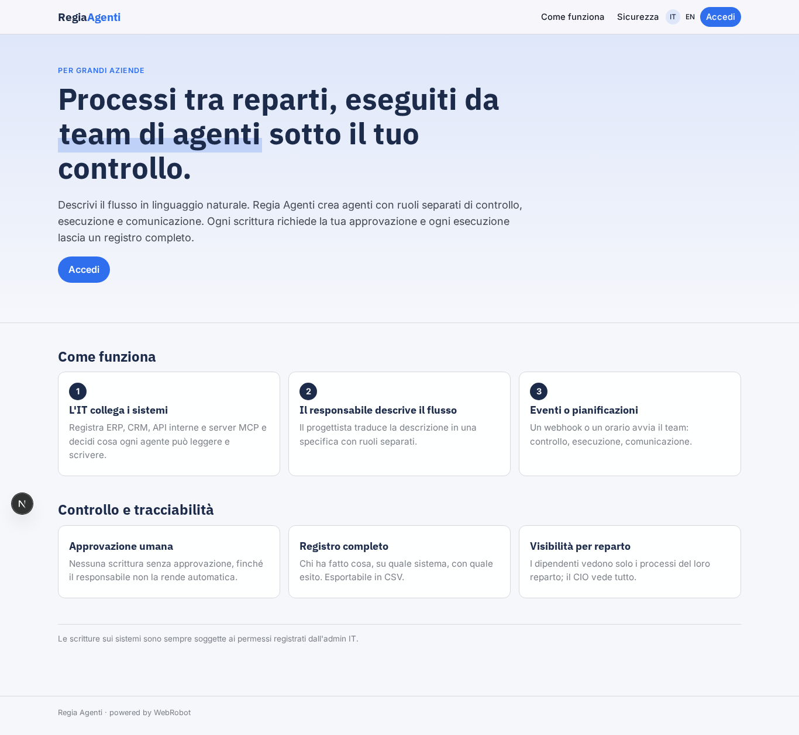

### home-mobile
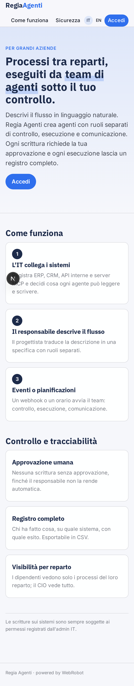

### home
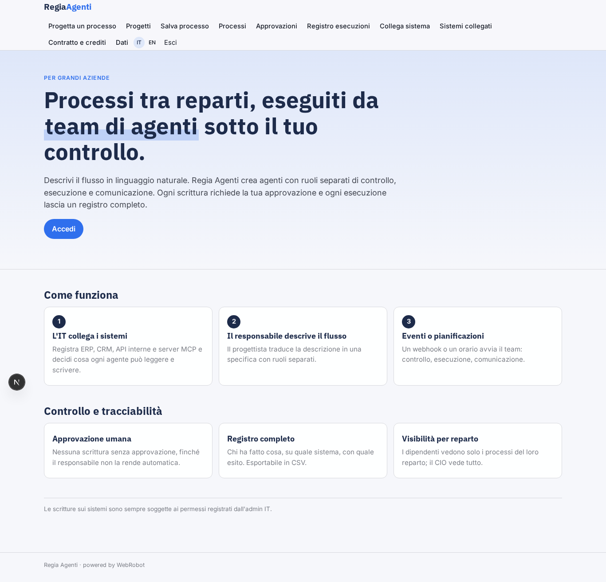

### new_process
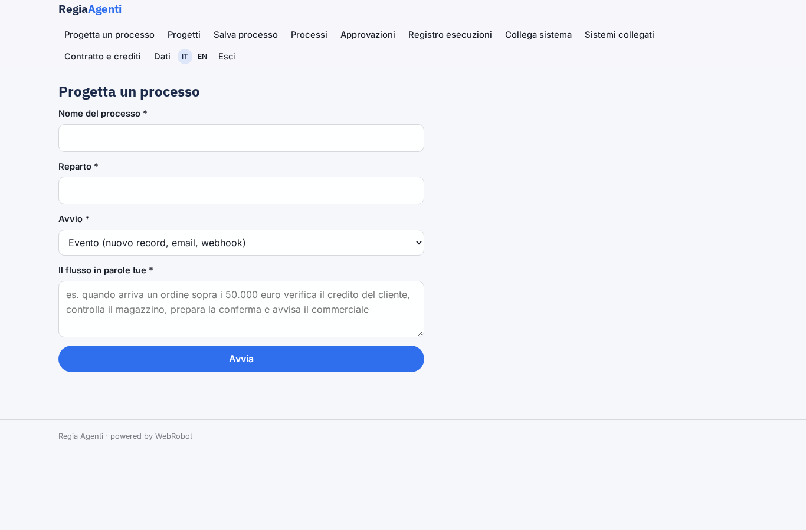

### designs
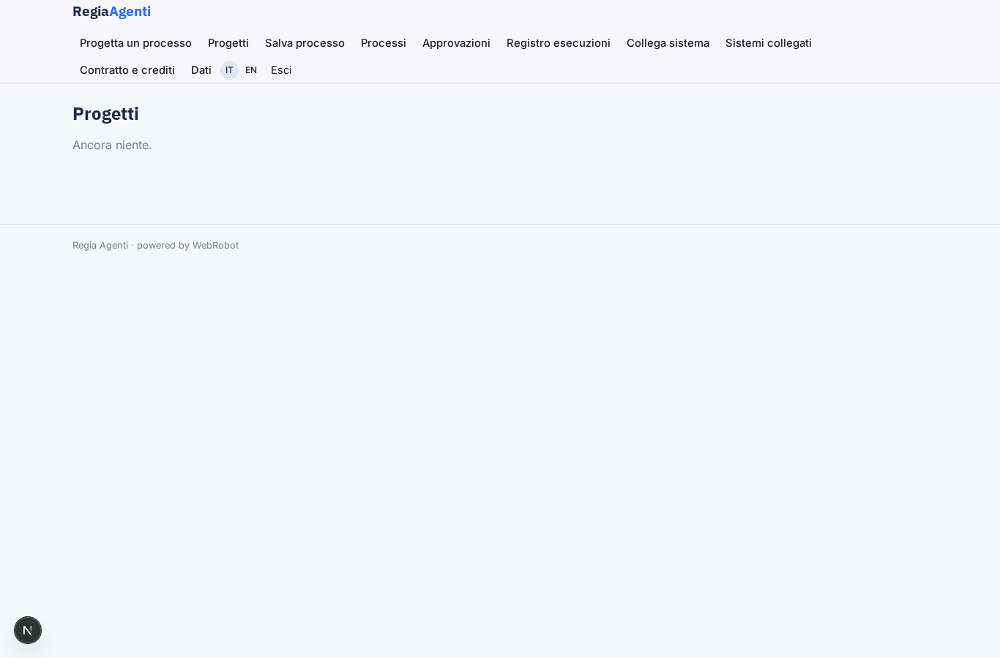

### save_process
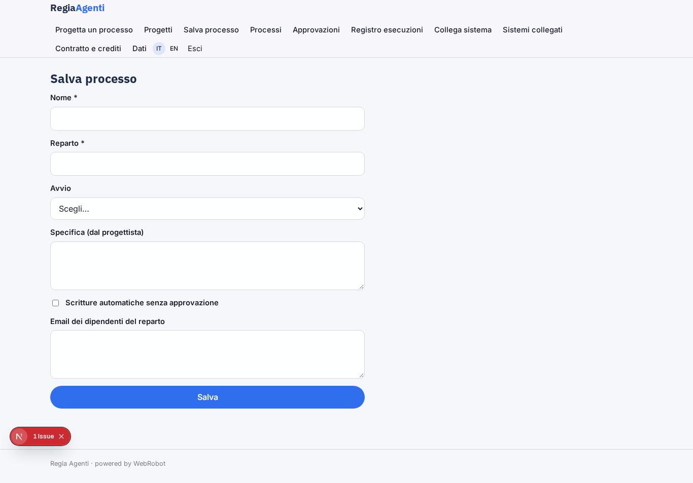

### processes
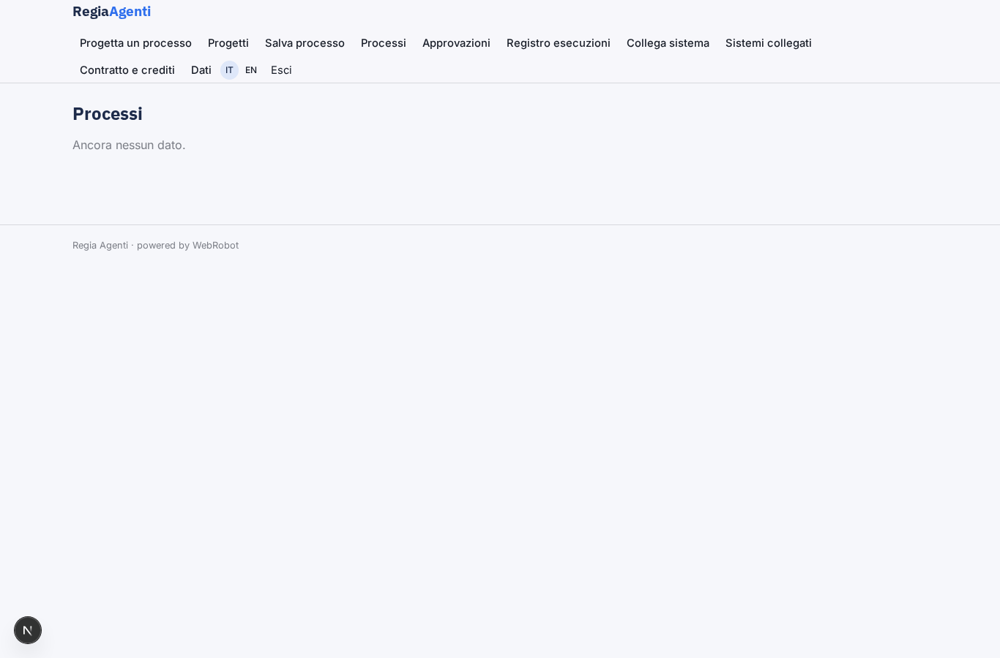

### approvals_view
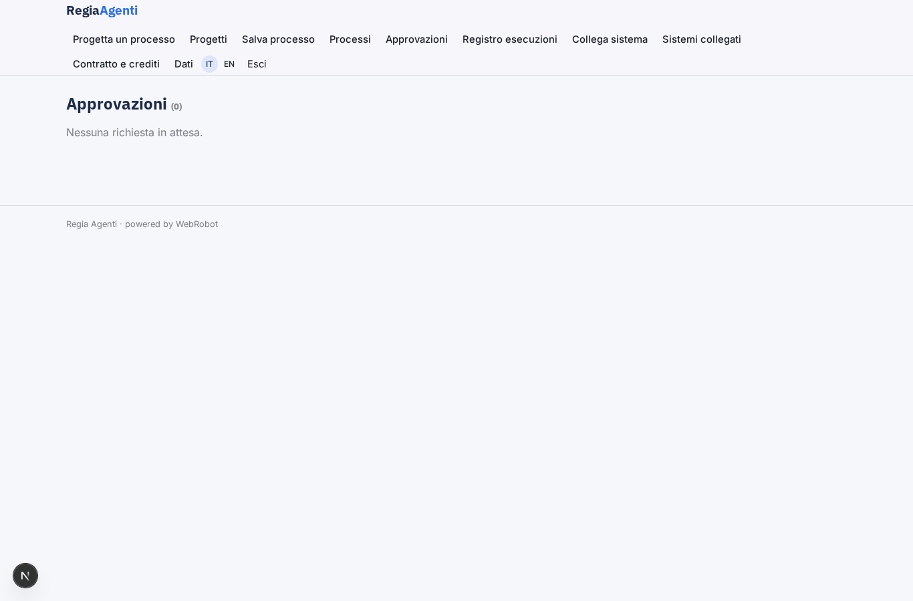

### audit
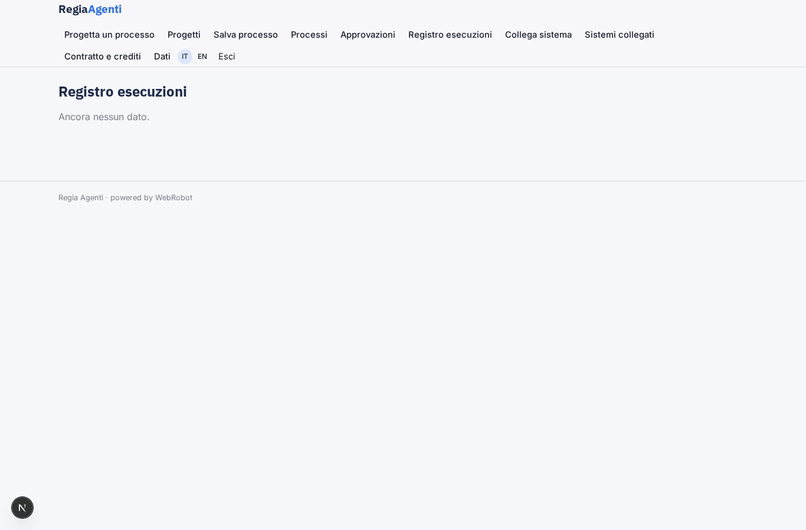

### connect_system
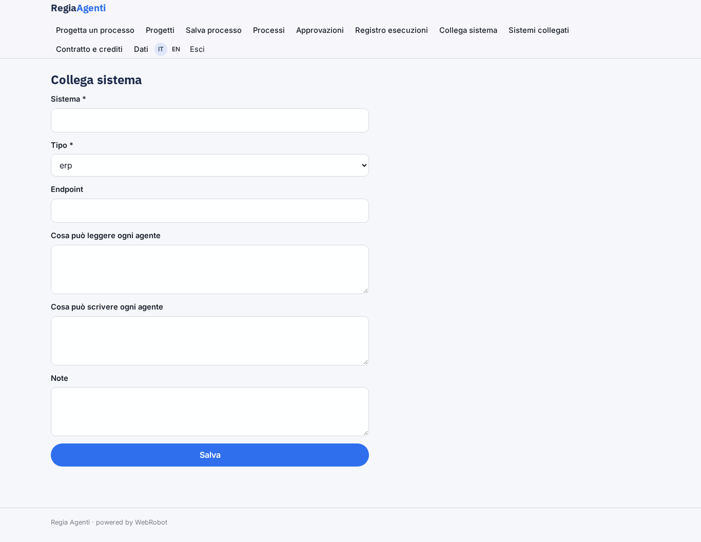

### systems

### account
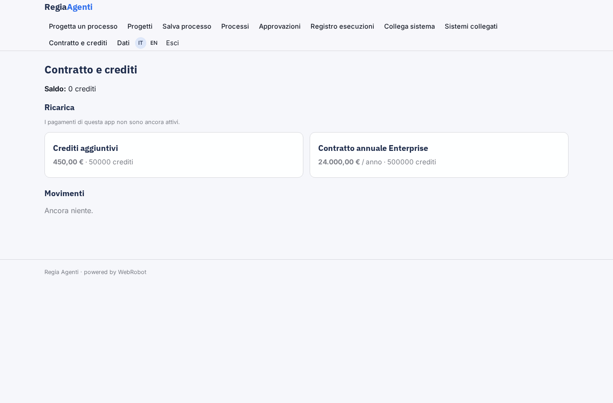
