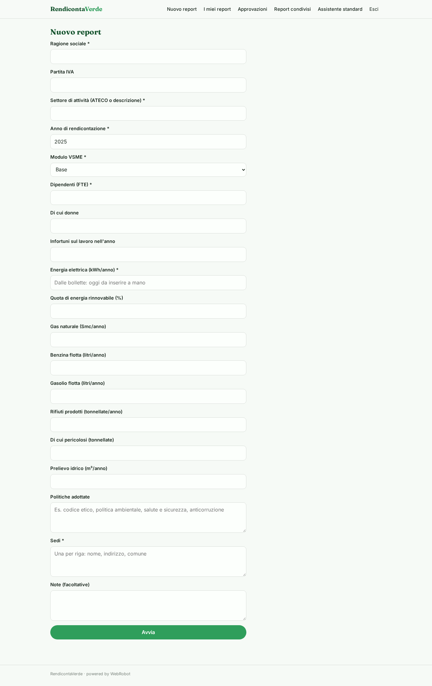
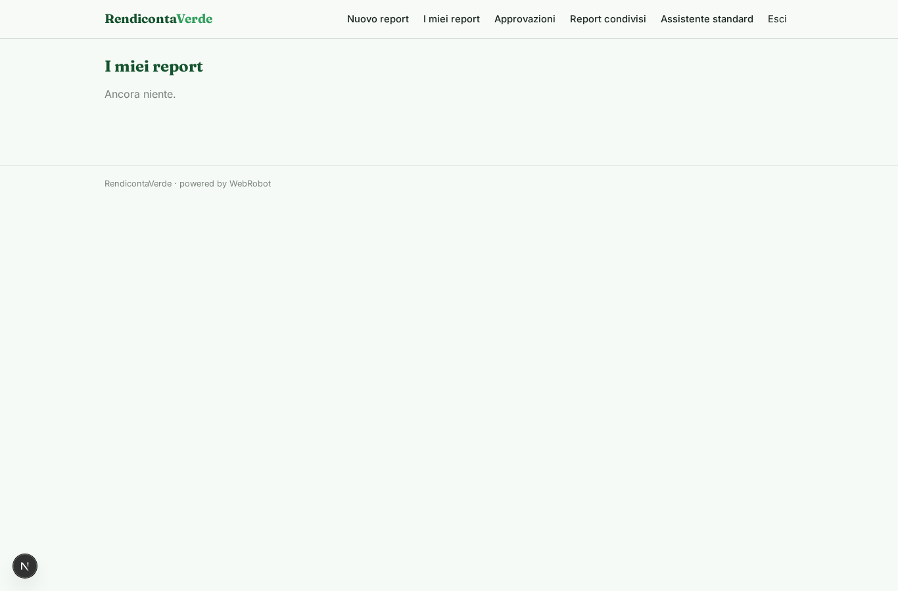
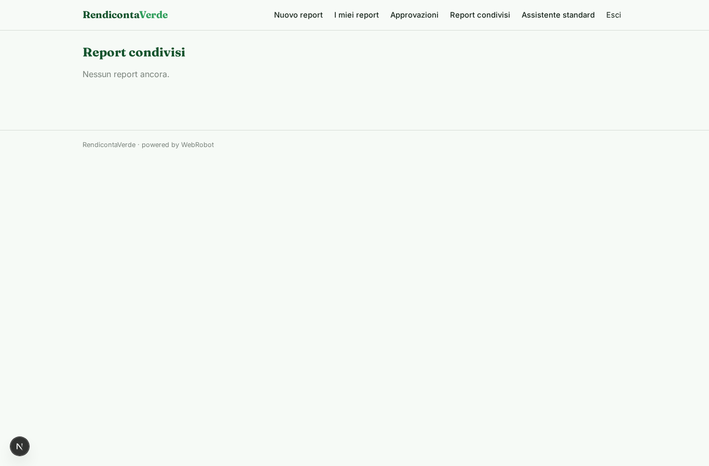
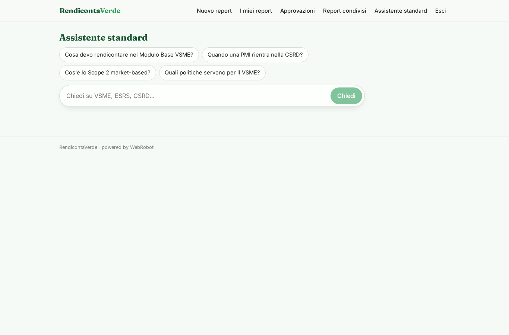
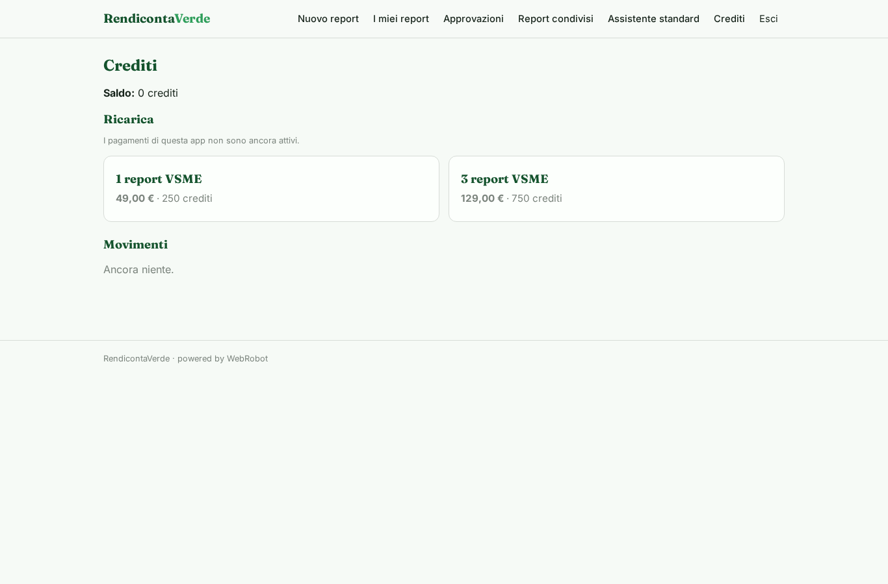

# RendicontaVerde

_Il report di sostenibilità VSME per la tua PMI, in bozza e pronto da approvare._

**Manifest status:** valid (schema validator + runtime contract)

## Description given to the app builder (Italian)

Voglio creare RendicontaVerde per aiutare le PMI a produrre il report di sostenibilità secondo lo standard volontario VSME e a prepararsi alla CSRD. L'utente aziendale compila moduli guidati con dati su dipendenti, consumi di energia, gas, carburanti, rifiuti, acqua e politiche adottate. Un agente calcola le emissioni GHG di Scope 1 e 2 con i fattori ISPRA, mentre un altro valuta il rischio climatico fisico delle sedi interrogando Copernicus Climate Data Store e IdroGEO per alluvioni e frane. Un terzo agente conosce gli standard EFRAG ed ESRS e risponde in chat ai dubbi su cosa vada rendicontato. Alla fine una squadra di agenti redige il report VSME completo in bozza, che il responsabile ESG rivede e approva prima dell'esportazione in PDF. Oggi i consumi vanno inseriti a mano: vorrei che l'utente potesse caricare le bollette in PDF e che i valori fossero letti automaticamente. Promemoria email annuale per l'aggiornamento. Ogni azienda vede solo i propri dati, i consulenti i loro clienti. Pagamento per report, in italiano.

## Features not expressible today (spec.extensions)

- **bill_upload**: Caricamento delle bollette in PDF con lettura automatica dei consumi: non disponibile (i campi file non sono ancora supportati). Per ora i consumi si inseriscono a mano.
- **annual_reminder**: Promemoria email annuale per l'aggiornamento dei dati: le notifiche email non sono ancora disponibili.
- **cds_download**: Download dei dati Copernicus CDS: richiede un token personale per ogni richiesta; per ora l'agente usa solo il catalogo pubblico.
- **consultant_clients**: Accesso del consulente ai propri clienti: oggi tramite condivisione per singolo report (viewer/editor) da parte dell'azienda; un'anagrafica clienti dedicata richiede logica personalizzata.

## Screenshots (interpretive runtime)

### home-anon

### home-mobile

### home

### new_report

### reports

### approvals_view

### clients_reports

### assistant

### account

