# RendicontaVerde

_Il report di sostenibilità VSME per la tua PMI, pronto per la CSRD._

**Manifest:** valid (schema + runtime contract) · **Functional test:** passed (24 checks passed)

## Description given to the app builder (Italian)

Voglio creare RendicontaVerde per aiutare le PMI a produrre il report di sostenibilità secondo lo standard volontario VSME e a prepararsi alla CSRD. L'utente aziendale compila moduli guidati con dati su dipendenti, consumi di energia, gas, carburanti, rifiuti, acqua e politiche adottate. Un agente calcola le emissioni GHG di Scope 1 e 2 con i fattori ISPRA, mentre un altro valuta il rischio climatico fisico delle sedi interrogando Copernicus Climate Data Store e IdroGEO per alluvioni e frane. Un terzo agente conosce gli standard EFRAG ed ESRS e risponde in chat ai dubbi su cosa vada rendicontato. Alla fine una squadra di agenti redige il report VSME completo in bozza, che il responsabile ESG rivede e approva prima dell'esportazione in PDF. Oggi i consumi vanno inseriti a mano: vorrei che l'utente potesse caricare le bollette in PDF e che i valori fossero letti automaticamente. Promemoria email annuale per l'aggiornamento. Ogni azienda vede solo i propri dati, i consulenti i loro clienti. Pagamento per report, in italiano.

## Features not expressible today (spec.extensions)

- **consultant_runs**: I report generati (run) restano visibili solo all'azienda che li ha avviati; i consulenti vedono i dati dei clienti ma non i run. Per condividere il report con il consulente serve l'esportazione in PDF.
- **ispra_factors_load**: I fattori di emissione ISPRA vanno caricati dagli amministratori in /admin/data (CSV) nella collezione emission_factors e aggiornati ogni anno.

## Screenshots (interpretive runtime, no data)

### home-anon
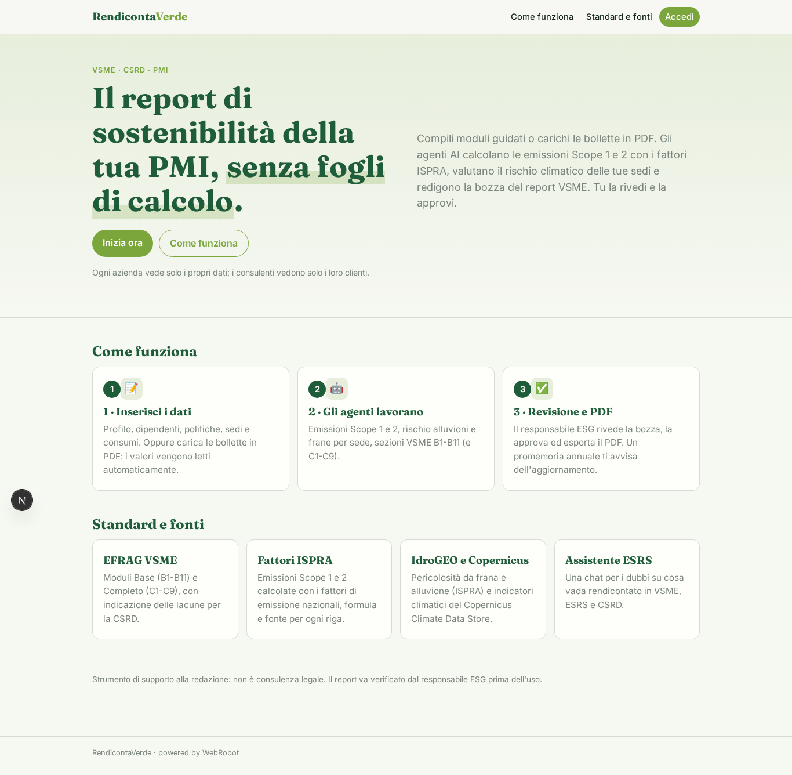

### home-mobile
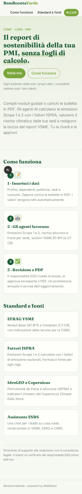

### home
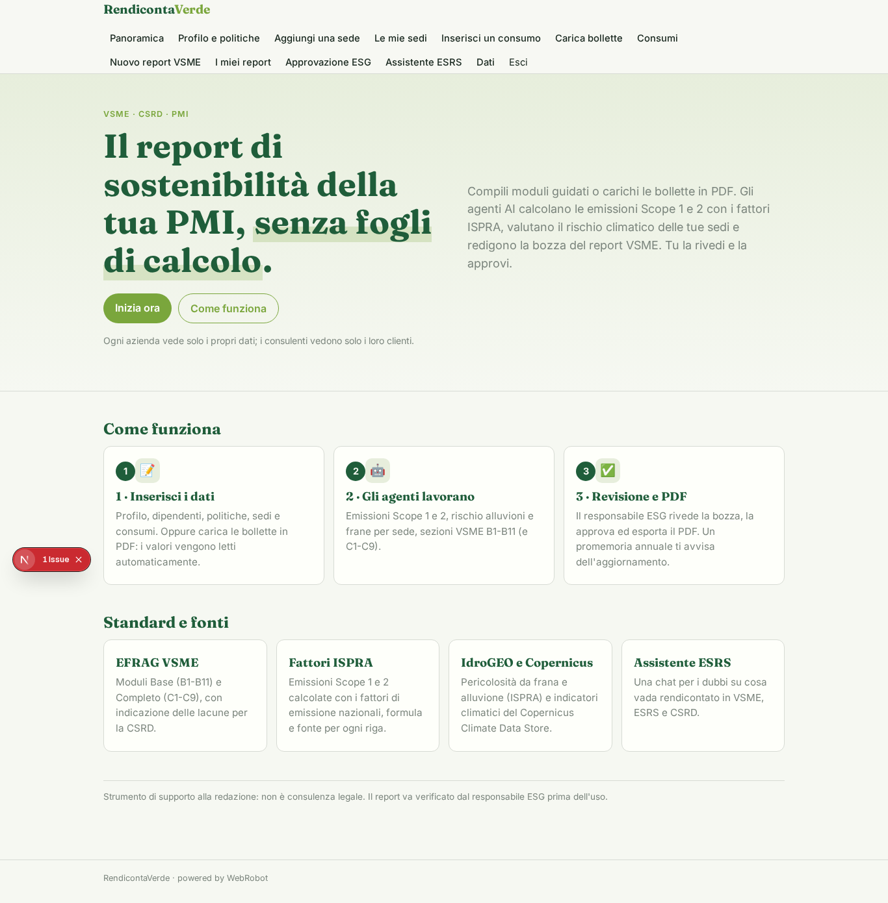

### overview
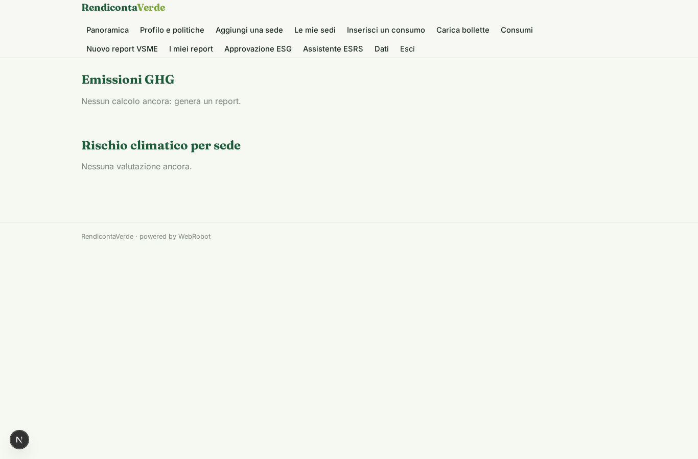

### company_form
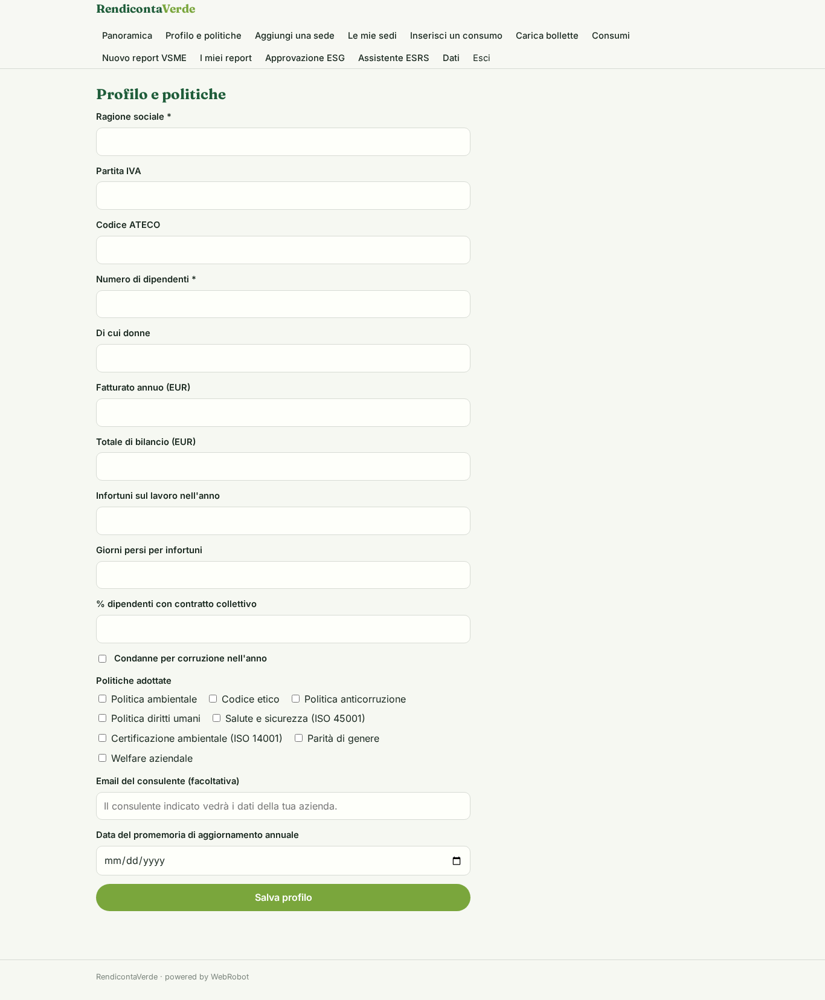

### site_form
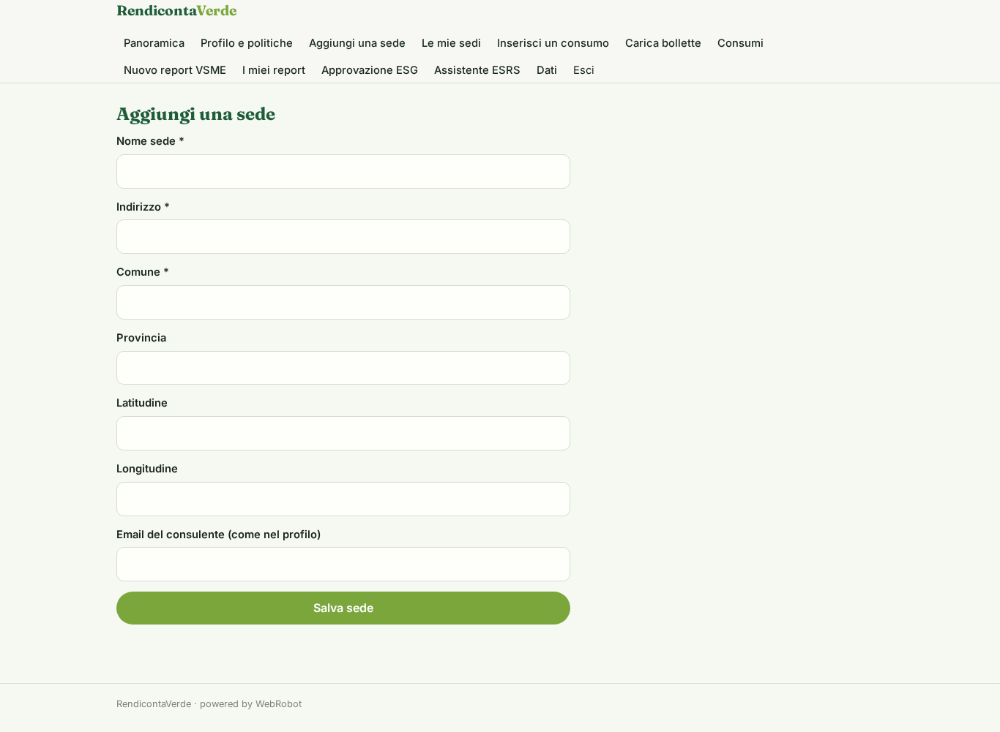

### sites
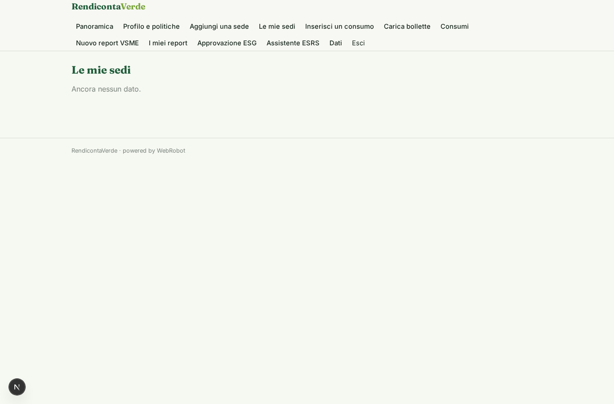

### consumption_form
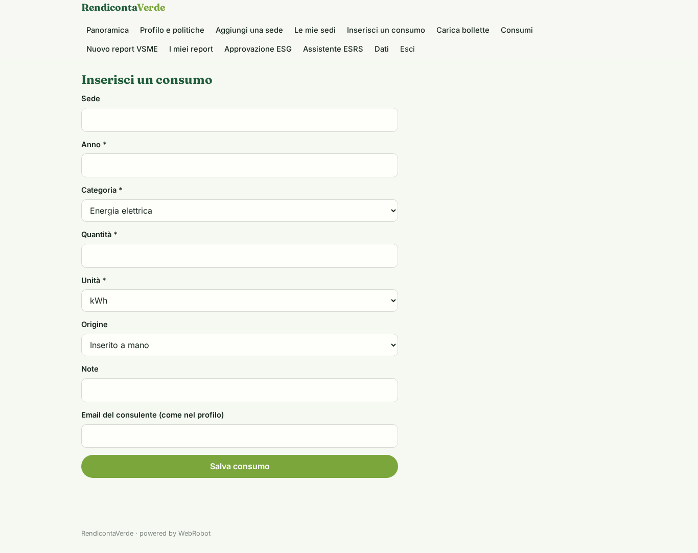

### bill_upload
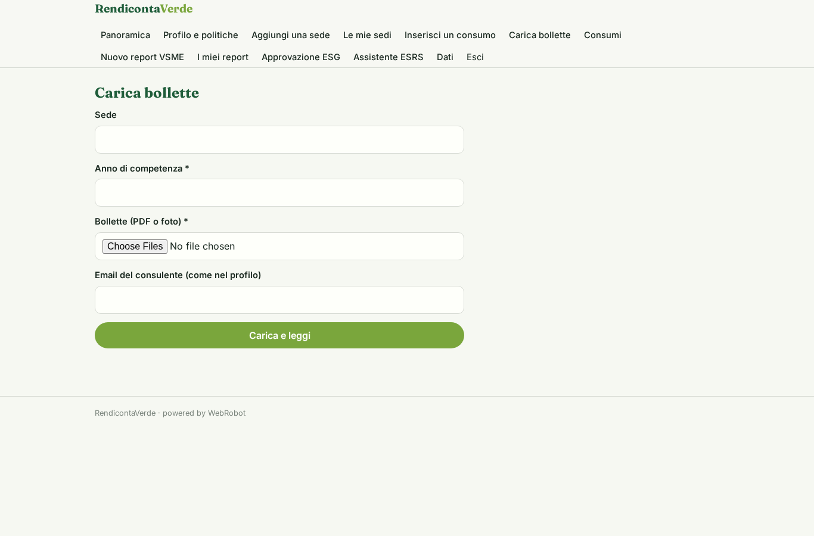

### consumptions
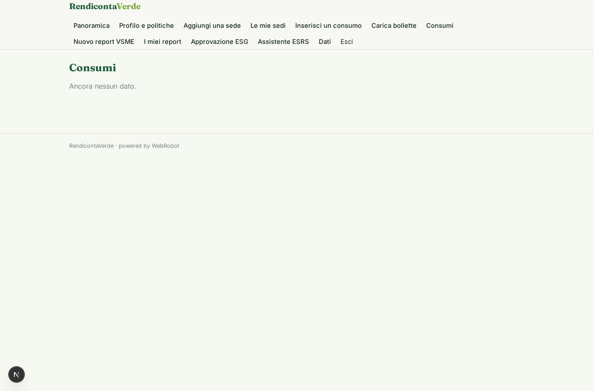

### new_report
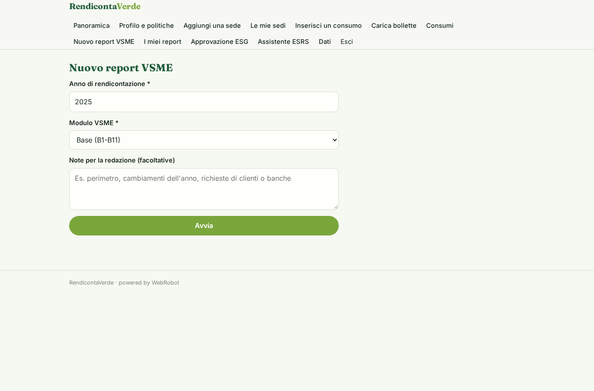

### reports

### signoff
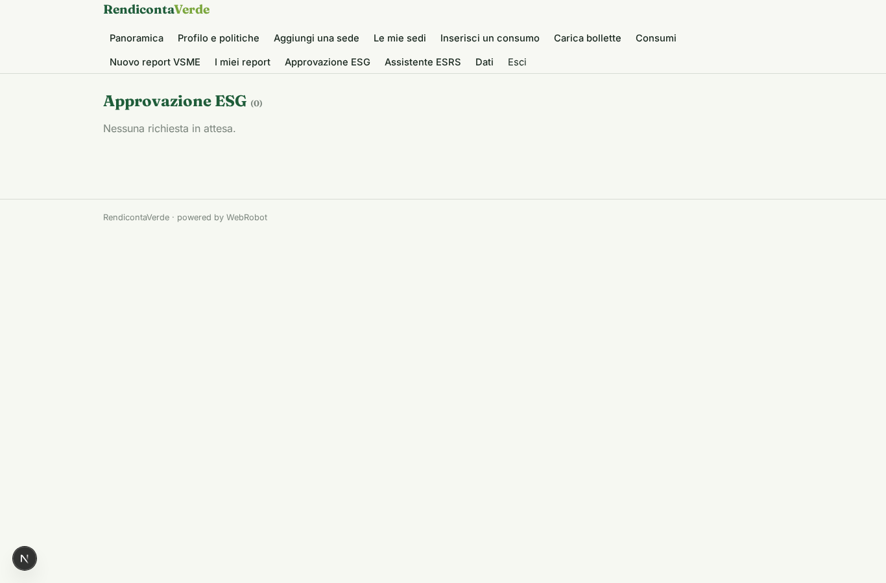

### esrs_chat
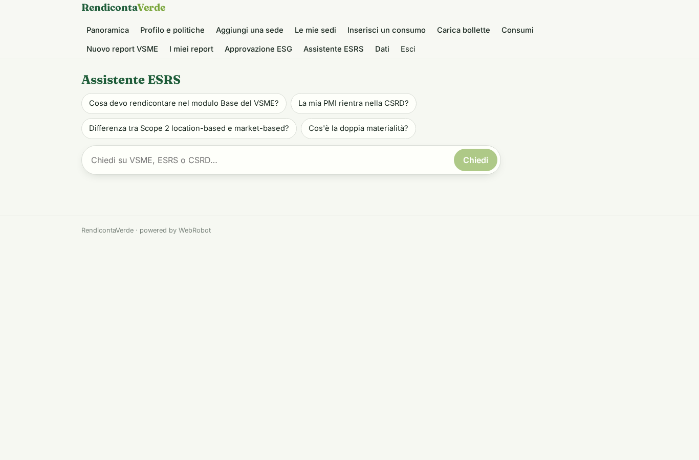

### clients

### account

