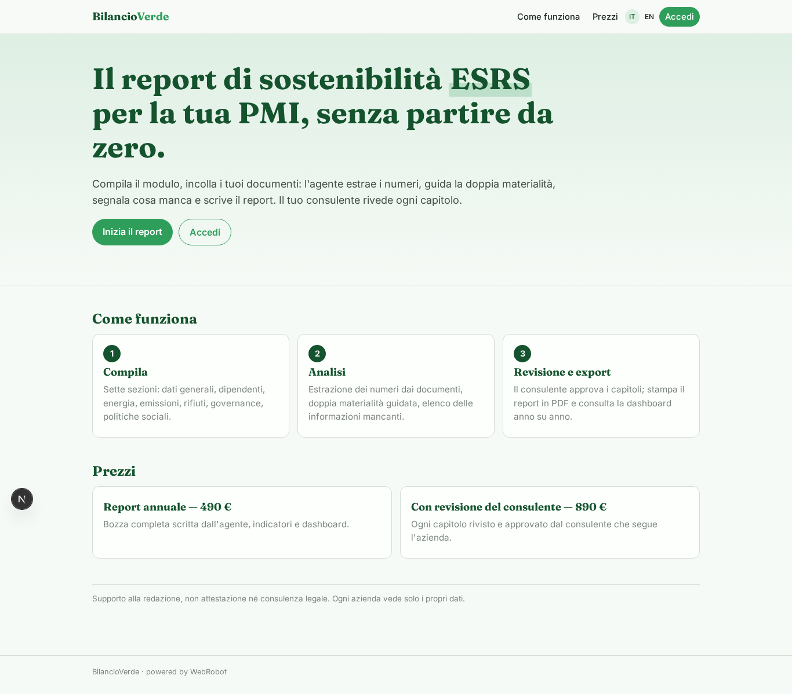
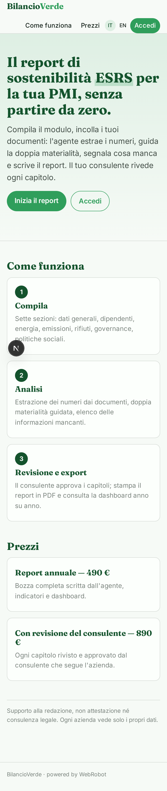
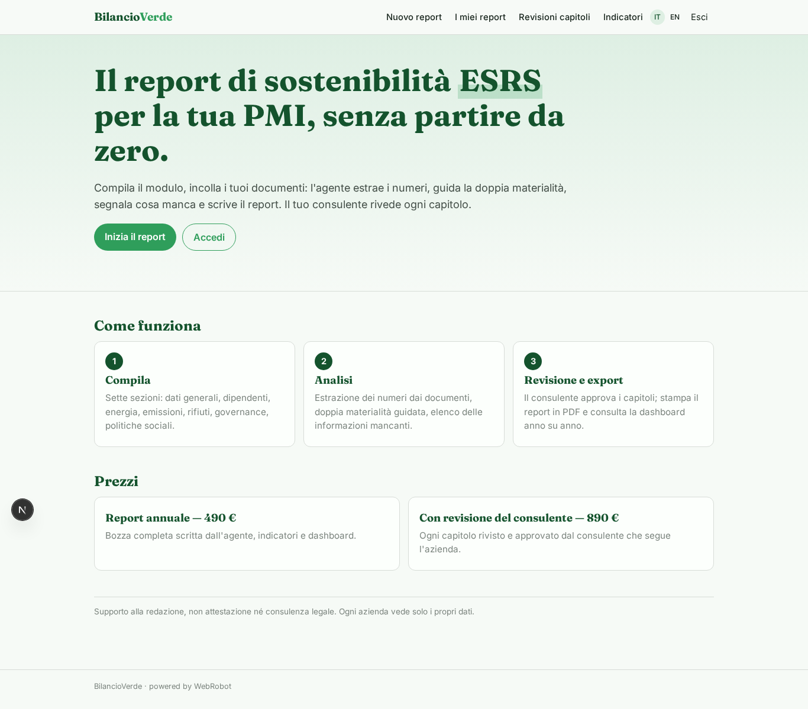
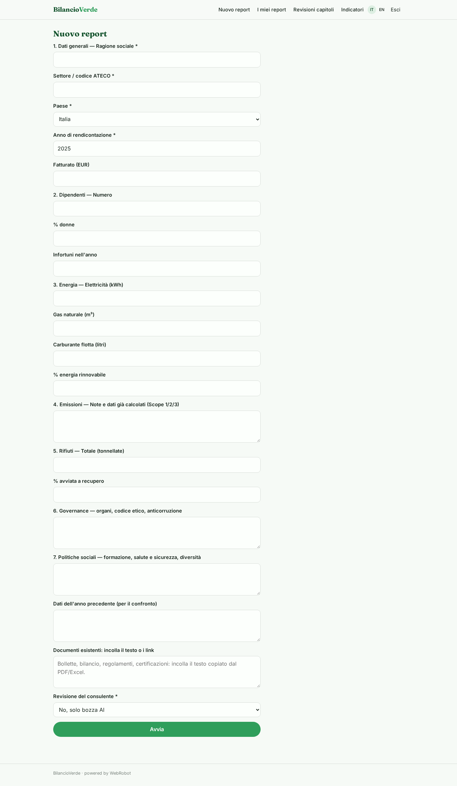
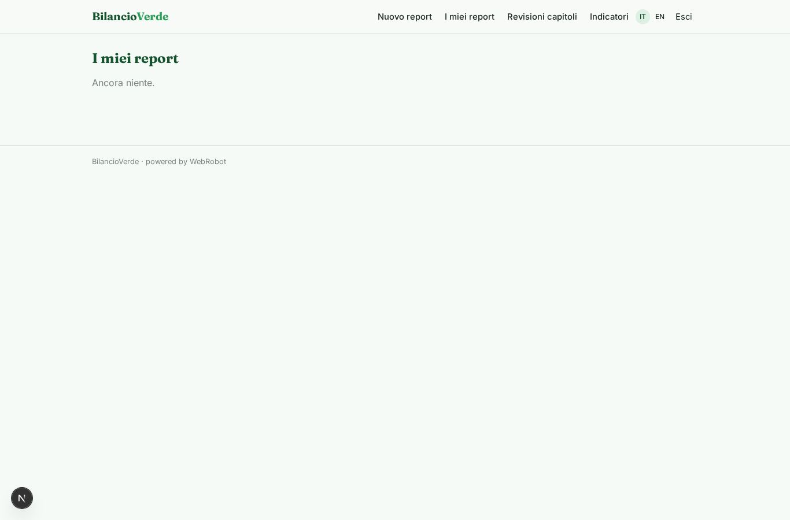
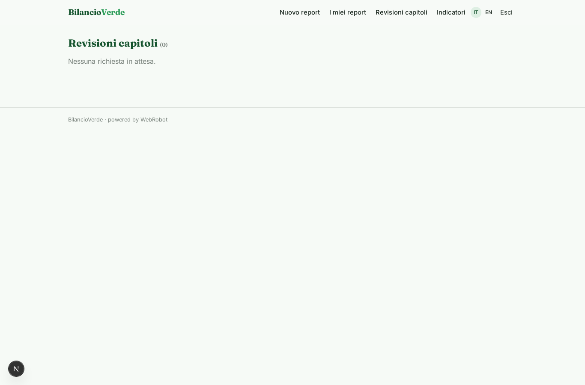
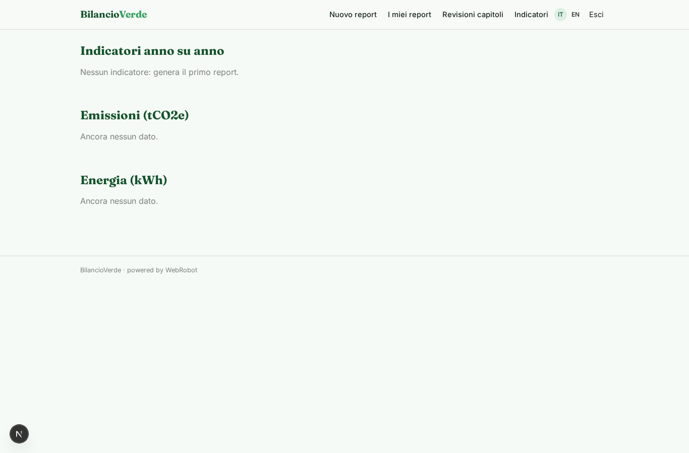
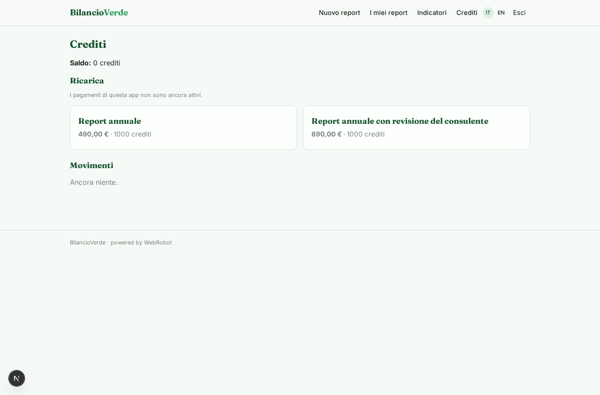

# BilancioVerde

_Il report di sostenibilità ESRS per PMI, pronto e rivisto dal tuo consulente._

**Manifest status:** valid (schema validator + runtime contract)

## Description given to the app builder (Italian)

Mi serve BilancioVerde per aiutare le PMI a redigere il report di sostenibilità secondo gli standard europei ESRS (versione semplificata per PMI). Il referente dell'azienda compila un modulo a sezioni: dati generali, dipendenti, consumi energetici, emissioni, rifiuti, governance, politiche sociali; può caricare documenti esistenti come bollette, bilancio, regolamenti interni e certificazioni in PDF o Excel, da cui un agente estrae i numeri. Un agente consulta gli standard EFRAG indicizzati, esegue l'analisi di doppia materialità guidata, indica quali informazioni mancano e scrive le sezioni del report con tabelle e indicatori. Il consulente che segue l'azienda rivede e approva ogni capitolo. Il risultato è un report completo esportabile in Word e PDF e una dashboard degli indicatori con confronto anno su anno. Ogni azienda vede solo i propri dati, i consulenti quelli dei loro clienti. Pagamento annuale per report, con prezzo superiore per la revisione del consulente. Italiano e inglese.

## Features not expressible today (spec.extensions)

- **file_upload**: File upload (PDF/Excel) is not available yet: users paste the text of documents or links. Automatic extraction from files will need it.
- **word_export**: Word (.docx) export is not available yet; the report is printable to PDF. Word export needs a runtime export.
- **efrag_index**: A dedicated indexed EFRAG standards search is not available; the analyst consults the public EFRAG pages through the WebRobot MCP.
- **consultant_clients**: Linking consultants to their client companies uses per-record sharing of indicators and the chapter_review approval; a dedicated client-assignment collection is still to be defined.
- **review_pricing**: The higher price with consultant review is sold as a separate pack; enforcing that review is requested only after buying it needs custom logic.
- **notifications**: Email notifications to the consultant when a chapter awaits review are not available yet.

## Screenshots (interpretive runtime)

### home-anon

### home-mobile

### home

### new_report

### reports

### reviews

### dashboard

### account

