# BilancioVerde

_Il report di sostenibilità ESRS per PMI, guidato e rivisto dal tuo consulente._

**Manifest:** valid (schema + runtime contract) · **Functional test:** passed (28 checks passed)

## Description given to the app builder (Italian)

Mi serve BilancioVerde per aiutare le PMI a redigere il report di sostenibilità secondo gli standard europei ESRS (versione semplificata per PMI). Il referente dell'azienda compila un modulo a sezioni: dati generali, dipendenti, consumi energetici, emissioni, rifiuti, governance, politiche sociali; può caricare documenti esistenti come bollette, bilancio, regolamenti interni e certificazioni in PDF o Excel, da cui un agente estrae i numeri. Un agente consulta gli standard EFRAG indicizzati, esegue l'analisi di doppia materialità guidata, indica quali informazioni mancano e scrive le sezioni del report con tabelle e indicatori. Il consulente che segue l'azienda rivede e approva ogni capitolo. Il risultato è un report completo esportabile in Word e PDF e una dashboard degli indicatori con confronto anno su anno. Ogni azienda vede solo i propri dati, i consulenti quelli dei loro clienti. Pagamento annuale per report, con prezzo superiore per la revisione del consulente. Italiano e inglese.

## Functional test: what did not pass

- **trigger has its effect** (trigger chapter_new): email to record.consultant_email: no such recipient in the test (role nobody holds or empty field) _(warning)_

## Features not expressible today (spec.extensions)

- **word_export**: Word (.docx) export of the full report is not available yet: the report view prints to PDF and chapters export as CSV.
- **efrag_index**: The EFRAG standards are consulted on the public EFRAG site through the WebRobot MCP; a dedicated search index is not available yet.
- **review_price**: The higher price for consultant review is sold as a separate pack; enforcing that only reviewed reports are approved is not automated.

## Screenshots (interpretive runtime, no data)

### home-anon

### home-mobile

### home

### general
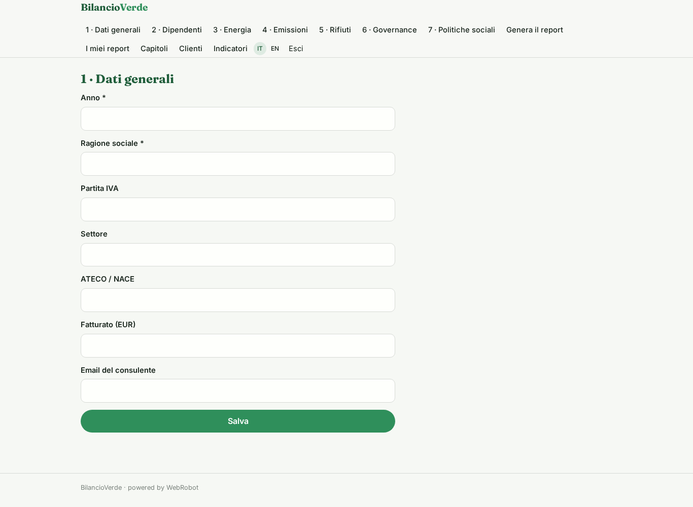

### employees
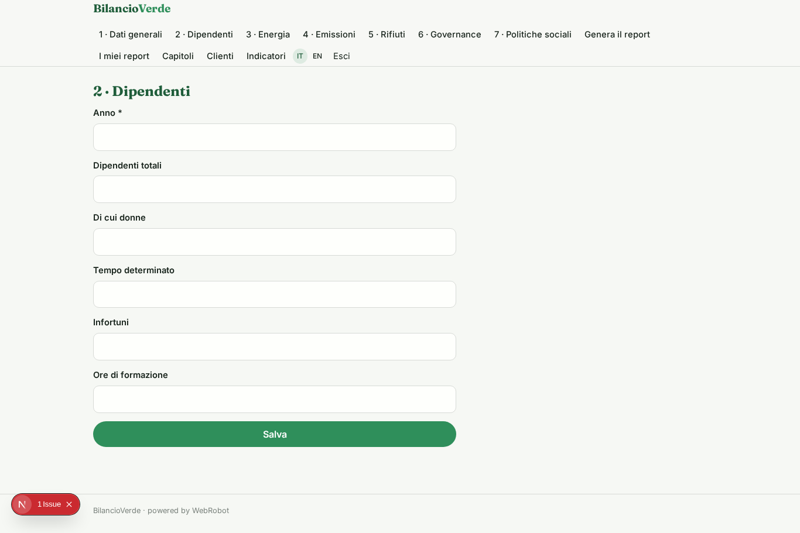

### energy
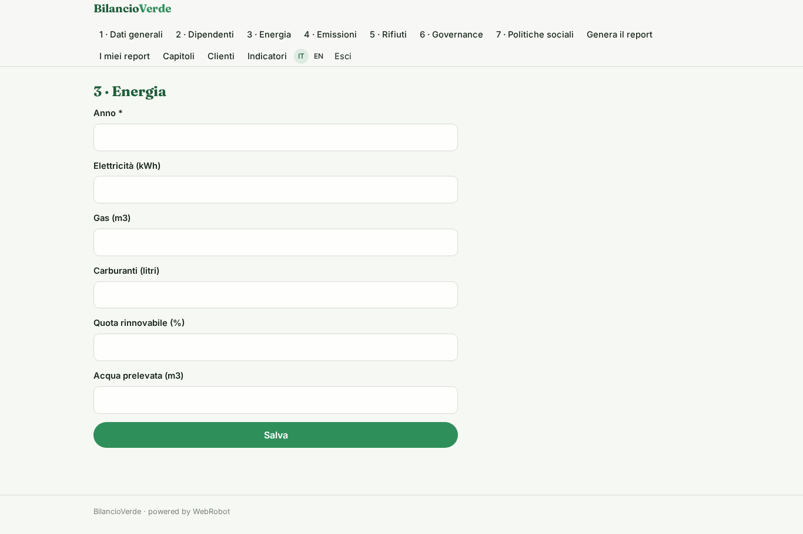

### emissions
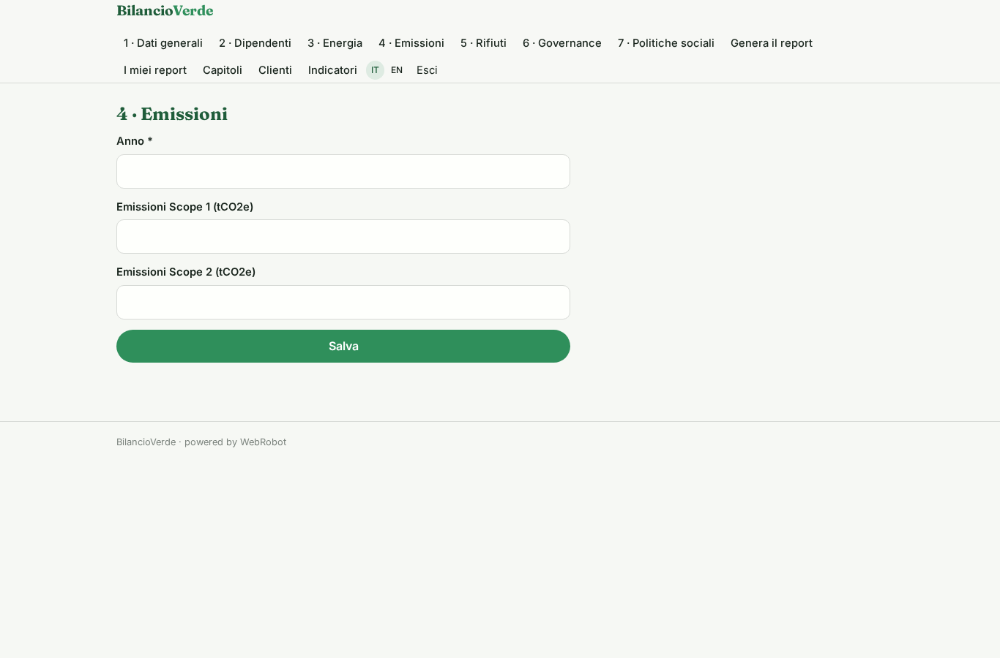

### waste
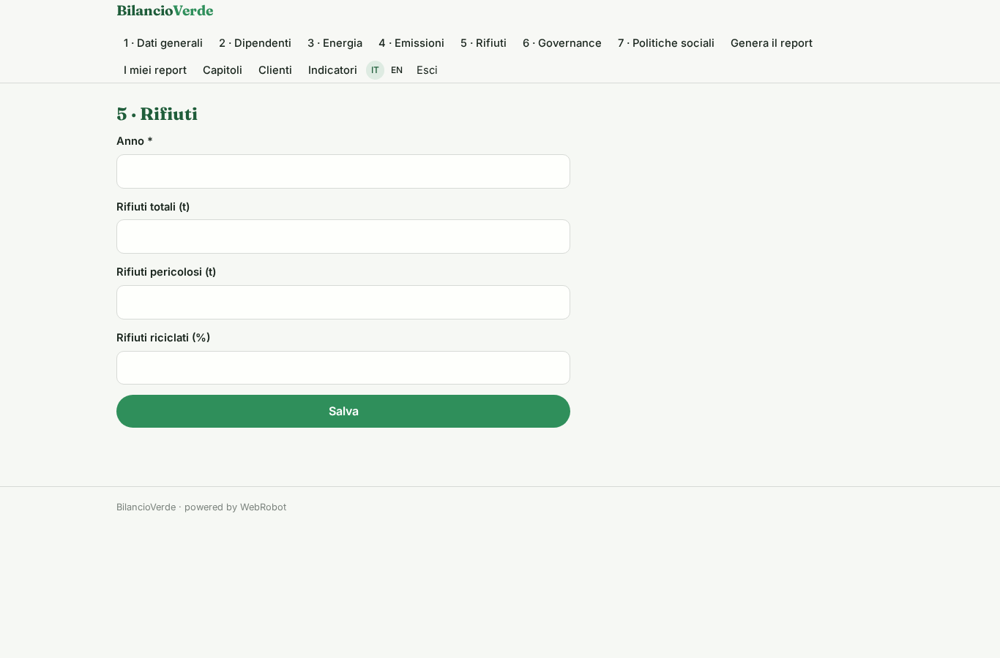

### governance
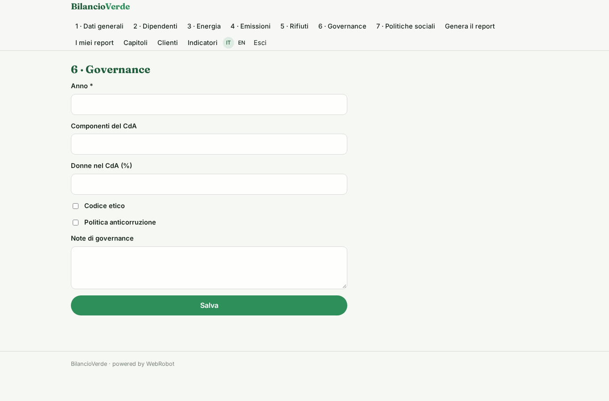

### social
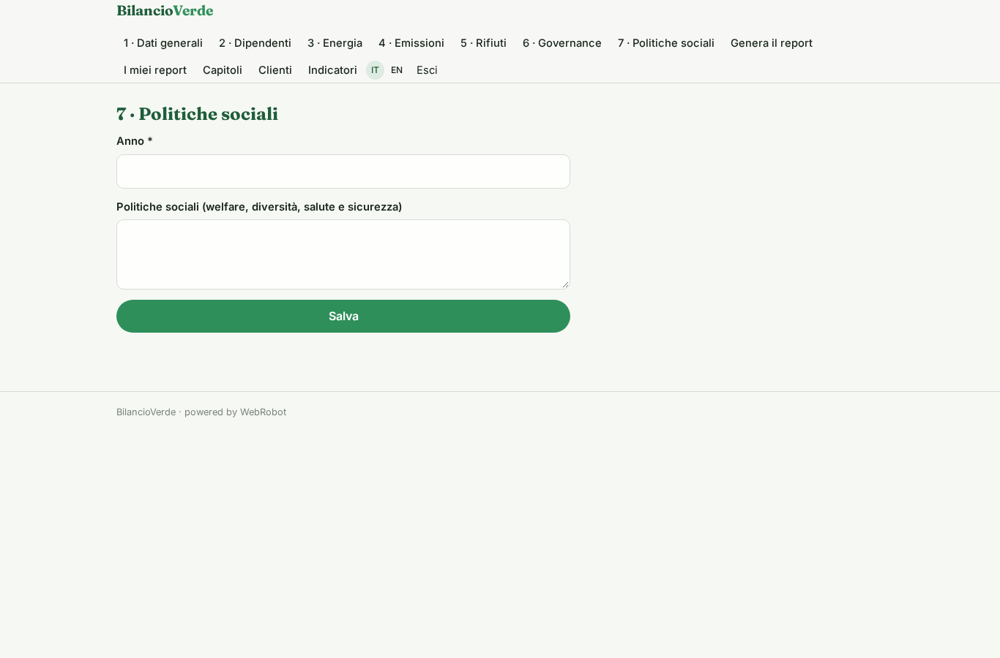

### new_run
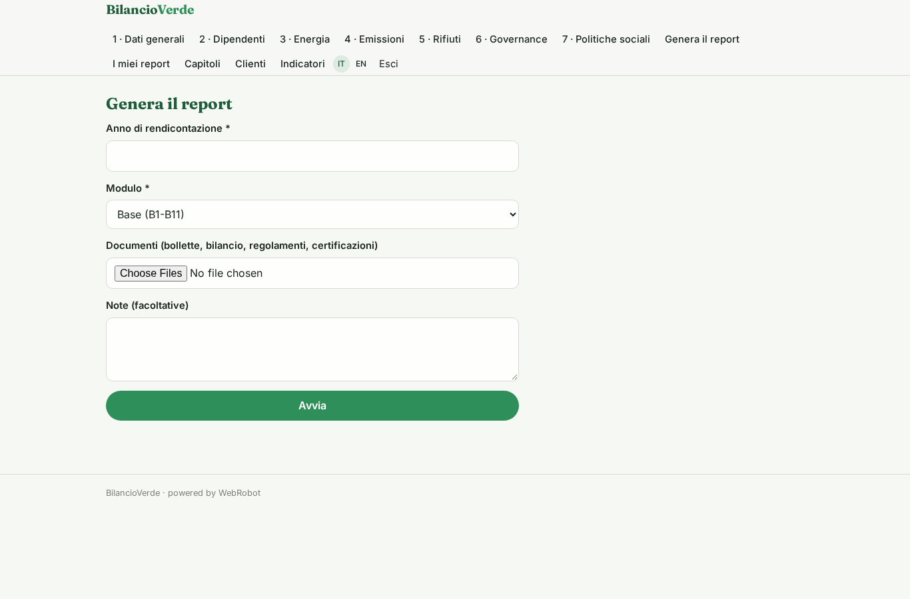

### reports

### chapters_list

### review
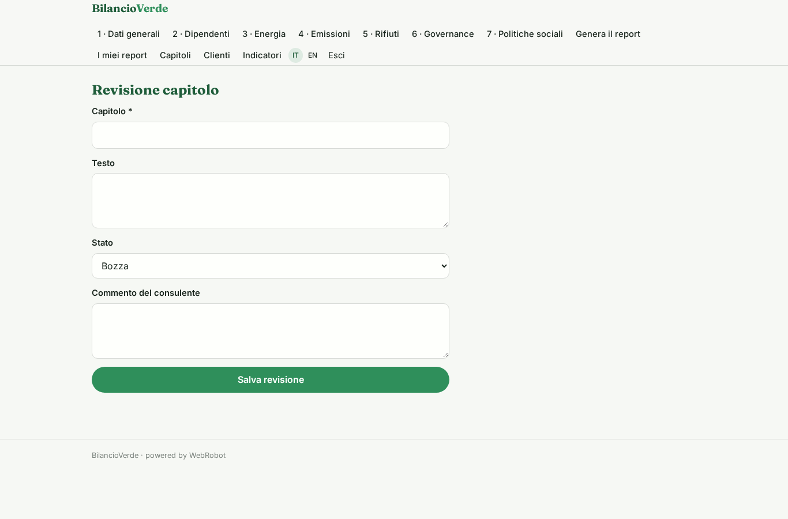

### clients
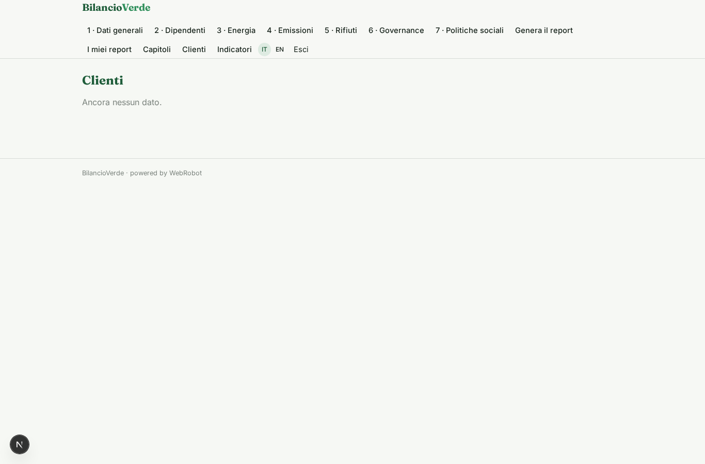

### dashboard
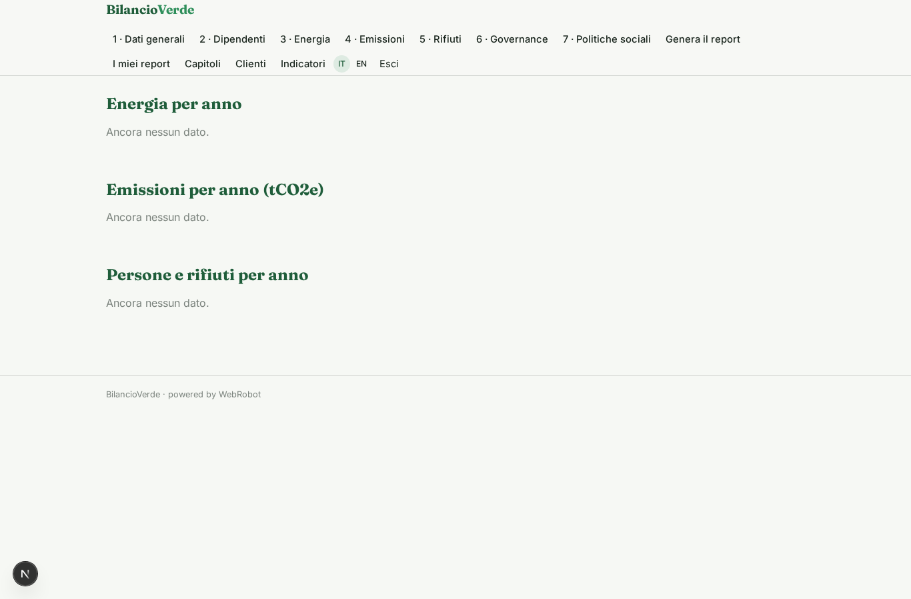

### account
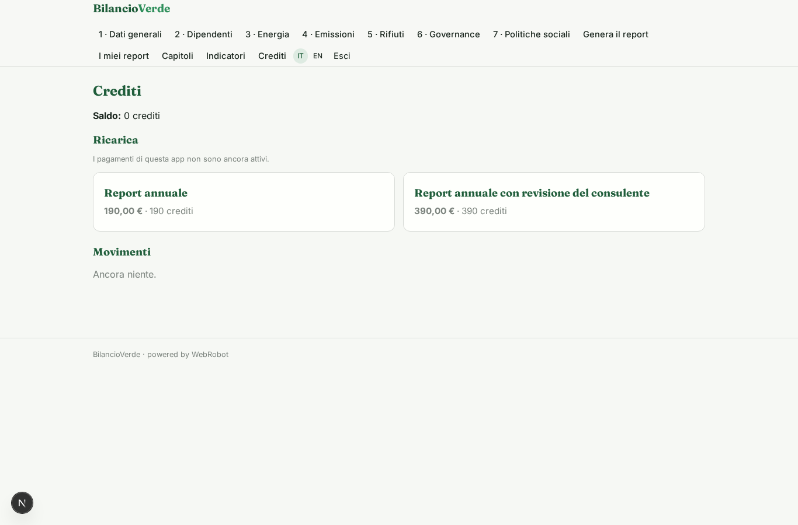
