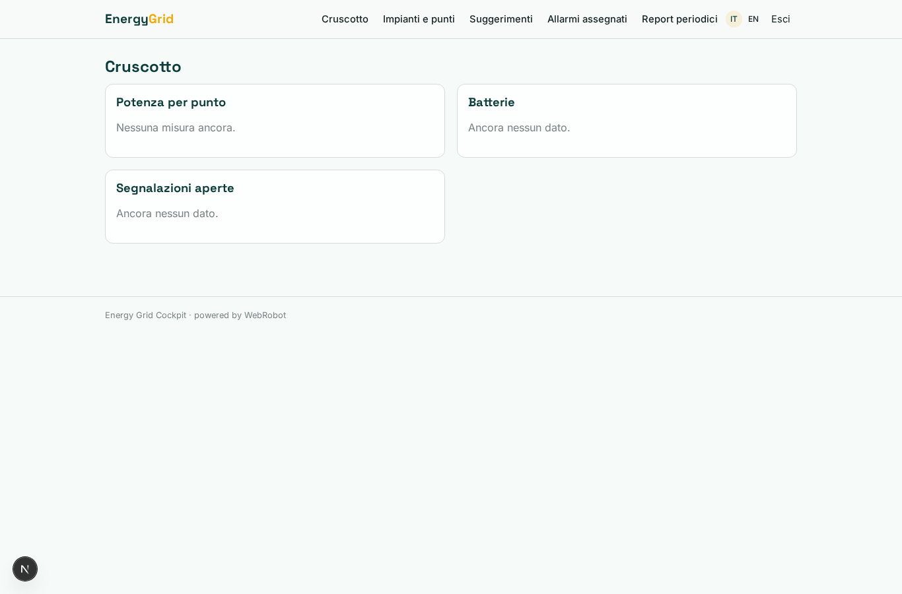
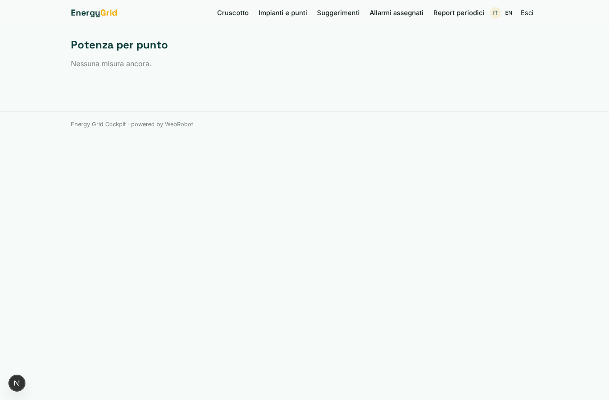
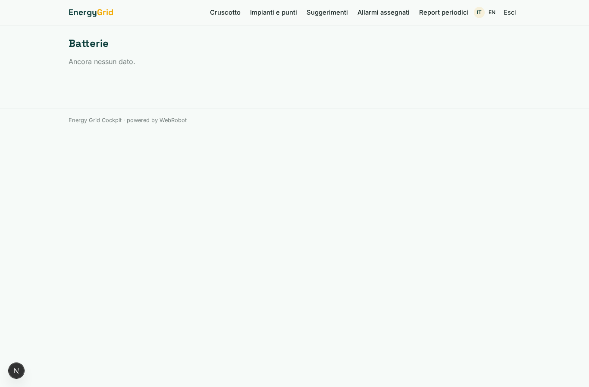
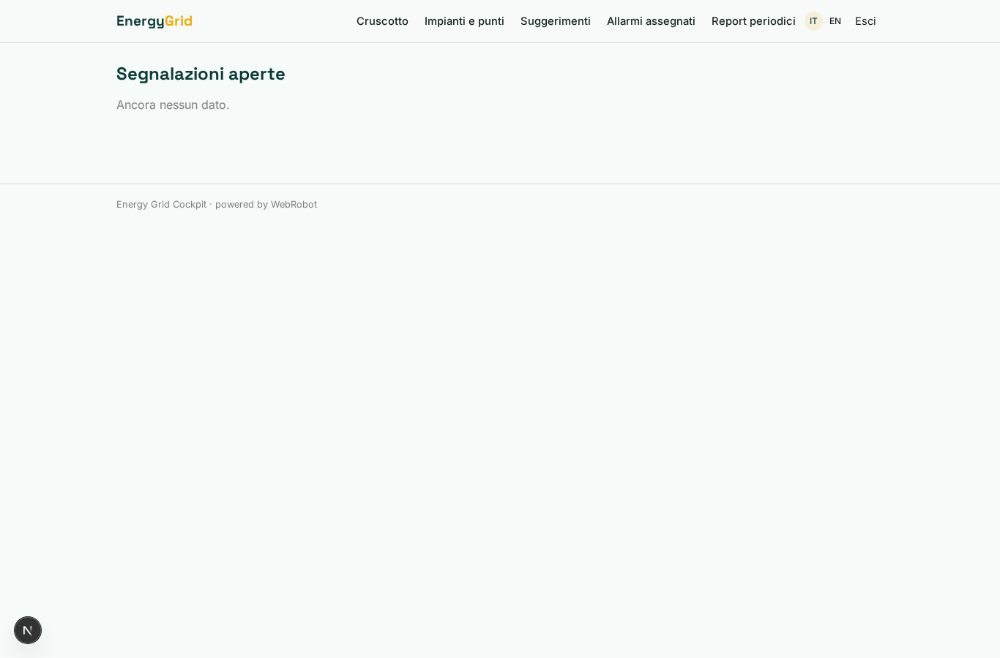
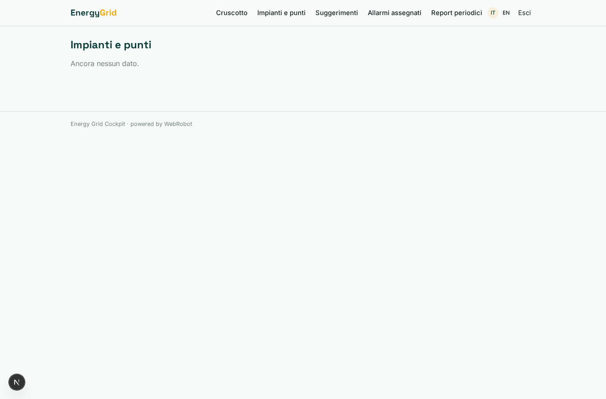
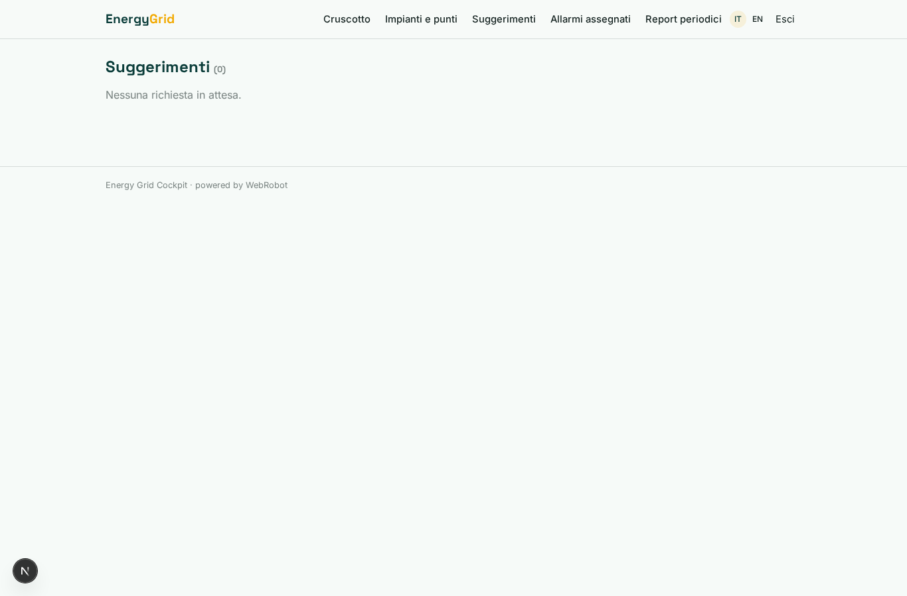
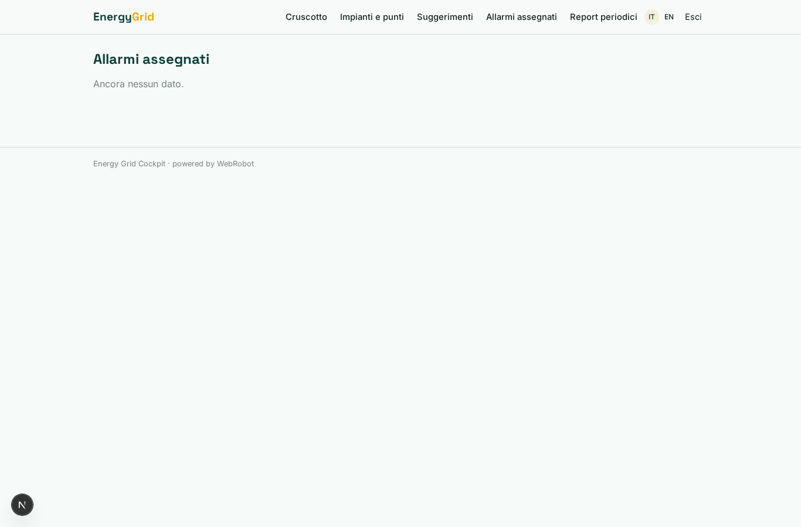
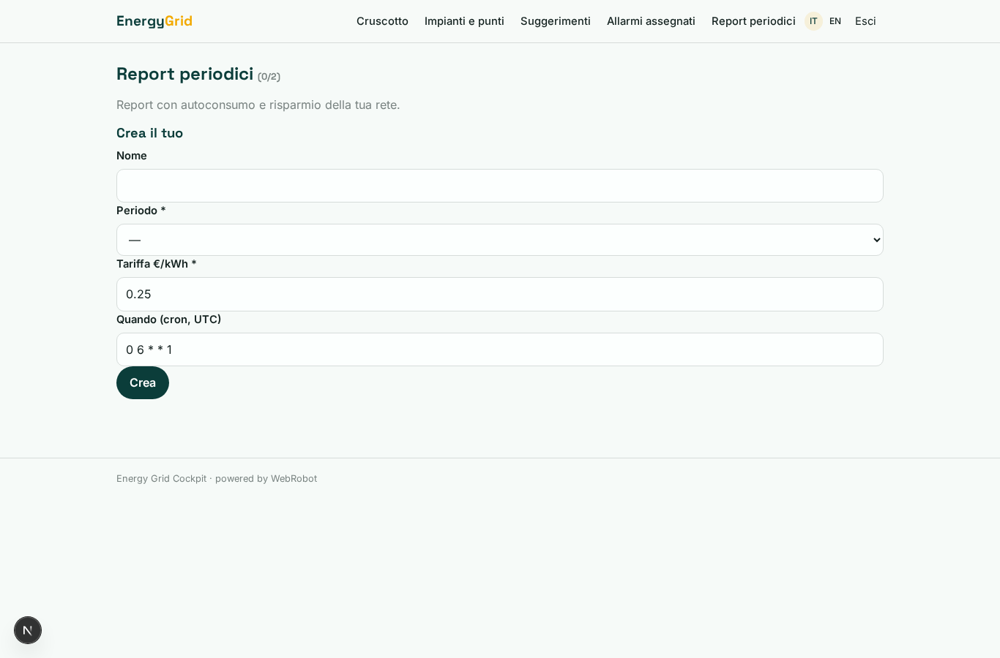
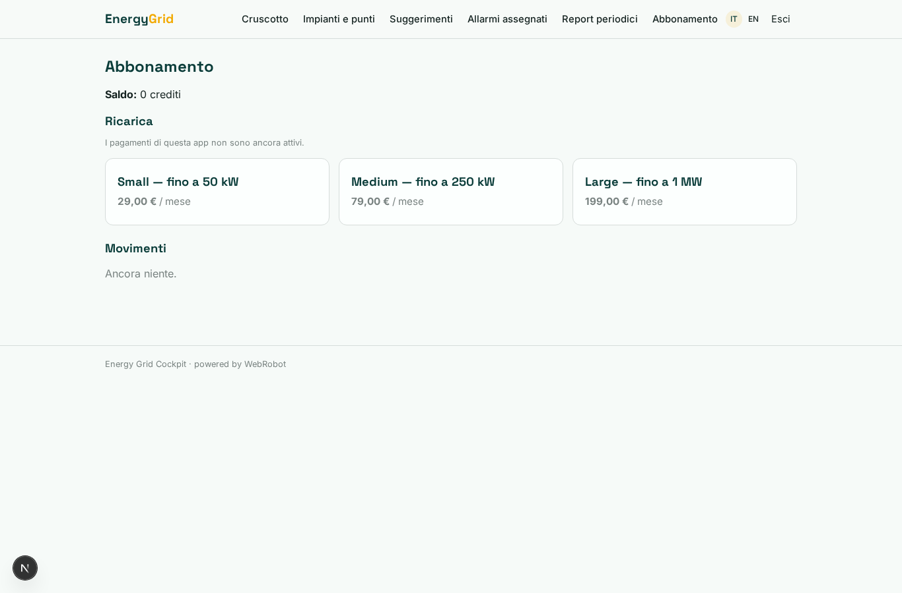

# Energy Grid Cockpit

_Produzione, consumo e batterie della tua rete locale, con un agente che ti consiglia._

**Manifest status:** valid (schema validator + runtime contract)

## Description given to the app builder (Italian)

Descrivo solo lo strato software di un sistema di gestione dell'energia rinnovabile: il cruscotto e gli agenti che leggono i dati, non i dispositivi hardware di controllo, che sono un prodotto a parte. Il gestore registra gli impianti, le batterie e i punti di consumo di una rete locale e collega la fonte dei dati (il sistema di misura) tramite webhook. Un agente mostra in tempo quasi reale produzione, consumo, carica delle batterie e scambio con la rete, calcola l'autoconsumo e stima, in base alle previsioni meteo da Open-Meteo e ai profili di consumo, come conviene usare o accumulare l'energia nelle ore successive, proponendo i suggerimenti al gestore. Quando rileva un funzionamento anomalo apre una segnalazione per il tecnico. Il gestore vede la dashboard della propria rete e un report periodico via email con autoconsumo e risparmio; i tecnici vedono gli allarmi assegnati. Ogni gestore vede solo i propri impianti. Abbonamento mensile in base alla potenza gestita. In italiano e inglese.

## Features not expressible today (spec.extensions)

- **email_report**: Sending the periodic report by email is not available yet: the report is generated on schedule and shown in the app.
- **power_limit_enforcement**: Plan limits by managed kW (sum of assets power_kw) are not enforced automatically; the owner checks them for now.
- **technician_cross_user_alarms**: Technicians see alarms through the derived role on alarms.technician_email; visibility of alarms owned by another user's records needs runtime support or manual check.
- **webhook_user_mapping**: Each operator's metering system posts to /api/hooks/measurement_hook with the hook secret; mapping the secret to the operator account must be configured at publish.

## Screenshots (interpretive runtime)

### home-anon

### home-mobile

### home

### overview

### power_chart

### battery_cards

### open_alarms

### assets_view

### suggestions_view

### alarms_view

### reports_view

### account

