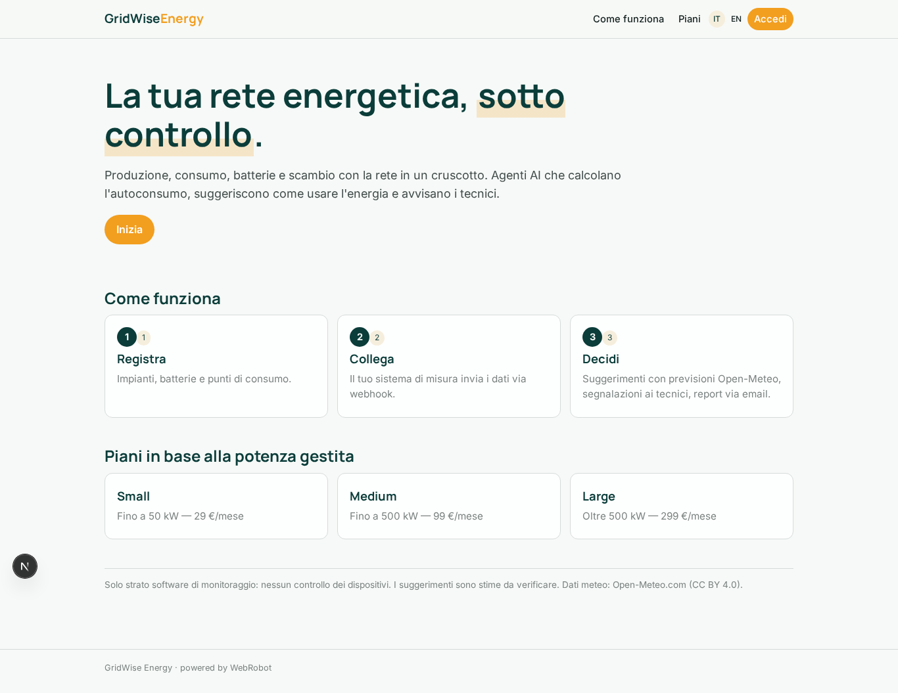
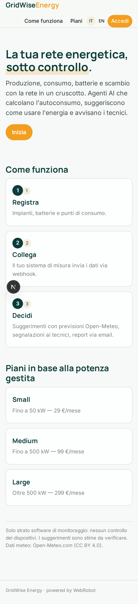
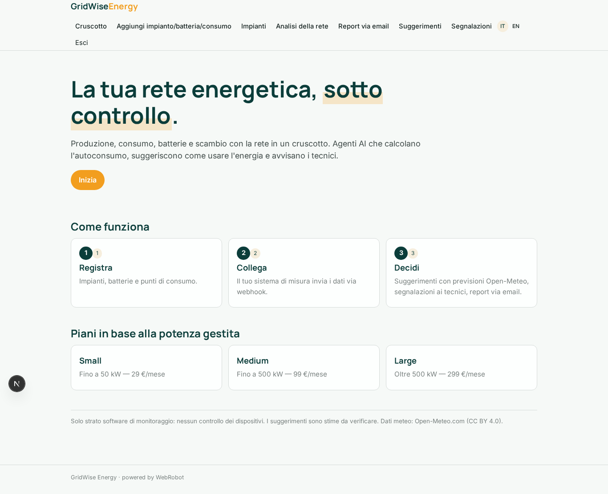
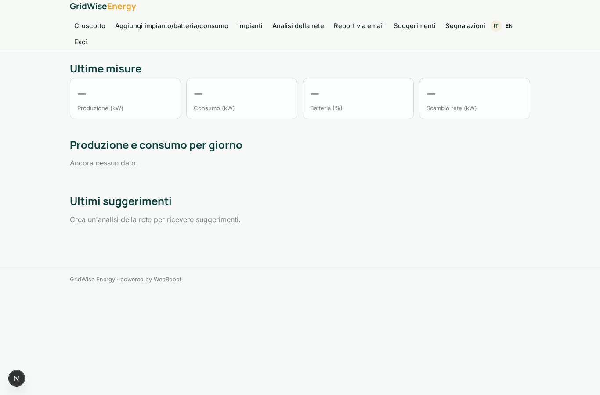
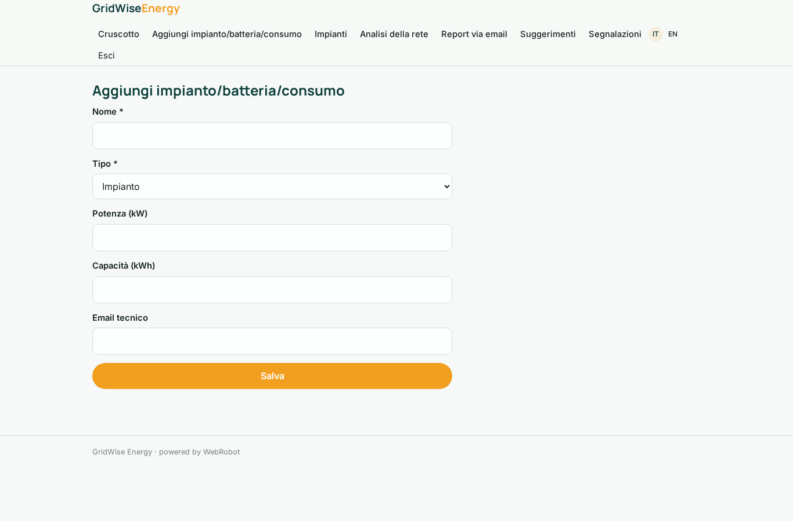
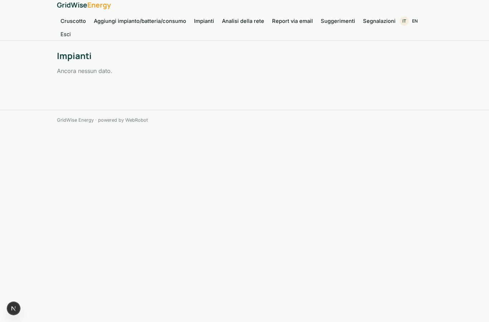
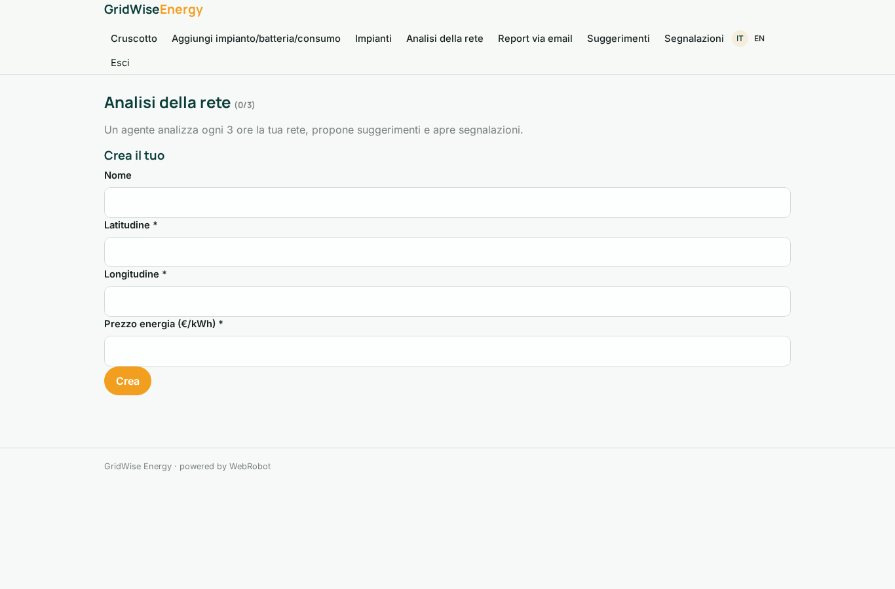
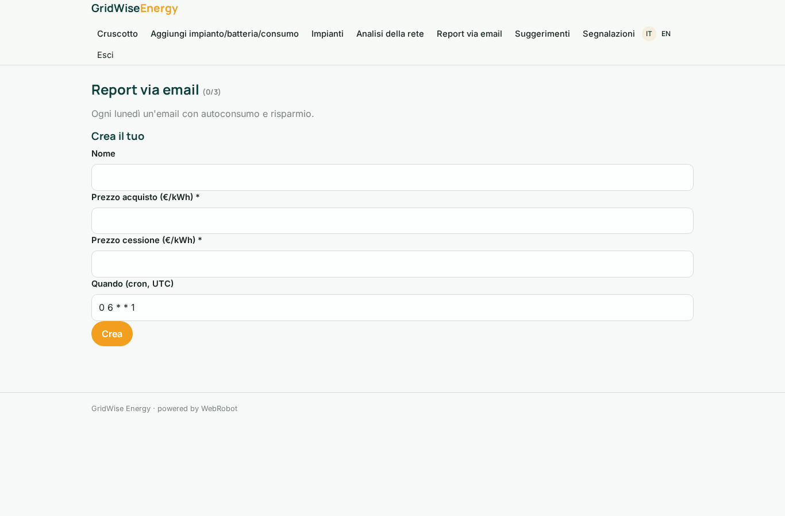
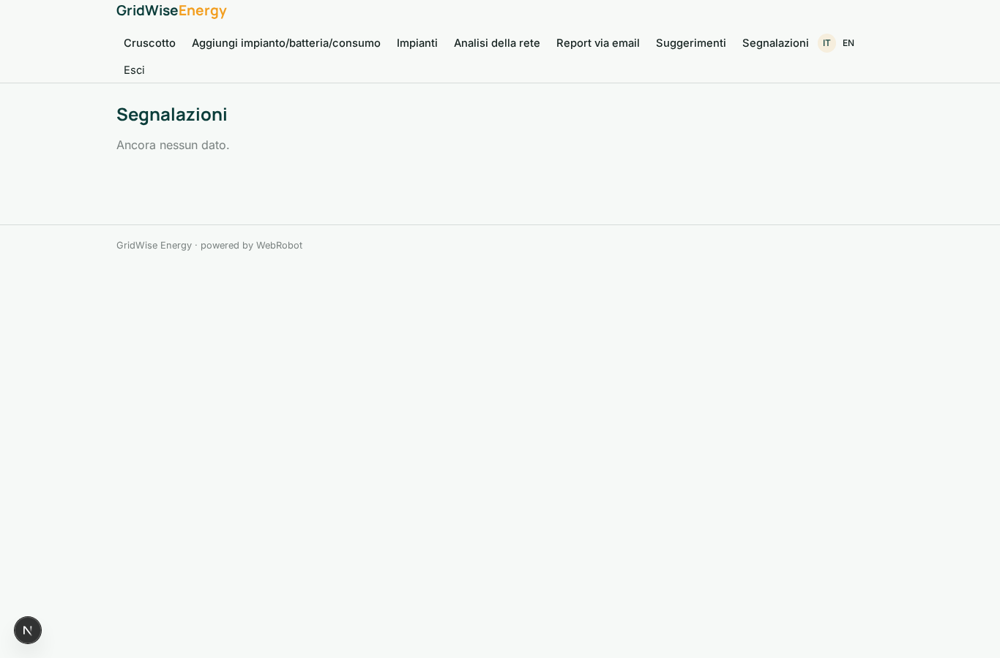
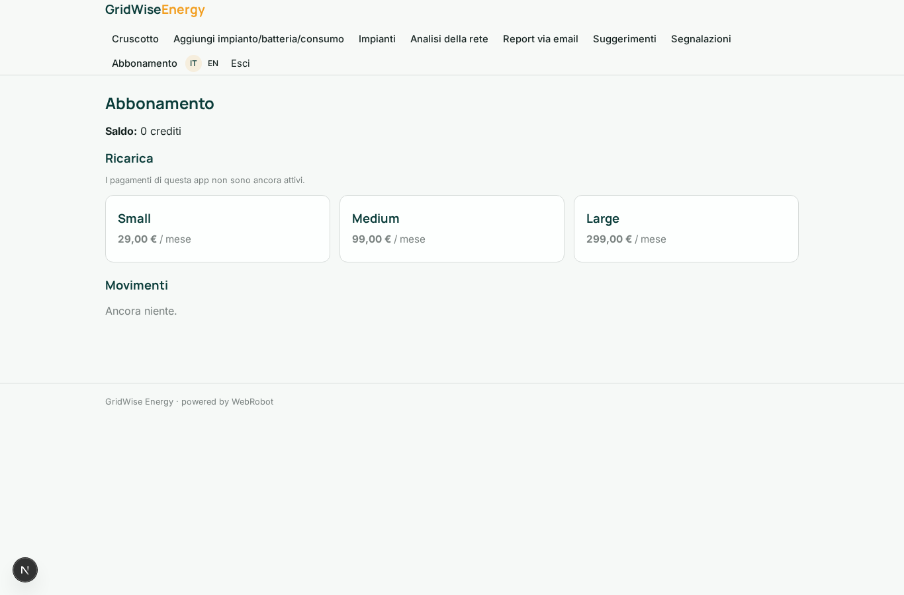

# GridWise Energy

_Cruscotto e agenti per la tua rete energetica locale._

**Manifest:** valid (schema + runtime contract) · **Functional test:** passed (12 checks passed)

## Description given to the app builder (Italian)

Descrivo solo lo strato software di un sistema di gestione dell'energia rinnovabile: il cruscotto e gli agenti che leggono i dati, non i dispositivi hardware di controllo, che sono un prodotto a parte. Il gestore registra gli impianti, le batterie e i punti di consumo di una rete locale e collega la fonte dei dati (il sistema di misura) tramite webhook. Un agente mostra in tempo quasi reale produzione, consumo, carica delle batterie e scambio con la rete, calcola l'autoconsumo e stima, in base alle previsioni meteo da Open-Meteo e ai profili di consumo, come conviene usare o accumulare l'energia nelle ore successive, proponendo i suggerimenti al gestore. Quando rileva un funzionamento anomalo apre una segnalazione per il tecnico. Il gestore vede la dashboard della propria rete e un report periodico via email con autoconsumo e risparmio; i tecnici vedono gli allarmi assegnati. Ogni gestore vede solo i propri impianti. Abbonamento mensile in base alla potenza gestita. In italiano e inglese.

## Features not expressible today (spec.extensions)

- **webhook_owner**: The metering webhook must identify the operator (per-operator hook secret) so readings are saved in that operator's records; device hardware control is out of scope.

## Screenshots (interpretive runtime, no data)

### home-anon

### home-mobile

### home

### dashboard

### add_asset

### assets

### watches

### reports_setup

### advice_list

### tickets

### account

