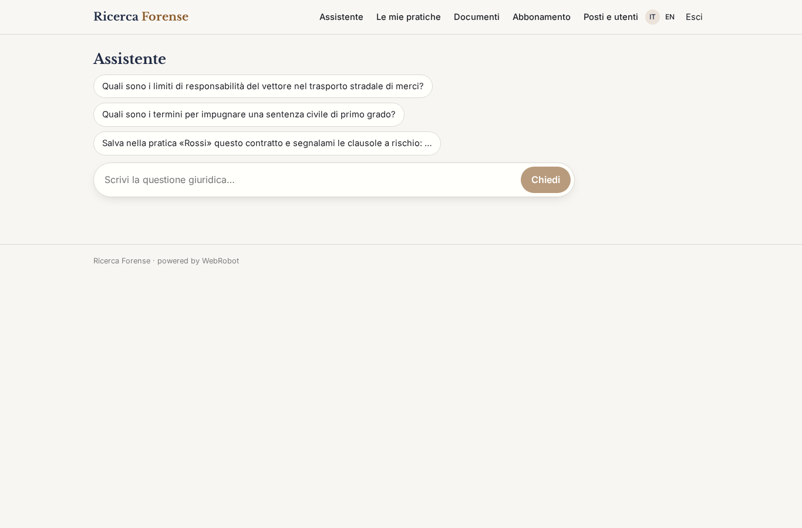
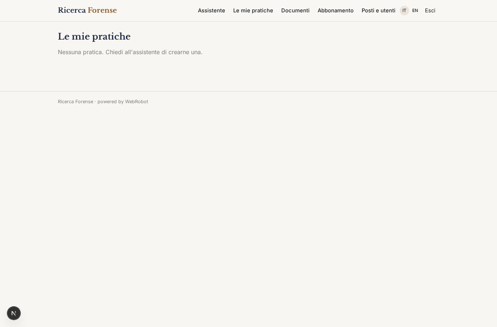
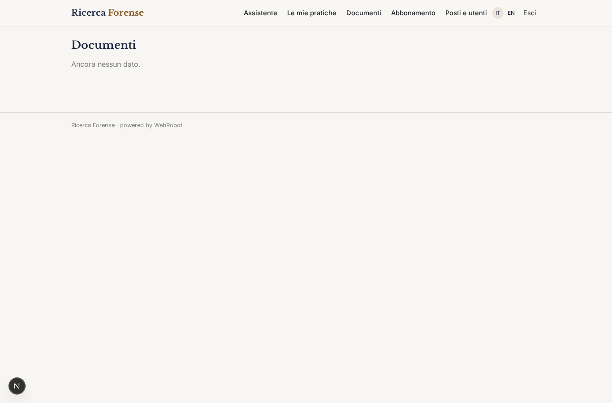
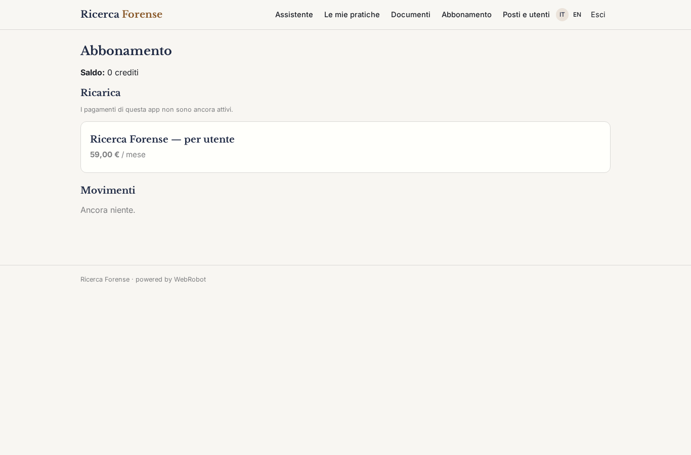
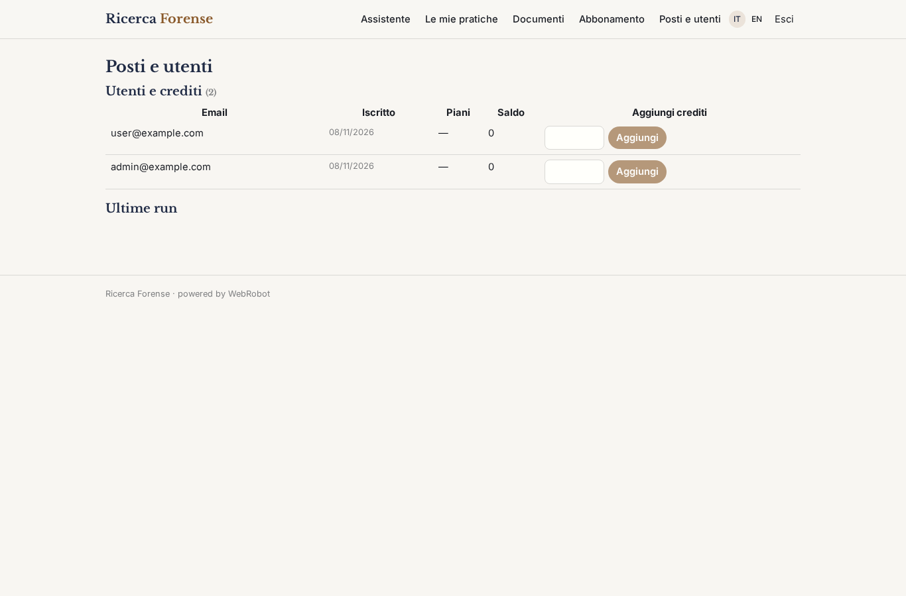

# Ricerca Forense

_Ricerca giuridica con citazioni puntuali, per avvocati e uffici legali._

**Stato manifest:** valido (validatore Python + contratto runtime)

## Descrizione data all'app builder

Voglio realizzare Ricerca Forense, un assistente di ricerca giuridica per avvocati e uffici legali. Gli utenti accedono con login; lo studio ha un admin che gestisce i posti. L'avvocato scrive in chat una questione giuridica in linguaggio naturale, per esempio sulla responsabilità del vettore o sui termini di impugnazione, e l'agente cerca nella normativa italiana su Normattiva, nel diritto europeo su EUR-Lex e con una ricerca web su fonti istituzionali, poi risponde con un ragionamento strutturato e citazioni puntuali agli articoli. Deve includere anche la giurisprudenza di legittimità e di merito, che però arriva da banche dati a licenza che lo studio collega con il proprio abbonamento. L'avvocato può caricare atti, contratti e sentenze in PDF o Word: l'agente li indicizza in uno spazio privato della pratica e risponde confrontando il documento con le norme, evidenziando clausole a rischio. Le pratiche sono riservate: ogni avvocato vede le sue e quelle condivise con lui, nessuno fuori dallo studio vede nulla. Le risposte si esportano in Word come base di un parere. Abbonamento mensile per utente.

## Funzioni non esprimibili oggi (spec.extensions)

- **file_upload**: Caricamento di PDF e Word non ancora disponibile: l'avvocato incolla il testo o un link nella pratica tramite la chat. Servirà l'upload con estrazione del testo e indicizzazione.
- **licensed_case_law**: Giurisprudenza da banche dati a licenza (DeJure, Pluris, ecc.) richiede credenziali dell'abbonamento dello studio: connettore non ancora disponibile. Per ora solo fonti pubbliche istituzionali.
- **word_export**: Esportazione delle risposte in Word (.docx) non disponibile: per ora la risposta è stampabile e copiabile.
- **firm_scope**: Condivisione delle pratiche per singolo avvocato tramite inviti per record; i posti dello studio sono gestiti dall'admin con ruolo su invito, nessuna registrazione libera.

## Screenshot (runtime interpretativo)

### home-anon

### home-mobile

### home

### assistente

### pratiche

### documenti

### account

### admin

