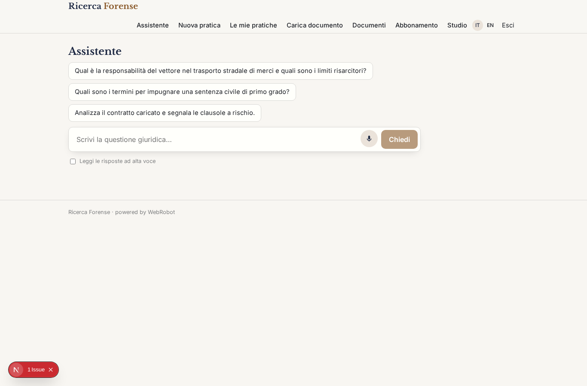
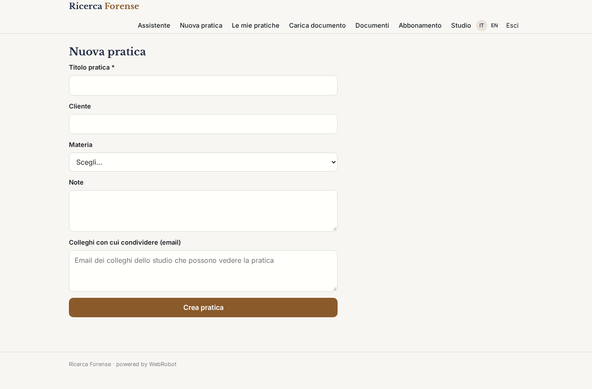
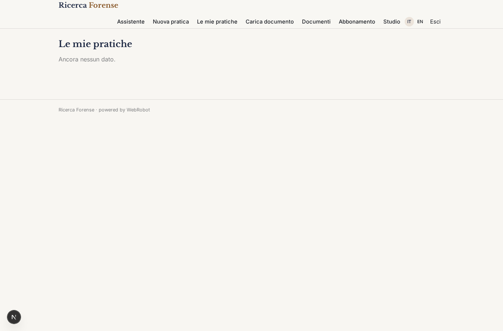
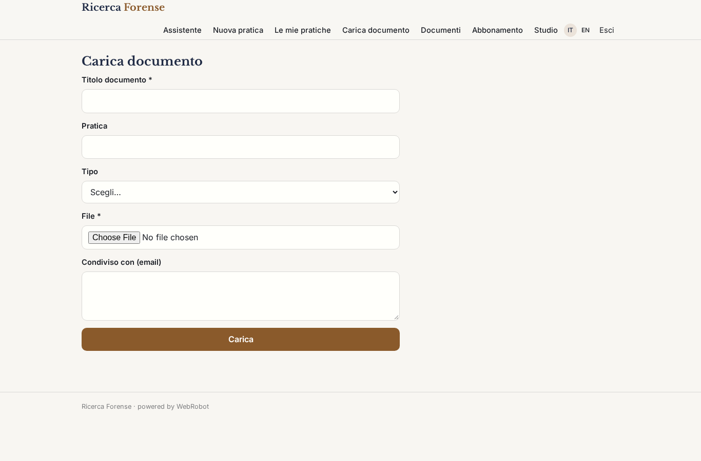
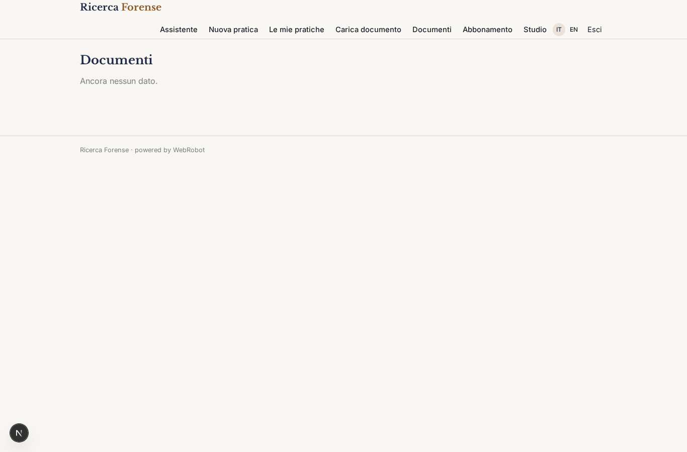
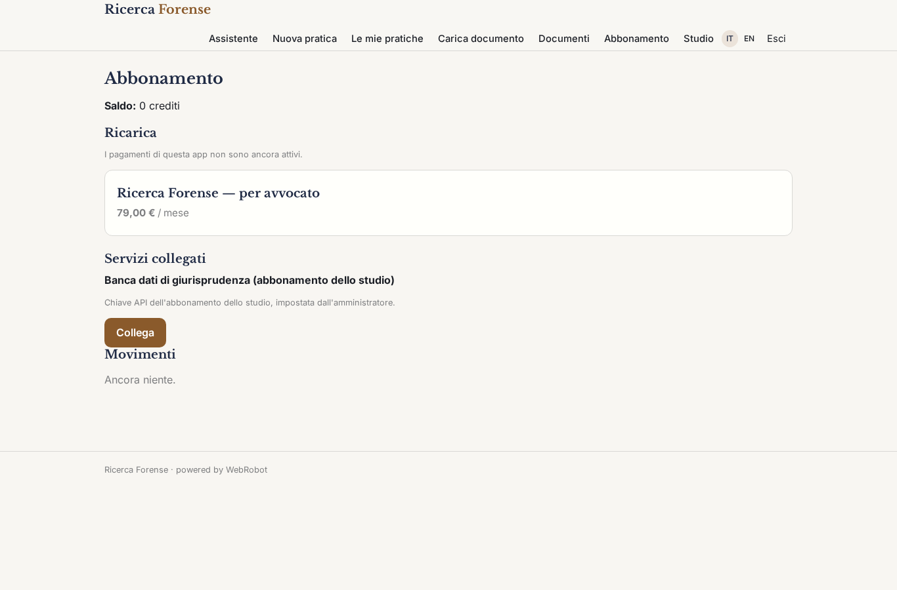
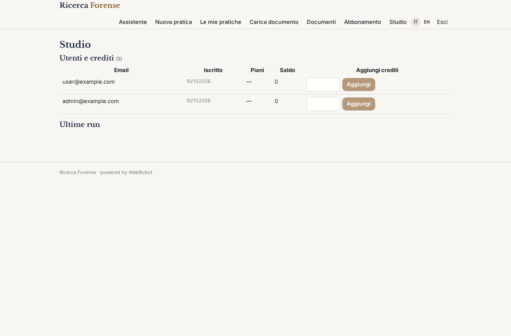

# Ricerca Forense

_L'assistente di ricerca giuridica per avvocati e uffici legali._

**Manifest:** valid (schema + runtime contract) · **Functional test:** passed (18 checks passed)

## Description given to the app builder (Italian)

Voglio realizzare Ricerca Forense, un assistente di ricerca giuridica per avvocati e uffici legali. Gli utenti accedono con login; lo studio ha un admin che gestisce i posti. L'avvocato scrive in chat una questione giuridica in linguaggio naturale, per esempio sulla responsabilità del vettore o sui termini di impugnazione, e l'agente cerca nella normativa italiana su Normattiva, nel diritto europeo su EUR-Lex e con una ricerca web su fonti istituzionali, poi risponde con un ragionamento strutturato e citazioni puntuali agli articoli. Deve includere anche la giurisprudenza di legittimità e di merito, che però arriva da banche dati a licenza che lo studio collega con il proprio abbonamento. L'avvocato può caricare atti, contratti e sentenze in PDF o Word: l'agente li indicizza in uno spazio privato della pratica e risponde confrontando il documento con le norme, evidenziando clausole a rischio. Le pratiche sono riservate: ogni avvocato vede le sue e quelle condivise con lui, nessuno fuori dallo studio vede nulla. Le risposte si esportano in Word come base di un parere. Abbonamento mensile per utente.

## Features not expressible today (spec.extensions)

- **giurisprudenza_licenziata**: Collegamento alle banche dati di giurisprudenza a licenza (legittimità e merito) con l'abbonamento dello studio: serve scegliere il fornitore e il suo host API per aggiungere lo strumento http con la credenziale 'banca_dati_giurisprudenza'. Finora l'agente cita solo giurisprudenza letta su fonti istituzionali aperte.
- **export_word**: Esportazione delle risposte della chat in Word (.docx) come base di un parere: non ancora disponibile; per ora il testo si copia dalla chat.
- **indicizzazione_documenti**: I documenti sono letti dall'agente al bisogno tramite read_file nello spazio privato dell'utente; un indice di ricerca semantico dedicato per pratica non è ancora disponibile. Il file di un collega con cui la pratica è condivisa potrebbe non essere apribile dall'agente.
- **posti_per_utente**: Il canone mensile per utente è modellato come piano di abbonamento; la fatturazione automatica per numero di posti dello studio (un solo pagamento cumulativo) non è prevista.

## Screenshots (interpretive runtime, no data)

### home-anon

### home-mobile

### home

### assistant

### new_matter

### matters

### upload_document

### documents

### account

### admin

