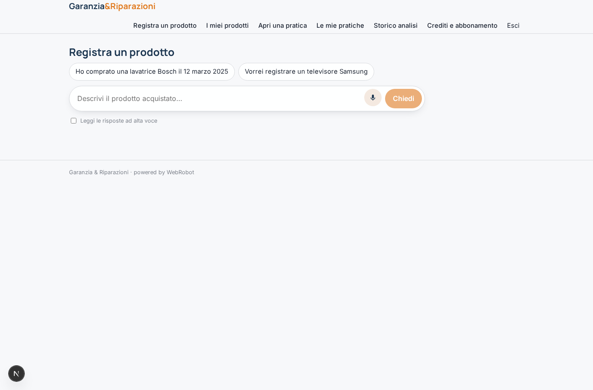
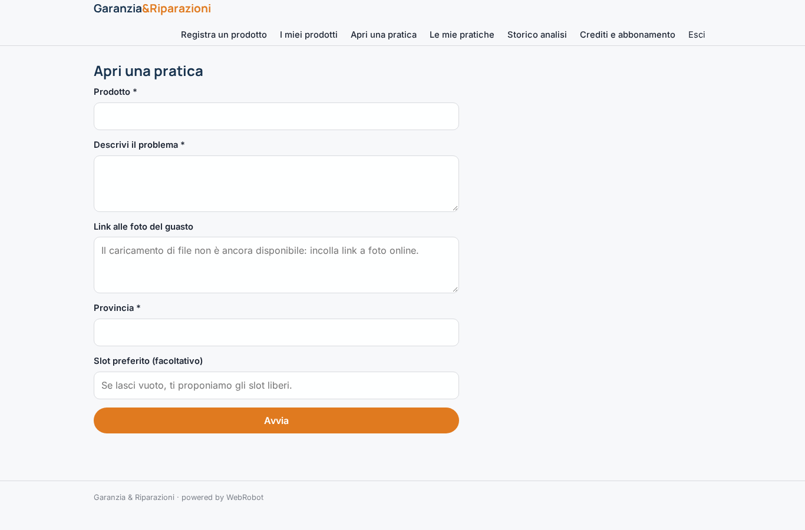
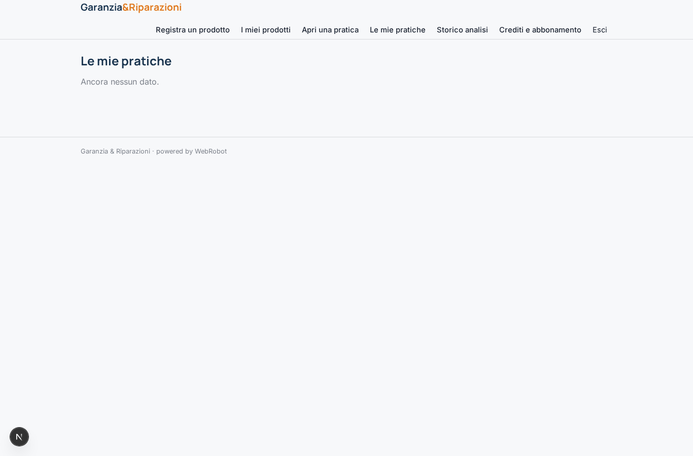
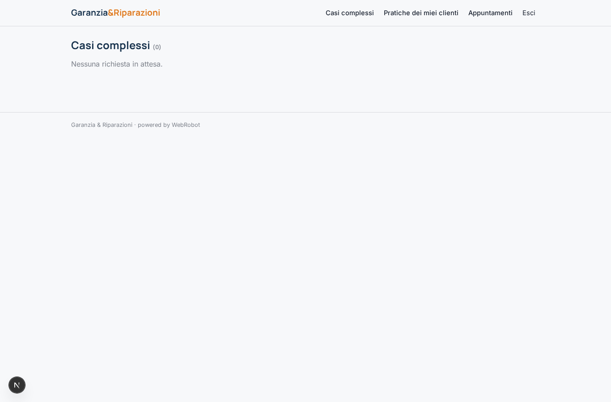
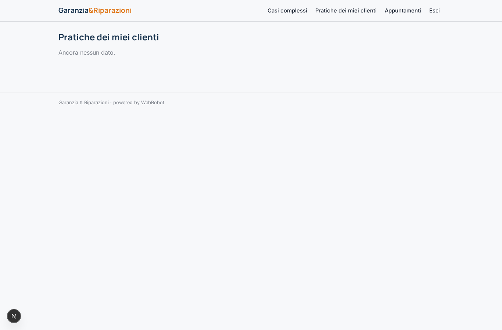
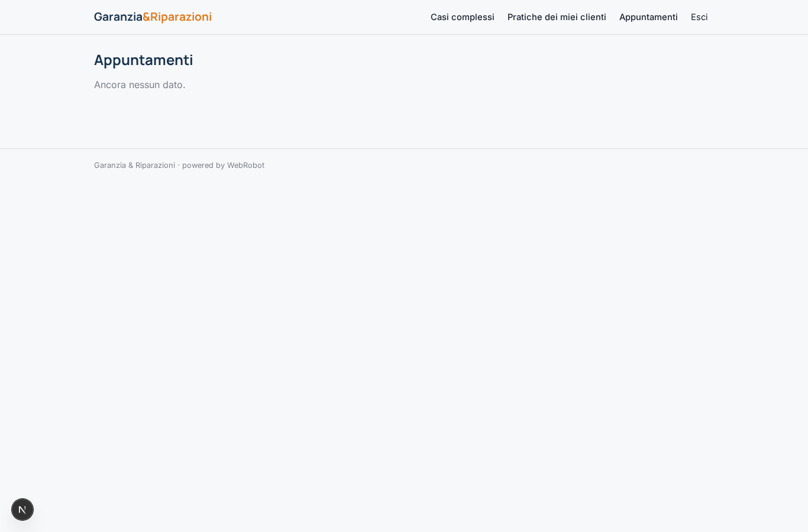

# Garanzia & Riparazioni

_Dalla segnalazione del guasto all'appuntamento, in un solo portale._

**Stato manifest:** valido (validatore Python + contratto runtime)

## Descrizione data all'app builder

Descrivo solo lo strato software, cioe il portale che gestisce richieste di garanzia e riparazioni; la rete fisica dei tecnici e i centri di riparazione sono un servizio a parte. Il cliente registra il prodotto acquistato (tipo, marca, data e scontrino caricato come foto) e, quando ha un problema, apre una pratica descrivendolo e allegando foto. Un agente classifica il guasto, verifica se e in garanzia in base ai dati inseriti, propone i primi controlli da fare e, se serve un intervento, mostra le opzioni disponibili e fissa un appuntamento scegliendo tra gli slot liberi, inoltrando la pratica al centro di riparazione competente. Il cliente segue lo stato della pratica nella propria area e riceve aggiornamenti via email a ogni passaggio; un operatore umano gestisce i casi complessi. Il rivenditore partner vede le pratiche dei propri clienti, il cliente solo le proprie, l'admin tutto. Monetizzazione: abbonamento dei rivenditori partner e fee per pratica gestita. In italiano.

## Funzioni non esprimibili oggi (spec.extensions)

- **file_upload**: Caricamento di foto di scontrini e guasti non ancora disponibile: nel manifesto si usano link a immagini online. Da sostituire con campi file quando sarà supportato.
- **email_updates**: Email al cliente a ogni cambio di stato non disponibili ancora: lo stato è visibile solo nell'area personale.
- **reseller_visibility**: Un rivenditore deve vedere solo le pratiche dei propri clienti (collegamento cliente-rivenditore); con ownedBy user le pratiche sono del cliente. Serve una regola di visibilità per rivenditore, oggi non esprimibile.
- **slot_locking**: Blocco atomico dello slot prenotato (evitare doppie prenotazioni) e sincronizzazione con il sistema dei centri di riparazione esterno.
- **per_case_fee**: La fee per pratica ai rivenditori è modellata con crediti a consumo dal cliente e abbonamento; l'addebito diretto al rivenditore per ogni pratica gestita richiede una regola dedicata.

## Screenshot (runtime interpretativo)

### home-anon

### home-mobile

### home

### products_chat

### my_products

### new_case

### my_cases

### history

### approvals

### reseller_cases

### all_appointments

### account

