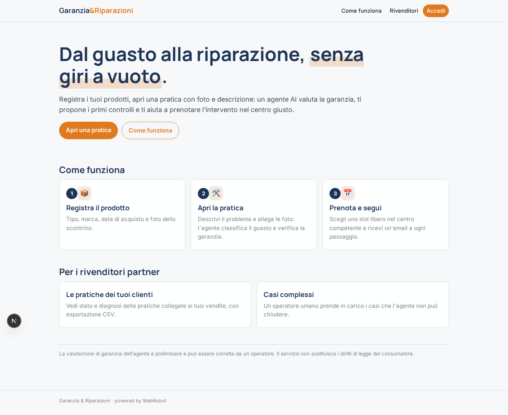
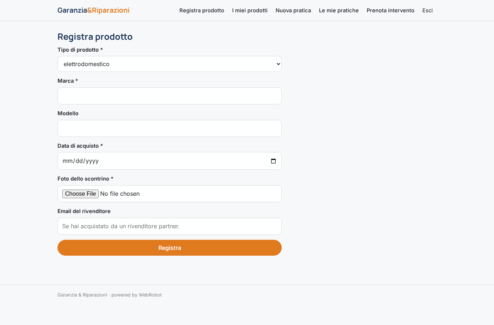
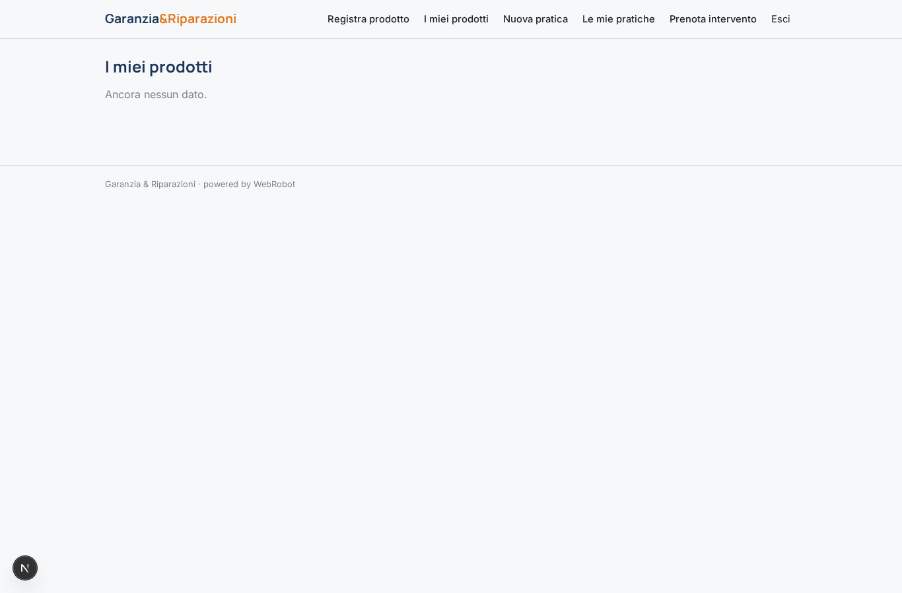
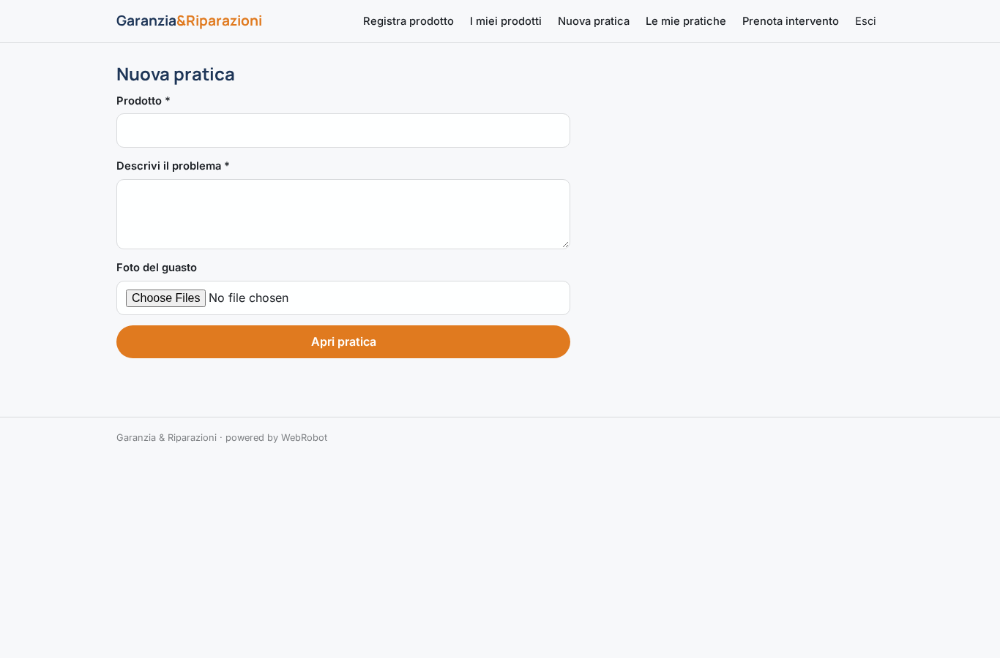
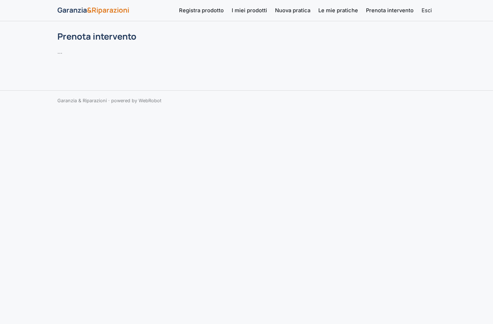
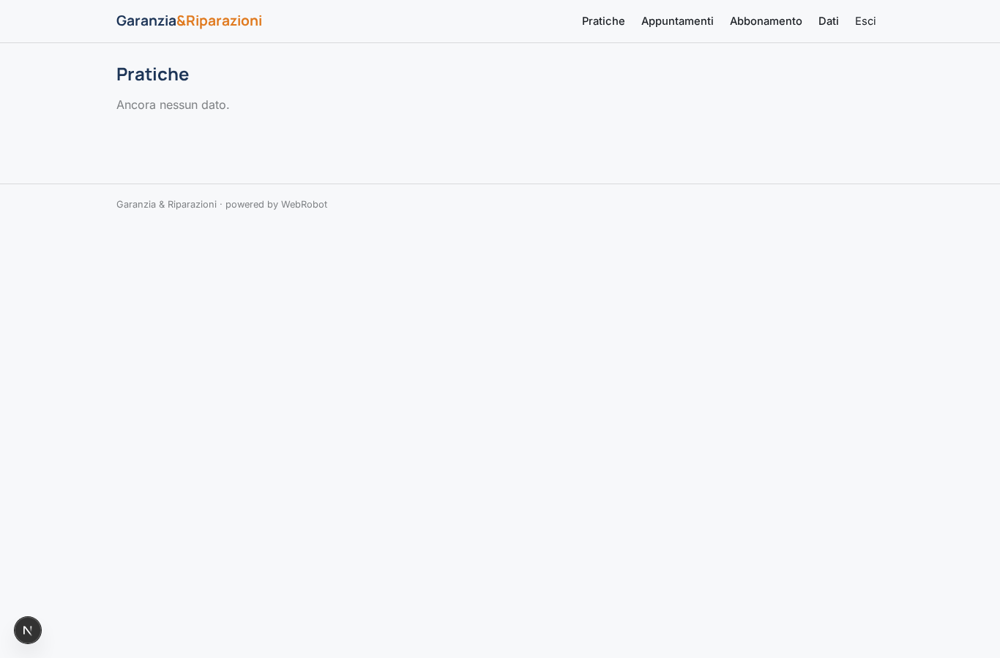
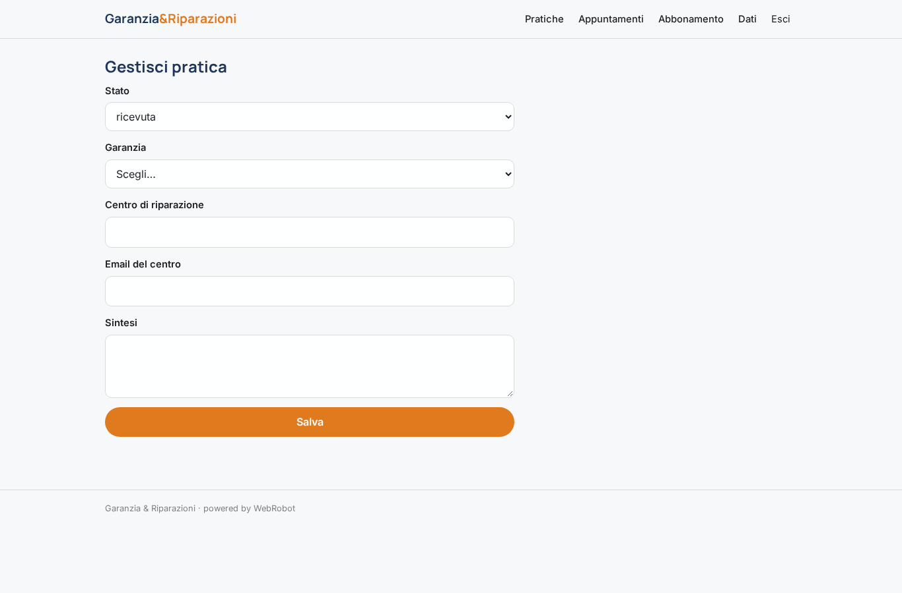
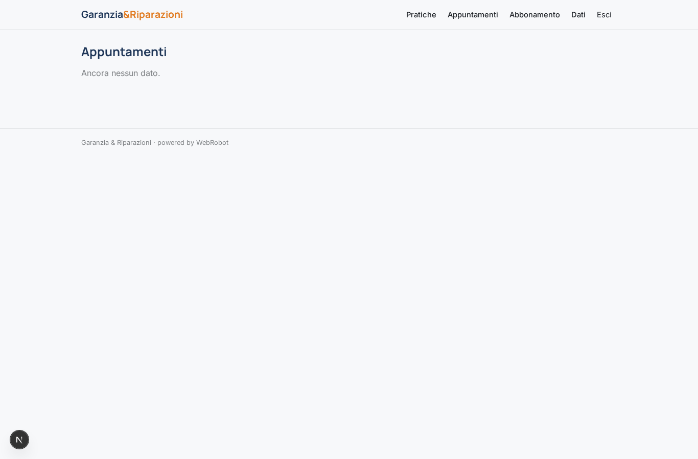
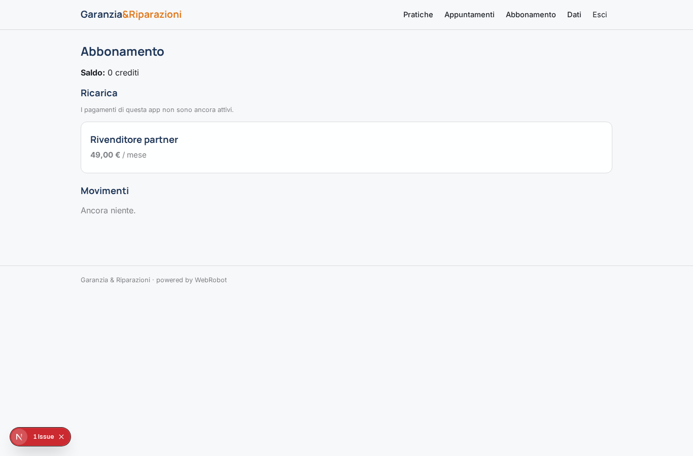

# Garanzia & Riparazioni

_Dal guasto alla riparazione, con la pratica sempre sotto controllo._

**Manifest:** valid (schema + runtime contract) · **Functional test:** passed (19 checks passed)

## Description given to the app builder (Italian)

Descrivo solo lo strato software, cioe il portale che gestisce richieste di garanzia e riparazioni; la rete fisica dei tecnici e i centri di riparazione sono un servizio a parte. Il cliente registra il prodotto acquistato (tipo, marca, data e scontrino caricato come foto) e, quando ha un problema, apre una pratica descrivendolo e allegando foto. Un agente classifica il guasto, verifica se e in garanzia in base ai dati inseriti, propone i primi controlli da fare e, se serve un intervento, mostra le opzioni disponibili e fissa un appuntamento scegliendo tra gli slot liberi, inoltrando la pratica al centro di riparazione competente. Il cliente segue lo stato della pratica nella propria area e riceve aggiornamenti via email a ogni passaggio; un operatore umano gestisce i casi complessi. Il rivenditore partner vede le pratiche dei propri clienti, il cliente solo le proprie, l'admin tutto. Monetizzazione: abbonamento dei rivenditori partner e fee per pratica gestita. In italiano.

## Functional test: what did not pass

- **saved record shown where its collection is read** (view my_claims): a record was saved in claims (by user, admin) but the page does not show it (as user) _(warning)_
- **saved record shown where its collection is read** (view claims_all): a record was saved in claims (by user, admin) but the page does not show it (as reseller) _(warning)_

## Features not expressible today (spec.extensions)

- **fee_per_pratica**: La fee per pratica gestita da addebitare al rivenditore partner non è disponibile: gli addebiti per evento colpiscono l'utente dell'evento (il cliente), non il rivenditore. Per ora solo abbonamento; la fee va fatturata fuori piattaforma.
- **slot_liberi_agente**: L'agente non vede gli slot liberi: propone il centro e il cliente sceglie lo slot nella vista Prenota. La pratica passa a 'appuntamento' per mano dell'operatore.

## Screenshots (interpretive runtime, no data)

### home-anon

### home-mobile

### home

### product_new

### my_products

### claim_new

### my_claims

### book

### claims_all

### claim_edit

### appointments_all

### account

