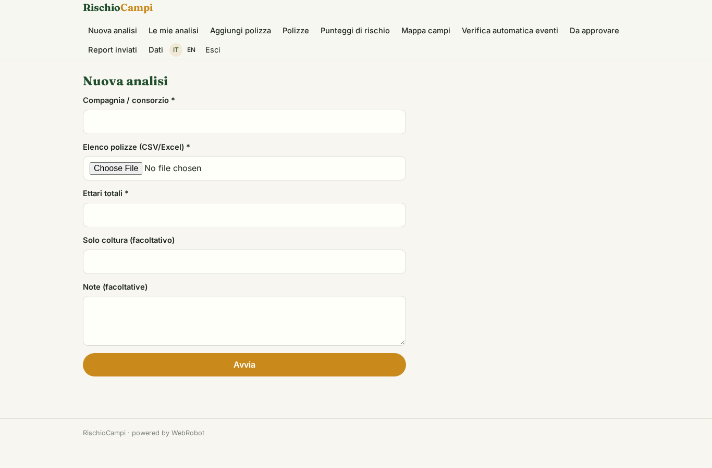
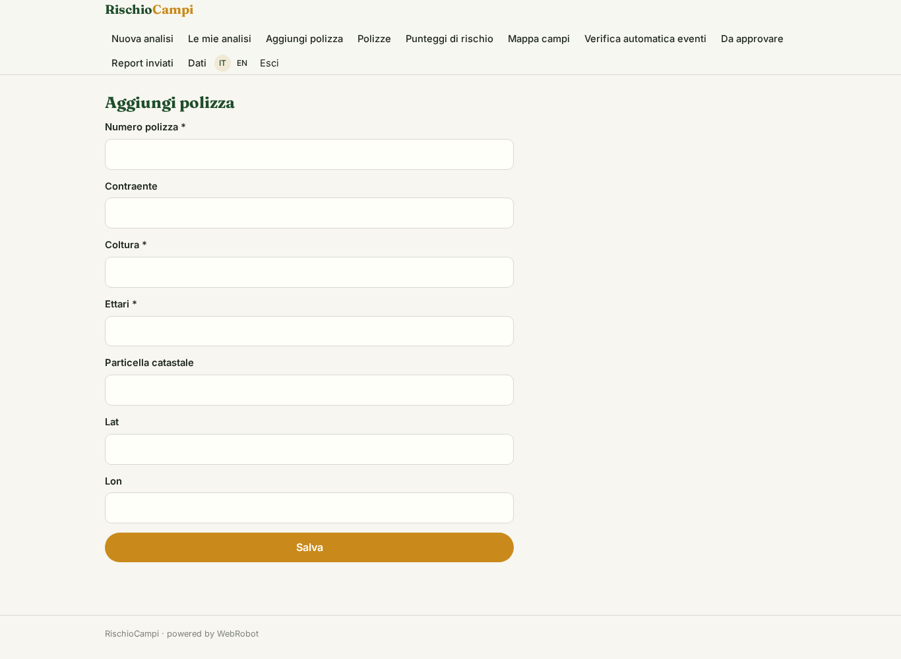
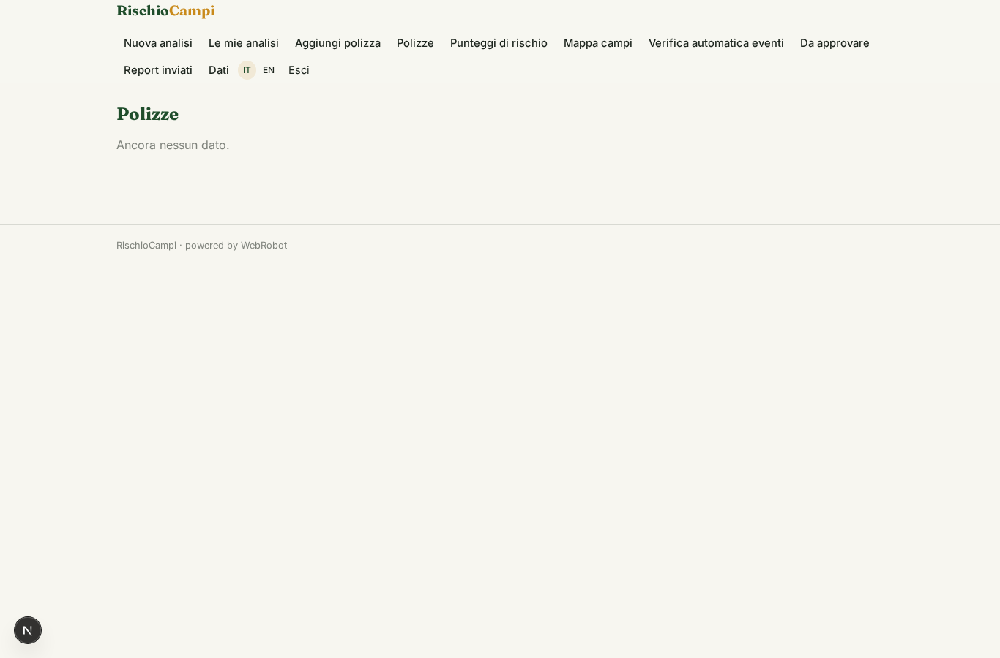
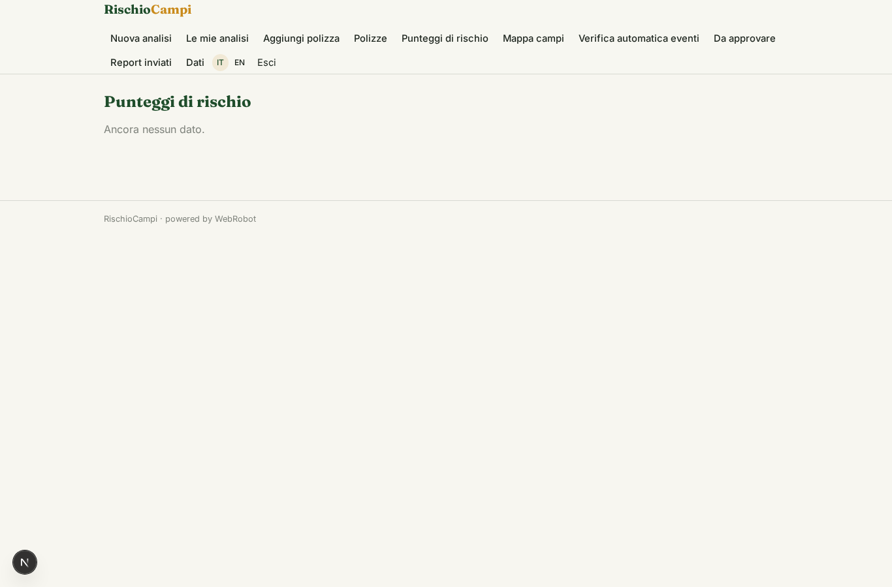
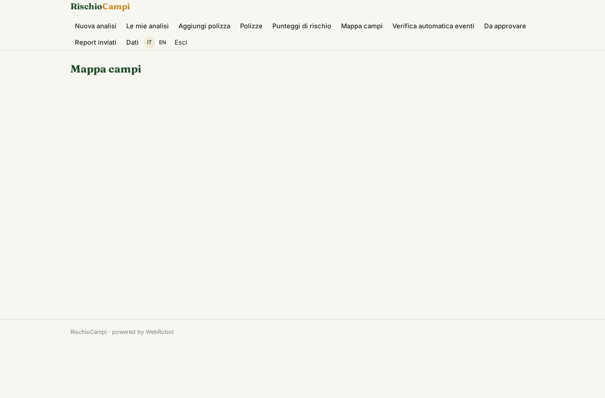
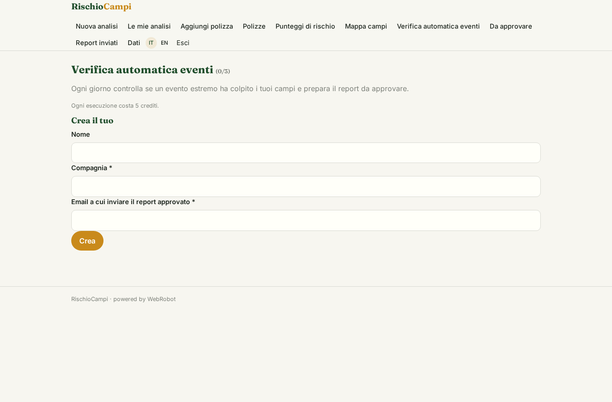
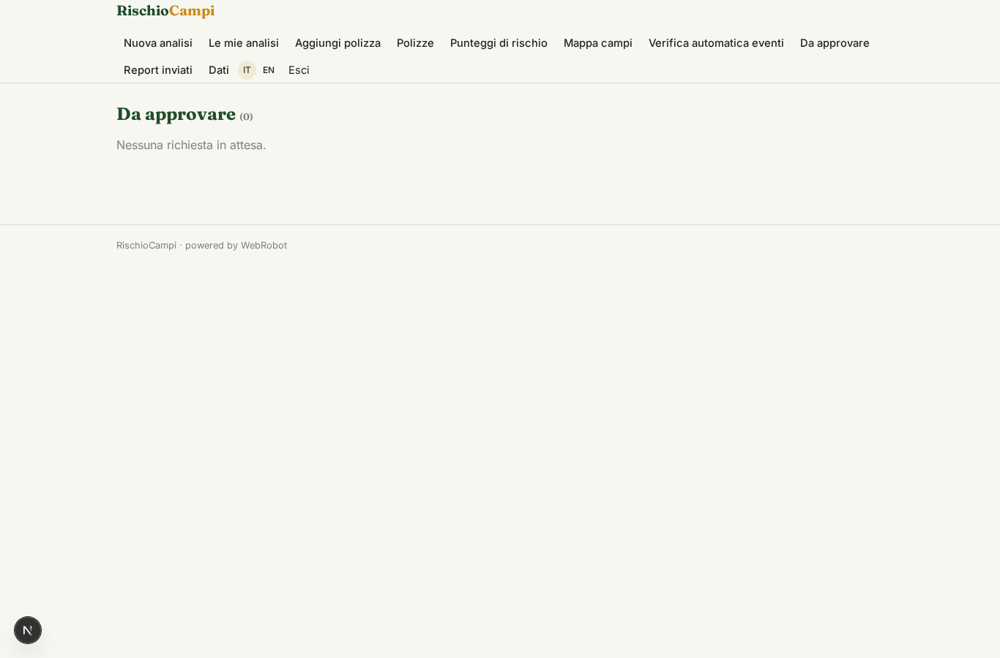
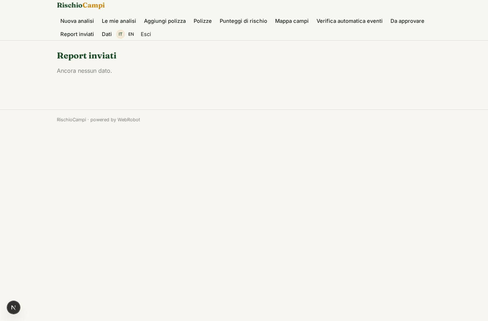
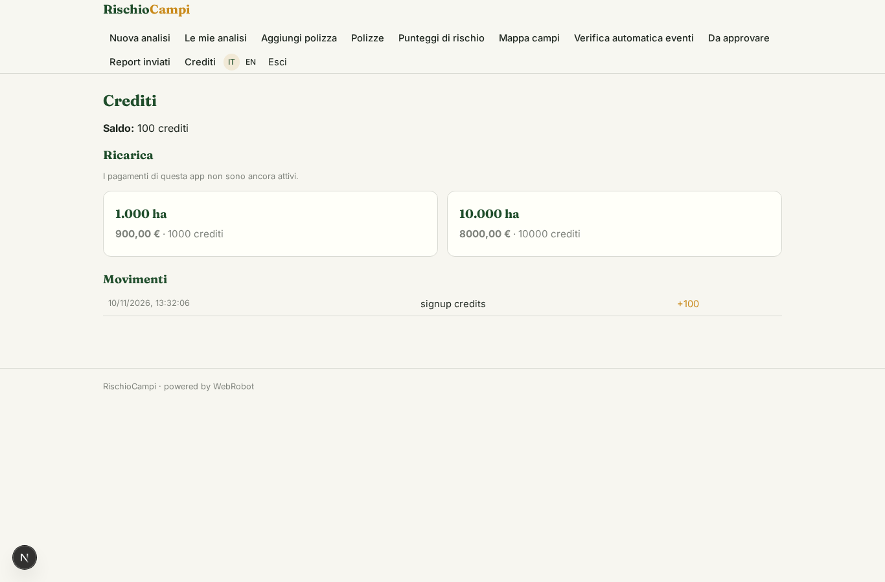

# RischioCampi

_Rischio e danni sui campi assicurati, dai satelliti aperti e dal meteo._

**Manifest:** valid (schema + runtime contract) · **Functional test:** passed (16 checks passed)

## Description given to the app builder (Italian)

Voglio RischioCampi, un servizio per assicurazioni e consorzi di difesa agricola. L'assicuratore carica l'elenco delle polizze con coordinate o particelle catastali dei campi e coltura dichiarata. Per ogni campo un agente calcola indici di vegetazione dalle immagini satellitari aperte Sentinel-2, li confronta con la media storica della zona e con i dati meteo aperti (grandine, siccità, gelate), e produce un punteggio di rischio e una stima del danno dopo un evento. Dopo ogni evento meteo estremo nella zona parte in automatico una verifica dei campi colpiti, e il perito riceve un report con i campi da ispezionare in ordine di priorità, che approva prima dell'invio alla compagnia. Ogni compagnia vede solo le sue polizze. Prezzo per ettaro monitorato all'anno.

## Features not expressible today (spec.extensions)

- **annual_per_hectare**: Pricing per monitored hectare per year is approximated with credits per hectare (1 credit = 1 ha-year); a real annual subscription billed on the hectares in the policy list is not available yet.
- **cadastral_parcels**: Cadastral parcels are only geocoded approximately (Nominatim centroid); exact parcel polygons from the Agenzia delle Entrate cadastre are not wired in — coordinates are preferable.
- **ndvi_via_pipeline**: NDVI is computed by the agent through a WebRobot pipeline over Sentinel-2 assets; results depend on cloud cover and are shown with a confidence level.

## Screenshots (interpretive runtime, no data)

### home-anon

### home-mobile

### home

### new_analysis

### analyses

### add_policy

### policies

### scores

### map

### watches

### approvals

### reports

### account

