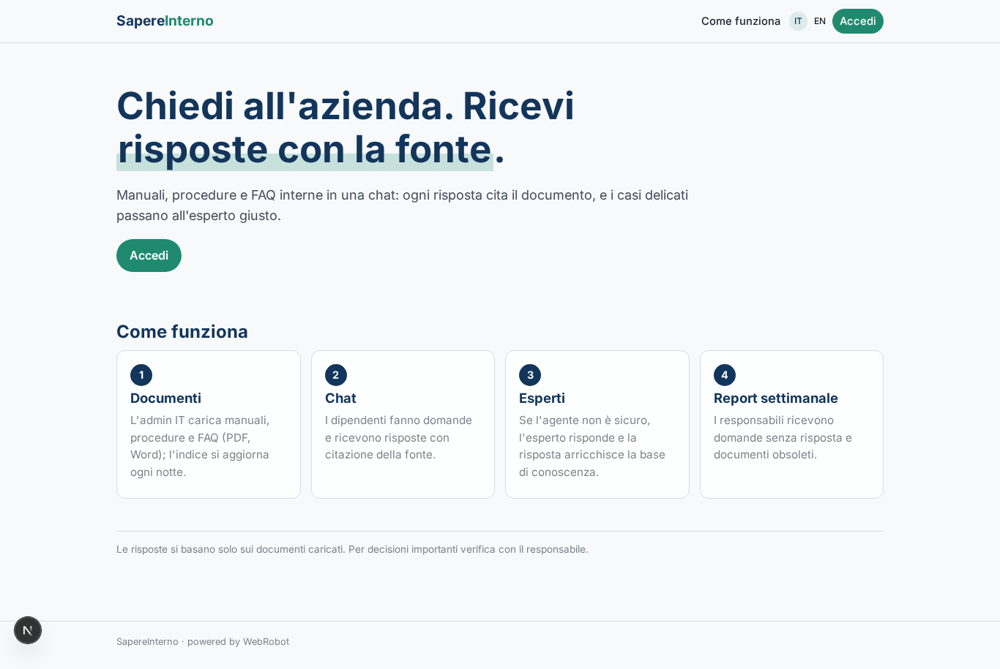
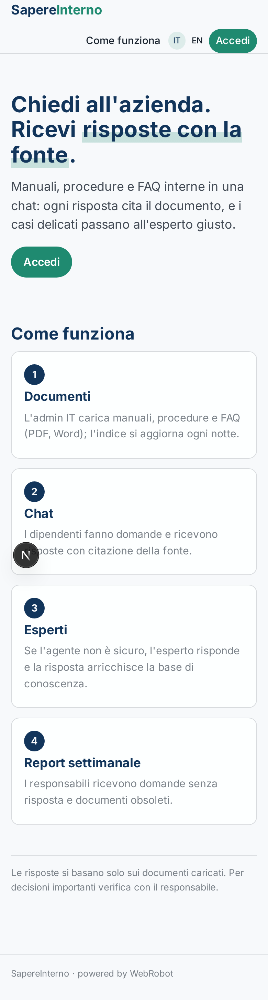
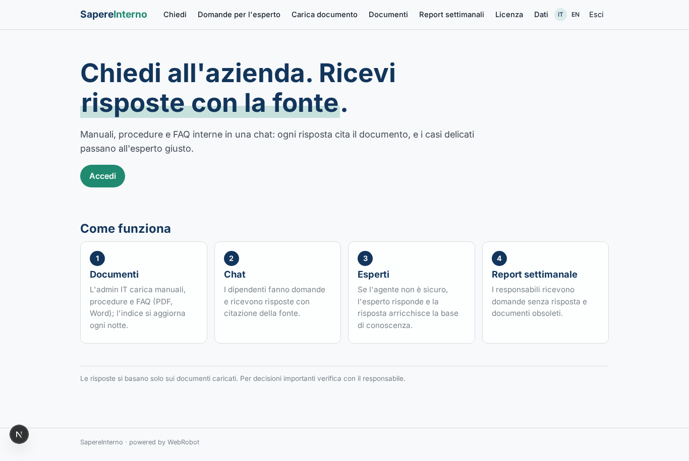
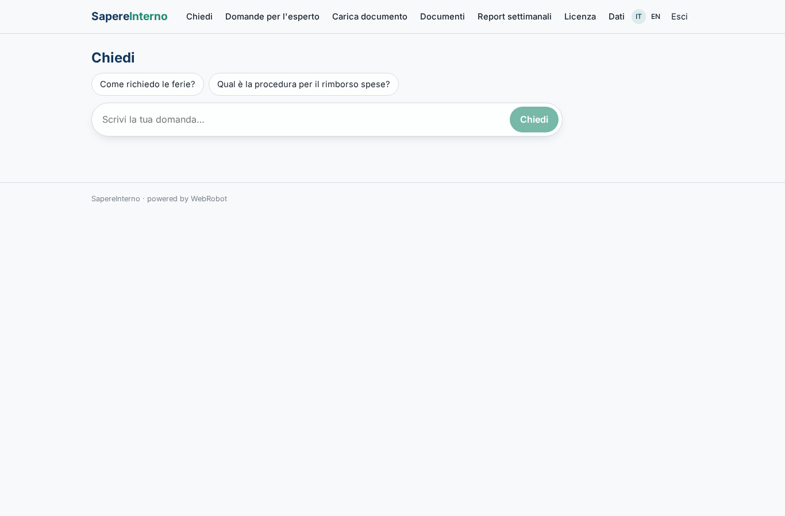
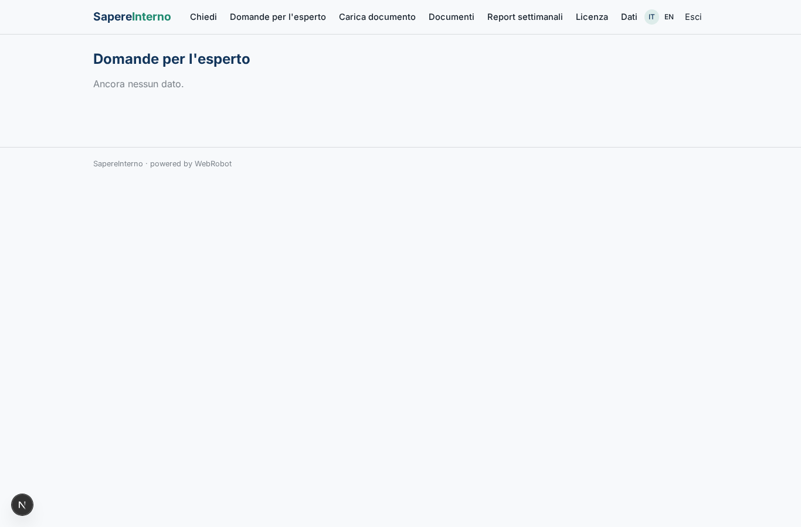
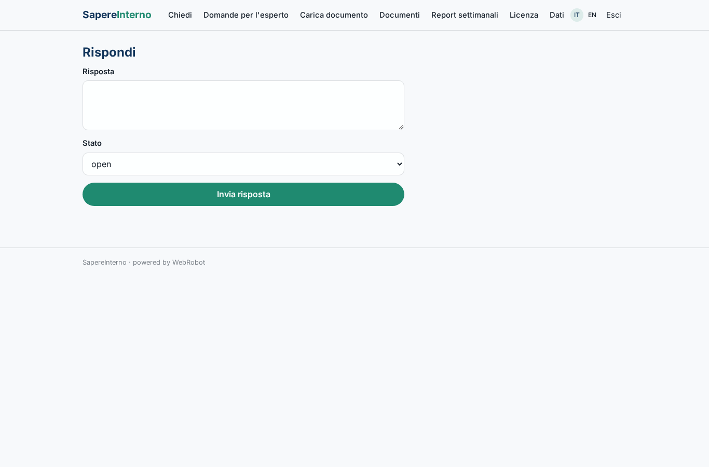
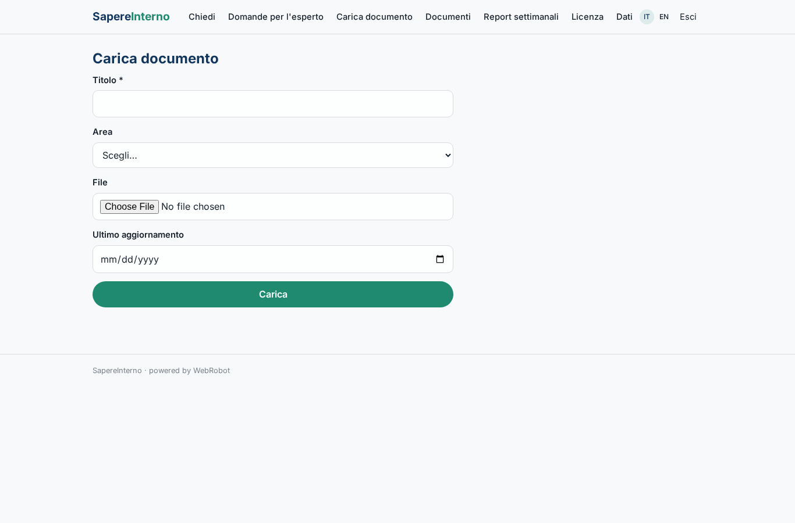
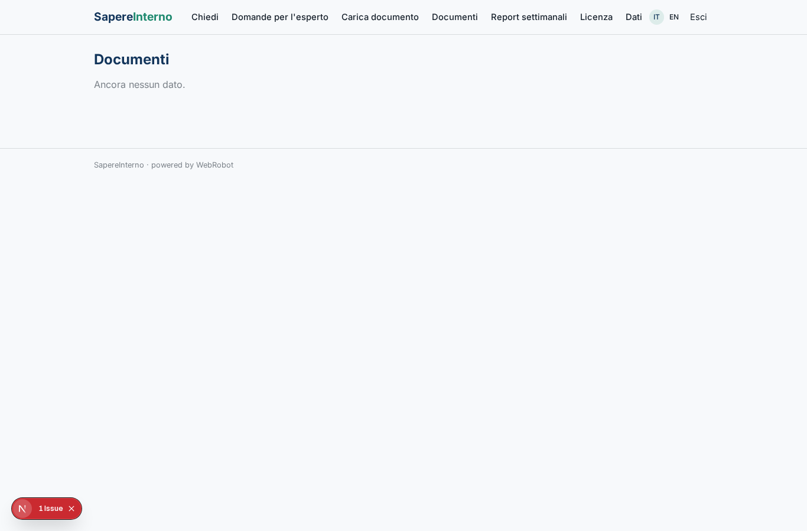
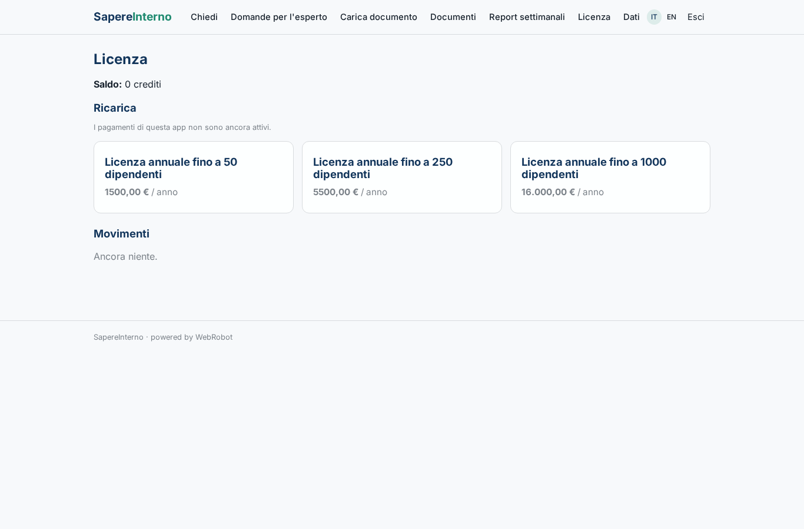

# SapereInterno

_Le risposte dell'azienda, con la fonte, in una chat._

**Manifest:** valid (schema + runtime contract) · **Functional test:** passed (18 checks passed)

## Description given to the app builder (Italian)

SapereInterno è un assistente aziendale che risponde ai dipendenti usando la conoscenza interna dell'organizzazione. L'admin IT collega le fonti documentali dell'azienda: SharePoint, Microsoft Teams e cartelle condivise, oppure carica manualmente manuali, procedure e FAQ in PDF e Word. I documenti vengono indicizzati con i permessi originali, così ogni dipendente ritrova solo ciò che è autorizzato a vedere. I dipendenti fanno domande in una chat con login aziendale, sia nell'app web sia dentro Teams, e ricevono risposte con citazione del documento fonte. Quando l'agente non è sicuro o la domanda riguarda un argomento sensibile, inoltra il quesito all'esperto interno designato, che risponde; la sua risposta viene salvata e arricchisce la base di conoscenza. Ogni settimana i responsabili ricevono un report con le domande più frequenti senza risposta e i documenti obsoleti da aggiornare. L'indicizzazione si aggiorna ogni notte. Licenza annuale per numero di dipendenti. Italiano e inglese.

## Functional test: what did not pass

- **trigger has its effect** (trigger expert_new): email to role:expert: no such recipient in the test (role nobody holds or empty field) _(warning)_
- **saved record shown where its collection is read** (view expert_inbox): a record was saved in expert_queue (by admin) but the page does not show it (as admin) _(warning)_

## Features not expressible today (spec.extensions)

- **sso_microsoft**: Login aziendale Microsoft 365 / Entra ID (OAuth): non disponibile, si usa il magic link via email aziendale.
- **connectors_sharepoint_teams**: Connettori SharePoint, Teams e cartelle condivise con sincronizzazione notturna: non disponibili (OAuth). I documenti si caricano manualmente (PDF, Word).
- **original_permissions**: Indicizzazione con i permessi originali dei documenti: non disponibile; i documenti caricati sono visibili a tutti i dipendenti. Per contenuti riservati usare l'esperto interno.
- **teams_bot**: Chat dentro Microsoft Teams: canale non disponibile, la chat è nell'app web.
- **license_seat_limit**: Il limite di dipendenti della licenza annuale è indicato dal piano ma non applicato automaticamente.

## Screenshots (interpretive runtime, no data)

### home-anon

### home-mobile

### home

### ask

### expert_inbox

### answer

### upload_doc

### docs

### reports

### account

