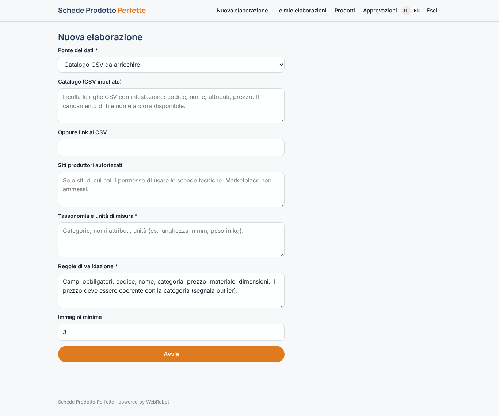
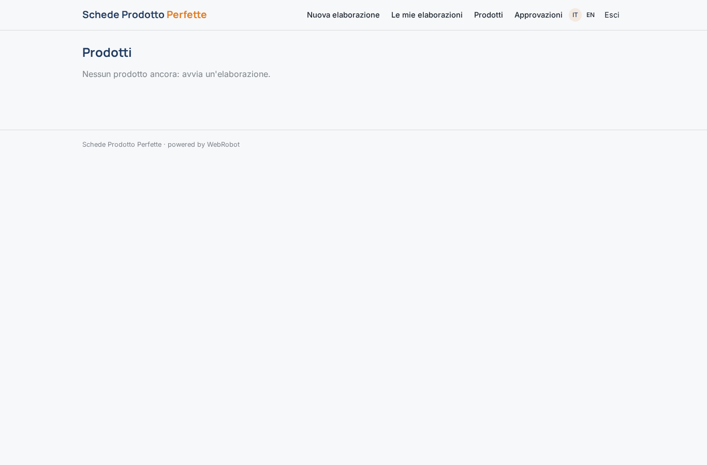
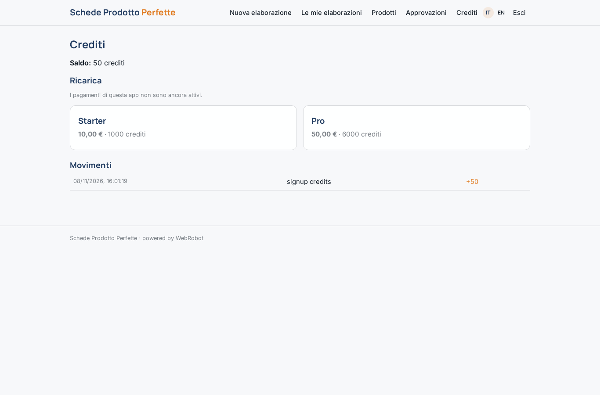

# Schede Prodotto Perfette

_Cataloghi completi, coerenti e pronti da pubblicare._

**Manifest status:** valid (schema validator + runtime contract)

## Description given to the app builder (Italian)

Voglio Schede Prodotto Perfette, un team di agenti che arricchisce e controlla i cataloghi di distributori ed e-commerce. Il cliente carica il catalogo in CSV o Excel con codici, nomi e attributi parziali, oppure ci indica i siti dei produttori da cui ha il permesso di prendere le schede tecniche. Un primo agente legge le pagine dei produttori autorizzati ed estrae specifiche, misure, materiali e immagini; non vogliamo usare marketplace come Amazon. Un secondo agente normalizza gli attributi secondo la tassonomia del cliente, uniforma unità di misura e nomi. Un terzo scrive titoli e descrizioni SEO in italiano e inglese. Un quarto valida ogni scheda con regole configurabili (campi obbligatori, coerenza tra prezzo e categoria, immagini minime) e assegna un punteggio di qualità. Il cliente vede una tabella dei prodotti con stato e anomalie, e un responsabile catalogo approva le schede prima della pubblicazione. Le schede approvate vanno esportate in CSV o inviate direttamente a Shopify. Ogni cliente vede solo il suo catalogo. Pagamento a crediti per prodotto elaborato.

## Features not expressible today (spec.extensions)

- **file_upload**: Caricamento diretto di file CSV/Excel non ancora disponibile: il cliente incolla il CSV o fornisce un link.
- **shopify_push**: Invio diretto a Shopify non disponibile (richiede le credenziali di ogni cliente): per ora export CSV delle schede approvate.
- **per_product_credits**: Il costo è misurato sull'uso reale (token e calcolo) invece che con un prezzo fisso per prodotto elaborato.
- **editable_rules**: Le regole di validazione sono un campo testuale del modulo, non ancora un editor di regole strutturato.

## Screenshots (interpretive runtime)

### home-anon

### home-mobile

### home

### new_run

### history

### products_table

### approvals

### account

