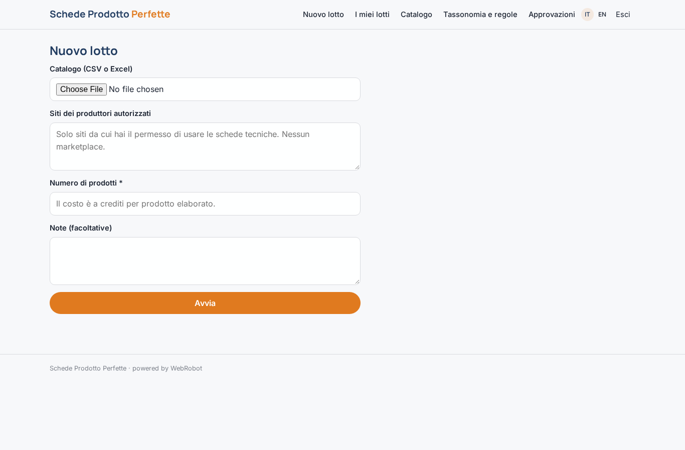
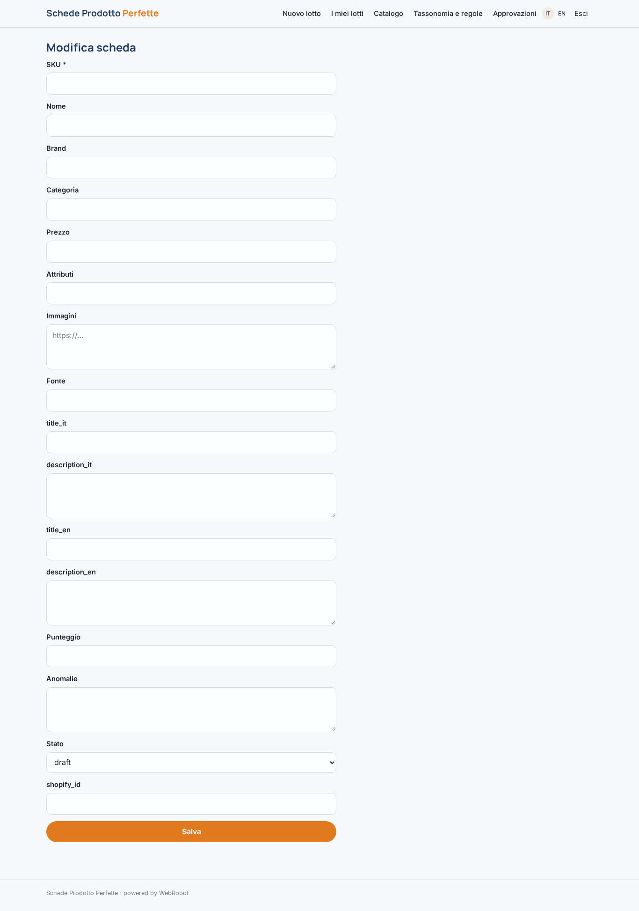
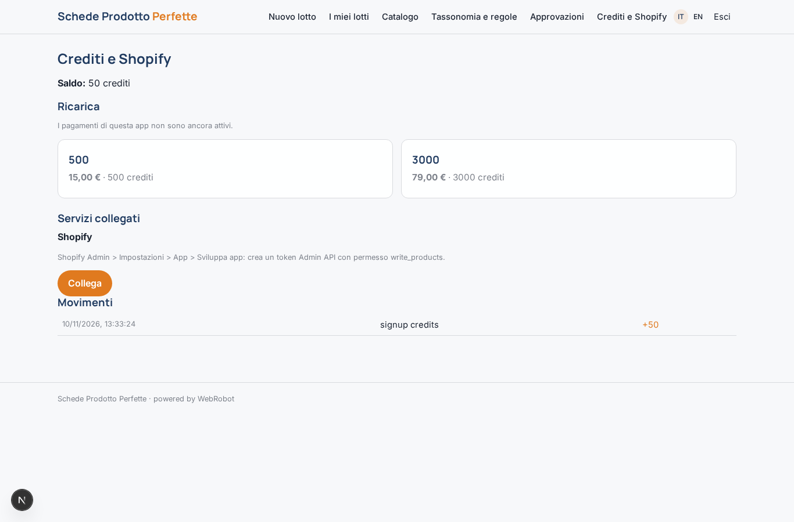

# Schede Prodotto Perfette

_Cataloghi completi, normalizzati, SEO e validati da un team di agenti._

**Manifest:** valid (schema + runtime contract) · **Functional test:** passed (13 checks passed)

## Description given to the app builder (Italian)

Voglio Schede Prodotto Perfette, un team di agenti che arricchisce e controlla i cataloghi di distributori ed e-commerce. Il cliente carica il catalogo in CSV o Excel con codici, nomi e attributi parziali, oppure ci indica i siti dei produttori da cui ha il permesso di prendere le schede tecniche. Un primo agente legge le pagine dei produttori autorizzati ed estrae specifiche, misure, materiali e immagini; non vogliamo usare marketplace come Amazon. Un secondo agente normalizza gli attributi secondo la tassonomia del cliente, uniforma unità di misura e nomi. Un terzo scrive titoli e descrizioni SEO in italiano e inglese. Un quarto valida ogni scheda con regole configurabili (campi obbligatori, coerenza tra prezzo e categoria, immagini minime) e assegna un punteggio di qualità. Il cliente vede una tabella dei prodotti con stato e anomalie, e un responsabile catalogo approva le schede prima della pubblicazione. Le schede approvate vanno esportate in CSV o inviate direttamente a Shopify. Ogni cliente vede solo il suo catalogo. Pagamento a crediti per prodotto elaborato.

## Screenshots (interpretive runtime, no data)

### home-anon

### home-mobile

### home

### new_batch

### batches

### catalog

### product_edit

### settings

### review

### shopify

