# ScudoPMI

_La sicurezza informatica della tua PMI, senza un reparto IT._

**Manifest:** valid (schema + runtime contract) · **Functional test:** passed (14 checks passed)

## Description given to the app builder (Italian)

Vorrei realizzare ScudoPMI, un servizio di sorveglianza della sicurezza per piccole e medie imprese senza un reparto IT. Il titolare inserisce i domini aziendali, gli indirizzi email dei dipendenti e l'elenco dei servizi esposti che conosce. Ogni settimana un agente esegue controlli passivi e leciti: certificati SSL in scadenza, configurazione SPF, DKIM e DMARC, record DNS, presenza di indirizzi aziendali in archivi pubblici di data breach, versioni software dichiarate dai banner pubblici confrontate con il database CVE. Nessuna scansione attiva senza autorizzazione scritta. Un secondo agente trasforma i risultati in un punteggio di rischio e in un report comprensibile anche per chi non è tecnico, con le azioni da fare in ordine di priorità. C'è poi una parte di formazione: ogni mese i dipendenti ricevono via email una breve lezione e un quiz, e l'admin vede chi l'ha completato. Alert immediato via email se compare una nuova vulnerabilità critica o un breach. L'admin vede tutto, i dipendenti solo la propria formazione. Abbonamento mensile per numero di dipendenti, in italiano.

## Functional test: what did not pass

- **form saves a record** (form quiz): only role employee may fill it, and the test cannot hold that role _(warning)_

## Features not expressible today (spec.extensions)

- **employee_signup_role**: Un dipendente che accede riceve anche il ruolo 'user' di signup: vede solo i propri dati (i record sono per utente) e la propria formazione, ma le voci di menu del titolare restano visibili e vuote.
- **quiz_scoring**: Il quiz non ha correzione automatica: l'admin vede il completamento e le risposte; il punteggio automatico richiede una logica dedicata.

## Screenshots (interpretive runtime, no data)

### home-anon
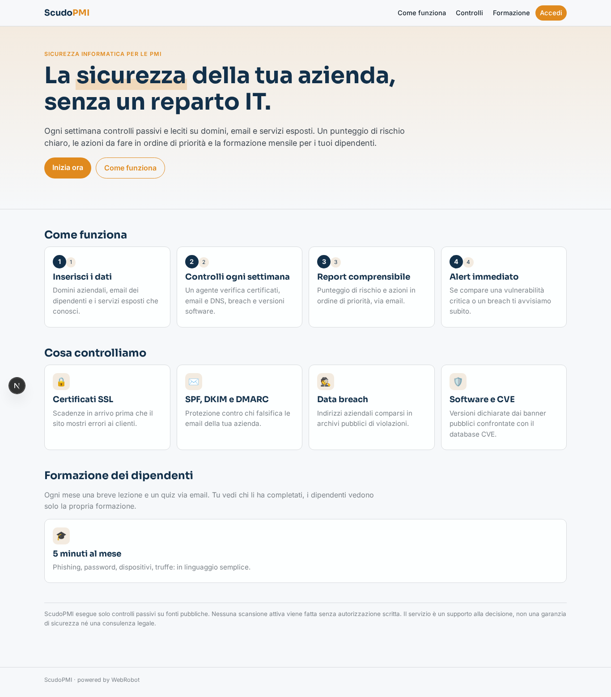

### home-mobile
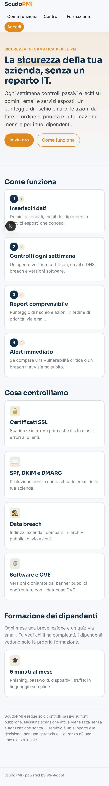

### home
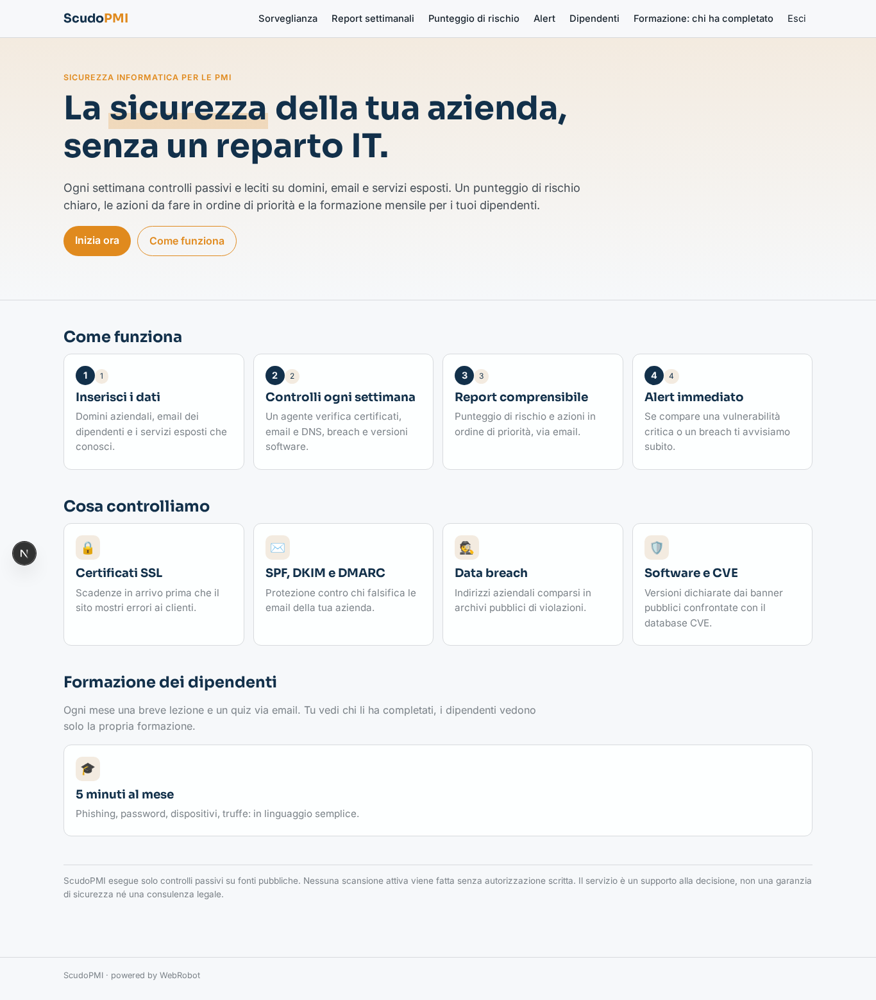

### monitors
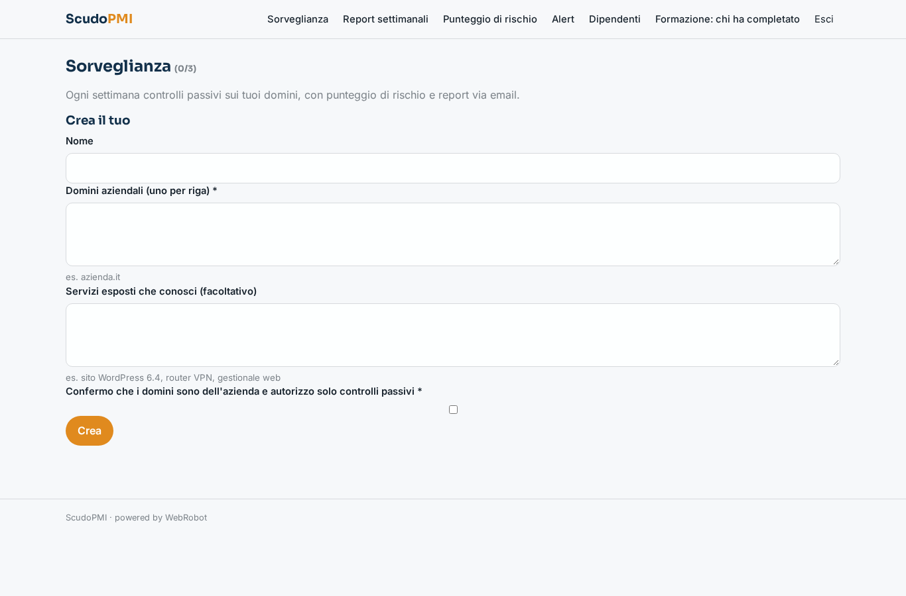

### reports
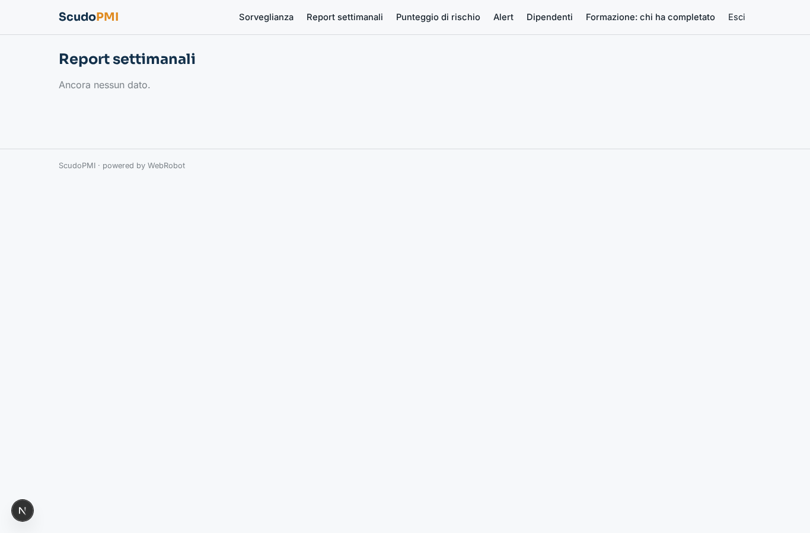

### score
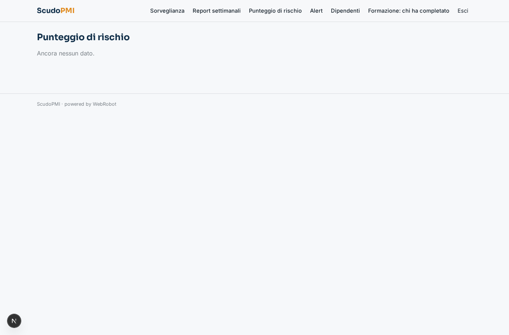

### alerts
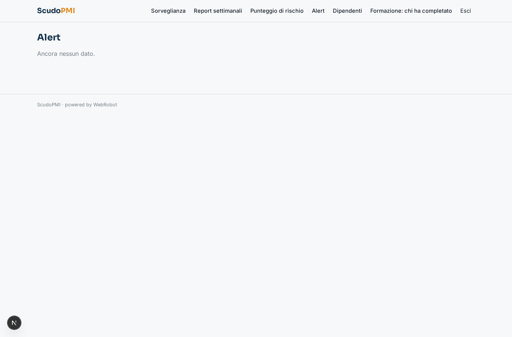

### add_employee
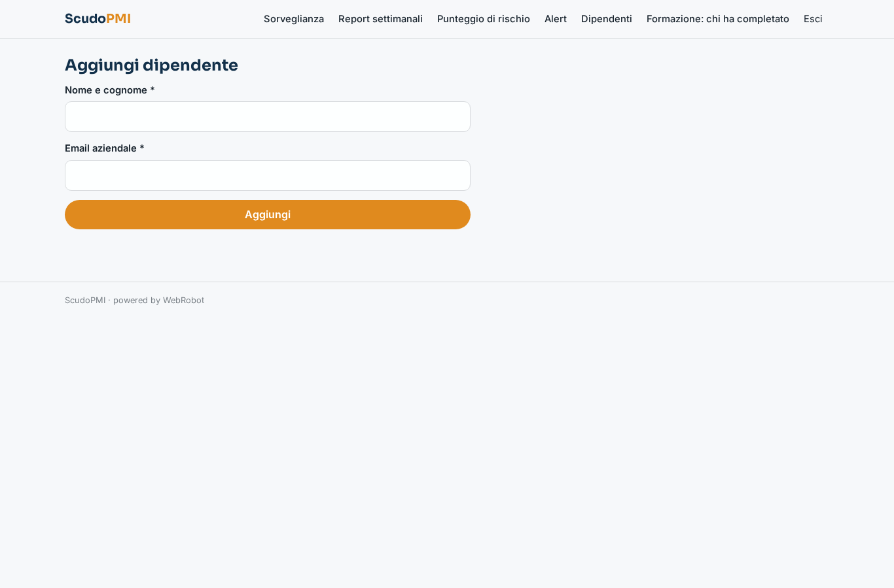

### employees
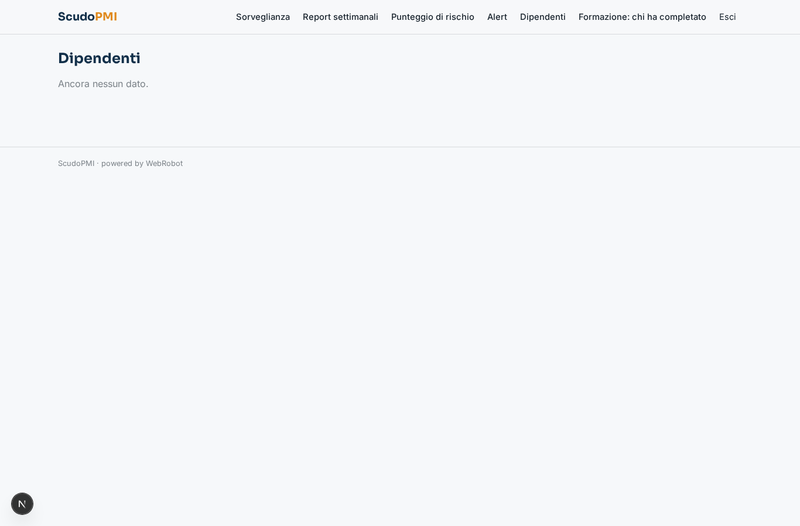

### training_admin
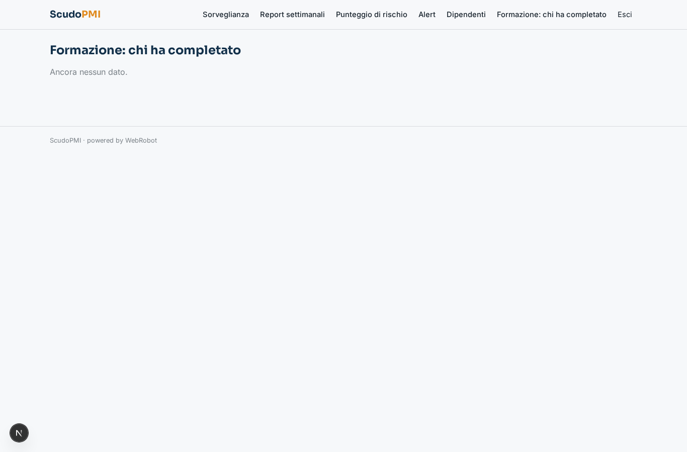

### my_training

### quiz
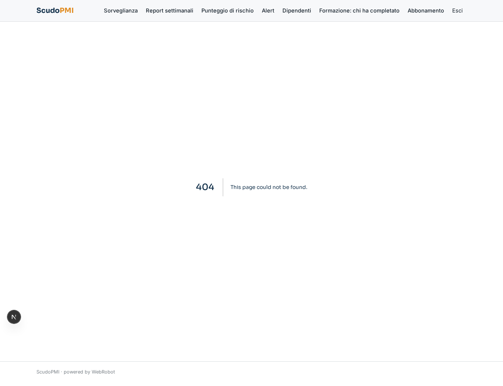

### account
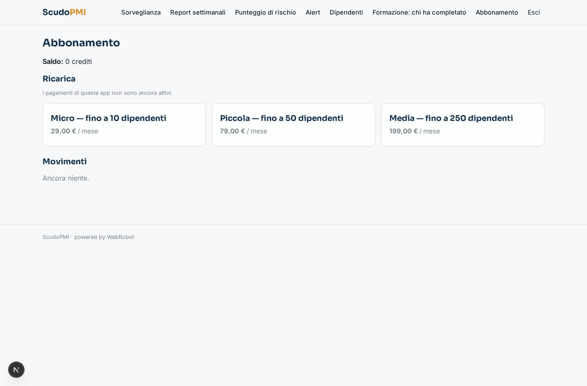
