# Seconda Vita

_Il tuo usato, la sua seconda vita sull'e-shop del brand._

**Manifest:** valid (schema + runtime contract) · **Functional test:** passed (33 checks passed)

## Description given to the app builder (Italian)

Ci serve Seconda Vita, un'app per brand di moda che vogliono vendere il proprio usato direttamente sul loro sito. I clienti del brand si registrano, scelgono un capo acquistato in passato (anche dallo storico ordini), caricano foto, indicano taglia, condizioni e prezzo desiderato. Un agente riconosce il modello confrontandolo con il catalogo storico del brand, suggerisce un prezzo in base a condizioni e domanda, e prepara la scheda. Il team del brand deve verificare l'autenticità e lo stato del capo, quando arriva in magazzino o dalle foto, e approvare la messa in vendita. Le schede approvate compaiono in una sezione dell'e-shop del brand. Chi compra paga con carta; la piattaforma divide l'incasso tra venditore, brand e commissione di servizio tramite Stripe Connect. In alternativa il venditore può scegliere un buono acquisto del brand di valore maggiore. Bisogna gestire spedizione, resi entro 14 giorni e rimborsi. Il brand vede tutte le transazioni e un report mensile su capi rivenduti e CO2 risparmiata; il cliente vede solo i suoi capi.

## Functional test: what did not pass

- **trigger has its effect** (trigger listing_to_review): email to role:staff: no such recipient in the test (role nobody holds or empty field) _(warning)_
- **trigger has its effect** (trigger order_new): email to role:staff, record.seller_email: no such recipient in the test (role nobody holds or empty field) _(warning)_
- **trigger has its effect** (trigger return_new): email to role:staff: no such recipient in the test (role nobody holds or empty field) _(warning)_
- **saved record shown where its collection is read** (view my_items): a record was saved in listings (by admin) but the page does not show it (as user) _(warning)_
- **saved record shown where its collection is read** (view my_orders): a record was saved in orders (by user, admin) but the page does not show it (as user) _(warning)_
- **saved record shown where its collection is read** (view my_vouchers): a record was saved in vouchers (by admin-data, admin-data) but the page does not show it (as user) _(warning)_
- **saved record shown where its collection is read** (view orders_admin): a record was saved in orders (by user, admin) but the page does not show it (as admin) _(warning)_
- **saved record shown where its collection is read** (view monthly_report): a record was saved in orders (by user, admin) but the page does not show it (as admin) _(warning)_

## Features not expressible today (spec.extensions)

- **eshop_embed**: Embedding the Seconda Vita section in the brand's existing e-shop and syncing the order history (webhook history_feed) from its platform.
- **split_rules**: Stripe Connect split seller/brand/service fee per sale and the refund executed after an accepted return: percentages are set in the studio; automatic refund and shipping-label generation are done by staff manually for now.
- **carrier_labels**: Shipping carrier integration (labels, tracking) is not available yet; staff enter the tracking number.

## Screenshots (interpretive runtime, no data)

### home-anon

### home-mobile

### home

### shop

### buy
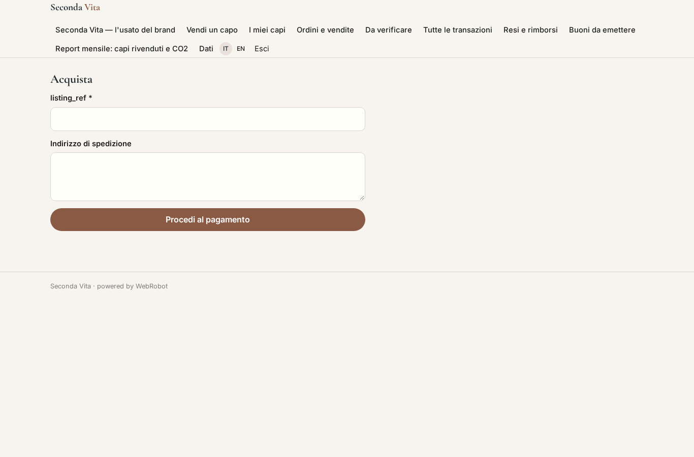

### new_listing
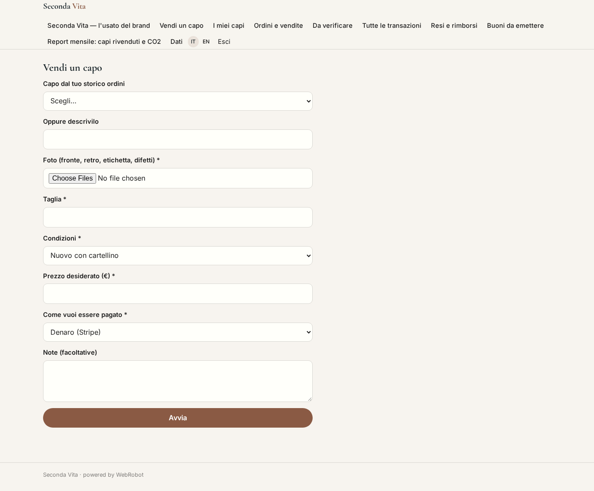

### my_listings
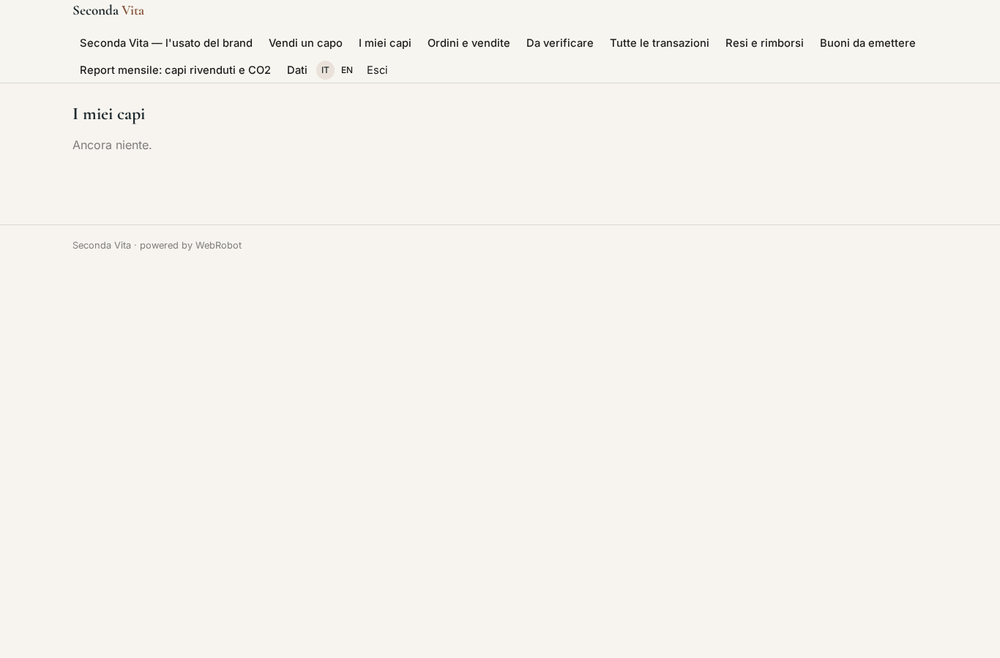

### my_items
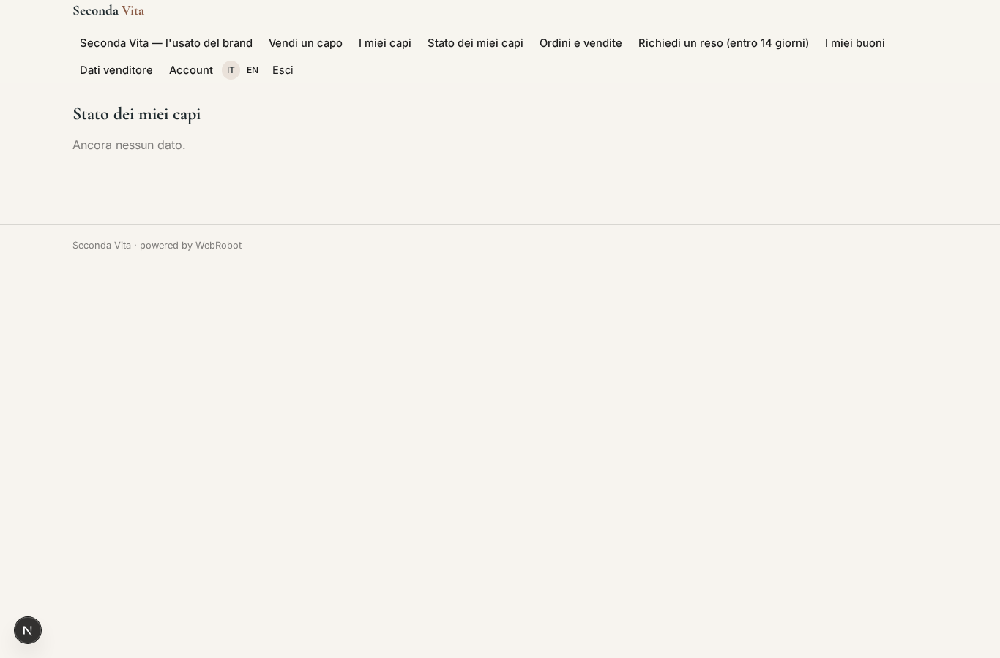

### my_orders
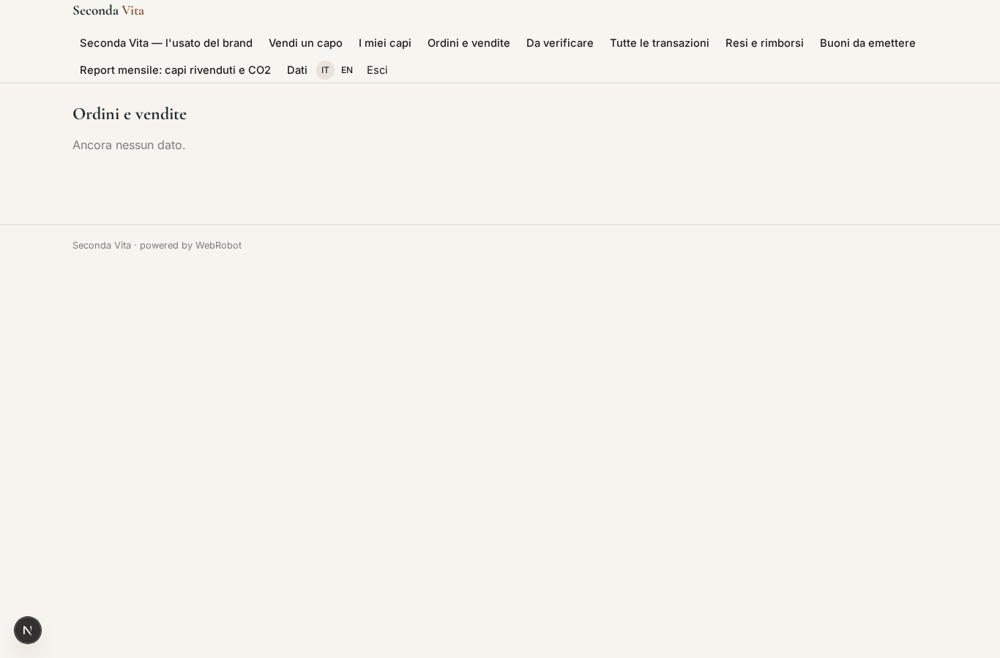

### return_request
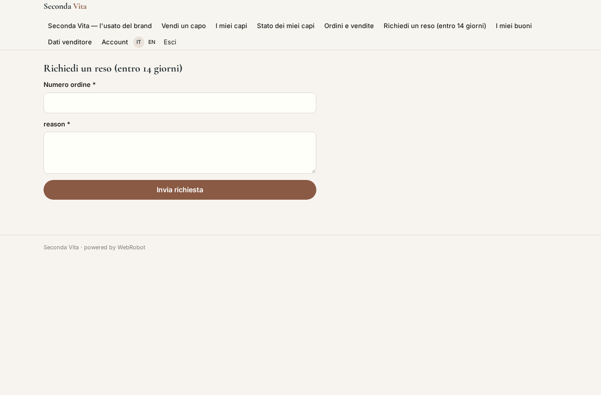

### my_vouchers

### seller_profile
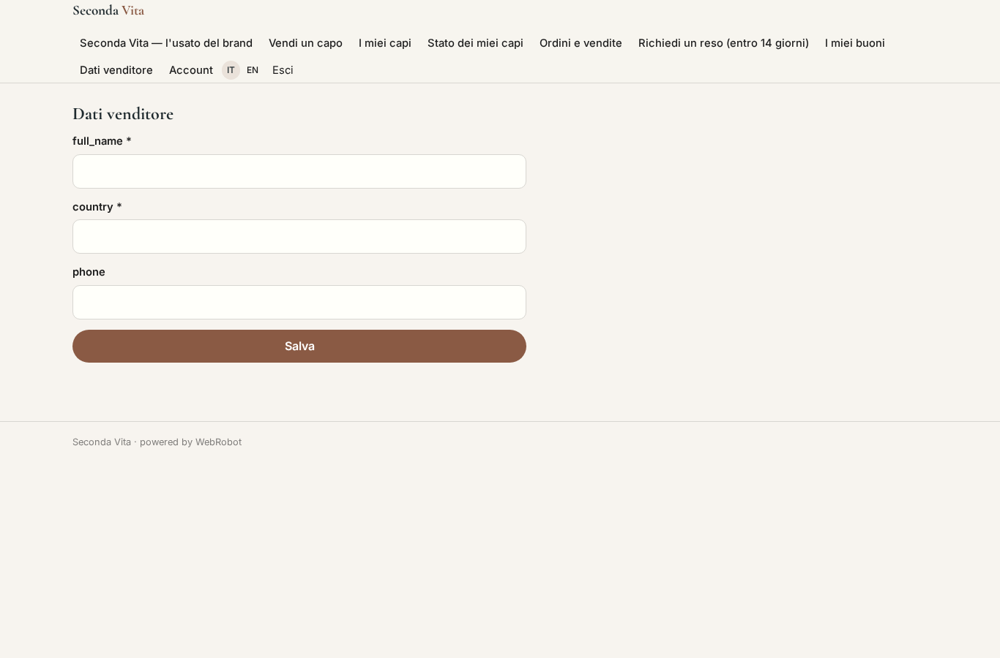

### review

### review_edit
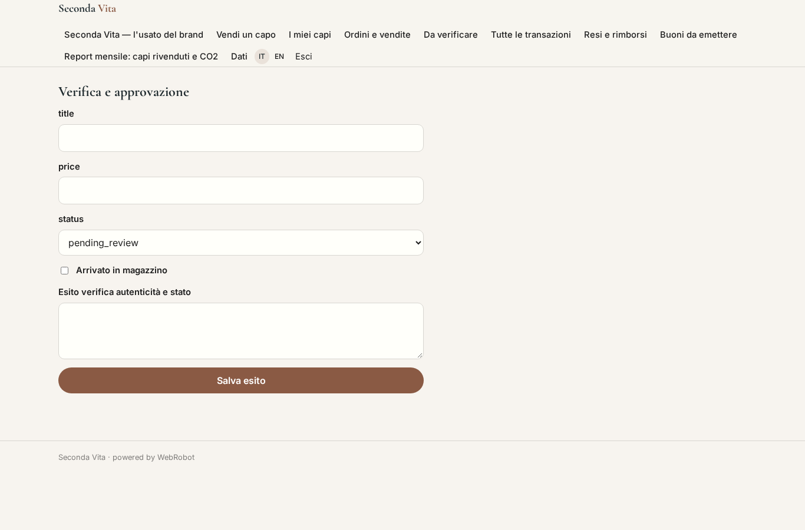

### orders_admin

### order_edit
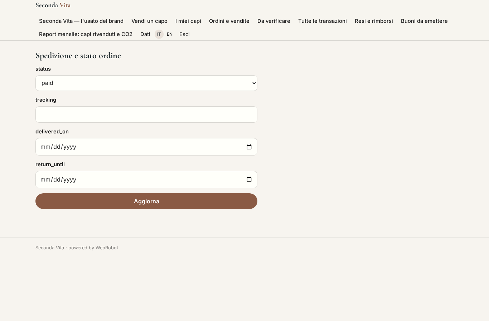

### returns_admin
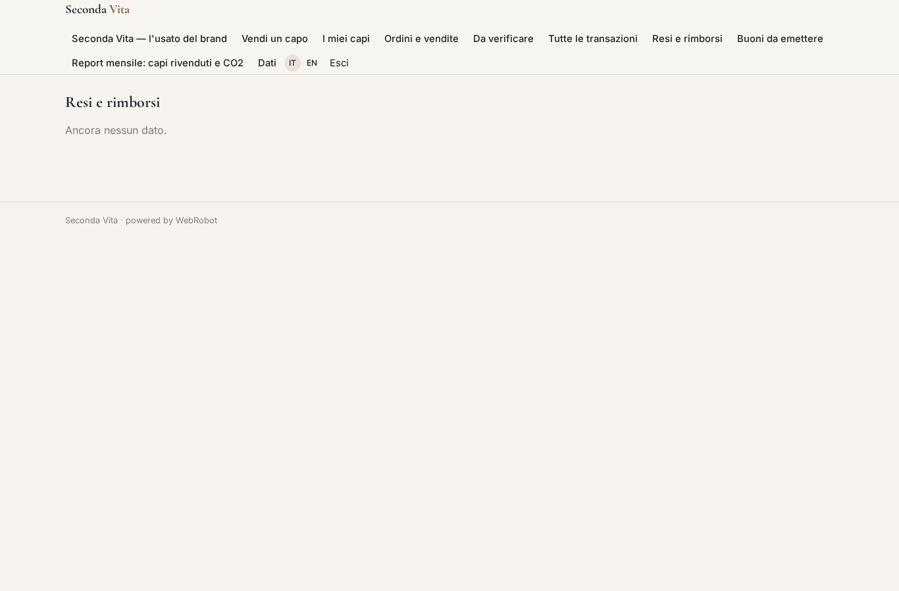

### return_edit
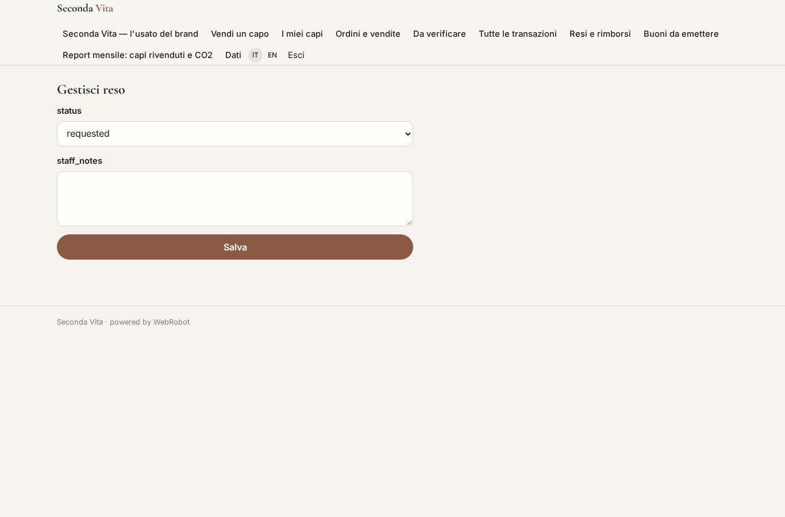

### vouchers_admin

### monthly_report

### account
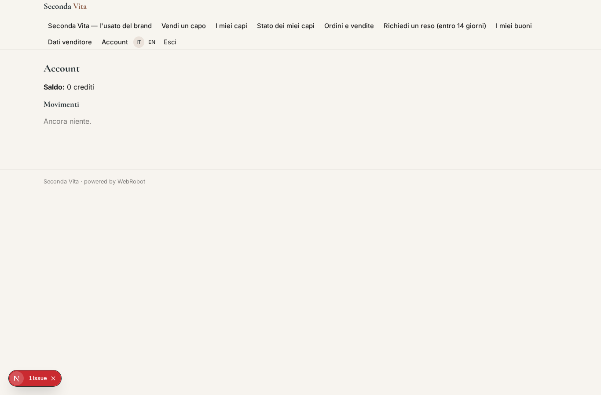
