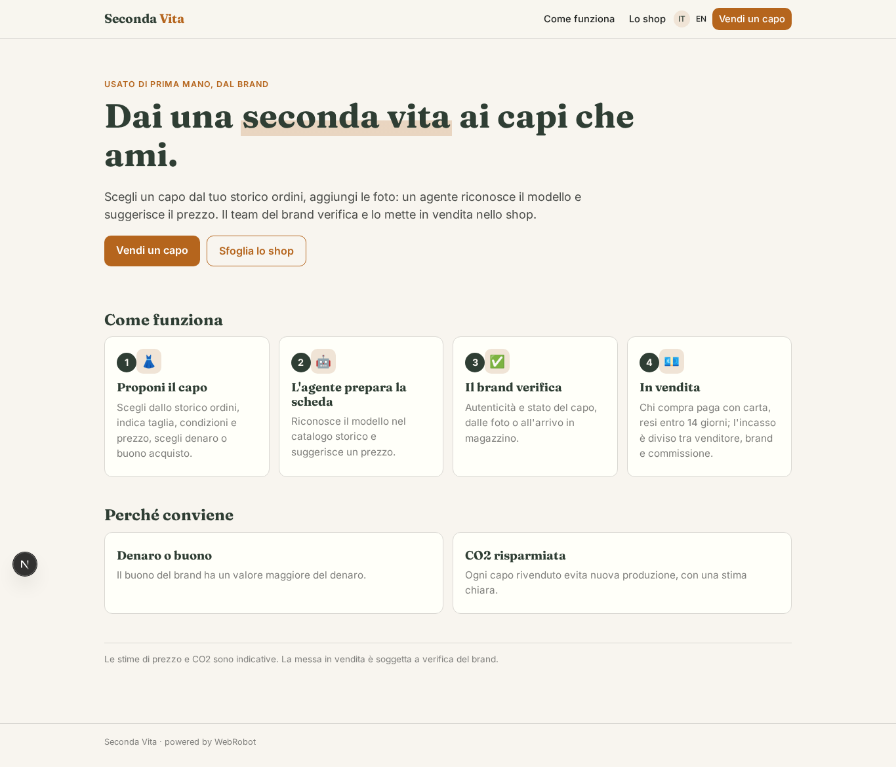
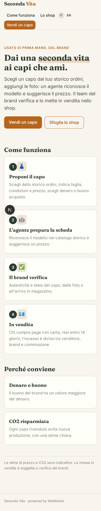
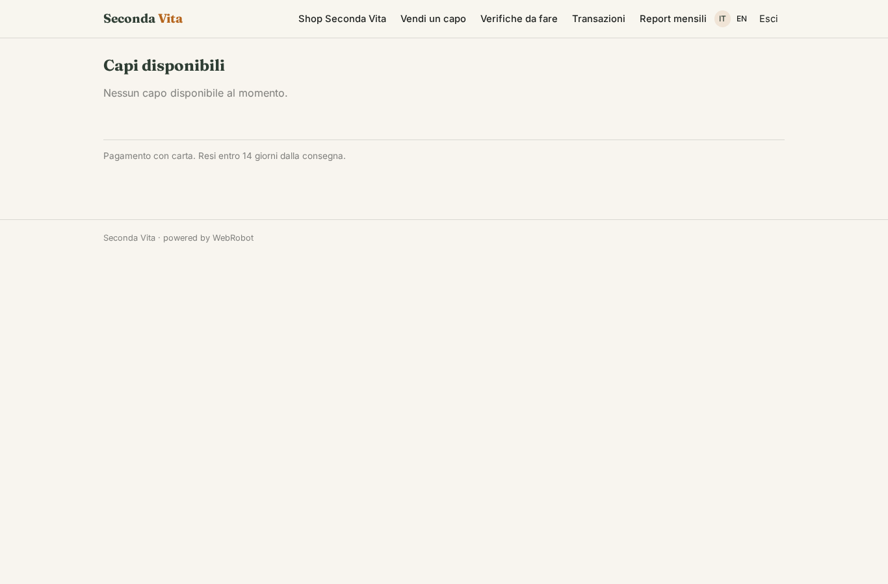
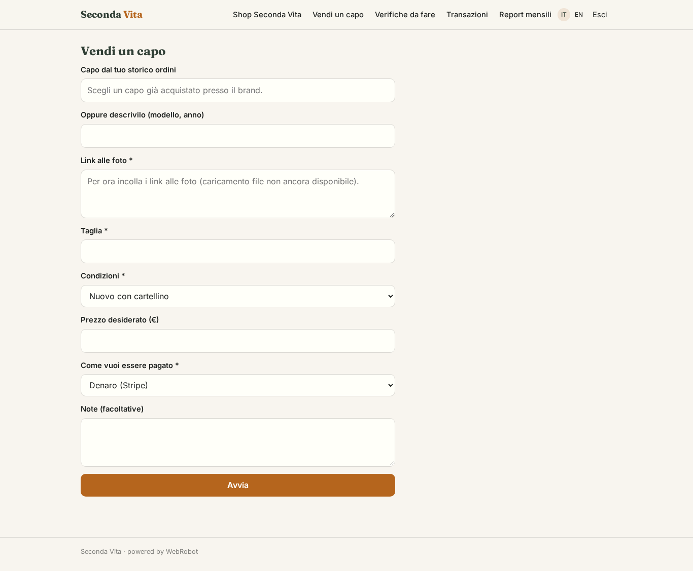
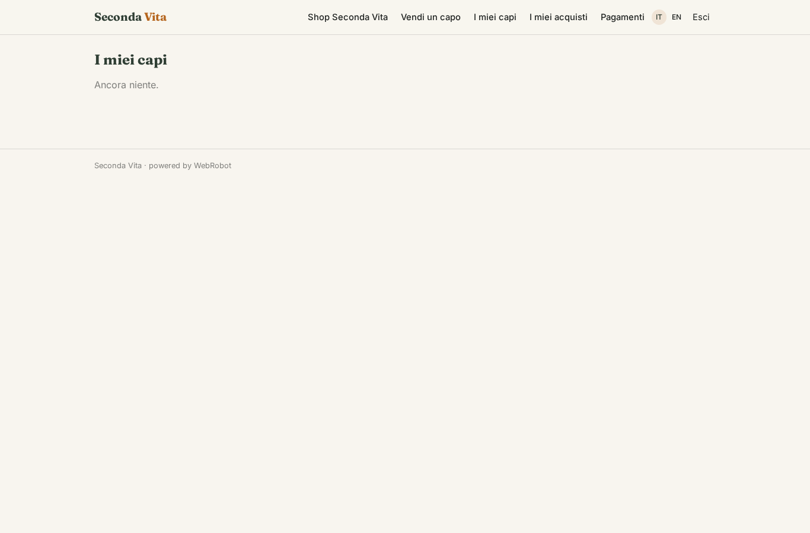
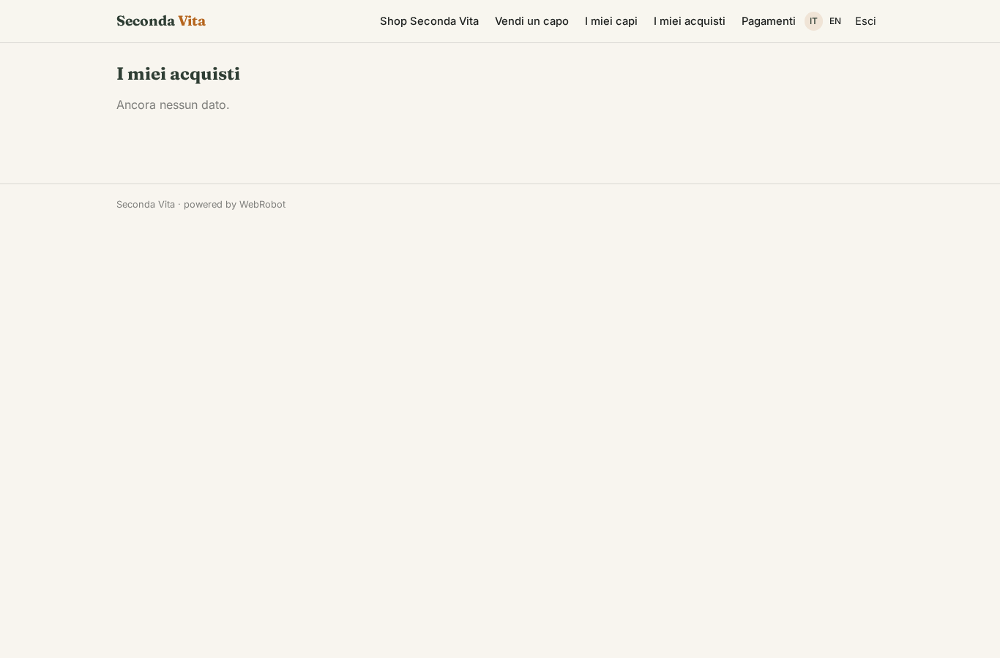
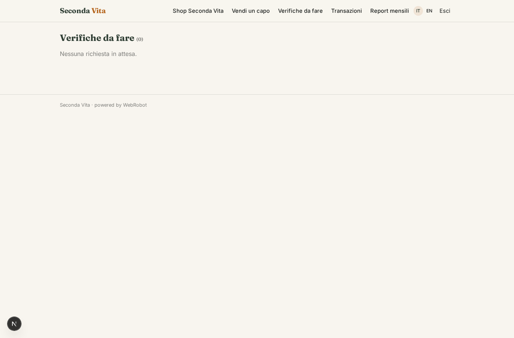
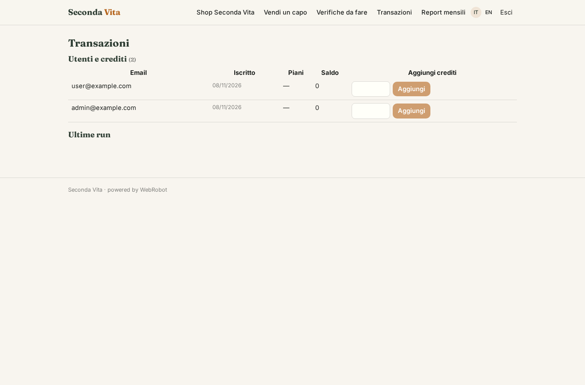
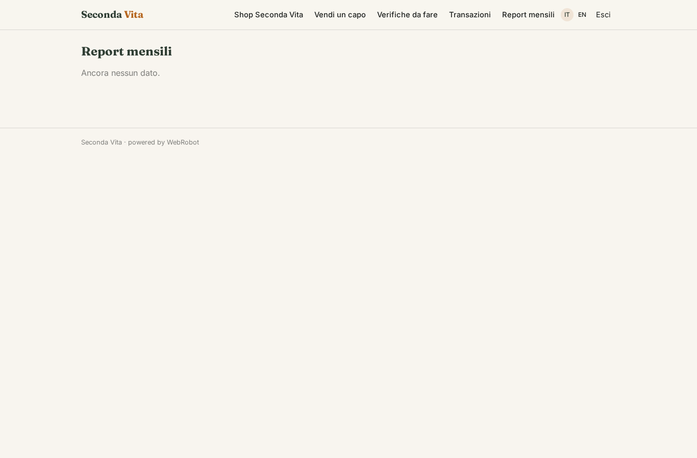
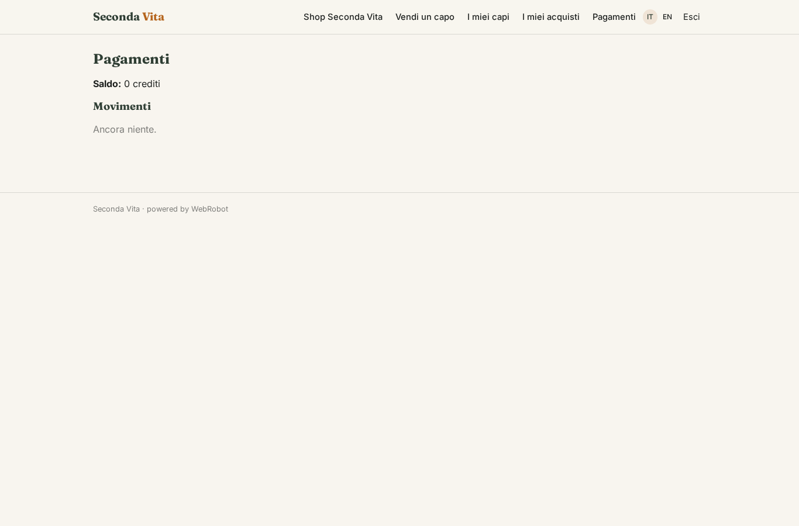

# Seconda Vita

_Il tuo usato, la sua seconda vita, sul sito del brand._

**Stato manifest:** valido (validatore Python + contratto runtime)

## Descrizione data all'app builder

Ci serve Seconda Vita, un'app per brand di moda che vogliono vendere il proprio usato direttamente sul loro sito. I clienti del brand si registrano, scelgono un capo acquistato in passato (anche dallo storico ordini), caricano foto, indicano taglia, condizioni e prezzo desiderato. Un agente riconosce il modello confrontandolo con il catalogo storico del brand, suggerisce un prezzo in base a condizioni e domanda, e prepara la scheda. Il team del brand deve verificare l'autenticità e lo stato del capo, quando arriva in magazzino o dalle foto, e approvare la messa in vendita. Le schede approvate compaiono in una sezione dell'e-shop del brand. Chi compra paga con carta; la piattaforma divide l'incasso tra venditore, brand e commissione di servizio tramite Stripe Connect. In alternativa il venditore può scegliere un buono acquisto del brand di valore maggiore. Bisogna gestire spedizione, resi entro 14 giorni e rimborsi. Il brand vede tutte le transazioni e un report mensile su capi rivenduti e CO2 risparmiata; il cliente vede solo i suoi capi.

## Funzioni non esprimibili oggi (spec.extensions)

- **photo_upload**: Uploading photos is not available yet: the seller pastes photo links.
- **shipping_returns_refunds**: Shipping labels, the 14-day return window and refunds are tracked only as order statuses; carrier integration and automatic Stripe refunds are not available yet and must be handled by the brand team.
- **brand_voucher**: Issuing the brand voucher needs the brand's e-shop/gift-card system; for now the brand team issues it manually after approval.
- **eshop_integration**: Showing approved items inside the brand's existing e-shop and importing order history requires a connector with the brand's platform; for now order_history is loaded by the brand team and the shop is a section of this app.
- **notifications**: Email notifications (approval needed, item sold, return) are not available yet.

## Screenshot (runtime interpretativo)

### home-anon

### home-mobile

### home

### shop

### new_listing

### my_listings

### my_orders

### review

### transactions

### reports

### account

