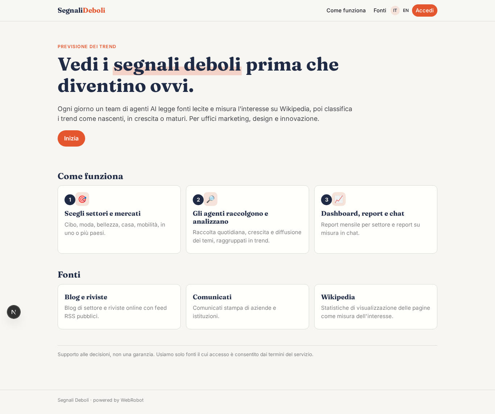
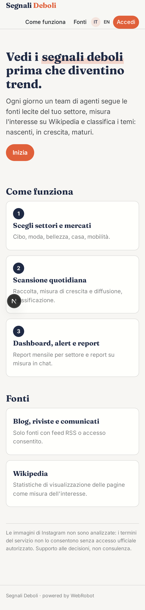
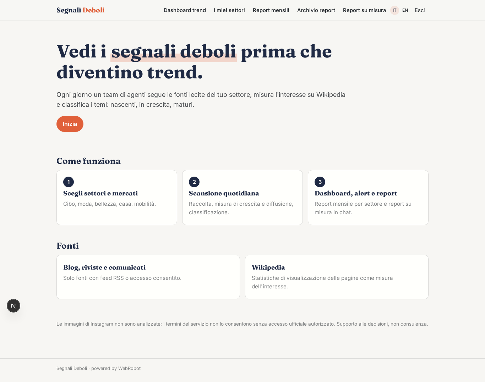
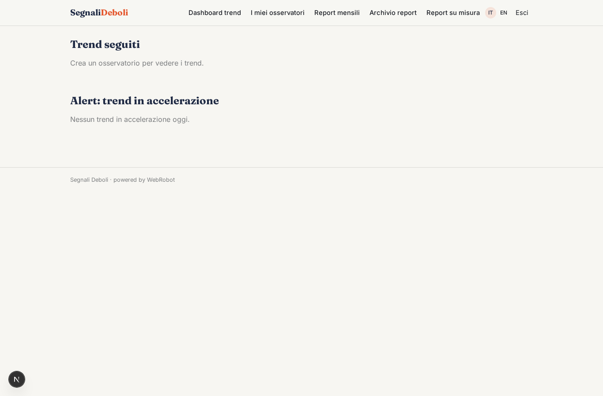
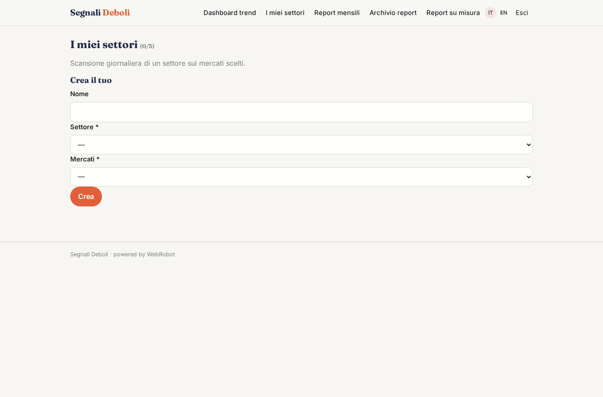
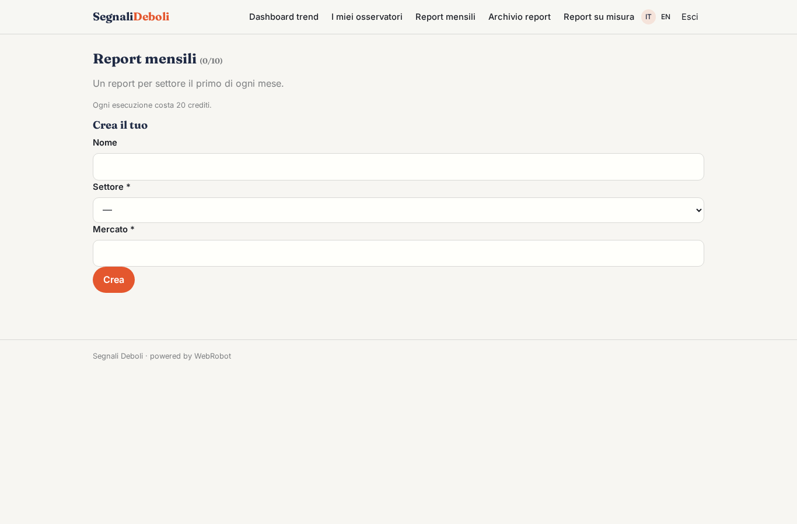
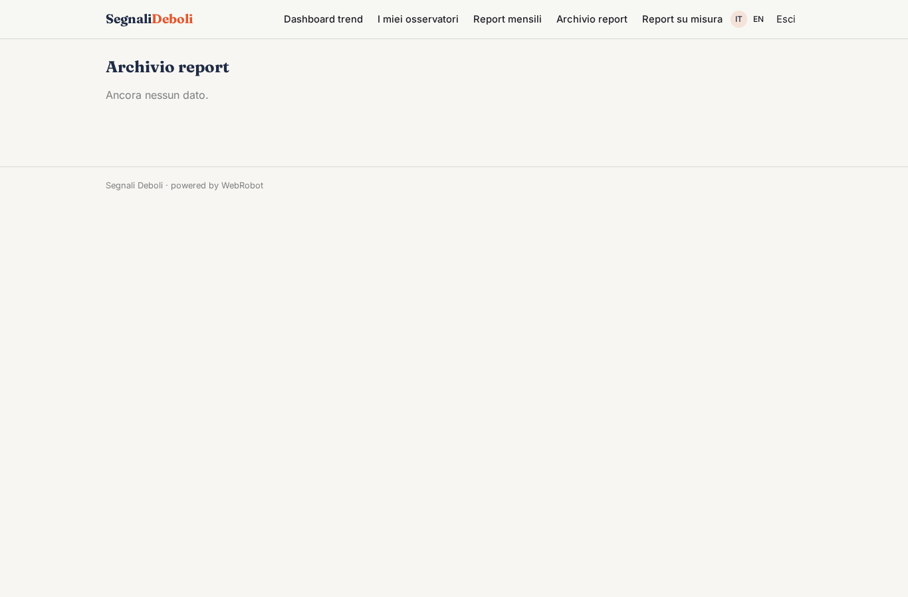
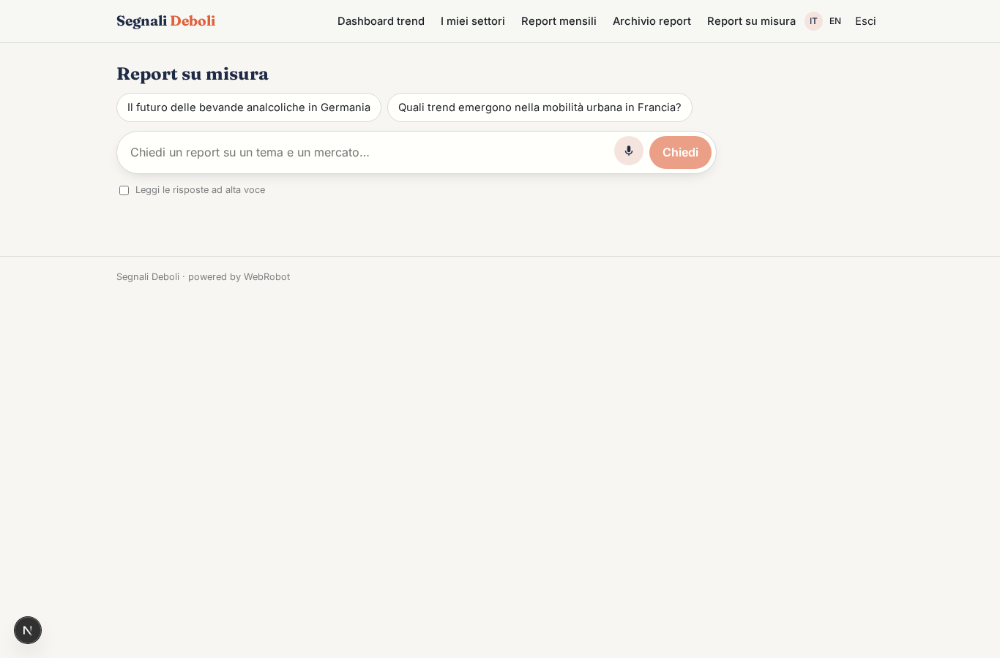
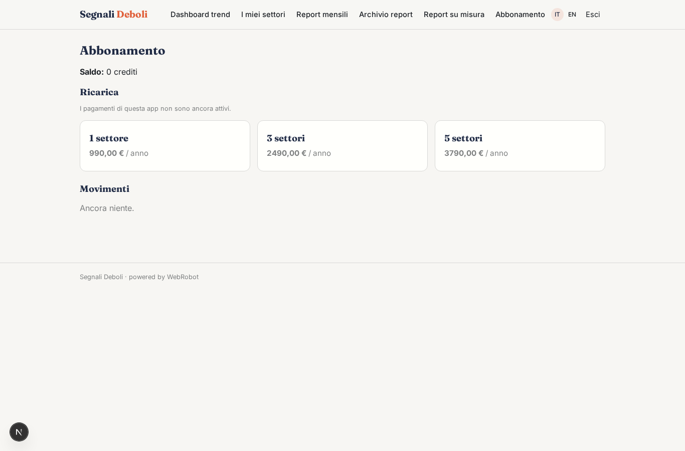

# Segnali Deboli

_Vedi i trend prima che diventino ovvi._

**Manifest status:** valid (schema validator + runtime contract)

## Description given to the app builder (Italian)

Voglio creare Segnali Deboli, una piattaforma di previsione dei trend per uffici marketing, design e innovazione. Il cliente sceglie i settori da seguire (cibo, moda, bellezza, casa, mobilità) e i mercati. Ogni giorno un agente raccoglie contenuti da fonti lecite: blog di settore, riviste online con feed RSS, comunicati, e misura l'interesse con le statistiche di visualizzazione delle pagine di Wikipedia. Vorremmo includere anche le immagini pubblicate su Instagram dagli innovatori, analizzandole con modelli di visione, ma solo se l'accesso è consentito dai termini del servizio. Un team di agenti riconosce i temi emergenti, ne misura crescita e diffusione, li raggruppa in trend e li classifica come nascenti, in crescita o maturi. Ogni mese viene generato un report per settore con esempi, grafici di crescita e implicazioni per il business; il cliente può anche chiedere in chat un report su misura, per esempio sul futuro delle bevande analcoliche in Germania. L'analista del cliente vede una dashboard con i trend seguiti e riceve alert quando uno accelera. Abbonamento annuale per numero di settori.

## Features not expressible today (spec.extensions)

- **alerts_email**: Notifications are not available yet: alerts on accelerating trends are shown in the dashboard, not sent by email.
- **instagram_vision**: Instagram images with vision models are left out: they would need an access allowed by the terms of service (official API with the innovators' consent). To add later if a licensed source is available.
- **plan_limits**: The maximum number of sectors per plan is not enforced by the manifest (maxPerUser is a fixed 10); it needs a check per plan.

## Screenshots (interpretive runtime)

### home-anon

### home-mobile

### home

### dashboard

### watches

### report_plans

### reports

### chat

### account

