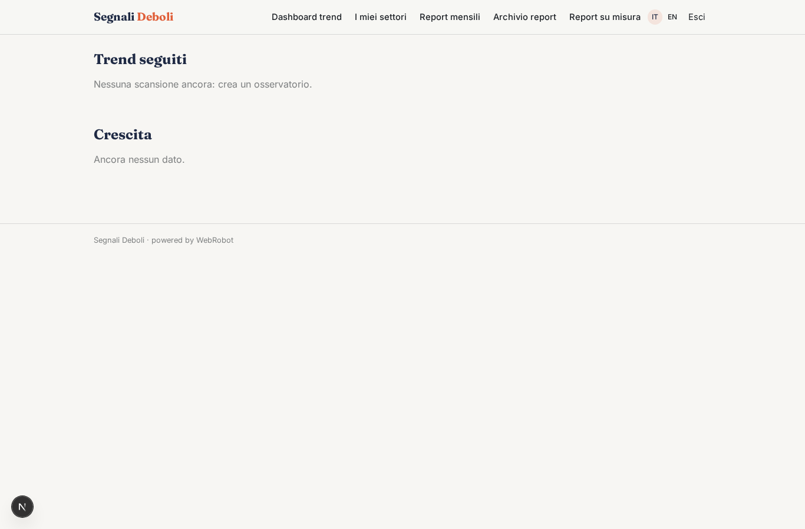
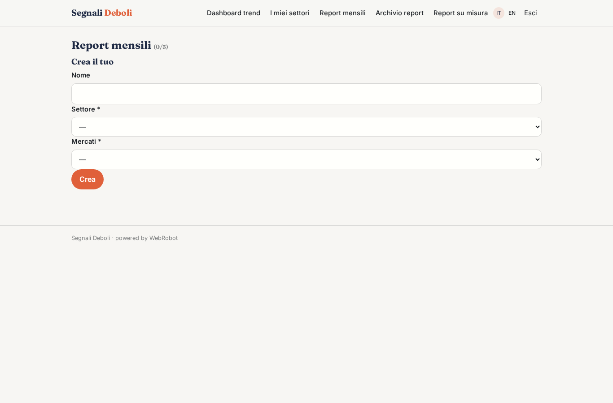

# Segnali Deboli

_Vedi i trend prima che diventino ovvi._

**Manifest:** valid (schema + runtime contract) · **Functional test:** passed (10 checks passed)

## Description given to the app builder (Italian)

Voglio creare Segnali Deboli, una piattaforma di previsione dei trend per uffici marketing, design e innovazione. Il cliente sceglie i settori da seguire (cibo, moda, bellezza, casa, mobilità) e i mercati. Ogni giorno un agente raccoglie contenuti da fonti lecite: blog di settore, riviste online con feed RSS, comunicati, e misura l'interesse con le statistiche di visualizzazione delle pagine di Wikipedia. Vorremmo includere anche le immagini pubblicate su Instagram dagli innovatori, analizzandole con modelli di visione, ma solo se l'accesso è consentito dai termini del servizio. Un team di agenti riconosce i temi emergenti, ne misura crescita e diffusione, li raggruppa in trend e li classifica come nascenti, in crescita o maturi. Ogni mese viene generato un report per settore con esempi, grafici di crescita e implicazioni per il business; il cliente può anche chiedere in chat un report su misura, per esempio sul futuro delle bevande analcoliche in Germania. L'analista del cliente vede una dashboard con i trend seguiti e riceve alert quando uno accelera. Abbonamento annuale per numero di settori.

## Features not expressible today (spec.extensions)

- **sector_quota**: Il numero di settori seguiti dovrebbe seguire il piano (1/3/5): da applicare come quota per piano sulle istanze di sector_watch.
- **instagram_vision**: Analisi con modelli di visione delle immagini Instagram: non disponibile. Richiede accesso ufficiale consentito dai termini (API con consenso OAuth, non ancora disponibile); non si fa scraping.

## Screenshots (interpretive runtime, no data)

### home-anon

### home-mobile

### home

### radar

### watches

### report_watches

### reports

### chat

### account

